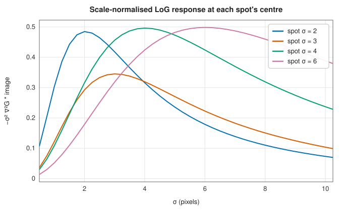
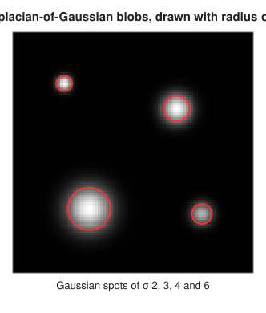
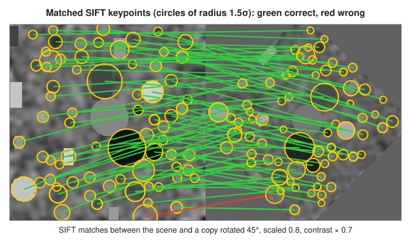

# Local features: blobs, SIFT and SURF

<div class="entry-summary">

| | |
|---|---|
| **Problem** | Find distinctive points in an image, with their size and orientation, and describe each so that the same point can be recognised in another image of the scene: shifted, rotated, scaled or differently lit |
| **Devised by** | Tony Lindeberg (1994, 1998), scale selection with the normalised Laplacian; David Lowe (1999, 2004), SIFT; Herbert Bay, Tinne Tuytelaars and Luc Van Gool (2006), SURF |
| **Accuracy** | Blob positions and scales agree with scikit-image's `blob_log`; SIFT and SURF matches are 92–100% correct under rotation, scaling and contrast change (table below) |
| **Cost** | Blobs: one blur per scale; SIFT a few blurs per octave plus $O(1)$ per keypoint; SURF a constant cost per sample from the integral image, several times faster than SIFT |
| **Read first** | [Image filtering: convolution, Gaussian blur, Sobel gradients and sharpening](filtering.md) |
| **API** | [`blob_detection`](../../api/lib_jsl_dsp/discrete/image/feature_extraction/blob_detection/fn.blob_detection.html), [`Blob`](../../api/lib_jsl_dsp/discrete/image/feature_extraction/blob_detection/struct.Blob.html), [`sift`](../../api/lib_jsl_dsp/discrete/image/feature_extraction/sift/fn.sift.html), [`SiftParams`](../../api/lib_jsl_dsp/discrete/image/feature_extraction/sift/struct.SiftParams.html), [`SiftKeypoint`](../../api/lib_jsl_dsp/discrete/image/feature_extraction/sift/struct.SiftKeypoint.html), [`surf`](../../api/lib_jsl_dsp/discrete/image/feature_extraction/surf/fn.surf.html), [`SurfParams`](../../api/lib_jsl_dsp/discrete/image/feature_extraction/surf/struct.SurfParams.html), [`SurfKeypoint`](../../api/lib_jsl_dsp/discrete/image/feature_extraction/surf/struct.SurfKeypoint.html), [`IntegralImage`](../../api/lib_jsl_dsp/discrete/image/feature_extraction/surf/struct.IntegralImage.html), [`match_descriptors`](../../api/lib_jsl_dsp/discrete/image/feature_extraction/fn.match_descriptors.html) |

</div>

## Overview

To stitch panoramas, track objects or recognise a scene, one image's points must be found again in another. **Local features** make this possible. A detector finds points that can be located reliably, such as the centres of
**blobs** and corners, together with a characteristic **scale**. A descriptor then summarises the neighbourhood at that scale as a vector that changes little under rotation, scaling and changes of brightness. Matching compares descriptors.
The **Laplacian of Gaussian** finds blobs and their sizes. **SIFT** combines a difference-of-Gaussian detector with a descriptor of gradient histograms. **SURF** approximates both with box filters on an integral image, for speed.

## History

Tony Lindeberg (1994, 1998) showed how to select a feature's scale automatically: take the scale at which a derivative response, multiplied by the right power of $\sigma$, peaks. David Lowe's scale-invariant feature transform
(1999, refined 2004) combined this with a gradient-histogram descriptor. It worked so well that it dominated image matching for over a decade, and its patent (expired 2020) shaped the field. Herbert Bay, Tinne Tuytelaars and Luc Van Gool (2006) designed SURF for speed, replacing Gaussian derivatives with box
filters computed in constant time from an integral image, a device from Frank Crow (1984) popularised by Paul Viola and Michael Jones (2001). Learned features from convolutional networks have since taken over many tasks. SIFT and SURF remain the reference
hand-crafted methods.

## The idea

### Blobs and the normalised Laplacian

The aim of this entry is to find points in an image that can be found *again* in another image
of the same scene, taken from a different distance or angle. Such **features** are the basis of
image stitching, object recognition and 3D reconstruction. A good feature must be distinctive,
and its detection must not depend on its size in the image. The simplest such feature is a
**blob**: a roughly round region that is brighter or darker than its surroundings.

Blurring by a Gaussian of width $\sigma$ and taking the Laplacian $\nabla^2 = \partial_x^2 + \partial_y^2$ gives a strong negative response at the centre of a bright blob. The response is strongest when $\sigma$ matches the blob's size. Raw derivatives of blurred images shrink as $\sigma$ grows,
so the response is **normalised** by $\sigma^2$:

$$
L(x, y; \sigma) = -\sigma^2\,\nabla^2(G_\sigma * f)(x, y).
$$

For a Gaussian blob of width $s$, $L$ at its centre peaks exactly at $\sigma = s$; for a disc of radius $R$, at $\sigma = R/\sqrt2$:



<p class="caption" id="fig-17-11"><strong>Figure 17.11.</strong> LoG response against scale.</p>

[`blob_detection`](../../api/lib_jsl_dsp/discrete/image/feature_extraction/blob_detection/fn.blob_detection.html) evaluates $L$ at geometrically spaced scales (the Laplacian by the 5-point stencil). It keeps points that are maxima of their $3 \times 3 \times 3$ neighbourhood in position and scale and exceed a
threshold. Of two detections overlapping by more than a given fraction of the smaller one's area, it drops the weaker. Each blob's radius is about $\sigma\sqrt2$:



<p class="caption" id="fig-17-12"><strong>Figure 17.12.</strong> Blobs.</p>

### SIFT

The **scale-invariant feature transform** turns blob detection into a complete pipeline. It
finds blob-like **keypoints** together with their size and orientation, and then summarises the
image around each one by a **descriptor**, a vector of numbers computed relative to that size
and orientation. Because the descriptor is measured in the keypoint's own frame, it comes out
nearly the same when the image is scaled or rotated, and keypoints in two images can be paired
by comparing descriptors.

1. **Scale space.** Blur the image by Gaussians of widths $\sigma_0k^i$, with $k = 2^{1/s}$ for $s$ scales per octave. After each octave, halve the image and continue. Adjacent differences, the **difference of Gaussians** (DoG), approximate $(k - 1)\,\sigma^2\nabla^2G$, the normalised Laplacian.
2. **Detection.** Candidates are extrema of the DoG among their 26 neighbours in position and scale.
3. **Localisation.** Fit a quadratic to the DoG around each candidate by Newton's method: the offset $\hat{\mathbf x} = -H^{-1}\nabla D$, moving to the neighbouring sample if an offset exceeds one half. Reject candidates of low contrast, $|D(\hat{\mathbf x})| < 0.04/s$. Reject those on edges, where the ratio of principal curvatures of the $2 \times 2$ spatial Hessian exceeds 10, tested as $\mathrm{tr}^2/\det \ge (r + 1)^2/r$.
4. **Orientation.** Histogram the gradient directions around the keypoint (36 bins, Gaussian-weighted, smoothed). Each peak within 80% of the highest gives a keypoint with that orientation.
5. **Descriptor.** Rotate the neighbourhood to that orientation and divide it into $4 \times 4$ cells, each holding an 8-bin histogram of gradient directions, with trilinear interpolation: 128 numbers. Normalise to unit length, clip at 0.2 to limit the influence of large gradients, and normalise again.

Normalising the image to $[0, 1]$ first makes the thresholds independent of brightness and contrast. Unlike Lowe's implementation, the image is not upsampled first, so features smaller than about two pixels are missed.

### SURF and the integral image

SURF ("speeded-up robust features") follows the same plan as SIFT but replaces the Gaussian
filters by crude approximations that are extremely cheap to compute. The device behind it is the
**integral image** $I(r, c) = \sum_{r' < r,\, c' < c} f(r', c')$, in which each entry holds the
sum of all the pixels above and to the left. The sum over any rectangle is then obtained from
the values at its four corners, by adding two and subtracting two, whatever the rectangle's
size. SURF approximates the Gaussian second derivatives $D_{xx}, D_{yy}, D_{xy}$ by box filters (lobes of $\pm1$ and $-2$) and detects maxima of the
approximate Hessian determinant

$$
\det H \approx D_{xx}D_{yy} - (0.9\,D_{xy})^2,
$$

with 0.9 correcting the box approximation's scale. Filters of size 9, 15, 21, 27 cover the first octave and grow from there. Since a box sum costs the same at any size, SURF grows the filter instead of shrinking the image. The orientation comes from Haar-wavelet responses in a circle of radius
$6s$, summed in a sliding window of $\pi/3$. The descriptor divides a $20s$ square into $4 \times 4$ subregions, each contributing $(\sum d_x, \sum d_y, \sum|d_x|, \sum|d_y|)$, a 64-vector. The sign of the Laplacian is stored, so bright-on-dark features are never matched with dark-on-bright ones.

### Matching

[`match_descriptors`](../../api/lib_jsl_dsp/discrete/image/feature_extraction/fn.match_descriptors.html) pairs each descriptor with its nearest neighbour in the other set, by Euclidean distance, and applies Lowe's **ratio test**. A match is accepted only if the nearest is closer than `ratio` (0.75–0.8) times the second nearest, which
rejects descriptors that resemble several others. With `mutual`, the match must also be nearest in the other direction.



<p class="caption" id="fig-17-13"><strong>Figure 17.13.</strong> SIFT matches.</p>

{{#include ../generated/image/matching_table.md}}

A match is counted correct if the keypoint lands within 3 pixels of where the known transformation sends it. Both detectors find fewer keypoints in the shrunken copies, since fine features fall below the
smallest scale. SURF is 4–6 times faster here and less discriminating, with fewer and slightly less reliable matches.

## Algorithm

**Blob detection.**

1. For each scale $\sigma$ of a geometric sequence: blur the image by $\sigma$; apply the
   five-point Laplacian; multiply by $-\sigma^2$. This gives a stack of response images.
2. Find the points of the stack that exceed the threshold and are at least as large as all
   their 26 neighbours, 8 in their own image and 9 in each of the images at the adjacent
   scales.
3. Sort the detections by response. Take each in turn and discard it if it overlaps an
   already accepted blob by more than the allowed fraction of the smaller one's area.

**SIFT.**

1. **Scale space.** For each octave, blur the image to a sequence of increasing widths and
   subtract neighbouring images to form the difference-of-Gaussians (DoG) stack. Halve the
   image for the next octave.
2. **Extrema.** Find the points of each DoG stack that are larger, or smaller, than all 26
   neighbours.
3. **Refine.** For each candidate, fit a quadratic to the DoG values around it and solve for
   the offset of the true extremum. If the offset exceeds half a sample in any direction, move
   to the neighbouring sample and try again, up to five times. Reject the candidate if its
   contrast is low or if it lies on an edge.
4. **Orientation.** Build the histogram of gradient directions around the keypoint, and create
   one keypoint for each sufficiently high peak.
5. **Descriptor.** Compute the $4 \times 4 \times 8$ histogram in the rotated frame, normalise,
   clip and renormalise.

**SURF.**

1. Compute the integral image.
2. For each filter size, compute the box-filter approximations of $D_{xx}$, $D_{yy}$ and
   $D_{xy}$ at every pixel, and the determinant response.
3. Find the maxima above the threshold among the 26 neighbours in position and filter size,
   and interpolate their position and scale.
4. Assign an orientation from the Haar-wavelet responses, and compute the 64-number
   descriptor.

**Matching** two sets of descriptors.

1. For each descriptor of the first set, find its nearest and second-nearest neighbours in
   the second set, by Euclidean distance.
2. Accept the match if the nearest distance is below `ratio` times the second nearest.
3. With `mutual`, also require that the first descriptor be the nearest neighbour of its match
   in the opposite direction.

## Implementation

```rust,ignore
{{#include ../../../crates/dsp/src/discrete/image/feature_extraction/blob_detection.rs:log_stack}}
```

```rust,ignore
{{#include ../../../crates/dsp/src/discrete/image/feature_extraction/sift.rs:sift_refine}}
```

```rust,ignore
{{#include ../../../crates/dsp/src/discrete/image/feature_extraction/surf.rs:box_hessian}}
```

```rust,ignore
{{#include ../../../crates/dsp/src/discrete/image/feature_extraction.rs:ratio_test}}
```

- Only bright blobs are detected. A dark blob gives a negative centre and a weak positive ring, about 13% of the response, so keep the threshold above that.
- `SiftParams` and `SurfParams` default to the papers' values; `SurfParams::upright` skips orientation (U-SURF) when images are not rotated.
- Matching is brute force, $O(nm)$ distance computations; for thousands of descriptors a k-d tree or approximate search would be faster.

## In practice

```rust,ignore
{{#include ../../../crates/dsp/examples/dsp_image_features.rs}}
```

```text
blob at (50, 55), σ = 6.09, radius 8.6
blob at (20, 20), σ = 3.09, radius 4.4
SIFT: 40 and 45 keypoints, 29 matches, 28 with the true shift (5, 3)
SURF: 25 and 26 keypoints, descriptors of length 64
```

The blob scales are the nearest of the 12 sampled scales to the true 3 and 6. All but one SIFT match recovers the shift, despite the halved contrast.

**Strengths**

- Repeatable keypoints with their own scale and orientation; descriptors invariant to rotation, scale and affine changes of brightness, and robust to moderate viewpoint change.
- SURF trades a little distinctiveness for speed.

**Weaknesses**

- Not invariant to strong perspective change; repetitive texture produces ambiguous matches that the ratio test must reject.
- Many parameters and many steps; matches still need geometric verification (for example RANSAC) in practice.

## Exercises

1. Show that for $f = G_s$, the normalised Laplacian at the origin, $-\sigma^2\nabla^2(G_\sigma * G_s)(0)$, is maximised at $\sigma = s$.
2. Show that $G_{k\sigma} - G_\sigma \approx (k - 1)\sigma^2\nabla^2G_\sigma$ using the heat equation $\partial G/\partial\sigma = \sigma\nabla^2G$.
3. Derive the sub-pixel offset $\hat{\mathbf x} = -H^{-1}\nabla D$ from a second-order Taylor expansion.
4. Show that $\mathrm{tr}(H)^2/\det(H) = (r + 1)^2/r$ when the eigenvalues of $H$ are in the ratio $r$.
5. Write the box sum of a rectangle in terms of four integral-image values.

<details>
<summary>Hints and answers</summary>

1. For a 2-D Gaussian, $\nabla^2G_\tau(0) = -1/(\pi\tau^4)$. Since $G_\sigma * G_s = G_\tau$ with $\tau^2 = \sigma^2 + s^2$, the normalised response is $\sigma^2/\big(\pi(\sigma^2 + s^2)^2\big)$; setting its derivative with respect to $\sigma^2$ to zero gives $\sigma^2 = s^2$.
2. The heat equation gives $G_{k\sigma} - G_\sigma \approx (k\sigma - \sigma)\partial G/\partial\sigma = (k - 1)\sigma\cdot\sigma\nabla^2G_\sigma = (k - 1)\sigma^2\nabla^2G_\sigma$.
3. Expand $D(\mathbf x + \mathbf h) \approx D + \nabla D^{\mathsf T}\mathbf h + \tfrac12\mathbf h^{\mathsf T}H\mathbf h$ and set the gradient to zero: $\mathbf h = -H^{-1}\nabla D$.
4. With eigenvalues $\alpha = r\beta$, $\mathrm{tr}(H)^2/\det(H) = (\alpha + \beta)^2/(\alpha\beta) = (r + 1)^2/r$.
5. For the rectangle with corners $(x_1, y_1)$ to $(x_2, y_2)$ (inclusive of the lower-right corner), the sum is $I(x_2, y_2) - I(x_1 - 1, y_2) - I(x_2, y_1 - 1) + I(x_1 - 1, y_1 - 1)$.

</details>

## Further reading

- T. Lindeberg, "Feature detection with automatic scale selection", *International Journal of Computer Vision* 30 (1998) 79–116.
- D. G. Lowe, "Distinctive image features from scale-invariant keypoints", *International Journal of Computer Vision* 60 (2004) 91–110.
- H. Bay, A. Ess, T. Tuytelaars and L. Van Gool, "Speeded-up robust features (SURF)", *Computer Vision and Image Understanding* 110 (2008) 346–359.
- R. Szeliski, *Computer Vision: Algorithms and Applications*, 2nd ed., Springer, 2022, chapter 7.
