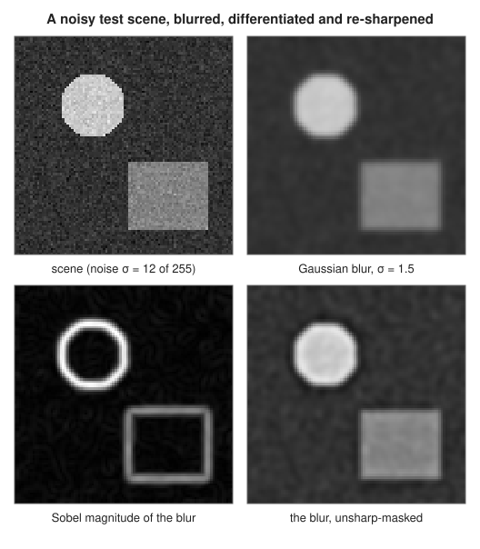
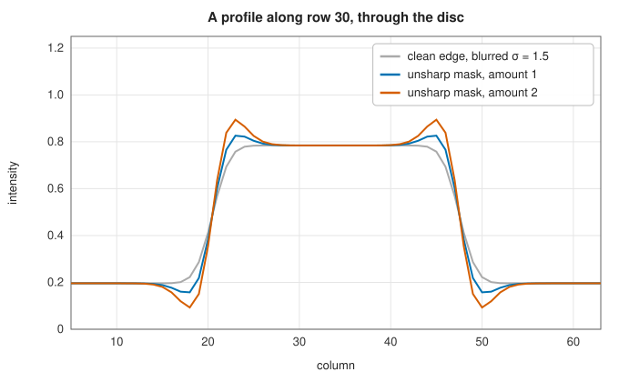

# Image filtering: convolution, Gaussian blur, Sobel gradients and sharpening

<div class="entry-summary">

| | |
|---|---|
| **Problem** | Replace each pixel by a weighted combination of its neighbours: to smooth noise, estimate the gradient, or emphasise detail |
| **Devised by** | Irwin Sobel and Gary Feldman (1968), the Sobel operator; Jan Koenderink (1984) and Andrew Witkin (1983), Gaussian scale space; unsharp masking from photographic darkrooms (1930s) |
| **Accuracy** | Exact (the library agrees with SciPy's `ndimage` to the 12 digits compared; see the [chapter overview](index.md#testing-against-scipy-and-scikit-image)) |
| **Cost** | $O(k^2)$ per pixel for a $k \times k$ kernel; $O(k)$ when the kernel is separable, as the Gaussian and Sobel kernels are |
| **API** | [`correlate2d`](../../api/lib_jsl_dsp/discrete/image/convolution/fn.correlate2d.html), [`convolve2d`](../../api/lib_jsl_dsp/discrete/image/convolution/fn.convolve2d.html), [`separable_convolve`](../../api/lib_jsl_dsp/discrete/image/convolution/fn.separable_convolve.html), [`Border`](../../api/lib_jsl_dsp/discrete/image/convolution/enum.Border.html), [`gaussian_kernel_1d`](../../api/lib_jsl_dsp/discrete/image/convolution/fn.gaussian_kernel_1d.html), [`gaussian_blur`](../../api/lib_jsl_dsp/discrete/image/filters/gaussian_blur/fn.gaussian_blur.html), [`sobel`](../../api/lib_jsl_dsp/discrete/image/filters/sobel/fn.sobel.html), [`sharpening`](../../api/lib_jsl_dsp/discrete/image/filters/sharpening/fn.sharpening.html), [`sharpening_with_threshold`](../../api/lib_jsl_dsp/discrete/image/filters/sharpening/fn.sharpening_with_threshold.html) |

</div>

## Overview

An image is a two-dimensional signal. The library stores it as an `Array2<f64>` indexed `(row, column)`, with rows increasing downwards. The most basic operation
slides a small **kernel** over the image and replaces each pixel by the kernel-weighted sum of its neighbourhood: a **2D convolution**. The kernel decides what the filter does. A
**Gaussian** kernel smooths, suppressing noise and detail smaller than its width. The **Sobel** kernels estimate the two components of the intensity gradient, which is large at edges. **Unsharp masking**
subtracts a blurred copy to isolate the fine detail, then adds it back amplified, which makes edges look crisper. Near the image's edge the kernel reaches past the
pixels that exist, so every filter needs a **border** rule.

## History

Averaging neighbouring samples to reduce noise is as old as measurement. In digital image processing, Irwin Sobel and Gary Feldman presented their 3 × 3 gradient
operator at the Stanford Artificial Intelligence Project in 1968. It became the standard edge filter, although the talk itself was never published. Andrew Witkin (1983) and Jan Koenderink (1984) showed that blurring by Gaussians of increasing width is the natural
way to look at an image at several scales, the **scale space** underlying the blob and feature detectors of later entries. Unsharp masking began in darkrooms, where a slightly blurred
negative was sandwiched with the original to boost edge contrast. It moved into digital imaging with the first scanners.

## The idea

### Convolution and border modes

The library's [`correlate2d`](../../api/lib_jsl_dsp/discrete/image/convolution/fn.correlate2d.html) computes

$$
g[r, c] = \sum_{i=-h_r}^{h_r}\sum_{j=-h_c}^{h_c} k[i, j]\, f[r + i, c + j]
$$

for a kernel of odd size $(2h_r + 1) \times (2h_c + 1)$ centred on the output pixel. [`convolve2d`](../../api/lib_jsl_dsp/discrete/image/convolution/fn.convolve2d.html) flips the kernel first, $f[r - i, c - j]$, which is the true convolution. The two
differ only for asymmetric kernels. The output has the input's size. Outside the image, [`Border`](../../api/lib_jsl_dsp/discrete/image/convolution/enum.Border.html) supplies the missing pixels: **Zero** pads with zeros, which darkens the edges; **Replicate** repeats the edge pixel; **Reflect** mirrors the
image about its edge (`c b a | a b c | c b a`). These are SciPy's `constant`, `nearest` and `reflect` modes.

### Separable kernels

A kernel that is an outer product, $k[i, j] = u[i]\,v[j]$, can be applied as a convolution along every row with $v$ and then along every column with $u$. That costs $O(k)$ per pixel instead of $O(k^2)$. [`separable_convolve`](../../api/lib_jsl_dsp/discrete/image/convolution/fn.separable_convolve.html) does this,
and the Gaussian and Sobel kernels are both separable. {{#include ../generated/image/gaussian_facts.md}}

### Gaussian blur

The 2D Gaussian $G_\sigma(x, y) = e^{-(x^2 + y^2)/2\sigma^2}/2\pi\sigma^2$ is the product of two 1D Gaussians. [`gaussian_kernel_1d`](../../api/lib_jsl_dsp/discrete/image/convolution/fn.gaussian_kernel_1d.html) samples it out to $\lceil 4\sigma\rceil$ pixels and normalises the samples to
sum to one, so a constant image is unchanged. (SciPy truncates at $\mathrm{round}(4\sigma)$ instead. The two agree when the radii coincide, and differ by about $10^{-5}$ when they do not, as for $\sigma = 2.3$ in the [reference table](index.md#testing-against-scipy-and-scikit-image).) The Gaussian is the only kernel that is both separable and rotationally symmetric, and Gaussians **compose**:
a blur of $\sigma_1$ followed by $\sigma_2$ equals one blur of $\sqrt{\sigma_1^2 + \sigma_2^2}$, because variances add under convolution. Blurring suppresses detail finer than about $\sigma$ pixels.

### Gradients: the Sobel operator

The intensity gradient $\nabla f = (\partial f/\partial x, \partial f/\partial y)$ points across edges, and its magnitude measures their strength. The Sobel operator estimates it with

$$
G_x = \begin{pmatrix}-1 & 0 & 1\\-2 & 0 & 2\\-1 & 0 & 1\end{pmatrix} = \begin{pmatrix}1\\2\\1\end{pmatrix}\begin{pmatrix}-1 & 0 & 1\end{pmatrix}, \qquad G_y = G_x^{\mathsf T},
$$

a central difference along one axis and a $[1, 2, 1]$ smoothing across it, which is less sensitive to noise than a plain difference. Applied by correlation, $G_x$ responds positively to intensity increasing to the right and $G_y$ to
intensity increasing downwards. The raw response is 8 times the gradient; `sobel(image, true)` divides by 8, so that a ramp $f = ax + by$ gives exactly $(a, b)$. It also returns the magnitude $\sqrt{g_x^2 + g_y^2}$ and the direction $\operatorname{atan2}(g_y, g_x)$.



Differentiating amplifies noise, so gradients are normally taken after a Gaussian blur, as in the figure: the magnitude then outlines the disc and the square cleanly.

### Unsharp masking

The difference between an image and its blur, $f - G_\sigma * f$, contains only the detail finer than $\sigma$. Adding a multiple of it back,

$$
f_{\text{sharp}} = f + a\,(f - G_\sigma * f),
$$

steepens edges and adds an overshoot on either side, which the eye reads as crispness. [`sharpening_with_threshold`](../../api/lib_jsl_dsp/discrete/image/filters/sharpening/fn.sharpening_with_threshold.html) applies the boost only where $|f - G_\sigma * f|$ exceeds a threshold, so flat, noisy regions are left alone:



## Algorithm

1. **Correlation**: for each output pixel, sum kernel × neighbourhood, mapping indices outside the image by the border rule; convolution flips the kernel first.
2. **Separable filtering**: filter every row with the row kernel, then every column of the result with the column kernel.
3. **Gaussian blur**: build the normalised 1D kernel; filter separably with it along both axes.
4. **Sobel**: correlate with $G_x$ and $G_y$ (borders replicated); optionally divide by 8; form magnitude and direction.
5. **Unsharp mask**: blur; add `amount` × (image − blur) where the detail passes the threshold.

## Implementation

```rust,ignore
{{#include ../../../crates/dsp/src/discrete/image/convolution.rs:separable}}
```

```rust,ignore
{{#include ../../../crates/dsp/src/discrete/image/filters/sobel.rs:sobel}}
```

```rust,ignore
{{#include ../../../crates/dsp/src/discrete/image/filters/sharpening.rs:unsharp}}
```

- Kernels must have odd dimensions, so that they have a centre.
- The direct sum suits small kernels. For large ones, [`fft_convolve_2d`](../../api/lib_jsl_dsp/discrete/fft_convolution/fn.fft_convolve_2d.html) convolves by FFT (with zero borders).
- `gaussian_blur` replicates borders; `gaussian_blur_with_border` takes any mode.

## In practice

```rust,ignore
{{#include ../../../crates/dsp/examples/dsp_image_filtering.rs}}
```

```text
3x3 mean, Zero: corner 0.089, centre row [0.133, 0.200, 0.200, 0.400, 0.600, 0.800, 0.800, 0.800, 0.533]
3x3 mean, Replicate: corner 0.200, centre row [0.200, 0.200, 0.200, 0.400, 0.600, 0.800, 0.800, 0.800, 0.800]
3x3 mean, Reflect: corner 0.200, centre row [0.200, 0.200, 0.200, 0.400, 0.600, 0.800, 0.800, 0.800, 0.800]
Gaussian σ = 1 across the edge: [0.200, 0.203, 0.235, 0.380, 0.620, 0.765, 0.797, 0.800, 0.800]
Sobel gx across the edge: [0.00, 0.00, 0.00, 0.30, 0.30, 0.00, 0.00, 0.00, 0.00] (gy 0.00)
unsharp mask of the blur: [0.197, 0.184, 0.187, 0.345, 0.655, 0.813, 0.816, 0.803, 0.800]
Sobel of 2x + 3y at the centre: gx 2 gy 3, direction 0.9828 rad
```

Zero padding darkens the borders; the other two modes keep a constant region constant. The step of 0.6 between columns 3 and 4 gives a normalised Sobel response of 0.3 at both, since the central
difference spans two pixels.

**Strengths**

- Simple, exact and predictable; separable kernels make large Gaussian blurs cheap.
- Gaussian blurs compose and commute with differentiation, which is the basis of scale-space methods.

**Weaknesses**

- Linear smoothing blurs edges as much as noise (the [Wiener filter](restoration.md) adapts instead).
- Every border rule invents data; results within a kernel radius of the edge depend on it.

## Exercises

1. Show that convolution with an outer-product kernel $u\,v^{\mathsf T}$ equals row filtering with $v$ followed by column filtering with $u$.
2. Prove that the convolution of Gaussians of variances $\sigma_1^2$ and $\sigma_2^2$ is a Gaussian of variance $\sigma_1^2 + \sigma_2^2$.
3. Show that the normalised Sobel operator is exact for linear ramps, and find its error for $f = x^2$.
4. Find the frequency response of the 3 × 3 Sobel $G_x$ and compare it with the ideal differentiator $i\omega_x$.
5. Find the impulse response and frequency response of unsharp masking, and show that it is a high-frequency boost.

## Further reading

- R. C. Gonzalez and R. E. Woods, *Digital Image Processing*, 4th ed., Pearson, 2018, chapter 3.
- I. Sobel, "An isotropic 3 × 3 image gradient operator", 1968 talk, written up in 2014 (Stanford AI Project); see also R. Duda and P. Hart, *Pattern Classification and Scene Analysis*, Wiley, 1973, p. 271.
- J. J. Koenderink, "The structure of images", *Biological Cybernetics* 50 (1984) 363–370.
- T. Lindeberg, *Scale-Space Theory in Computer Vision*, Kluwer, 1994.
