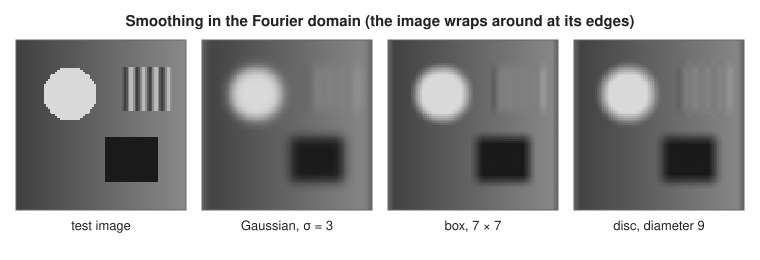
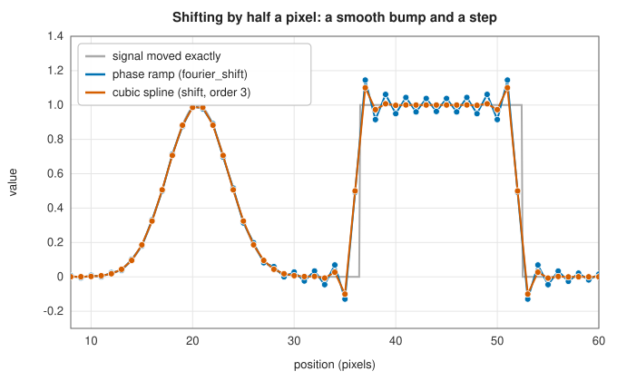

# Fourier-domain filters

<div class="entry-summary">

| | |
|---|---|
| **Problem** | Smooth an image with a Gaussian, box or disc kernel of any size at a fixed cost, or shift it by a fraction of a pixel, by multiplying its Fourier transform |
| **Devised by** | The convolution theorem (Fourier analysis, 19th century); fast convolution by the FFT: Thomas Stockham (1966); the closed-form transfer functions used here are those of `scipy.ndimage` |
| **Accuracy** | Agrees with `scipy.ndimage` to $2\times10^{-15}$ on full and real spectra; a phase-ramp shift of a smooth, periodic image is exact to rounding |
| **Cost** | Two 2D FFTs and one multiplication per frequency: $O(N\log N)$ for $N$ pixels, independent of the kernel size |
| **Read first** | [Convolution and correlation](../filters/convolution.md), [Rank filters, derivative filters and geometric transforms](rank-geometric.md) |
| **API** | [`fourier_gaussian`](../../api/lib_jsl_dsp/discrete/image/fourier/fn.fourier_gaussian.html), [`fourier_uniform`](../../api/lib_jsl_dsp/discrete/image/fourier/fn.fourier_uniform.html), [`fourier_ellipsoid`](../../api/lib_jsl_dsp/discrete/image/fourier/fn.fourier_ellipsoid.html), [`fourier_shift`](../../api/lib_jsl_dsp/discrete/image/fourier/fn.fourier_shift.html), [`fourier_filter`](../../api/lib_jsl_dsp/discrete/image/fourier/fn.fourier_filter.html), [`frequencies`](../../api/lib_jsl_dsp/discrete/image/fourier/fn.frequencies.html), [`Spectrum`](../../api/lib_jsl_dsp/discrete/image/fourier/enum.Spectrum.html) |

</div>

## Overview

A convolution in space is a multiplication in frequency. Smoothing an image with a $k \times k$ kernel costs $O(k^2)$ operations per pixel
directly, or $O(k)$ if the kernel is separable; through the fast Fourier transform it costs the same $O(\log N)$ per pixel for any kernel. For
large kernels that is a large saving, and for some operations the frequency domain is simply the natural place to work: a shift by
half a pixel, for instance, is a pure phase change.

The four filters here, following `scipy.ndimage`, take a **spectrum** (the 2D FFT of an image) and multiply it by a transfer
function known in closed form:

- `fourier_gaussian`: a Gaussian of standard deviations $(\sigma_r, \sigma_c)$;
- `fourier_uniform`: a box (moving average) of size $(s_r, s_c)$;
- `fourier_ellipsoid`: a uniform disc or ellipse with axes $(s_r, s_c)$;
- `fourier_shift`: a translation by $(t_r, t_c)$ pixels, not necessarily whole.

The price of working with the DFT is that convolution becomes **circular**: the image is treated as one tile of a periodic pattern, so
features near one edge bleed into the opposite edge.

## History

The convolution theorem is as old as Fourier analysis itself, but it became a practical computing tool only with the fast Fourier
transform of James Cooley and John Tukey (1965). Thomas Stockham (1966) showed within a year that "high-speed convolution" by the FFT beats
direct convolution for all but short kernels, and image processing adopted it for large blurs, deconvolution and correlation. The
transfer functions here are the Fourier transforms of the continuous kernels (a Gaussian, a box and a disc, whose transform is the Airy
pattern of optics); their use in this form, applied to an existing spectrum, follows `scipy.ndimage`, whose `fourier_*` functions date
from Peter Verveer's original `numarray` image library (around 2002).

## The idea

### Frequencies of the DFT

The 2D DFT of an $M \times N$ image has the same shape. Entry $(k, l)$ belongs to the frequency $(f_r, f_c)$ in cycles per pixel, where along each
axis the first half of the indices are non-negative frequencies and the rest negative ones:

$$
f = \begin{cases} k/N, & k < \lceil N/2\rceil, \\ (k - N)/N, & \text{otherwise.} \end{cases}
$$

For a real image it is common to store only half of the spectrum along one axis, from a **real FFT**: the rows then hold the
frequencies $k/N$ for $k = 0, \ldots, \lfloor N/2\rfloor$. `Spectrum::Full` and `Spectrum::RealRows { columns }` select between the two layouts
(SciPy's argument `n`). A filter multiplies each entry by its transfer function $H(f_r, f_c)$; filtering a real image with a real,
symmetric $H$ gives a real result.

### The transfer functions

Each filter uses the Fourier transform of the *continuous* kernel, evaluated at the DFT frequencies.

**Gaussian.** The Fourier transform of $g(x) = \frac{1}{\sqrt{2\pi}\sigma}e^{-x^2/2\sigma^2}$ is $\hat g(f) = e^{-2\pi^2\sigma^2f^2}$, again a Gaussian, so

$$
H(f_r, f_c) = \exp\big(-2\pi^2(\sigma_r^2f_r^2 + \sigma_c^2f_c^2)\big).
$$

A wider Gaussian in space is a narrower one in frequency: smoothing removes high frequencies.

**Box.** A box of width $s$ has transform $\operatorname{sinc}(sf) = \frac{\sin(\pi sf)}{\pi sf}$, and the 2D box is a product, so
$H = \operatorname{sinc}(s_rf_r)\operatorname{sinc}(s_cf_c)$. The sinc changes sign: some frequencies come out *inverted*, which is why a box blur turns
fine stripes into stripes of opposite contrast.

**Disc and ellipse.** A uniform disc of diameter $s$ has the transform $\frac{2J_1(\pi sf)}{\pi sf}$, with $J_1$ the Bessel function of the first
kind and $f = \sqrt{f_r^2 + f_c^2}$; this is the Airy pattern that a circular lens produces from a point. An ellipse is a disc with its
axes scaled, which gives

$$
H(f_r, f_c) = \frac{2J_1(x)}{x}, \qquad x = \pi\sqrt{(s_rf_r)^2 + (s_cf_c)^2}.
$$

**Shift.** Moving a signal by $t$ multiplies its transform by $e^{-2\pi i ft}$, so

$$
H(f_r, f_c) = e^{-2\pi i(t_rf_r + t_cf_c)}.
$$

The magnitude is 1 at every frequency: nothing is smoothed, only delayed.



<p class="caption" id="fig-17-20"><strong>Figure 17.20.</strong> Smoothing in the Fourier domain.</p>

All three kernels blur the disc and the square similarly, but the box (whose sinc changes sign) leaves the stripes with reversed
contrast, and every filter treats the image as periodic: the bright right edge and the dark left edge bleed into each other.

### Fourier against spatial filtering

The spatial Gaussian filter of the [previous entry](rank-geometric.md#gaussian-derivatives) samples the Gaussian and truncates it at $4\sigma$;
the Fourier filter uses the exact transform of the untruncated continuous Gaussian. With wrap-around boundaries the two compute
nearly the same thing:

<p class="caption" id="tab-17-8"><strong>Table 17.8.</strong> Spatial against Fourier Gaussian smoothing of a 256 × 256 image: difference and time.</p>

{{#include ../generated/image/fourier_vs_spatial.md}}

For $\sigma \ge 2$ they agree to $10^{-5}$, the size of the truncated Gaussian tail. For small $\sigma$ they differ a lot, because the continuous
Gaussian is not band-limited: its transform does not vanish at the Nyquist frequency, so sampling it in space and evaluating it in
frequency are different discretisations. The spatial cost grows with $\sigma$; the Fourier cost does not. Where the two cross depends on the machine and
the image size, but beyond a few pixels the Fourier filter is always the cheaper.

### Shifting by a fraction of a pixel

For a band-limited, periodic signal the phase ramp is the *exact* shift: the shifted samples are those of the shifted continuous
signal. For anything else it is the shift of the band-limited periodic interpolant, which rings near discontinuities, and the ringing
spreads across the whole period:



<p class="caption" id="fig-17-21"><strong>Figure 17.21.</strong> Shifting by half a pixel.</p>

<p class="caption" id="tab-17-9"><strong>Table 17.9.</strong> Largest error when shifting each signal alone by half a pixel.</p>

{{#include ../generated/image/fourier_shift_errors.md}}

On the smooth bump the phase ramp is exact to $10^{-11}$, far better than the cubic spline. At the step both are wrong by half the step,
because no sampled signal can say where inside a pixel a jump lies; the phase ramp adds Gibbs ringing that, in the figure, reaches
all the way to the bump.

## Algorithm

**Frequencies** of an $M \times N$ spectrum: along the rows, $k/M$ for $k < \lceil M/2\rceil$ and $(k - M)/M$ otherwise; along the columns the
same with $N$, or $k/n$ for $k = 0, \ldots, \lfloor n/2\rfloor$ for a real FFT of rows of length $n$.

**Filter**: multiply every entry by $H(f_r, f_c)$:

| filter | $H(f_r, f_c)$ |
|---|---|
| Gaussian $(\sigma_r, \sigma_c)$ | $\exp(-2\pi^2(\sigma_r^2f_r^2 + \sigma_c^2f_c^2))$ |
| box $(s_r, s_c)$ | $\operatorname{sinc}(s_rf_r)\operatorname{sinc}(s_cf_c)$ |
| ellipse $(s_r, s_c)$ | $2J_1(x)/x$ with $x = \pi\sqrt{(s_rf_r)^2 + (s_cf_c)^2}$, and 1 at $x = 0$ |
| shift $(t_r, t_c)$ | $\exp(-2\pi i(t_rf_r + t_cf_c))$ |

**`fourier_filter`**, for a real image: FFT, apply the filter to the full spectrum, inverse FFT, keep the real part.

## Implementation

```rust,ignore
{{#include ../../../crates/dsp/src/discrete/image/fourier.rs:transfer_functions}}
```

- The filters take and return complex spectra, as SciPy's do; `fourier_filter` wraps the FFTs for a real image.
- `Spectrum::RealRows { columns }` handles spectra from a real FFT along each row (SciPy's `n` with `axis=-1`); the other axis is
  treated as a full spectrum, as in SciPy, whether or not it has been transformed.
- $J_1$ comes from the special-functions crate.

## In practice

Every filter is compared with `scipy.ndimage` on full spectra and on real-FFT rows (see the
[chapter's reference table](index.md#testing-against-scipy-and-scikit-image)); the largest difference is $2\times10^{-15}$.

**Strengths**

- The cost is independent of the kernel size: large blurs are as cheap as small ones.
- The transfer functions are exact transforms of the continuous kernels, with no truncation.
- Sub-pixel shifts of smooth images are exact, and several filters can be combined by multiplying their transfer functions once.

**Weaknesses**

- Convolution is circular: edges wrap around. Pad the image (by reflection, or with its mean) before filtering to avoid it.
- For small kernels the spatial filter is faster, and for $\sigma \lesssim 1$ the two discretisations differ noticeably.
- Phase shifts ring at sharp edges, and the ringing is not local.
- The FFT works in floating point on the whole image, so memory grows with the image, not the kernel.

## Exercises

1. Show that the Fourier transform of $e^{-x^2/2\sigma^2}/(\sqrt{2\pi}\sigma)$ is $e^{-2\pi^2\sigma^2f^2}$, and deduce that two Gaussian blurs of $\sigma_1$ and $\sigma_2$ make one of
   $\sqrt{\sigma_1^2 + \sigma_2^2}$.
2. Find the frequencies at which a box of width 7 inverts the contrast of a pattern, and check them on stripes of period 5 and 3 pixels.
3. Show that shifting by a whole number of pixels with `fourier_shift` reproduces `numpy.roll` exactly, for any image.
4. Pad an image by reflection to twice its size, smooth it with `fourier_gaussian`, and crop. Compare the edges with the unpadded result
   and with the spatial filter in `Reflect` mode.
5. Combine a Gaussian blur and a shift into one transfer function, and verify that the result equals applying them one after the other.

<details>
<summary>Hints and answers</summary>

1. Complete the square in $\int e^{-x^2/2\sigma^2}e^{-2\pi ifx}dx$. Products of the transforms add the exponents: $e^{-2\pi^2(\sigma_1^2 + \sigma_2^2)f^2}$.
2. $\operatorname{sinc}(7f) < 0$ for $1/7 < |f| < 2/7$ (and $3/7$ to $1/2$). Stripes of period 5 have $f = 0.2$ (inverted, gain $-0.22$); period 3 has $f = 1/3$ (not
   inverted, gain $+0.12$).
3. With $t$ an integer, $e^{-2\pi ift}$ at $f = k/N$ is $e^{-2\pi ikt/N}$, the DFT shift theorem for a circular shift of $t$ samples.
4. The reflected padding makes the image continuous across its edges, so the wrap-around disappears and the result matches the spatial
   filter in `Reflect` mode to the size of the Gaussian tail.
5. Transfer functions of a cascade multiply; multiplication is commutative, so the order does not matter, and one pass with the product
   gives the same spectrum to rounding.

</details>

## Further reading

- T. G. Stockham, "High-speed convolution and correlation", *Proceedings of the AFIPS Spring Joint Computer Conference* 28 (1966) 229–233.
- R. N. Bracewell, *The Fourier Transform and Its Applications*, 3rd ed., McGraw-Hill, 2000.
- R. C. Gonzalez and R. E. Woods, *Digital Image Processing*, 4th ed., Pearson, 2018, chapter 4 (filtering in the frequency domain).
