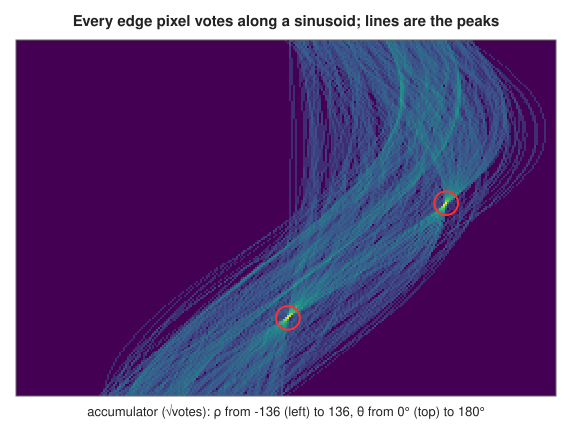
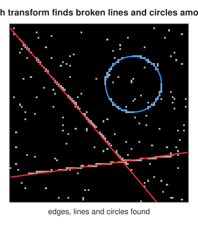

# The Hough transform: lines and circles

<div class="entry-summary">

| | |
|---|---|
| **Problem** | Find straight lines and circles in an edge map, even when they are broken, partly hidden or surrounded by clutter |
| **Devised by** | Paul Hough (1959, patented 1962), for bubble-chamber tracks; Richard Duda and Peter Hart (1972), the $(\rho, \theta)$ form and circles |
| **Accuracy** | The strongest lines and circles agree with scikit-image's (see the [chapter overview](index.md#testing-against-scipy-and-scikit-image)); positions to the accumulator's resolution, one pixel and one degree by default |
| **Cost** | $O(E\,n_\theta)$ for lines and $O(E\,r)$ per radius for circles, for $E$ edge pixels |
| **API** | [`hough_transform`](../../api/lib_jsl_dsp/discrete/image/feature_extraction/hough_transform/fn.hough_transform.html), [`HoughLines`](../../api/lib_jsl_dsp/discrete/image/feature_extraction/hough_transform/struct.HoughLines.html), [`hough_line_peaks`](../../api/lib_jsl_dsp/discrete/image/feature_extraction/hough_transform/fn.hough_line_peaks.html), [`hough_lines`](../../api/lib_jsl_dsp/discrete/image/feature_extraction/hough_transform/fn.hough_lines.html), [`hough_circles`](../../api/lib_jsl_dsp/discrete/image/feature_extraction/hough_transform/fn.hough_circles.html) |

</div>

## Overview

An edge detector reports pixels, not shapes. The **Hough transform** turns the search for shapes into **voting**. Each edge pixel votes for every shape that could pass through it, and votes accumulate in an array over the shapes'
parameters. A shape supported by many edge pixels collects many votes and appears as a peak. Pixels need not be adjacent or in order, so gaps and occlusions only reduce a peak, and scattered clutter spreads its votes thinly. Lines
have two parameters, and circles of a known radius have two (the centre).

## History

Paul Hough devised the method in 1959 to find the straight tracks of particles in bubble-chamber photographs, and patented it in 1962. His version parametrised lines by slope and intercept, which are unbounded for
near-vertical lines. Richard Duda and Peter Hart (1972) replaced them with the normal form $(\rho, \theta)$, which is bounded, and extended the method to circles. Dana Ballard (1981) generalised it to arbitrary shapes given as templates. The Hough transform remains a standard
tool in document analysis, lane detection and industrial inspection.

## The idea

### Lines in normal form

Every line in the plane can be written

$$
\rho = x\cos\theta + y\sin\theta, \qquad 0 \le \theta < \pi,
$$

where $\theta$ is the direction of the line's normal and $\rho$ its signed distance from the origin. Here $x$ is the column and $y$ the row, increasing downwards. Through a fixed point $(x, y)$ passes one line for each $\theta$, so the point votes along the
sinusoid $\rho(\theta) = x\cos\theta + y\sin\theta$ in the $(\rho, \theta)$ plane. The sinusoids of collinear points all cross at the line's parameters. [`hough_transform`](../../api/lib_jsl_dsp/discrete/image/feature_extraction/hough_transform/fn.hough_transform.html) quantises $\theta$ into `num_angles` steps
and $\rho$ into bins of `rho_resolution` pixels, covering $\pm$ the image diagonal.



<p class="caption" id="fig-17-9"><strong>Figure 17.9.</strong> Hough accumulator.</p>

### Finding peaks

One physical line spreads its votes over neighbouring cells, so [`hough_line_peaks`](../../api/lib_jsl_dsp/discrete/image/feature_extraction/hough_transform/fn.hough_line_peaks.html) takes the strongest cell, suppresses cells within $\pm$`min_rho_bins` and $\pm$`min_theta_bins` of it, and repeats.
The neighbourhood wraps across $\theta = 0 \equiv \pi$, where the same line reappears with $\rho$ negated. [`hough_lines`](../../api/lib_jsl_dsp/discrete/image/feature_extraction/hough_transform/fn.hough_lines.html) does both steps with one-degree, one-pixel bins.

### Circles

A circle of radius $r$ centred at $(a, b)$ passes through $(x, y)$ if $(x - a)^2 + (y - b)^2 = r^2$. For a known radius, each edge pixel votes for every centre on the circle of radius $r$ around itself. The votes of a true circle's
pixels meet at its centre. [`hough_circles`](../../api/lib_jsl_dsp/discrete/image/feature_extraction/hough_transform/fn.hough_circles.html) does this for each candidate radius. It reports centres whose votes exceed `min_support` times the circumference $2\pi r$, strongest first, and keeps only centres at least `min_distance` apart.
The **support** of a complete circle is about 0.9 for an 8-connected outline and up to 1.3 for a thicker, 4-connected one.



<p class="caption" id="fig-17-10"><strong>Figure 17.10.</strong> Hough transform.</p>

{{#include ../generated/image/hough_facts.md}}

## Algorithm

**Line transform**, on a binary edge image.

1. Allocate an accumulator with one row for each quantised distance $\rho$ and one column for
   each of the `num_angles` angles $\theta_j$, all zero. Tabulate $\cos\theta_j$ and
   $\sin\theta_j$.
2. For each edge pixel $(x, y)$ and each angle: compute
   $\rho = x\cos\theta_j + y\sin\theta_j$, find its bin, and add 1 to that cell.

The cost is (number of edge pixels) × (number of angles).

**Peak finding.**

1. List the cells with at least `min_votes` votes, sorted by decreasing votes.
2. Take each in turn. If it has not been suppressed, report it as a line, and suppress every
   cell within a given neighbourhood of it. The neighbourhood wraps round in $\theta$: the
   lines $(\rho, \theta)$ and $(-\rho, \theta + \pi)$ are the same line, so beyond the last angle
   the neighbourhood continues at the first, with $\rho$ mirrored.

**Circle transform**, for a list of candidate radii.

1. For each radius, list the distinct integer pixel offsets that lie on a circle of that
   radius.
2. For each edge pixel and each offset, add 1 to the accumulator cell (for that radius) at the
   pixel displaced by the offset. A true centre collects a vote from every edge pixel on its
   circle.
3. Keep the cells whose votes are at least `min_support` times the circumference $2\pi r$,
   which is about the number of votes a complete circle would collect.
4. Sort them by strength, and discard any centre closer than `min_distance` to a stronger
   one.

## Implementation

```rust,ignore
{{#include ../../../crates/dsp/src/discrete/image/feature_extraction/hough_transform.rs:hough_vote}}
```

- `HoughLines` holds the accumulator, the angles and the $\rho$ axis; `rho(i)` gives the centre of bin $i$.
- A circle's offsets are deduplicated, so each edge pixel votes once for each candidate centre.
- For unknown radii, pass a range: the cost grows linearly with the number of radii.

## In practice

```rust,ignore
{{#include ../../../crates/dsp/examples/dsp_image_hough.rs}}
```

```text
line: θ = 117°, ρ = 8.5, 50 votes
exact: θ = 116.6°, ρ = 8.94
circle: centre (row 45, column 20), radius 9, support 1.27
```

The rasterised line $y = 10 + \lfloor x/2\rfloor$ lies on average a quarter of a pixel above the exact line $y = 10 + x/2$, which lowers $\rho$ by $0.25\sin\theta \approx 0.22$. The nearest bin centre to the result is 8.5.
The cell has 50 votes; the other few of the 54 line pixels fell in neighbouring bins. The circle, drawn densely, is thicker than 8-connected and scores 1.27.

**Strengths**

- Robust to gaps, occlusion and clutter; finds several shapes at once.
- Simple; the line accumulator is a useful picture in itself.

**Weaknesses**

- Memory and time grow with the number of parameters (a circle of unknown radius needs three, an ellipse five).
- Resolution is fixed by the bins; peaks of nearby or short shapes merge, and textured regions create false peaks.

## Exercises

1. Show that the sinusoids of two points cross at the parameters of the line through them.
2. Why does the slope-intercept form need an unbounded accumulator, and the normal form not?
3. Use the gradient direction at each edge pixel to vote for only one $\theta$ (or one centre for circles), and compare the cost and the peaks.
4. Show that a line of length $L$ pixels at angle $\theta$ gives about $L$ votes in one cell only if the $\rho$ bin is at least about one pixel wide.
5. Extend `hough_circles` to estimate the radius by fitting the votes of each centre over a range of radii.

<details>
<summary>Hints and answers</summary>

1. The line through points $(x_1, y_1)$ and $(x_2, y_2)$ satisfies $x_i\cos\theta + y_i\sin\theta = \rho$ for both points, so the two sinusoids $\rho_i(\theta)$ intersect at that $(\theta, \rho)$.
2. Slope-intercept $y = mx + c$ has $m \to \infty$ for vertical lines. The normal form has $\theta \in [0, \pi)$ and $|\rho| \le$ the image diagonal, both bounded.
3. With the gradient direction the edge pixel votes only for $\theta$ along the gradient (plus or minus a small tolerance), so the cost per pixel falls from the number of angle bins to one or a few and the peaks are sharper.
4. A line of length $L$ gives $L$ pixels whose $\rho$ values are spread over an interval of about $L|\sin\delta\theta|$ for a small angular error $\delta\theta$; a $\rho$ bin of at least one pixel keeps them in a single cell.
5. For each centre candidate, accumulate votes at the distances $r$ to the edge pixels; the peak of this one-dimensional histogram gives the radius.

</details>

## Further reading

- P. V. C. Hough, "Method and means for recognizing complex patterns", US patent 3 069 654, 1962.
- R. O. Duda and P. E. Hart, "Use of the Hough transformation to detect lines and curves in pictures", *Communications of the ACM* 15 (1972) 11–15.
- D. H. Ballard, "Generalizing the Hough transform to detect arbitrary shapes", *Pattern Recognition* 13 (1981) 111–122.
- R. Szeliski, *Computer Vision: Algorithms and Applications*, 2nd ed., Springer, 2022, section 7.4.
