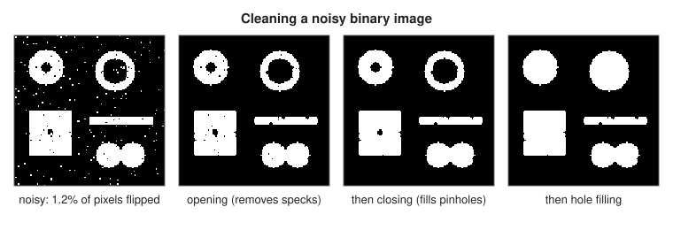
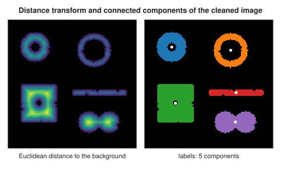

# Morphology, distance transforms and labelling

<div class="entry-summary">

| | |
|---|---|
| **Problem** | Clean up binary and greyscale images by shape; measure how far each pixel is from the background; find, count and measure the separate objects in a binary image |
| **Devised by** | Mathematical morphology: Georges Matheron and Jean Serra (1964 onwards, École des Mines); distance transforms: Azriel Rosenfeld and John Pfaltz (1966); the linear-time exact Euclidean transform: Pedro Felzenszwalb and Daniel Huttenlocher (2004, 2012); two-pass labelling: Rosenfeld and Pfaltz (1966) |
| **Accuracy** | Exact: every result is identical to `scipy.ndimage`, apart from rounding (below $10^{-14}$) in distances and intensity measurements |
| **Cost** | Morphology and rank operations: $O(Nk)$ for $N$ pixels and a $k$-pixel structuring element; exact Euclidean distance transform and labelling: $O(N)$ |
| **Read first** | [Segmentation: Otsu's threshold, Canny edges and the watershed](segmentation.md) |
| **API** | [`binary_erosion`](../../api/lib_jsl_dsp/discrete/image/morphology/fn.binary_erosion.html), [`binary_dilation`](../../api/lib_jsl_dsp/discrete/image/morphology/fn.binary_dilation.html), [`binary_opening`](../../api/lib_jsl_dsp/discrete/image/morphology/fn.binary_opening.html), [`binary_closing`](../../api/lib_jsl_dsp/discrete/image/morphology/fn.binary_closing.html), [`binary_fill_holes`](../../api/lib_jsl_dsp/discrete/image/morphology/fn.binary_fill_holes.html), [`grey_erosion`](../../api/lib_jsl_dsp/discrete/image/morphology/fn.grey_erosion.html), [`grey_dilation`](../../api/lib_jsl_dsp/discrete/image/morphology/fn.grey_dilation.html), [`white_tophat`](../../api/lib_jsl_dsp/discrete/image/morphology/fn.white_tophat.html), [`morphological_gradient`](../../api/lib_jsl_dsp/discrete/image/morphology/fn.morphological_gradient.html), [`distance_transform_edt`](../../api/lib_jsl_dsp/discrete/image/distance/fn.distance_transform_edt.html), [`distance_transform_cdt`](../../api/lib_jsl_dsp/discrete/image/distance/fn.distance_transform_cdt.html), [`label`](../../api/lib_jsl_dsp/discrete/image/labelling/fn.label.html), [`regions`](../../api/lib_jsl_dsp/discrete/image/labelling/fn.regions.html), [`Mode`](../../api/lib_jsl_dsp/discrete/image/boundary/enum.Mode.html) |

</div>

## Overview

After a threshold or an edge detector has turned an image into foreground and background, the result is rarely clean: there
are specks of noise, pinholes inside objects, ragged outlines, and objects that touch. **Mathematical morphology** repairs such
images by probing them with a small shape, the **structuring element**. Two operations underlie everything else. **Erosion**
keeps a pixel only if the element, centred there, fits entirely inside the foreground; it shrinks objects and deletes those
smaller than the element. **Dilation** turns a pixel on if the element touches the foreground; it grows objects and fills
small gaps. Erosion followed by dilation (**opening**) removes small objects but restores the large ones almost exactly;
dilation followed by erosion (**closing**) fills small holes and gaps. On greyscale images the same ideas become a minimum and
a maximum over the element.

Two further tools turn a clean binary image into numbers. The **distance transform** gives each foreground pixel its
distance to the nearest background pixel, a map of how deep inside its object every pixel lies. **Labelling** gives each
connected group of foreground pixels its own number, so that objects can be counted and measured one by one: their area,
centroid, bounding box and intensity statistics.

## History

Mathematical morphology was created by Georges Matheron and Jean Serra at the École des Mines de Paris from 1964, to quantify
the structure of porous rocks and mineral grains seen in thin sections under the microscope. Matheron's *Random Sets and
Integral Geometry* (1975) and Serra's *Image Analysis and Mathematical Morphology* (1982) set out the theory; the greyscale
form and its use in industrial inspection followed through the 1980s.

Azriel Rosenfeld and John Pfaltz (1966) introduced both the two-pass sequential algorithm for labelling connected components
and the chamfer distance transforms computed by two raster sweeps. Exact Euclidean distance transforms took longer: early
methods propagated vectors and could be wrong in rare configurations, until linear-time exact algorithms appeared around
2000. The one used here, by Pedro Felzenszwalb and Daniel Huttenlocher (published 2004, journal version 2012), reduces the
problem to one dimension and solves each line as the lower envelope of parabolas.

## The idea

### Erosion and dilation

Let $A$ be the set of foreground pixels and $B$ the structuring element, a set of offsets around the origin, such as the
$3 \times 3$ **cross** (the four edge neighbours and the centre) or the $3 \times 3$ **square**. Translating $B$ to a pixel $p$
gives $B_p = \{p + b : b \in B\}$. Then

$$
A \ominus B = \{p : B_p \subseteq A\}, \qquad A \oplus B = \{p : \hat B_p \cap A \ne \emptyset\},
$$

where $\hat B = \{-b : b \in B\}$ is the reflected element (the same as $B$ for the symmetric elements used here). Erosion
asks "does the element fit?" and dilation "does it touch?". Pixels beyond the image count as background, so objects touching
the image edge are eroded from it.

Two properties give the operations their meaning. Both are **increasing**: if $A \subseteq A'$ then $A \ominus B \subseteq A' \ominus B$,
so they never create features that were not there. And they are **dual**: dilating the foreground is eroding the background,
$A \oplus B = (A^c \ominus \hat B)^c$, so every statement about one has a mirror image about the other.

### Opening and closing

Erosion followed by dilation, $A \circ B = (A \ominus B) \oplus B$, is the **opening**. It is the union of all translates of $B$ that
fit inside $A$: every part of $A$ that the element can reach while staying inside survives, and only the parts too narrow
for it (specks, thin spurs, small protrusions) disappear. The **closing**, $A \bullet B = (A \oplus B) \ominus B$, is the dual: it fills
everything the element cannot fit into from outside, such as pinholes, narrow gaps and small bays. Both are **idempotent**:
opening an opened image changes nothing, which is why they are the standard tools for cleaning.



<p class="caption" id="fig-17-14"><strong>Figure 17.14.</strong> Cleaning a noisy binary image.</p>

The scene has five objects; 1.2% of its pixels have been flipped. Opening with the cross removes every isolated speck but
leaves pinholes; closing then fills the pinholes; the remaining holes, too large for the element, are removed by **hole
filling**: a background region is a hole if it cannot be reached from outside the image by steps allowed by the structuring
element. A breadth-first search from the background pixels on the border marks everything reachable; the rest is foreground.

### Greyscale morphology

On a greyscale image, "the element fits" becomes a minimum and "the element touches" a maximum:

$$
(f \ominus B)(p) = \min_{b \in B} f(p + b), \qquad (f \oplus B)(p) = \max_{b \in B} f(p - b).
$$

A greyscale opening removes bright features narrower than the element while keeping the background level; the **white
top-hat**, $f - f \circ B$, keeps exactly those bright features, which makes it a good way to find small spots on an uneven
background. The **black top-hat**, $f \bullet B - f$, finds small dark features, and the **morphological gradient**,
$f \oplus B - f \ominus B$, is large on edges and zero in flat regions. Beyond the image, greyscale operations use the boundary
modes of `scipy.ndimage` ([`Mode`](../../api/lib_jsl_dsp/discrete/image/boundary/enum.Mode.html)), `Reflect` by default.

### Distance transforms

For each foreground pixel $p$, the **distance transform** gives $\min_{q \in A^c} \lVert p - q\rVert$, the distance to the nearest
background pixel. With the city-block or chessboard distance it can be computed by two raster sweeps: going forwards, each
pixel takes one more than the smallest value among its already visited neighbours (above and to the left); going backwards,
the same with the other neighbours. These are the **chamfer** transforms.

The Euclidean distance needs more care, because the nearest background pixel is not always reached through a neighbour's
nearest one. The squared distance separates:

$$
D^2(r, c) = \min_{c'} \Big( (c - c')^2 + \min_{r'} \big( (r - r')^2 : (r', c') \in A^c \big) \Big).
$$

The inner minimum is a one-dimensional problem down each column, giving $g(r, c')$; the outer one is a one-dimensional problem
along each row, $\min_{c'} \big((c - c')^2 + g(r, c')\big)$. Each candidate $c'$ contributes a parabola $(c - c')^2 + g(r, c')$, and the
answer is their **lower envelope**. Because all the parabolas have the same shape, any two cross exactly once, so the envelope
is built left to right in linear time, discarding parabolas that a newer one undercuts before they ever become lowest. Recording
which parabola wins gives the **feature transform**, the position of the nearest background pixel, as a by-product.



<p class="caption" id="fig-17-15"><strong>Figure 17.15.</strong> Distance transform and labels.</p>

The distance is largest at the centres of the thick objects, and its maximum in each object is the radius of the largest
disc that fits inside it. The ridges of the distance map form the object's **skeleton**.

### Labelling

Two foreground pixels are **connected** if a chain of foreground pixels links them, each step allowed by the structuring element:
the cross allows only edge neighbours (**4-connectivity**), the square also diagonals (**8-connectivity**). The connected
components are found in two raster passes. The first gives each pixel the label of an already visited neighbour (above or to
the left) or a new provisional label if it has none; when two different labels meet at a pixel, their equivalence is recorded
in a **union-find** structure. The second pass replaces each label by its representative, numbered in the order the objects are
first met. With path compression, the union-find operations cost effectively constant time, so the whole is $O(N)$.

<p class="caption" id="tab-17-4"><strong>Table 17.4.</strong> Connected components of the scene before and after cleaning.</p>

{{#include ../generated/image/object_counts.md}}

Noise turns five objects into well over a hundred components; opening alone already restores the count. The two touching
discs are one object to any connectivity rule. Thresholding the distance transform splits them (the "cores" row): their two
centres are deep, the neck between them is not. But the thin objects disappear at the same threshold, which is why touching
objects are usually separated with the [watershed](segmentation.md) of the distance transform rather than by a single threshold.

Once labelled, each region can be measured in one pass over the image:

<p class="caption" id="tab-17-5"><strong>Table 17.5.</strong> Measurements of the labelled regions of the cleaned scene.</p>

{{#include ../generated/image/region_table.md}}

## Algorithm

**Binary erosion and dilation** with element offsets $B$: for each pixel, test all offsets (erosion: all on; dilation: any on, with
the offsets reflected), treating pixels beyond the image as background; repeat for several iterations, or until the image stops
changing.

**Hole filling**: mark every background pixel that has a step (an element offset) leading out of the image; breadth-first
search through background pixels by element steps; invert the marked set.

**Greyscale erosion and dilation**: the minimum (maximum) of the image, extended by the boundary mode, over the footprint
(reflected, for dilation). Opening, closing, top-hats and the gradient are compositions and differences of these.

**Exact Euclidean distance transform**, with pixel spacing $(h_r, h_c)$:

1. For each column, set $f = 0$ on background and $\infty$ on foreground, and compute the one-dimensional squared distance
   transform $g = \min_p \big((q - p)^2h_r^2 + f(p)\big)$, remembering the minimising row.
2. For each row, compute the same transform of $g$ with spacing $h_c$, remembering the minimising column.
3. The distance is the square root; the feature transform combines the two remembered indices.

The one-dimensional transform maintains the envelope as a stack of parabola positions $v$ and boundaries $z$. For each new finite
$q$, compute where its parabola meets the top one, $s = \frac{(f(q) + q^2h^2) - (f(p) + p^2h^2)}{2h^2(q - p)}$; pop while $s$ is left of the
top's boundary; push $q$ with boundary $s$. Then read off, for each position, the parabola whose interval contains it.

**Labelling**: as described above, with union-find (path halving, union by smaller label) over provisional labels, then
renumbering in raster order of first appearance.

## Implementation

Binary erosion and dilation:

```rust,ignore
{{#include ../../../crates/dsp/src/discrete/image/morphology.rs:binary}}
```

The lower envelope of parabolas:

```rust,ignore
{{#include ../../../crates/dsp/src/discrete/image/distance.rs:envelope}}
```

Labelling:

```rust,ignore
{{#include ../../../crates/dsp/src/discrete/image/labelling.rs:label}}
```

- Binary images are `Array2<bool>` (`true` is foreground); greyscale images `Array2<f64>`. Structuring elements are
  `Array2<bool>` with odd sides, centred: `cross()`, `square(k)`, `disk(r)`.
- `iterations = 0` repeats erosion or dilation until the image stops changing (SciPy's `iterations < 1`).
- The distance transform returns both the distances and the nearest background pixel; it requires at least one background
  pixel. Chamfer distances are integers, `None` where no background exists.
- `regions` returns the area, bounding box (half-open, as SciPy's `find_objects`) and centroid of each label, and with an
  intensity image its sum, mean, minimum, maximum and intensity-weighted centre (SciPy's `center_of_mass`).

## In practice

The comparison with `scipy.ndimage` covers every function on a $20 \times 24$ test image, with both structuring elements and every boundary
mode; the results are identical, or agree to rounding error (see the [chapter's reference table](index.md#testing-against-scipy-and-scikit-image)).

**Strengths**

- Simple, exact and fast: binary operations are bit tests, distance transforms and labelling are linear in the number of pixels.
- Shape-based: opening and closing remove features by size and shape, not by intensity, so they keep sharp outlines.
- Labelling and region measurements turn a segmentation into a table of objects.

**Weaknesses**

- The structuring element must be chosen for the scale of the features; one size rarely suits every object.
- Morphology on a square grid is anisotropic: the cross and the square erode diagonals and edges differently; discs approximate
  isotropy only for larger radii.
- Touching objects form one component; separating them needs more (a watershed of the distance transform).
- The direct implementation costs $O(k)$ per pixel for a $k$-pixel element; large elements are faster by decomposition (a
  square is two lines), which is not implemented.

## Exercises

1. Show that opening is idempotent: $(A \circ B) \circ B = A \circ B$. (Use $A \circ B = \bigcup\{B_p : B_p \subseteq A\}$.)
2. Prove the duality $A \oplus B = (A^c \ominus \hat B)^c$, and deduce that closing the foreground is opening the background.
3. A disc of radius $R$ is eroded by the $3 \times 3$ square $k$ times. What shape and size remains? What does the cross leave?
4. Compute the Euclidean distance transform of a single background pixel at the origin by hand for the $3 \times 3$ neighbourhood, and check
   that the two one-dimensional passes reproduce $\sqrt{r^2 + c^2}$.
5. Label the image whose rows are `#.#`, `.#.`, `#.#` with 4- and 8-connectivity. How many components does each find? Explain why
   the background of the 8-connected foreground should be taken as 4-connected (the digital topology paradox).

<details>
<summary>Hints and answers</summary>

1. Every $B_p \subseteq A \circ B$ that fits in $A \circ B$ also fits in $A$, and every one that fits in $A$ is contained in $A \circ B$; so the union
   of translates fitting in $A \circ B$ is the same union.
2. $p \in (A^c \ominus \hat B)$ iff $p - b \in A^c$ for all $b$, iff no $p - b$ is in $A$, iff $p \notin A \oplus B$. Applying this to the complement:
   closing $A$ is the complement of the opening of $A^c$ (with the reflected element).
3. Erosion by the square removes all pixels within chessboard distance $k$ of the background, so the disc shrinks to the set of
   pixels at chessboard distance more than $k$ from the outside: roughly an octagon-like shape of radius $R - k$, flattened along the
   diagonals by about $k(\sqrt2 - 1)$. The cross erodes by city-block distance, leaving a diamond-like shape flattened on the axes.
4. The column pass gives $g(r, 0) = r^2$ in the column through the origin and $\infty$ elsewhere; the row pass gives
   $\min_{c'}((c - c')^2 + g(r, c')) = c^2 + r^2$.
5. With 4-connectivity: five components (each `#` alone). With 8-connectivity: one (all are diagonal neighbours of the centre). The
   paradox: with 8-connected foreground and 8-connected background, a diagonal line both separates and does not separate the
   background; using the complementary connectivity for the background restores the Jordan curve theorem.

</details>

## Further reading

- J. Serra, *Image Analysis and Mathematical Morphology*, Academic Press, 1982.
- P. Soille, *Morphological Image Analysis: Principles and Applications*, 2nd ed., Springer, 2003.
- A. Rosenfeld and J. L. Pfaltz, "Sequential operations in digital picture processing", *Journal of the ACM* 13 (1966) 471–494.
- P. F. Felzenszwalb and D. P. Huttenlocher, "Distance transforms of sampled functions", *Theory of Computing* 8 (2012) 415–428.
