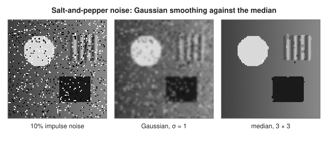
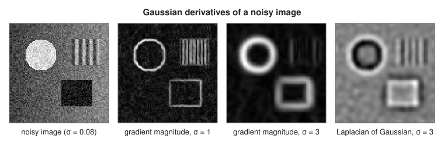
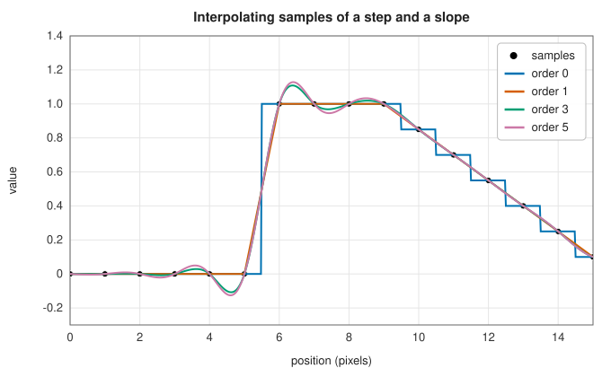
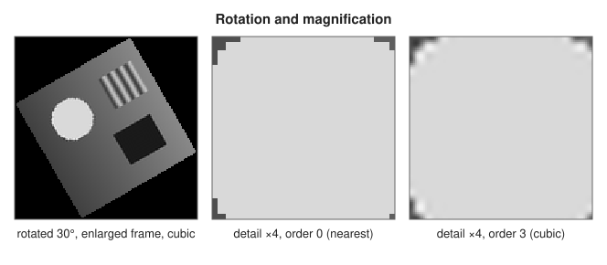

# Rank filters, derivative filters and geometric transforms

<div class="entry-summary">

| | |
|---|---|
| **Problem** | Remove impulse noise without blurring edges; differentiate a noisy image at a chosen scale; resample an image after a rotation, shift, scaling or general affine map |
| **Devised by** | The median filter: John Tukey (1971, "running medians"); Gaussian derivative filters and scale space: Iijima (1962), Andrew Witkin (1983), Jan Koenderink (1984); B-spline interpolation by recursive filtering: Michael Unser, Akram Aldroubi and Murray Eden (1991–1993) |
| **Accuracy** | Rank filters are identical to `scipy.ndimage`; Gaussian filters and spline interpolation agree to $10^{-14}$ (quintic splines in `Nearest` mode to $2\times10^{-10}$) |
| **Cost** | Rank filter: $O(k)$ per pixel (selection) for a $k$-pixel window; Gaussian derivatives: $O(\sigma)$ per pixel (separable); spline interpolation of order $n$: an $O(N)$ prefilter, then $O((n + 1)^2)$ per output pixel |
| **Read first** | [Image filtering: convolution, Gaussian blur, Sobel gradients and sharpening](filtering.md), [Splines](../interpolation/splines.md) |
| **API** | [`median_filter`](../../api/lib_jsl_dsp/discrete/image/rank_filters/fn.median_filter.html), [`rank_filter`](../../api/lib_jsl_dsp/discrete/image/rank_filters/fn.rank_filter.html), [`percentile_filter`](../../api/lib_jsl_dsp/discrete/image/rank_filters/fn.percentile_filter.html), [`minimum_filter`](../../api/lib_jsl_dsp/discrete/image/rank_filters/fn.minimum_filter.html), [`maximum_filter`](../../api/lib_jsl_dsp/discrete/image/rank_filters/fn.maximum_filter.html), [`gaussian_filter`](../../api/lib_jsl_dsp/discrete/image/derivative_filters/fn.gaussian_filter.html), [`gaussian_laplace`](../../api/lib_jsl_dsp/discrete/image/derivative_filters/fn.gaussian_laplace.html), [`gaussian_gradient_magnitude`](../../api/lib_jsl_dsp/discrete/image/derivative_filters/fn.gaussian_gradient_magnitude.html), [`laplace`](../../api/lib_jsl_dsp/discrete/image/derivative_filters/fn.laplace.html), [`spline_filter`](../../api/lib_jsl_dsp/discrete/image/geometric/fn.spline_filter.html), [`map_coordinates`](../../api/lib_jsl_dsp/discrete/image/geometric/fn.map_coordinates.html), [`affine_transform`](../../api/lib_jsl_dsp/discrete/image/geometric/fn.affine_transform.html), [`shift`](../../api/lib_jsl_dsp/discrete/image/geometric/fn.shift.html), [`zoom`](../../api/lib_jsl_dsp/discrete/image/geometric/fn.zoom.html), [`rotate`](../../api/lib_jsl_dsp/discrete/image/geometric/fn.rotate.html) |

</div>

## Overview

This entry collects three families of `scipy.ndimage` operations that work on any greyscale image.

**Rank filters** replace each pixel by an order statistic of its neighbourhood: the median, a percentile, the minimum or the
maximum. A linear filter averages an outlier into its surroundings; the median simply ignores it, so a $3 \times 3$ median removes
"salt-and-pepper" noise almost completely while keeping edges sharp.

**Derivative filters** estimate the derivatives of an image at a chosen scale. Differentiating raw pixels amplifies noise;
differentiating after Gaussian smoothing does not, and since differentiation commutes with convolution, the two steps are one
convolution with a derivative of the Gaussian. The gradient magnitude finds edges at scale $\sigma$, and the Laplacian of a
Gaussian finds blobs.

**Geometric transforms** move pixels: shift, rotate, zoom, or apply any affine map. Each output pixel comes from a point between
input pixels, so the image must be **interpolated**. Order 0 takes the nearest pixel, order 1 is bilinear, and the default,
order 3, is the cubic B-spline. For orders above 1 the spline must pass through the pixels, which needs a **prefilter** first.

## History

John Tukey introduced running medians in 1971 for smoothing time series that contain outliers, and the two-dimensional median
filter soon became the standard cure for impulse noise in images. Its theory (which signals pass through unchanged, the "root
signals") was developed through the 1980s.

Smoothing with Gaussians of increasing width, and taking derivatives of the smoothed image, was proposed by Taizo Iijima in
Japan in 1962 and rediscovered in the West as **scale space** by Andrew Witkin (1983) and Jan Koenderink (1984). The Gaussian is
the only smoothing kernel that creates no new extrema as the scale grows, which is why its derivatives are the standard
measurements at a scale. David Marr and Ellen Hildreth (1980) used the zero crossings of the Laplacian of a Gaussian as edges.

Interpolation by B-splines was well understood in approximation theory, but evaluating it exactly through the samples seemed to
require solving a large linear system. Michael Unser, Akram Aldroubi and Murray Eden (1991, 1993) showed that the system's
inverse is a pair of recursive filters per pole, applied along each axis in $O(N)$ operations. Their method is what
`scipy.ndimage` and this library implement.

## The idea

### Rank filters

For a window (the **footprint**) of $k$ pixels around each pixel, sort the $k$ values; the rank filter of rank $j$ returns the
$j$-th smallest. The median is $j = \lfloor k/2\rfloor$, the minimum $j = 0$ and the maximum $j = k - 1$; the minimum and maximum are
the greyscale erosion and dilation of the [morphology entry](morphology.md). Selection (not a full sort) finds the $j$-th
value in $O(k)$ time.

The median keeps a step edge exactly: in a window straddling the edge, more than half the pixels lie on one side, so the median is
a value from that side. And it ignores impulses: an isolated outlier is one of $k$ values, at the end of the sorted list, so it
cannot be the median. A Gaussian blur does neither: it spreads each outlier into a blob and softens each edge.



<p class="caption" id="fig-17-16"><strong>Figure 17.16.</strong> Median against Gaussian smoothing.</p>

<p class="caption" id="tab-17-6"><strong>Table 17.6.</strong> Peak signal-to-noise ratio (dB) after Gaussian and median smoothing, for impulse and Gaussian noise.</p>

{{#include ../generated/image/median_psnr.md}}

On impulse noise the $3 \times 3$ median gains 16 dB, far more than any Gaussian. On Gaussian noise the median and a small Gaussian
do about equally well: there are no outliers to ignore, and averaging is the right thing to do.

### Gaussian derivatives

The Gaussian of standard deviation $\sigma$ is sampled at integers out to $\lfloor 4\sigma + \tfrac12\rfloor$ and normalised to sum 1. Its
derivatives multiply it by polynomials: $x/\sigma^2$ for the first (with the sign arranged so that correlation estimates
$\partial f/\partial x$), and $x^2/\sigma^4 - 1/\sigma^2$ for the second. Because the two-dimensional Gaussian is a product of two
one-dimensional ones, every derivative filter is two one-dimensional passes: $\partial^2/\partial r^2$, for example, is the second-derivative
kernel down the columns and the smoothing kernel along the rows.

The truncated, sampled kernels are not exact. On the linear ramp $f = 3c$, the first-derivative filter with $\sigma = 2$ returns
$2.999$, not 3, because the discrete second moment of the sampled Gaussian is not exactly $\sigma^2$. SciPy's kernels, which these
reproduce exactly, make the same error.



<p class="caption" id="fig-17-17"><strong>Figure 17.17.</strong> Gaussian derivatives.</p>

At $\sigma = 1$ the gradient magnitude shows the edges but also the noise; at $\sigma = 3$ the noise is gone and only the large-scale
edges remain, broadened to the scale. The Laplacian of a Gaussian is negative inside bright regions and positive inside dark ones,
with its strongest response at blobs of radius about $\sigma\sqrt2$.

### Interpolation by B-splines

A geometric transform asks for image values at non-integer points. The **B-spline of degree $n$**, $\beta_n$, is the $n$-fold
convolution of a unit box with itself: a bell of width $n + 1$ made of polynomial pieces of degree $n$, with $n - 1$ continuous
derivatives. Interpolation writes the image as a combination of shifted B-splines,

$$
s(x) = \sum_k c_k\,\beta_n(x - k),
$$

and evaluates $s$ at any point from the $n + 1$ nearest coefficients. For $n = 0$ (a box) and $n = 1$ (a triangle) the coefficients
are the pixel values themselves. For $n \ge 2$ they are not: $\beta_3$, for example, has values $\tfrac16, \tfrac23, \tfrac16$ at the
integers, so $s(j) = \tfrac16c_{j-1} + \tfrac23c_j + \tfrac16c_{j+1}$, and making $s$ pass through the pixels means solving this
tridiagonal system for $\mathbf c$.

Unser's observation is that the system is a convolution, $\mathbf f = b * \mathbf c$ with $B(z) = \tfrac16(z + 4 + z^{-1})$, so
$\mathbf c = \mathbf f / B$. Factoring $B(z) = \tfrac{1}{6z_1}(1 - z_1z^{-1})(1 - z_1z)$ with the pole $z_1 = \sqrt3 - 2 \approx -0.268$, the inverse is a
causal first-order recursion $c^+_i = f_i + z_1c^+_{i-1}$ followed by an anti-causal one $c_i = z_1(c_{i+1} - c^+_i)$, with a gain. Higher
orders have two poles, each handled the same way. The recursions start from the infinite sums that the boundary symmetry implies,
which can be written in closed form for mirror, half-sample-reflect and periodic extensions. The prefilter runs along every row and
then every column, and costs a few operations per pixel.



<p class="caption" id="fig-17-18"><strong>Figure 17.18.</strong> Interpolation orders.</p>

Order 0 makes stairs and moves edges by up to half a pixel. Order 1 is continuous but has corners at the samples. Orders 3
and 5 are smooth and exact for polynomials of their degree, but they overshoot near a step, ringing like a band-limited signal,
because a smooth curve through a sudden jump must overshoot to stay smooth.

### Geometric transforms

All transforms map output coordinates to input coordinates, not the other way: output pixel $\mathbf o$ takes the interpolated value
at $M\mathbf o + \mathbf t$. Working backwards guarantees that every output pixel gets exactly one value. A **shift** by $\mathbf s$ has $M = I$ and
$\mathbf t = -\mathbf s$. A **zoom** by factor $z$ maps output index $o$ to $o(n - 1)/(m - 1)$, so that the first and last pixels of the output
sample the first and last pixels of the input exactly. A **rotation** by $\theta$ about the centre uses the rotation matrix of $-\theta$ and
the offset that maps the output centre to the input centre; with `reshape` the output grows to hold the whole rotated frame.
Points that fall outside the input are supplied by the boundary mode; in `Constant` mode, points outside the input's extent take the
constant.



<p class="caption" id="fig-17-19"><strong>Figure 17.19.</strong> Rotation and magnification.</p>

Every interpolation loses a little, and repeated transforms accumulate the loss. Rotating six times by $15°$ and back again:

<p class="caption" id="tab-17-7"><strong>Table 17.7.</strong> RMS error after rotating six times by 15° and back, by spline order.</p>

{{#include ../generated/image/rotation_roundtrip.md}}

On a smooth image the cubic spline is almost lossless, a hundred times better than bilinear interpolation; on an image with sharp
edges every order loses detail, because the edges contain frequencies that no sampled image can represent, and higher orders help
less.

## Algorithm

**Rank filter** of rank $j$ with footprint $F$ (origin at its element $(h/2, w/2)$): for each pixel, gather the image values at the
footprint's offsets (extended beyond the edges by the boundary mode), select the $j$-th smallest (a negative $j$ counts from the
largest). The median takes $j = \lfloor k/2\rfloor$, the percentile $p$ takes $j = \lfloor kp/100\rfloor$ (and $k - 1$ for $p = 100$).

**Gaussian filter** with standard deviations $(\sigma_r, \sigma_c)$ and derivative orders $(m_r, m_c)$: build the one-dimensional kernels of
radius $\lfloor 4\sigma + \tfrac12\rfloor$; correlate every column with the row kernel, then every row with the column kernel. The Laplacian of a
Gaussian is the sum of the $(2, 0)$ and $(0, 2)$ filters; the gradient magnitude is $\sqrt{f_r^2 + f_c^2}$ from the $(1, 0)$ and $(0, 1)$
filters.

**Spline interpolation** of order $n$ at points $(r, c)$:

1. Prefilter: for each line (columns, then rows), multiply by the gain $\prod(1 - z)(1 - 1/z)$ and, for each pole $z$, run the
   causal recursion from its boundary-implied initial value and then the anti-causal one. In `Nearest` mode, pad 12 copies of the
   edge first (as SciPy does).
2. For each point, find the first coefficient index (for odd $n$, $\lfloor x\rfloor - \lfloor n/2\rfloor$; for even $n$, $\lfloor x + \tfrac12\rfloor - n/2$) and the
   $n + 1$ weights $\beta_n(x - k)$ along each axis.
3. Sum the products of weights and coefficients over the $(n + 1)^2$ neighbourhood, mapping coefficient indices outside the image by
   the boundary symmetry; in `Constant` mode, points outside $[0, n - 1]$ return the constant.

**Affine transform**: apply step 3 at $M\mathbf o + \mathbf t$ for every output pixel $\mathbf o$, reusing one prefilter.

## Implementation

The rank filter:

```rust,ignore
{{#include ../../../crates/dsp/src/discrete/image/rank_filters.rs:rank_filter}}
```

The Gaussian kernels:

```rust,ignore
{{#include ../../../crates/dsp/src/discrete/image/derivative_filters.rs:gaussian_kernel}}
```

The B-spline prefilter:

```rust,ignore
{{#include ../../../crates/dsp/src/discrete/image/geometric.rs:prefilter}}
```

Interpolation at arbitrary points:

```rust,ignore
{{#include ../../../crates/dsp/src/discrete/image/geometric.rs:map_coordinates}}
```

- Boundary modes follow SciPy: `Reflect` (default for filters), `Mirror`, `Nearest`, `Constant(value)` and `Wrap`. For spline
  interpolation, `Wrap` behaves as SciPy's `grid-wrap`, the exactly periodic extension.
- Footprints may have even sides; the origin is then one element past the middle, as in SciPy, so the window extends one pixel
  further before the pixel than after it.
- Spline orders 0 to 5 are supported. `shift`, `zoom` and `rotate` are thin wrappers around `affine_transform`.

## In practice

Every function is compared with `scipy.ndimage` on a $20 \times 24$ test image, for every boundary mode and spline order (see the
[chapter's reference table](index.md#testing-against-scipy-and-scikit-image)). Rank filters are identical; Gaussian filters and
interpolation agree to $10^{-14}$, except quintic splines in `Nearest` mode, which agree to $2\times10^{-10}$ (both pad the image by 12 pixels
before prefiltering, and the poles of order 5 are not quite damped over that distance).

**Strengths**

- The median removes impulse noise and keeps edges; percentiles and extremes give robust local statistics.
- Gaussian derivative filters give stable derivatives at an explicit scale, the basis of edge, corner and blob detectors.
- Cubic spline interpolation is nearly lossless for smooth images and costs little more than bilinear interpolation, thanks to the
  recursive prefilter.

**Weaknesses**

- Rank filters cost $O(k)$ per pixel; large windows need faster sliding-histogram methods, not implemented here.
- The median rounds corners and removes thin lines narrower than half the window.
- High-order splines ring at sharp edges; for label images or masks use order 0.
- Repeated geometric transforms accumulate interpolation error; compose the maps and resample once.

## Exercises

1. Show that a $3 \times 3$ median leaves a straight step edge (in any direction through pixel centres) unchanged, but rounds the corner
   of a square. Which pixels change?
2. Show that the second-derivative kernel $(x^2/\sigma^4 - 1/\sigma^2)\varphi(x)$ applied to $f = x^2$ gives $2$ in the continuous case, and
   compute what the sampled kernel with $\sigma = 2$ gives.
3. Derive the cubic B-spline values $\beta_3(0) = \tfrac23$, $\beta_3(\pm1) = \tfrac16$ from $\beta_3 = \beta_0 * \beta_0 * \beta_0 * \beta_0$, and find the pole of
   $B(z) = \tfrac16(z + 4 + z^{-1})$.
4. Show that shifting by a whole number of pixels with any spline order (and `Wrap` mode) reproduces the image exactly, while
   shifting by half a pixel and back does not. Which order loses least?
5. Implement rotation by composing three shears (Paeth's method), each a one-dimensional shift of every row or column, and compare
   its error with `rotate` at order 3.

<details>
<summary>Hints and answers</summary>

1. Along a straight edge every $3 \times 3$ window has at least five pixels on the side of its centre (or exactly on the edge line), so the
   median is a value from that side. At a convex corner of a bright square the corner pixel's window has only four bright pixels
   out of nine, so the median is dark: the corner pixel is removed and the corner rounded.
2. The continuous second derivative of the Gaussian smoothing of $x^2$ is the smoothing of $2$, which is 2. The sampled kernel gives
   $\sum_x (x^2/\sigma^4 - 1/\sigma^2)\varphi(x)x^2$ (with $\varphi$ normalised to sum 1), about $1.95$ for $\sigma = 2$: half the value of the
   $0.974$ in the text, which was for $\tfrac12x^2$.
3. $\beta_3$ is the piecewise cubic $\tfrac23 - x^2 + \tfrac12|x|^3$ for $|x| < 1$ and $\tfrac16(2 - |x|)^3$ for $1 \le |x| < 2$. The roots of $z^2 + 4z + 1 = 0$
   are $-2 \pm \sqrt3$; the stable pole is $\sqrt3 - 2$.
4. At integer positions every spline evaluates to the coefficient-reconstructed sample exactly, since $s(j) = f_j$ by construction.
   A half-pixel shift evaluates between samples, and shifting back evaluates the interpolant of the interpolant; higher orders lose less
   on smooth images.
5. A rotation by $\theta$ equals shears with factors $-\tan(\theta/2)$, $\sin\theta$, $-\tan(\theta/2)$; each shear is a one-dimensional
   interpolation per line, so it accumulates three interpolations but each is one-dimensional. Compare RMS errors on a smooth image.

</details>

## Further reading

- J. W. Tukey, *Exploratory Data Analysis*, Addison-Wesley, 1977 (running medians).
- J. J. Koenderink, "The structure of images", *Biological Cybernetics* 50 (1984) 363–370.
- M. Unser, "Splines: a perfect fit for signal and image processing", *IEEE Signal Processing Magazine* 16 (1999) 22–38.
- M. Unser, A. Aldroubi and M. Eden, "B-spline signal processing: Part I—Theory" and "Part II—Efficient design and applications",
  *IEEE Transactions on Signal Processing* 41 (1993) 821–848.
