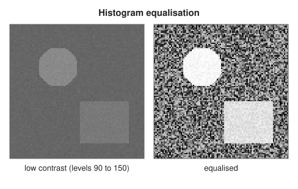
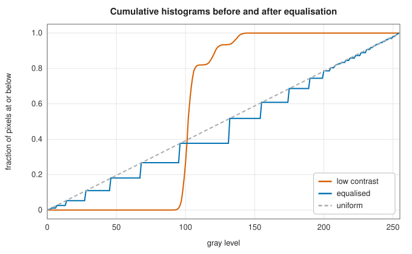
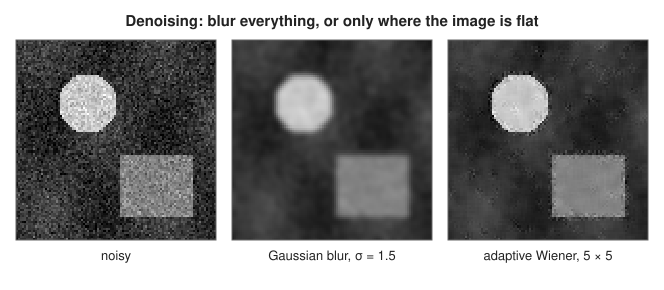
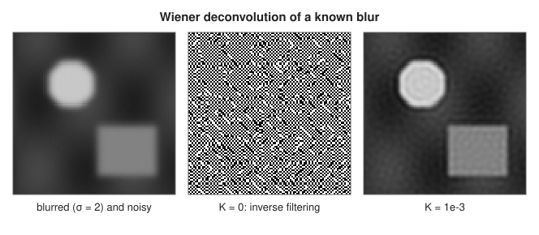

# Contrast and restoration: histogram equalisation and Wiener filtering

<div class="entry-summary">

| | |
|---|---|
| **Problem** | Spread an image's gray levels over the full range; remove noise without blurring edges; undo a known blur |
| **Devised by** | Norbert Wiener (1942, published 1949), the minimum-mean-square-error filter; Ernest Hall (1974) and others, histogram equalisation; Jong-Sen Lee (1980), the locally adaptive Wiener filter |
| **Accuracy** | Equalisation maps levels exactly through the cumulative histogram; the adaptive Wiener filter agrees with SciPy's `signal.wiener` to 12 digits away from the borders |
| **Cost** | $O(N)$ for equalisation and for the adaptive Wiener filter (box sums); $O(N\log N)$ for Wiener deconvolution by FFT, for $N$ pixels |
| **API** | [`histogram`](../../api/lib_jsl_dsp/discrete/image/filters/histogram_equalization/fn.histogram.html), [`equalization_lut`](../../api/lib_jsl_dsp/discrete/image/filters/histogram_equalization/fn.equalization_lut.html), [`histogram_equalization`](../../api/lib_jsl_dsp/discrete/image/filters/histogram_equalization/fn.histogram_equalization.html), [`wiener_filter`](../../api/lib_jsl_dsp/discrete/image/filters/wiener_filter/fn.wiener_filter.html), [`wiener_deconvolution`](../../api/lib_jsl_dsp/discrete/image/filters/wiener_filter/fn.wiener_deconvolution.html) |

</div>

## Overview

A photograph taken in poor light uses only a narrow band of the available gray levels, so it looks flat. **Histogram equalisation** remaps the levels through the image's own cumulative distribution, spreading them
evenly over the full range. A noisy image needs smoothing, but a fixed blur softens edges as much as noise. The **adaptive Wiener filter** smooths strongly only where the neighbourhood looks like
pure noise, and leaves edges and texture alone. A blurred image, if the blur is known, can be partly un-blurred. Dividing by the blur's transfer function amplifies noise without limit, so **Wiener deconvolution**
divides only where the signal dominates the noise.

## History

Norbert Wiener derived the optimal linear filter for separating a signal from noise during the Second World War, for anti-aircraft fire control. The report circulated in 1942, classified, and was published in 1949. Its
two-dimensional, frequency-domain form, analysed for images by Carl Helstrom (1967), became the standard method for restoring images whose blur could be measured. Histogram
equalisation appeared in the early 1970s in work on image enhancement (Ernest Hall and colleagues, 1971–74). Contrast-limited adaptive variants (CLAHE) followed in the 1980s for medical imaging. Jong-Sen Lee (1980) introduced
the locally adaptive filter, which estimates the signal statistics in a small window around each pixel. MATLAB's `wiener2` and SciPy's `signal.wiener` implement it.

## The idea

### Histogram equalisation

If a continuous random variable $X$ has cumulative distribution $F$, then $F(X)$ is uniform on $[0, 1]$. Mapping each gray level through the image's cumulative histogram therefore
flattens its histogram. For 8-bit images, with $\mathrm{cdf}(v)$ the number of pixels at or below level $v$, $\mathrm{cdf}_{\min}$ the first nonzero value, and $N$ pixels,

$$
v \mapsto \mathrm{round}\Big(255\,\frac{\mathrm{cdf}(v) - \mathrm{cdf}_{\min}}{N - \mathrm{cdf}_{\min}}\Big),
$$

which sends the darkest level present to 0 and the brightest to 255. The map is monotonic, so it preserves the order of brightness. With discrete levels the result is only approximately uniform: each input level maps to one output
level, so the histogram's bars are moved apart, not split.



<p class="caption" id="fig-17-3"><strong>Figure 17.3.</strong> Histogram equalisation.</p>



<p class="caption" id="fig-17-4"><strong>Figure 17.4.</strong> Cumulative histograms.</p>

The equalised cumulative histogram follows the diagonal in steps. Equalisation stretches the noise as much as the signal: the dense band of background levels is spread widest.

### The adaptive Wiener filter

Model each pixel as $x = s + n$, with signal $s$ of local mean $\mu$ and variance $\sigma_s^2$, and white noise $n$ of variance $\nu^2$. The linear estimate of $s$ with the smallest mean-square error is

$$
\hat s = \mu + \frac{\sigma_s^2}{\sigma_s^2 + \nu^2}(x - \mu).
$$

[`wiener_filter`](../../api/lib_jsl_dsp/discrete/image/filters/wiener_filter/fn.wiener_filter.html) estimates $\mu$ and the total variance $\sigma^2 = \sigma_s^2 + \nu^2$ over a $w \times w$ window around each pixel, by box filtering $x$ and $x^2$. The result is $\hat s = \mu + \max(\sigma^2 - \nu^2, 0)/\sigma^2\,(x - \mu)$. In a flat region $\sigma^2 \approx \nu^2$ and the pixel is replaced by
the local mean; at an edge $\sigma^2 \gg \nu^2$ and it is left almost unchanged. If the noise variance is not given, it is estimated as the mean of all the local variances.



<p class="caption" id="fig-17-5"><strong>Figure 17.5.</strong> Denoising.</p>

{{#include ../generated/image/denoise_table.md}}

The adaptive filter beats the best fixed blur by 2–3 dB, keeping the edges sharp. Estimating the noise variance did better than supplying the true value here. The mean local variance includes the edges, so it overestimates $\nu^2$ and smooths the flat regions harder,
which suits this mostly flat image.

### Wiener deconvolution

A blurred, noisy image is $g = h * f + n$, or $G = HF + N$ in the frequency domain. Dividing by $H$, the **inverse filter**, restores $F$ where there is no noise, but $H$ is tiny at high frequencies and $N/H$ explodes. The MMSE linear filter is

$$
\hat F = \frac{\overline{H}}{|H|^2 + K}\,G, \qquad K = \frac{S_n}{S_f},
$$

with $K$ the ratio of noise power to signal power, here taken as a constant. Where $|H|^2 \gg K$, it is the inverse filter; where $|H|^2 \ll K$, the gain falls to zero instead of growing. [`wiener_deconvolution`](../../api/lib_jsl_dsp/discrete/image/filters/wiener_filter/fn.wiener_deconvolution.html) pads the image to
power-of-two dimensions by repeating its edge pixels, centres the PSF at the origin, and applies the filter by FFT.



<p class="caption" id="fig-17-6"><strong>Figure 17.6.</strong> Deconvolution.</p>

{{#include ../generated/image/deconvolution_table.md}}

The inverse filter turns noise of standard deviation 0.002 into numbers of order $10^7$. Small $K$ restores too aggressively and large $K$ too timidly; the best value gains 3 dB over the blurred image here. Real blurs are not exactly
known, nor circular as in this test, so in practice $K$ is tuned by eye.

## Algorithm

**Histogram equalisation** of an 8-bit image.

1. Count the pixels at each of the 256 levels.
2. Form the cumulative counts $\mathrm{cdf}(v)$.
3. Build a lookup table of 256 entries from the formula above.
4. Replace each pixel by the table entry for its level.

The cost is one pass to count and one to map.

**Adaptive Wiener filter** with a $w \times w$ window.

1. Box-filter the image and the squared image (reflecting at the borders) to obtain, at each
   pixel, the local mean $\mu$ and the local mean square, and from them the local variance
   $\sigma^2$.
2. If the noise variance $\nu^2$ was not supplied, estimate it as the average of the local
   variances over the whole image.
3. At each pixel, output $\mu + \frac{\sigma^2 - \nu^2}{\sigma^2}(x - \mu)$ if
   $\sigma^2 > \nu^2$, and $\mu$ otherwise.

**Wiener deconvolution** with a known point spread function (PSF) and a constant $K$.

1. Pad the image to power-of-two dimensions by repeating its edge pixels.
2. Place the PSF in an array of the same size, shifted cyclically so that its centre is at
   index $(0, 0)$; otherwise the result would be displaced.
3. Take the two-dimensional FFT of both, giving $G$ and $H$.
4. Multiply $G$ by $\overline H/(|H|^2 + K)$ at every frequency.
5. Take the inverse FFT, and crop to the original size.

## Implementation

```rust,ignore
{{#include ../../../crates/dsp/src/discrete/image/filters/histogram_equalization.rs:equalize}}
```

```rust,ignore
{{#include ../../../crates/dsp/src/discrete/image/filters/wiener_filter.rs:wiener_local}}
```

```rust,ignore
{{#include ../../../crates/dsp/src/discrete/image/filters/wiener_filter.rs:wiener_deconvolution}}
```

- Equalisation works on `Array2<u8>`; the filters work on `Array2<f64>`.
- `wiener_filter` reflects at the borders, where SciPy pads with zeros; the two agree away from the edges.
- `wiener_deconvolution` does not normalise the PSF: a PSF summing to one preserves the image's mean.

## In practice

```rust,ignore
{{#include ../../../crates/dsp/examples/dsp_image_restoration.rs}}
```

```text
equalised levels: 100 -> 0, 110 -> 85, 120 -> 170, 130 -> 255
equalised image row 0: [0, 85, 170, 255, 0, 85, 170, 255]
MSE: noisy 9.72e-4, Wiener 5x5 1.26e-4
deconvolution with K = 1e-1: MSE 4.47e-3 (blurred 3.62e-3)
deconvolution with K = 1e-2: MSE 1.88e-3 (blurred 3.62e-3)
deconvolution with K = 1e-3: MSE 1.35e-3 (blurred 3.62e-3)
```

Four equally common levels become four evenly spaced ones. The example's deconvolution starts from a blur that was not circular, so the restoration is limited by the border mismatch as well as by $K$.

**Strengths**

- Equalisation needs no parameters and preserves the order of brightness.
- The adaptive Wiener filter preserves edges and needs only the window size; deconvolution has one parameter.

**Weaknesses**

- Equalisation is global: it can over-enhance noise and wash out small regions (adaptive, contrast-limited versions address this).
- The Wiener filters assume additive white noise and, for deconvolution, a known, shift-invariant blur.

## Exercises

1. Show that if $X$ has a continuous cumulative distribution $F$, then $F(X)$ is uniform on $[0, 1]$.
2. Derive the scalar MMSE estimate $\hat s = \mu + \sigma_s^2/(\sigma_s^2 + \nu^2)\,(x - \mu)$.
3. Derive the Wiener deconvolution filter by minimising $E|F - WG|^2$ at each frequency.
4. Show that the Fourier transform of a Gaussian blur of width $\sigma$ is a Gaussian of width $1/(2\pi\sigma)$, and explain why the inverse filter fails for it.
5. Implement contrast-limited equalisation: clip the histogram at a multiple of its mean before forming the cumulative sum.

## Further reading

- R. C. Gonzalez and R. E. Woods, *Digital Image Processing*, 4th ed., Pearson, 2018, chapters 3 and 5.
- N. Wiener, *Extrapolation, Interpolation, and Smoothing of Stationary Time Series*, MIT Press, 1949.
- J.-S. Lee, "Digital image enhancement and noise filtering by use of local statistics", *IEEE Transactions on Pattern Analysis and Machine Intelligence* 2 (1980) 165–168.
- C. W. Helstrom, "Image restoration by the method of least squares", *Journal of the Optical Society of America* 57 (1967) 297–303.
- J. S. Lim, *Two-Dimensional Signal and Image Processing*, Prentice Hall, 1990, chapter 9.
