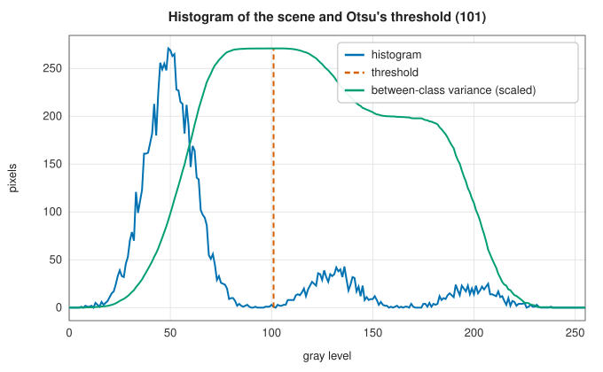
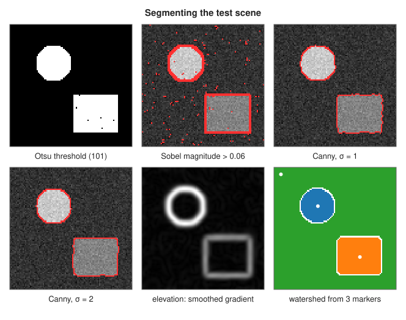

# Segmentation: Otsu's threshold, Canny edges and the watershed

<div class="entry-summary">

| | |
|---|---|
| **Problem** | Divide an image into objects and background: by brightness, by thin connected edges, or into regions grown from seed points |
| **Devised by** | Nobuyuki Otsu (1979), the threshold; John Canny (1986), the edge detector; Serge Beucher and Christian Lantuéjoul (1979), the watershed; Fernand Meyer (1991), flooding by priority queue |
| **Accuracy** | Otsu's threshold and the watershed agree exactly with scikit-image; Canny's edges agree to within a pixel (see the [chapter overview](index.md#testing-against-scipy-and-scikit-image)) |
| **Cost** | Otsu $O(N + L^2)$ or $O(N + L)$ for $N$ pixels and $L$ levels; Canny $O(N\sigma)$; watershed $O(N\log N)$ |
| **API** | [`otsu`](../../api/lib_jsl_dsp/discrete/image/segmentation/otsu/fn.otsu.html), [`otsu_threshold`](../../api/lib_jsl_dsp/discrete/image/segmentation/otsu/fn.otsu_threshold.html), [`canny_edge_detection`](../../api/lib_jsl_dsp/discrete/image/segmentation/canny_edge_detection/fn.canny_edge_detection.html), [`watershed`](../../api/lib_jsl_dsp/discrete/image/segmentation/watershed/fn.watershed.html), [`watershed_masked`](../../api/lib_jsl_dsp/discrete/image/segmentation/watershed/fn.watershed_masked.html), [`label_boundaries`](../../api/lib_jsl_dsp/discrete/image/segmentation/watershed/fn.label_boundaries.html) |

</div>

## Overview

**Segmentation** assigns each pixel to an object or to the background. The simplest way is a brightness **threshold**, and **Otsu's method** chooses it automatically from the histogram, as the level that best separates
two classes. **Edge detection** finds the boundaries instead. **Canny's detector** smooths, differentiates, thins the gradient to one-pixel ridges, and links them by two thresholds, so that faint
parts of strong edges survive while isolated noise does not. The **watershed** treats the gradient magnitude as a landscape and floods it from marker points, one per object. The lakes meet along the ridges, the boundaries.

## History

Nobuyuki Otsu (1979) derived his threshold from discriminant analysis. It remains the default automatic threshold. John Canny (1986), in his MIT master's thesis, set out three criteria for an edge
detector: good detection, good localisation, and a single response per edge. He showed that the derivative of a Gaussian nearly optimises them, and added non-maximum suppression and hysteresis. Serge Beucher and Christian Lantuéjoul (1979) at the
École des Mines introduced the watershed transform into mathematical morphology. Luc Vincent and Pierre Soille (1991) made it fast, and Fernand Meyer (1991) gave the priority-queue flooding used here. Markers are
needed because flooding from every local minimum over-segments a noisy image badly.

## The idea

### Otsu's threshold

A threshold $t$ splits the pixels into classes $C_0$ (levels $\le t$) and $C_1$, with probabilities $\omega_0, \omega_1$ and means $\mu_0, \mu_1$. Otsu chooses $t$ to maximise the **between-class variance**

$$
\sigma_b^2(t) = \omega_0\omega_1(\mu_0 - \mu_1)^2,
$$

which is equivalent to minimising the variance within the classes, since the two sum to the total variance $\sigma^2$. A single pass over the 256 levels with running sums finds the maximum. The ratio $\sigma_b^2/\sigma^2$, the
**separability**, measures how bimodal the histogram is. Ties, as in an image with two gray levels, are resolved to the middle of the tied range.



{{#include ../generated/image/otsu_facts.md}} The threshold degrades as the classes overlap, and with unequal class sizes: here the objects cover 18% of the pixels.

{{#include ../generated/image/otsu_table.md}}

With noise 30 and a gap of 80, the best threshold for these class sizes (157, by Bayes' rule) would misclassify about 6% of pixels. Otsu's, pulled towards the larger class, misclassifies 14%.

### Canny edges

1. **Smooth** with a Gaussian of width $\sigma$, which sets the scale of edges sought and suppresses noise.
2. **Differentiate** with the [Sobel operator](filtering.md#gradients-the-sobel-operator), normalised to intensity units per pixel.
3. **Thin** by **non-maximum suppression**: keep a pixel only if its gradient magnitude is at least that of its two neighbours along the gradient direction, quantised to 0°, 45°, 90° or 135°. Edges become ridges one pixel wide.
4. **Link** by **hysteresis**: pixels above the `high` threshold are edges; pixels above `low` are edges if they connect, through other such pixels in their 8-neighbourhoods, to one above `high`.

The comparison in step 3 is strict on one side, so a two-pixel plateau, as at an edge lying exactly between pixels, keeps one pixel. The outermost border is never marked.

### The watershed

View the elevation $E$, usually the smoothed gradient magnitude, as a landscape whose valleys are uniform regions and whose ridges are boundaries. Put a labelled marker in each valley and raise the water. Each marker's lake grows,
and where two lakes would merge, a dam stands: the **watershed line**. Meyer's algorithm floods with a priority queue. It repeatedly takes the lowest pixel on any lake's shore, gives each unlabelled 4-neighbour the same label, and queues it at elevation $\max(E_{\text{neighbour}}, E_{\text{current}})$, so the
water never runs downhill. Pixels at equal elevation leave the queue first in, first out, so floods spread evenly across plateaus. [`label_boundaries`](../../api/lib_jsl_dsp/discrete/image/segmentation/watershed/fn.label_boundaries.html) marks pixels whose right or lower neighbour has another label.



A plain threshold of the gradient (top middle) marks noise and thick edges. Canny's edges are thin and connected, and a larger $\sigma$ ignores more noise at the cost of rounding corners. The watershed, from one marker in each object and one in the background,
divides the image along the gradient ridges.

## Algorithm

1. **Otsu**: histogram; for each $t$, update $\omega_0$ and the sum of levels incrementally and evaluate $\sigma_b^2$; take the maximiser (the middle of a tie).
2. **Canny**: blur; Sobel; suppress non-maxima along the quantised direction; seed a queue with pixels above `high`; grow through 8-neighbours above `low`.
3. **Watershed**: queue the markers; pop the lowest (oldest on ties); label and queue its unlabelled neighbours at the higher of the two elevations; repeat until the queue is empty.

## Implementation

```rust,ignore
{{#include ../../../crates/dsp/src/discrete/image/segmentation/otsu.rs:otsu}}
```

```rust,ignore
{{#include ../../../crates/dsp/src/discrete/image/segmentation/canny_edge_detection.rs:hysteresis}}
```

```rust,ignore
{{#include ../../../crates/dsp/src/discrete/image/segmentation/watershed.rs:flood}}
```

- `otsu` returns the threshold, the binary image (255 above the threshold), the between-class variance and the separability.
- `watershed_masked` floods only inside a mask; pixels unreachable from any marker keep label 0.
- Canny's thresholds are on the normalised gradient, one eighth of the raw Sobel magnitude that scikit-image thresholds.

## In practice

```rust,ignore
{{#include ../../../crates/dsp/examples/dsp_image_segmentation.rs}}
```

```text
Otsu threshold 89, separability 0.926, foreground pixels 800 (true 800)
Canny edges along row 20: ..........|...................|...................|.........
watershed regions [398, 398, 1604] (true 400, 400, 1600); boundaries on row 20 at columns [9, 29, 49]
```

Otsu separates the background from both squares. Canny finds all three vertical edges, including the weaker one between the two squares. The watershed's regions differ from the true ones by four pixels in all,
where the ridge of the smoothed gradient does not follow the true edge exactly.

**Strengths**

- Otsu needs no parameters and is optimal for well-separated classes of similar size.
- Canny's edges are thin, connected and well localised; the watershed always gives closed region boundaries.

**Weaknesses**

- A single global threshold cannot handle uneven illumination.
- Canny needs three parameters and rounds corners; the watershed needs good markers, and without them over-segments.

## Exercises

1. Show that the between-class and within-class variances sum to the total variance, so maximising one minimises the other.
2. For two equal Gaussian classes of equal size, show that Otsu's threshold is the midpoint of the means. What happens when one class is four times larger?
3. Explain why non-maximum suppression needs the gradient direction, and what goes wrong at a corner.
4. Show that hysteresis is a connected-component computation: an edge is a weak-pixel component containing a strong pixel.
5. Run the watershed with a marker at every local minimum of a noisy image and count the regions.

## Further reading

- N. Otsu, "A threshold selection method from gray-level histograms", *IEEE Transactions on Systems, Man, and Cybernetics* 9 (1979) 62–66.
- J. Canny, "A computational approach to edge detection", *IEEE Transactions on Pattern Analysis and Machine Intelligence* 8 (1986) 679–698.
- F. Meyer, "Un algorithme optimal de ligne de partage des eaux", *Actes du 8e Congrès AFCET*, Lyon, 1991, 847–857.
- L. Vincent and P. Soille, "Watersheds in digital spaces: an efficient algorithm based on immersion simulations", *IEEE Transactions on Pattern Analysis and Machine Intelligence* 13 (1991) 583–598.
