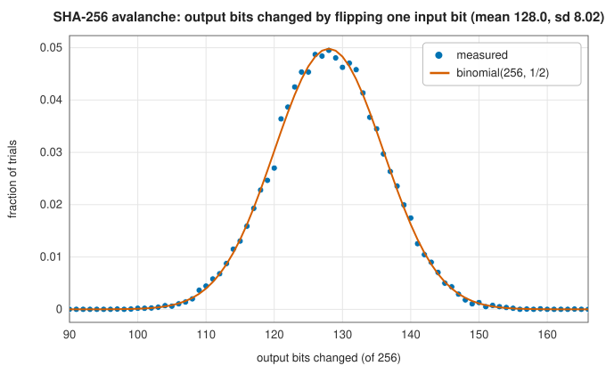

# Checksums and hashes: CRC-32 and SHA-256

<div class="entry-summary">

| | |
|---|---|
| **Problem** | Detect accidental corruption of data cheaply (a checksum), or fingerprint data so that no one can find two inputs with the same fingerprint (a cryptographic hash) |
| **Devised by** | W. Wesley Peterson (1961), cyclic redundancy checks; the IEEE 802.3 committee (1975–83), the CRC-32 polynomial; Guy Castagnoli and colleagues (1993), CRC-32C; the US National Security Agency (2001), SHA-256 |
| **Accuracy** | Exact: equal to Python's `zlib.crc32` and `hashlib.sha256` on every test input, including the FIPS long vector (table below) |
| **Cost** | CRC: one table lookup per byte (about 330 MB/s here); SHA-256: 64 rounds per 64-byte block (about 80–100 MB/s) |
| **API** | [`crc32`](../../api/lib_jsl_information/operators/crc32/fn.crc32.html), [`crc32c`](../../api/lib_jsl_information/operators/crc32/fn.crc32c.html), [`Crc32`](../../api/lib_jsl_information/operators/crc32/struct.Crc32.html) (`new`, `castagnoli`, `update`, `finalize`), [`sha256`](../../api/lib_jsl_information/operators/sha256/fn.sha256.html), [`Sha256`](../../api/lib_jsl_information/operators/sha256/struct.Sha256.html) (`new`, `update`, `finalize`), [`to_hex`](../../api/lib_jsl_information/operators/sha256/fn.to_hex.html) |

</div>

## Overview

A **cyclic redundancy check** (CRC) treats a message as a polynomial over GF(2) and appends the remainder of its division by a fixed generator polynomial. Bit errors that do not leave the message divisible are detected, and the generator is chosen so that the common ones (single bits, pairs, short bursts) never do. CRCs are linear and cheap,
but easy to forge. A **cryptographic hash** such as **SHA-256** maps any input to 256 bits so that no feasible computation can find an input with a given digest, or two inputs with the same one. It is used for signatures, content addressing and integrity against deliberate tampering.

## History

W. Wesley Peterson (1961) proposed cyclic codes for error detection and showed how a shift register computes the remainder. The 32-bit polynomial 0x04C11DB7 was chosen for Ethernet in the 1970s, following work by Joseph Hammond and colleagues, and went on to zip, gzip and PNG. Guy Castagnoli, Stefan Bräuer and Martin
Herrmann (1993) searched for 32-bit polynomials with better distance properties; their CRC-32C is used in iSCSI, SCTP and ext4, and has its own x86 instruction. SHA-256 was designed by the NSA and published by NIST in 2001 (FIPS 180-2) after weaknesses were found in MD5 and SHA-1. It is a Merkle-Damgård construction around a block cipher-like compression function and remains unbroken.

## The idea

### CRC: division over GF(2)

Read the message's bits as the coefficients of $M(x)$. With a generator $G(x)$ of degree 32, the CRC is the remainder $R(x) = x^{32}M(x) \bmod G(x)$, and the transmitted word $x^{32}M(x) + R(x)$ is a multiple of $G$. An error pattern $E(x)$ goes undetected only if $G$ divides $E$. So all single-bit errors are caught when $G$ has more than one term, and
all bursts of length 32 or less when $G$ has a nonzero constant term. Random corruption escapes with probability $2^{-32}$. For CRC-32, all two- and three-bit errors are caught in messages up to about 11 kB.

{{#include ../generated/information/crc_detection.md}}

In practice the CRC is computed a byte at a time with a 256-entry table of remainders, in **reflected** bit order (least significant bit first, matching serial transmission). The register starts at all ones, so leading zero bytes are not invisible, and the result is inverted. The table for 0xEDB88320, the bit reversal of 0x04C11DB7, gives the standard CRC-32. {{#include ../generated/information/crc32c_facts.md}}

### SHA-256

The message is padded with a 1 bit, zeros and its 64-bit length to a multiple of 512 bits. The 256-bit state, initially fixed constants, is updated by each 512-bit block. The block is expanded into 64 words with rotations and shifts. Then 64 rounds mix them into eight working variables, using the nonlinear choice and majority functions
$\mathrm{Ch}(e, f, g) = (e \wedge f) \oplus (\neg e \wedge g)$ and $\mathrm{Maj}(a, b, c)$, rotations, and 64 round constants from the cube roots of the first 64 primes. The result is added to the state. The final state is the digest.

A good hash shows the **avalanche** effect: changing one input bit changes each output bit with probability 1/2, independently:



{{#include ../generated/information/checksum_reference.md}}

{{#include ../generated/information/throughput_facts.md}}

## Algorithm

1. **CRC**: state = 0xFFFFFFFF; for each byte, state = table[(state ⊕ byte) & 0xFF] ⊕ (state ≫ 8); output ¬state.
2. **SHA-256**: buffer input into 64-byte blocks and compress each; to finish, append the padding and length and compress the last one or two blocks; output the state big-endian.

## Implementation

```rust,ignore
{{#include ../../../crates/information/src/operators/crc32.rs:crc_update}}
```

```rust,ignore
{{#include ../../../crates/information/src/operators/sha256.rs:sha256_rounds}}
```

- Both `Crc32` and `Sha256` can be fed in pieces, and `finalize` leaves them usable, so a running checksum can be read at any point.
- The CRC tables are built once per polynomial, on first use.

## In practice

```rust,ignore
{{#include ../../../crates/information/examples/information_checksums.rs}}
```

```text
CRC-32  414fa339
CRC-32C 22620404
SHA-256 d7a8fbb307d7809469ca9abcb0082e4f8d5651e46d3cdb762d02d0bf37c9e592
streamed: 414fa339 d7a8fbb307d78094
"dog" -> "cog": CRC-32 4400b5bc, 123 of 256 digest bits changed
```

**Strengths**

- CRCs: fast, with guaranteed detection of the common error patterns; SHA-256: collision resistance with no known practical attack.
- Streaming interfaces; results identical to the standard implementations.

**Weaknesses**

- A CRC protects only against accidents: it is linear, so anyone can alter data and fix the CRC.
- These are portable software implementations, slower than the hardware CRC and SHA instructions of modern processors.

## Exercises

1. Show that a CRC with a generator divisible by $x + 1$ detects every error with an odd number of flipped bits.
2. Show that every burst of length at most $\deg G$ is detected if $G$ has a nonzero constant term.
3. Show that $\mathrm{CRC}(a \oplus b) = \mathrm{CRC}(a) \oplus \mathrm{CRC}(b) \oplus \mathrm{CRC}(0)$ for equal-length messages, and explain why this makes CRCs forgeable.
4. Estimate, by the birthday bound, how many random messages must be hashed before two share a 32-bit CRC, and two a SHA-256 digest.
5. Verify the padding rule: how many blocks does SHA-256 compress for messages of 55, 56 and 64 bytes?

## Further reading

- W. W. Peterson and D. T. Brown, "Cyclic codes for error detection", *Proceedings of the IRE* 49 (1961) 228–235.
- G. Castagnoli, S. Bräuer and M. Herrmann, "Optimization of cyclic redundancy-check codes with 24 and 32 parity bits", *IEEE Transactions on Communications* 41 (1993) 883–892.
- National Institute of Standards and Technology, *Secure Hash Standard (SHS)*, FIPS PUB 180-4, 2015.
- P. Koopman, "32-bit cyclic redundancy codes for Internet applications", *Proceedings of the International Conference on Dependable Systems and Networks* (2002) 459–468.
