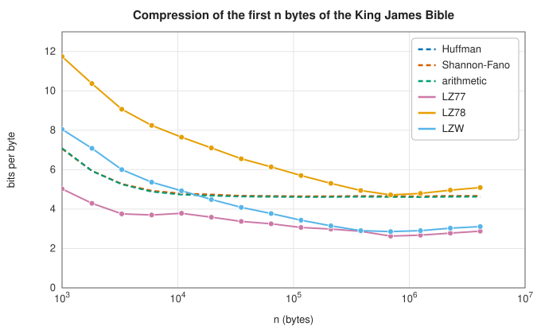

# Dictionary coding: LZ77, LZ78 and LZW

<div class="entry-summary">

| | |
|---|---|
| **Problem** | Compress data by replacing repeated strings with references to earlier occurrences or to a growing dictionary of phrases, without knowing the source's statistics in advance |
| **Devised by** | Abraham Lempel and Jacob Ziv (1977, 1978), LZ77 and LZ78; Terry Welch (1984), LZW |
| **Accuracy** | Lossless; on long inputs from a stationary ergodic source the compression rate approaches the entropy rate (universality). On the 4.6 MB test text: 2.9 bits per byte for LZ77, 3.1 for LZW |
| **Cost** | LZ77 encoding $O(n\,c\,m)$ for $c$ candidates of length up to $m$; LZ78 and LZW $O(n)$ hash lookups; decoding $O(n)$ for all |
| **Read first** | [Entropy coding: Huffman, Shannon-Fano and arithmetic coding](entropy-coding.md) |
| **API** | [`lz77_compress`](../../api/lib_jsl_information/source_coders/lz77/fn.lz77_compress.html), [`try_lz77_decompress`](../../api/lib_jsl_information/source_coders/lz77/fn.try_lz77_decompress.html), [`lz78_compress`](../../api/lib_jsl_information/source_coders/lz78/fn.lz78_compress.html), [`try_lz78_decompress`](../../api/lib_jsl_information/source_coders/lz78/fn.try_lz78_decompress.html), [`lzw_compress`](../../api/lib_jsl_information/source_coders/lzw/fn.lzw_compress.html), [`try_lzw_decompress`](../../api/lib_jsl_information/source_coders/lzw/fn.try_lzw_decompress.html), and the [`SourceCoder`](../../api/lib_jsl_information/source_coders/source_coder/trait.SourceCoder.html) wrappers |

</div>

## Overview

Text, code and most files repeat themselves: words, phrases, whole lines. **Dictionary coders** replace a repeated string with a short reference. **LZ77** points back into a sliding window of recent output: "copy 12 bytes from 340 bytes ago". **LZ78** builds an explicit dictionary of phrases,
each an earlier phrase plus one new byte, and emits phrase numbers. **LZW** drops the explicit byte by starting from a dictionary of all single bytes. None of them needs a model of the source, yet on long inputs they approach the best compression any method can achieve: they are **universal**.

## History

Abraham Lempel and Jacob Ziv at the Technion published the sliding-window method in 1977 and the dictionary method in 1978. They proved both asymptotically optimal for stationary ergodic sources. Terry Welch at Sperry (1984) simplified LZ78 for hardware disk controllers into LZW. It became the compressor of Unix `compress`,
GIF and early modems, and its patent caused the "GIF controversy" of the 1990s. LZ77 with Huffman coding of the tokens, as in Phil Katz's DEFLATE (1993), became zip, gzip and PNG. Modern descendants (LZMA, Zstandard, Brotli) still begin with an LZ77 stage.

## The idea

### LZ77: a sliding window

Entropy coders exploit the unequal frequencies of single symbols. Dictionary coders exploit
*repetition*: real data contain strings that have occurred before, and a repeated string can be
replaced by a short reference to its earlier occurrence. The three methods differ in what counts
as "the dictionary". In LZ77 it is simply the most recent stretch of the data itself, the
**window**.

At each position, find the longest earlier string, within the window, that matches the bytes ahead. If it is long enough, emit a **back-reference** (offset, length) and skip ahead. Otherwise emit the byte as a **literal**. The decoder needs no dictionary of its own: a back-reference points into the output it has
already produced, and it simply copies from there. A match may even overlap the bytes being
produced, because the copy proceeds byte by byte: offset 1 with length 100 repeats the previous
byte 100 times.

The library's format groups literals into runs of up to 128 behind a control byte. A back-reference takes 3 bytes: a control byte holding the length (3 to 130) and a 16-bit offset (up to 65 535). To find matches it indexes every position by its first three bytes and tries the 256 most recent positions with the same prefix.

### LZ78: an explicit dictionary

Read the longest phrase already in the dictionary, then the next byte. Emit (the phrase's index, the byte), and add the phrase plus the byte as a new entry. The dictionary grows by one phrase per token, and phrases grow by one byte at a time, so long repeats are learnt slowly. The library emits a 16-bit index, a flag byte and the byte,
4 bytes per token. When all 65 535 indices are used, the dictionary stops growing.

### LZW: no explicit byte

LZW removes the explicit byte from each LZ78 token, so that the output consists of dictionary
codes alone. Start with the 256 single bytes already in the dictionary. Read the longest known
phrase $w$ and emit its code. The next byte $k$ is not emitted; it begins the next phrase. The
string $wk$ is added to the dictionary.

For the input `ABABABA`, with A and B known at the start:

| phrase read | code emitted | entry added |
|---|---|---|
| A | A | AB |
| B | B | BA |
| AB | [AB] | ABA |
| ABA | [ABA] | |

Seven bytes become four codes. The decoder rebuilds the same dictionary one step behind the
encoder: it learns the byte $k$ that completes each entry only when it decodes the *next* phrase,
of which $k$ is the first byte. That leads to one awkward case, visible in the last row: the
code [ABA] refers to an entry the decoder has not yet completed. It can only arise when the new
phrase is the previous phrase $w$ followed by the first byte of $w$ itself, so the decoder can
reconstruct it.
The library uses fixed 16-bit codes and freezes the dictionary when full. Unix `compress` instead grew the code width from 9 bits and reset a full dictionary.

### Universality and its pace



<p class="caption" id="fig-18-3"><strong>Figure 18.3.</strong> Dictionary coder growth.</p>

The entropy coders (dashed) settle at the byte entropy within a few kilobytes. The dictionary coders keep improving as they learn longer phrases. LZ77 is best throughout, since its window holds every recent string. LZ78 and LZW improve until their dictionaries fill, after about 65 000 phrases, and then slowly
lose ground as the text drifts away from what they learnt. The asymptotic optimality of LZ78 needs an unbounded dictionary.

<p class="caption" id="tab-18-5"><strong>Table 18.5.</strong> Compression of different kinds of data by each coder.</p>

{{#include ../generated/information/data_kinds_table.md}}

On random bytes nothing compresses, and the token overhead expands the data: LZ78's 4 bytes per 2–3-byte phrase most of all. For four random letters, an entropy coder's 2 bits is optimal, and the dictionary coders cannot reach it alone. That is why practical compressors entropy-code the dictionary coder's output.
A repeated block is ideal for LZ77, whose window holds it whole.

## Algorithm

**LZ77 encoding.** A table maps each three-byte sequence to the positions where it has
occurred. At the current position:

1. look up the next three bytes in the table;
2. compare the text ahead with the text at each of the most recent candidate positions (up to
   256 of them) that lie within the window, and note the longest match;
3. if the longest match has three bytes or more, emit a back-reference (offset, length) and
   move past the matched bytes; otherwise emit the current byte as a literal and move one byte
   on;
4. add every position passed to the table.

**LZ77 decoding**: for a literal run, copy the bytes to the output; for a back-reference, copy
`length` bytes one at a time from `offset` bytes back in the output.

**LZ78 encoding.** The dictionary maps phrases to indices; index 0 is the empty phrase.

1. Start with the empty phrase.
2. Read a byte. If the current phrase extended by that byte is in the dictionary, make it the
   current phrase and repeat this step.
3. Otherwise emit the pair (index of the current phrase, the byte), add the extended phrase to
   the dictionary with the next free index, and go to 1.

**LZW encoding.** The dictionary starts with the 256 single bytes.

1. Start with the first input byte as the current phrase.
2. Read a byte. If the current phrase extended by that byte is in the dictionary, make it the
   current phrase and repeat this step.
3. Otherwise emit the index of the current phrase, add the extended phrase to the dictionary,
   and make the byte just read the new current phrase. Go to 2.

**LZW decoding**: for each code, output its phrase, and add to the dictionary the previous
phrase followed by the first byte of this one. If the code is the very entry about to be
added, its phrase is the previous phrase followed by its own first byte.

Each encoder makes one pass over the input, with about constant work per byte for the
dictionary lookups.

## Implementation

```rust,ignore
{{#include ../../../crates/information/src/source_coders/lz77.rs:lz77}}
```

```rust,ignore
{{#include ../../../crates/information/src/source_coders/lzw.rs:lzw}}
```

- The decoders check every reference against what has been reconstructed and return an error for malformed streams.
- Dictionaries are `HashMap<Vec<u8>, u16>`. That is simple but memory-hungry; production LZW uses a trie of (code, byte) pairs.

## In practice

The [entropy coding example](entropy-coding.md#in-practice) runs all six coders through the `SourceCoder` trait. On its eight repetitions of one paragraph, LZ77 needs 0.77 bits per byte and LZW 4.28: LZW learns the paragraph's phrases only a byte at a time.

**Strengths**

- No model needed; adapts to any data; decoding is very fast (LZ77 decodes at about 170 MB/s here).
- Universal: asymptotically optimal for stationary sources.

**Weaknesses**

- Slow convergence; on short or random data the token overhead dominates.
- Without an entropy-coding stage, the tokens themselves are poorly packed; LZ77 encoding is slow when it searches thoroughly.

## Exercises

1. Encode "abababababab" with LZ77 by hand, and show how an overlapping match repeats the pattern.
2. Encode "TOBEORNOTTOBEORTOBEORNOT" with LZW, and decode the result, including the special case.
3. Show that LZ78 parses a string into distinct phrases, and bound the number of phrases in a string of length $n$.
4. Why does LZ78 do worse than LZW on text, although LZW also emits one code per phrase?
5. Add Huffman coding of the LZ77 tokens and measure the improvement on the test text.

<details>
<summary>Hints and answers</summary>

1. For "abababababab", after emitting literals $a$ and $b$ the next token can be (distance 2, length 10): the match source overlaps the output being written and repeats the 2-character pattern.
2. LZW with $A = 1, \ldots, Z = 26$ produces $20, 15, 2, 5, 15, 18, 14, 15, 20, 27, 29, 31, 36, 30, 32, 34$. The special case in decoding is a code that has not been defined yet: it must be the previous phrase plus its own first character.
3. Each LZ78 phrase is a previously seen phrase plus one new character, so all phrases are distinct; there are at most $O(n/\log n)$ of them in a string of length $n$ (since distinct phrases of length at most $\ell$ number at most $|\Sigma|^{\ell + 1}$).
4. LZ78 emits an (index, character) pair for every phrase, so each phrase carries an extra literal character. LZW emits only an index, because the character that ends one phrase is also the first character of the next, and its dictionary is pre-loaded with every single character.
5. Compare the compressed size of the token stream (literal bytes, lengths, distances) with and without entropy coding; typically it drops by 20 to 30% on text.

</details>

## Further reading

- J. Ziv and A. Lempel, "A universal algorithm for sequential data compression", *IEEE Transactions on Information Theory* 23 (1977) 337–343.
- J. Ziv and A. Lempel, "Compression of individual sequences via variable-rate coding", *IEEE Transactions on Information Theory* 24 (1978) 530–536.
- T. A. Welch, "A technique for high-performance data compression", *Computer* 17:6 (1984) 8–19.
- K. Sayood, *Introduction to Data Compression*, 5th ed., Morgan Kaufmann, 2017, chapter 5.
