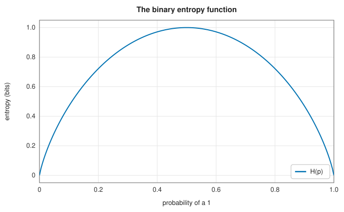
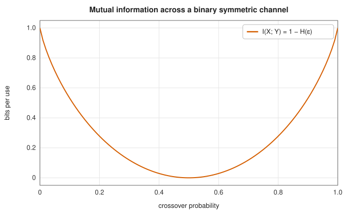

# Entropy, divergence and mutual information

<div class="entry-summary">

| | |
|---|---|
| **Problem** | Measure how much information a source produces, how far one distribution is from another, and how much one variable reveals about another |
| **Devised by** | Claude Shannon (1948), entropy and mutual information; Solomon Kullback and Richard Leibler (1951), the divergence; Frank Gray (1947, patented 1953), the reflected binary code |
| **Accuracy** | Exact sums; the library agrees with SciPy's `stats.entropy` to the 12 digits shown (table below) |
| **Cost** | $O(n)$ for $n$ bytes or probabilities; $O(rc)$ for an $r \times c$ joint table |
| **API** | [`entropy`](../../api/lib_jsl_information/operators/entropy/fn.entropy.html), [`entropy_from_probabilities`](../../api/lib_jsl_information/operators/entropy/fn.entropy_from_probabilities.html), [`cross_entropy`](../../api/lib_jsl_information/operators/entropy/fn.cross_entropy.html), [`kl_divergence`](../../api/lib_jsl_information/operators/entropy/fn.kl_divergence.html), [`mutual_information`](../../api/lib_jsl_information/operators/entropy/fn.mutual_information.html), [`gray_code`](../../api/lib_jsl_information/source_coders/gray_codes/fn.gray_code.html), [`gray_decode`](../../api/lib_jsl_information/source_coders/gray_codes/fn.gray_decode.html), [`gray_code_sequence`](../../api/lib_jsl_information/source_coders/gray_codes/fn.gray_code_sequence.html) |

</div>

## Overview

How much information does a message carry? Shannon's answer is the **entropy**: the average number of bits needed to describe the outcome of a random source, if the description is as efficient as possible. It
sets the limit for lossless compression, which the [next entries](entropy-coding.md) approach. The **cross entropy** and the **Kullback-Leibler divergence** measure the cost of coding with the wrong distribution, and the **mutual
information** measures how much one variable tells about another. Mutual information sets the capacity of a noisy channel, which the error-correcting codes of the next chapter approach. This entry also covers **Gray codes**, which order binary numbers so that neighbours differ in one bit.

## History

Claude Shannon's "A mathematical theory of communication" (1948) founded information theory. It defined entropy, showed that it is the limit of lossless compression (the **source coding theorem**), defined mutual information and channel capacity, and showed that
reliable communication is possible at any rate below capacity (the **channel coding theorem**). Ralph Hartley (1928) had measured information by the logarithm of the number of possible messages, and the name "entropy" came at John von Neumann's suggestion, from statistical mechanics. Solomon
Kullback and Richard Leibler (1951) introduced the divergence for statistical discrimination. Frank Gray at Bell Labs filed his patent on the reflected binary code in 1947, for pulse-code modulation. The same code is the solution of the Chinese rings puzzle, known for centuries.

## The idea

### Entropy

A source emitting symbol $x$ with probability $p(x)$ has entropy

$$
H(X) = -\sum_x p(x)\log_2 p(x) \quad\text{bits},
$$

with $0\log 0 = 0$. A symbol of probability $p$ carries $-\log_2 p$ bits of **surprise**, and the entropy is the average surprise. It ranges from 0, for a certain outcome, to $\log_2 n$ for $n$ equally likely outcomes. A fair coin has 1 bit and a byte of random data 8. [`entropy`](../../api/lib_jsl_information/operators/entropy/fn.entropy.html) computes it
for the empirical distribution of the bytes of a slice; [`entropy_from_probabilities`](../../api/lib_jsl_information/operators/entropy/fn.entropy_from_probabilities.html) for a given distribution.



The **source coding theorem** says that no lossless code can use fewer than $H$ bits per symbol on average, and that codes exist using fewer than $H + 1$ (for single symbols) or $H + \epsilon$ (for long blocks).
The byte entropy only describes symbols taken one at a time. Real data has structure between symbols, and the entropy of blocks, per symbol, falls as the blocks lengthen:

{{#include ../generated/information/entropy_table.md}}

The entropy rate of English is thought to be about 1–1.5 bits per character. Dictionary coders exploit this structure; order-0 entropy coders cannot.

### Cross entropy and divergence

Coding a source with distribution $p$ using a code designed for $q$ costs, on average, the **cross entropy**

$$
H(p, q) = -\sum_x p(x)\log_2 q(x) = H(p) + D(p\,\Vert\,q),
$$

where the **Kullback-Leibler divergence** $D(p\,\Vert\,q) = \sum_x p(x)\log_2\big(p(x)/q(x)\big)$ is the extra cost. It is never negative, it is zero only when $q = p$ (Gibbs' inequality), and it is not symmetric. The cross entropy is infinite if $q$ gives zero probability to a symbol that occurs.
In machine learning, minimising cross entropy is the same as maximising likelihood.

{{#include ../generated/information/entropy_reference.md}}

### Mutual information

For a pair of variables with joint distribution $p(x, y)$,

$$
I(X; Y) = \sum_{x,y} p(x, y)\log_2\frac{p(x, y)}{p(x)\,p(y)} = H(X) - H(X \mid Y),
$$

the reduction in uncertainty about $X$ from knowing $Y$. It is the divergence of the joint distribution from the product of its marginals, so it is zero exactly when the variables are independent. [`mutual_information`](../../api/lib_jsl_information/operators/entropy/fn.mutual_information.html) takes the joint distribution as a
row-major table. A binary symmetric channel, which flips each bit with probability $\varepsilon$, carries $1 - H(\varepsilon)$ bits per use for a uniform input. That is its capacity:



### Gray codes

In ordinary binary, 3 → 4 changes three bits (011 → 100). A sensor reading the bits of a rotating disc at the moment of that change can briefly report anything from 000 to 111. The **reflected binary code** $g = n \oplus (n \gg 1)$ changes exactly
one bit between consecutive values, so a misread is off by at most one step. {{#include ../generated/information/gray_facts.md}} Decoding XORs together all the right shifts of $g$, which [`gray_decode`](../../api/lib_jsl_information/source_coders/gray_codes/fn.gray_decode.html) does in six doubling steps. Gray codes also label
[constellation points](../comms/modulation.md#constellations-and-gray-labelling) so that the likeliest symbol error flips a single bit.

## Algorithm

1. **Byte entropy**: count the 256 byte values; sum $p\log_2(1/p)$ over those present.
2. **Divergence**: cross entropy minus entropy.
3. **Mutual information**: marginals by summing rows and columns; sum $p\log_2\big(p/(p_rp_c)\big)$ over nonzero cells.
4. **Gray**: encode $n \oplus (n \gg 1)$; decode $n \mathrel{\oplus}= n \gg 1, 2, 4, \ldots, 32$.

## Implementation

```rust,ignore
{{#include ../../../crates/information/src/operators/entropy.rs:entropy}}
```

```rust,ignore
{{#include ../../../crates/information/src/source_coders/gray_codes.rs:gray}}
```

- All measures are in bits (base-2 logarithms).
- The distribution functions return `NaN` for negative or non-finite entries and for mismatched lengths, and do not check that probabilities sum to one.

## In practice

```rust,ignore
{{#include ../../../crates/information/examples/information_entropy.rs}}
```

```text
entropy of "aaaa": 0 bits per byte
entropy of "abab": 1 bits per byte
entropy of "abcd": 2 bits per byte
entropy of a fair die: 2.5850 bits (log2 6 = 2.5850)
H(p) = 1.5, cross entropy H(p, q) = 1.5850, D(p||q) = 0.0850
I(X; Y) = 0.5310 bits = 1 - H(0.1) = 0.5310
3-bit Gray code: 000 001 011 010 110 111 101 100
gray_decode(0b110) = 4
```

**Strengths**

- Exact, simple and fast; the measures that bound compression and communication.

**Weaknesses**

- Byte entropy is order-0: it ignores all dependence between symbols, so it is not a compression limit for real data.
- Plug-in estimates from samples are biased low when the alphabet is large compared with the sample.

## Exercises

1. Show that $H(X) \le \log_2 n$ for $n$ outcomes, with equality only for the uniform distribution.
2. Prove Gibbs' inequality $D(p\,\Vert\,q) \ge 0$ from $\ln x \le x - 1$.
3. Show that $I(X; Y) = H(X) + H(Y) - H(X, Y)$, and that it is symmetric.
4. Compute the capacity of the binary erasure channel, which loses each bit with probability $\varepsilon$.
5. Prove that consecutive Gray codes differ in exactly one bit, and that `gray_decode` inverts `gray_code`.

## Further reading

- C. E. Shannon, "A mathematical theory of communication", *Bell System Technical Journal* 27 (1948) 379–423 and 623–656.
- T. M. Cover and J. A. Thomas, *Elements of Information Theory*, 2nd ed., Wiley, 2006, chapters 2 and 5.
- S. Kullback and R. A. Leibler, "On information and sufficiency", *Annals of Mathematical Statistics* 22 (1951) 79–86.
- F. Gray, "Pulse code communication", US patent 2 632 058, 1953.
