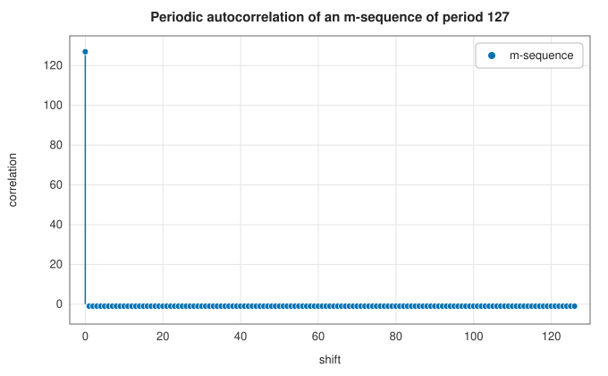

# Linear feedback shift registers, m-sequences and Gold codes

<div class="entry-summary">

| | |
|---|---|
| **Problem** | Generate long, noise-like binary sequences with a few gates: for scramblers, test patterns, spread-spectrum codes and sequences with sharp autocorrelation and low cross-correlation |
| **Devised by** | Solomon Golomb (1955–67), the theory of shift-register sequences; Robert Gold (1967), families of codes with bounded cross-correlation |
| **Accuracy** | Exact: periods, primitivity and correlation values match the theory (tables below) |
| **Cost** | One parity and one shift per output bit; the primitivity test needs $O(n^2\log 2^n)$ bit operations plus factoring $2^n - 1$ |
| **API** | [`Lfsr`](../../api/lib_jsl_information/lfsr/linear_feedback_shift_register/struct.Lfsr.html) (`new`, `from_polynomial`, `step`, `bits`, `period`), [`is_primitive_polynomial`](../../api/lib_jsl_information/lfsr/maximum_length_polynomials/fn.is_primitive_polynomial.html), [`maximum_length_polynomial`](../../api/lib_jsl_information/lfsr/maximum_length_polynomials/fn.maximum_length_polynomial.html), [`maximum_length_polynomials`](../../api/lib_jsl_information/lfsr/maximum_length_polynomials/fn.maximum_length_polynomials.html), [`all_maximum_length_polynomials`](../../api/lib_jsl_information/lfsr/maximum_length_polynomials/fn.all_maximum_length_polynomials.html), [`gold_codes`](../../api/lib_jsl_information/lfsr/gold_codes/fn.gold_codes.html), [`gold_correlation_bound`](../../api/lib_jsl_information/lfsr/gold_codes/fn.gold_correlation_bound.html) |

</div>

## Overview

A **linear feedback shift register** (LFSR) holds $n$ bits. At each step it outputs one bit, shifts, and feeds in the XOR of a fixed set of its bits, the **taps**. Its output obeys a linear recurrence over GF(2), so its behaviour is governed by a polynomial.
When the polynomial is **primitive**, the register runs through all $2^n - 1$ nonzero states before repeating. Its output is then a **maximum-length sequence** (m-sequence), which is balanced and looks random in many statistical senses. Its autocorrelation is nearly an impulse. Two m-sequences
chosen as a **preferred pair** generate a **Gold family** of $2^n + 1$ sequences whose cross-correlations are all small, so many users can share a channel.

## History

Shift-register sequences were studied in the 1950s for radar, missile guidance and cryptography. Solomon Golomb, at the Jet Propulsion Laboratory, developed their theory and published it as *Shift Register Sequences* (1967). His randomness postulates describe the balance, runs and correlation of m-sequences. JPL used them to range
spacecraft, and LFSR scramblers and test patterns (PRBS) appear in nearly every serial link standard. Robert Gold (1967) found the preferred pairs and the families named after him, and Tadao Kasami found related sets. Gold codes became the spreading codes of GPS (the C/A code, from two 10-stage registers) and of W-CDMA.

## The idea

### The recurrence and its polynomial

The library's register holds bits $s_t, \ldots, s_{t+n-1}$, with the oldest in bit 0. It outputs $s_t$ and shifts in

$$
s_{t+n} = \sum_{k=0}^{n-1} c_k\,s_{t+k} \pmod 2,
$$

the parity of the state ANDed with the tap mask $c$. The **characteristic polynomial** is $p(x) = x^n + \sum_k c_kx^k$. [`Lfsr::from_polynomial`](../../api/lib_jsl_information/lfsr/linear_feedback_shift_register/struct.Lfsr.html#method.from_polynomial) takes it as a bit mask, so `0b1011` is $x^3 + x + 1$. The all-zero state is a fixed point. From any other state, the period is the
**order** of $x$ modulo $p(x)$: the smallest $T$ with $x^T \equiv 1$. The order is at most $2^n - 1$, and reaches it exactly when $p$ is primitive.

### Testing primitivity

$p$ of degree $n$ is primitive if $x^{2^n - 1} \equiv 1 \pmod p$ and $x^{(2^n - 1)/q} \not\equiv 1$ for every prime $q$ dividing $2^n - 1$. Then the order is exactly $2^n - 1$, and $p$ is irreducible because its quotient ring has $2^n - 1$ units and so is a field. [`is_primitive_polynomial`](../../api/lib_jsl_information/lfsr/maximum_length_polynomials/fn.is_primitive_polynomial.html) computes the powers by square-and-multiply with carry-less arithmetic. It factors $2^n - 1$ by trial division, which limits it to degree 40.
There are $\varphi(2^n - 1)/n$ primitive polynomials of degree $n$. [`maximum_length_polynomial`](../../api/lib_jsl_information/lfsr/maximum_length_polynomials/fn.maximum_length_polynomial.html) returns one of minimal weight (fewest taps, the cheapest hardware), the numerically smallest among them:

{{#include ../generated/information/primitive_table.md}}

The counts found by [`all_maximum_length_polynomials`](../../api/lib_jsl_information/lfsr/maximum_length_polynomials/fn.all_maximum_length_polynomials.html) agree with the formula.

### Properties of m-sequences

An m-sequence of period $N = 2^n - 1$ has $2^{n-1}$ ones and $2^{n-1} - 1$ zeros. Every nonzero $n$-bit window appears exactly once per period. In ±1 form its periodic autocorrelation is $N$ at zero shift and $-1$ at every other shift:



That makes them ideal for ranging and channel sounding: a correlator finds the delay unambiguously.

### Gold codes

Two m-sequences of the same length can still cross-correlate strongly. Gold showed that if $v$ is the decimation $v_t = u_{qt}$ with $q = 2^k + 1$, where $\gcd(n, k) = 1$ for odd $n$ or $\gcd(n, k) = 2$ for $n \equiv 2 \pmod 4$, then $u$ and $v$ are a preferred pair. Their cross-correlation takes only the three values $-1$, $-t(n)$ and $t(n) - 2$, with
$t(n) = 1 + 2^{\lfloor (n+2)/2\rfloor}$. The family $\{u, v, u \oplus T^\tau v\}$ of all shifts $\tau$ keeps the same three values between any two members. [`gold_codes`](../../api/lib_jsl_information/lfsr/gold_codes/fn.gold_codes.html) uses $k = 1$ ($q = 3$) for odd $n$ and $k = 2$ ($q = 5$) for $n \equiv 2 \pmod 4$. No family exists when $4 \mid n$.

{{#include ../generated/information/gold_facts.md}}

## Algorithm

1. **Step**: output bit 0; feedback = parity(state AND taps); shift right; put the feedback in bit $n - 1$.
2. **Primitivity**: check $x^{2^n-1} = 1$ and $x^{(2^n-1)/q} \ne 1$ for each prime factor $q$.
3. **Gold family**: generate one period of $u$ from the minimal-weight primitive polynomial; decimate it by $q$ to get $v$; XOR $u$ with every cyclic shift of $v$.

## Implementation

```rust,ignore
{{#include ../../../crates/information/src/lfsr/linear_feedback_shift_register.rs:lfsr_step}}
```

```rust,ignore
{{#include ../../../crates/information/src/lfsr/maximum_length_polynomials.rs:primitive}}
```

```rust,ignore
{{#include ../../../crates/information/src/lfsr/gold_codes.rs:gold}}
```

- `Lfsr` is an `Iterator` over its output bits, up to 64 stages wide.
- Gold codes are returned as 0/1 bits; map them to chips with $1 - 2b$.
- The table of minimal-weight polynomials (degrees 2–32) is computed once, on first use.

## In practice

```rust,ignore
{{#include ../../../crates/information/examples/information_lfsr.rs}}
```

```text
x^4 + x + 1: period Some(15), bits [1, 0, 0, 0, 1, 0, 0, 1, 1, 0, 1, 0, 1, 1, 1]
x^4 + x^3 + x^2 + x + 1: primitive false, period Some(5)
degree-16 maximum-length polynomial: 0x1002d
33 Gold codes of length 31; cross-correlation values [-9, -1, 7] (bound t(5) = 9)
```

The second polynomial divides $x^5 - 1$, so although it is irreducible its period is only 5.

**Strengths**

- Very cheap generators with exactly known period and correlation; Gold families give many nearly orthogonal codes.

**Weaknesses**

- Linear, so useless for cryptography on their own: $2n$ output bits reveal the whole register (Berlekamp-Massey).
- Primitivity testing is limited to degree 40 by trial-division factoring.

## Exercises

1. Show that the output of an LFSR from a nonzero state is periodic, and that its period divides the order of $x$ modulo $p$.
2. Prove that an m-sequence has $2^{n-1}$ ones per period.
3. Derive the two-valued autocorrelation from the shift-and-add property: $u \oplus T^\tau u$ is a shift of $u$.
4. Verify $\varphi(2^n - 1)/n$ for $n = 4, 6$ by listing the primitive polynomials.
5. Use the Berlekamp-Massey algorithm to recover the polynomial of the example's register from 8 output bits.

## Further reading

- S. W. Golomb, *Shift Register Sequences*, Holden-Day, 1967; 3rd ed., World Scientific, 2017.
- R. Gold, "Optimal binary sequences for spread spectrum multiplexing", *IEEE Transactions on Information Theory* 13 (1967) 619–621.
- D. V. Sarwate and M. B. Pursley, "Crosscorrelation properties of pseudorandom and related sequences", *Proceedings of the IEEE* 68 (1980) 593–619.
- R. Lidl and H. Niederreiter, *Finite Fields*, 2nd ed., Cambridge University Press, 1997, chapters 3 and 8.
