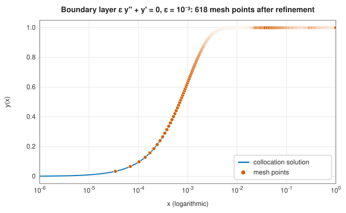
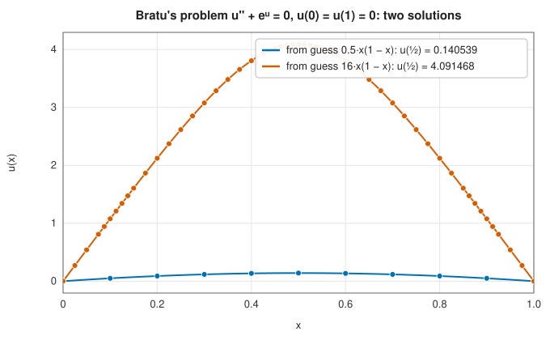

# Boundary value problems

<div class="entry-summary">

| | |
|---|---|
| **Problem** | Solve $\mathbf y' = \mathbf f(x, \mathbf y)$ on $[a, b]$ when the conditions are split between the two ends: $\mathbf g\big(\mathbf y(a), \mathbf y(b)\big) = \mathbf 0$ |
| **Devised by** | Shooting: in use since the early days of ballistics computation, analysed by Keller (1968). Collocation: de Boor and Swartz (1973), Ascher, Christiansen and Russell (COLSYS, 1979); the Hermite-Simpson scheme with residual control: Kierzenka and Shampine (2001) |
| **Accuracy** | Shooting: as accurate as the initial value solver, while the problem is well conditioned. Collocation: fourth order, with the mesh refined until the defect of the solution meets the tolerance |
| **Cost** | Shooting: $n + 1$ initial value solves per Newton iteration. Collocation: one linear system over the whole mesh per Newton iteration |
| **API** | [`solve_bvp_shooting`](../../api/lib_jsl_integration/boundary_value_problems/fn.solve_bvp_shooting.html), [`solve_bvp_collocation`](../../api/lib_jsl_integration/boundary_value_problems/fn.solve_bvp_collocation.html), [`BvpOptions`](../../api/lib_jsl_integration/boundary_value_problems/struct.BvpOptions.html), [`BvpSolution`](../../api/lib_jsl_integration/boundary_value_problems/struct.BvpSolution.html) |

</div>

## Overview

An [initial value problem](runge-kutta.md) gives all the information at one point and marches
forward. Many physical problems are not like that. A cable is fixed at both ends; a beam is clamped
at one end and loaded at the other; the temperature in a rod is held at given values at both ends;
an orbit must return to where it started. These are **boundary value problems** (BVPs): the
differential equation holds on an interval, and the conditions are shared between its two ends.

There are two classical approaches. **Shooting** guesses the missing initial values, integrates
the initial value problem across the interval, sees how far it misses the far boundary condition,
and corrects the guess by Newton's method, like adjusting a cannon until the shell lands on target.
**Collocation** treats the whole solution at once: it represents it by piecewise polynomials on a
mesh, requires the differential equation to hold at chosen points, and solves the resulting large
system of equations, refining the mesh where the approximation is poor. Shooting is simple and very
accurate when it works; collocation is the robust method for difficult problems.

## History

Shooting is as old as numerical ballistics, which is the origin of its name: firing tables were
computed by adjusting the elevation of a gun until the trajectory hit the target. Herbert Keller's
*Numerical Methods for Two-Point Boundary-Value Problems* (1968) analysed shooting, multiple
shooting and finite differences, and showed why shooting fails when the initial value problem is
unstable.

Collocation was developed in the 1970s. Carl de Boor and Blair Swartz (1973) proved that
collocation at Gauss points gives high-order accuracy, and Uri Ascher, J. Christiansen and Robert
Russell turned the theory into COLSYS (1979), with adaptive mesh selection. Jacek Kierzenka and
Lawrence Shampine (2001) designed MATLAB's `bvp4c` around the fourth-order Hermite-Simpson
(Lobatto IIIA) collocation scheme, controlling the **residual** of the continuous solution rather
than an estimate of the error. SciPy's `solve_bvp` and this library follow their approach.

## The idea

### Shooting

Suppose the state $\mathbf y$ has $n$ components. Choose a guess $\mathbf s$ for the unknown initial
state $\mathbf y(a)$, integrate the initial value problem from $a$ to $b$, and evaluate the boundary
residual

$$
\mathbf G(\mathbf s) = \mathbf g\big(\mathbf s, \mathbf y(b; \mathbf s)\big).
$$

The BVP is now a system of $n$ nonlinear equations $\mathbf G(\mathbf s) = \mathbf 0$ in $n$ unknowns. Newton's
method solves it: form the Jacobian $\partial \mathbf G / \partial \mathbf s$ by perturbing each component of $\mathbf s$
and integrating again, solve for a correction, and repeat. The library damps each Newton step,
halving it until the residual decreases, which widens the range of guesses that converge. Each
initial value solve uses the adaptive [Dormand-Prince method](runge-kutta.md) at a tight tolerance.

```rust,ignore
{{#include ../../../crates/integration/src/boundary_value_problems.rs:shooting_newton}}
```

### Why shooting fails

Shooting inherits the conditioning of the initial value problem. Consider $y'' = \lambda^2 y$ with
$y(0) = y(1) = 1$. Its solution $\cosh\big(\lambda(x - \tfrac12)\big)/\cosh(\lambda/2)$ is perfectly tame,
but the initial value problem has solutions growing like $e^{\lambda x}$. A change $\delta$ in the
initial slope changes $y(1)$ by about $\delta\,e^\lambda/\lambda$, so the boundary residual is that much
more sensitive than the solution itself. Once $e^\lambda$ approaches $1/\varepsilon_{\text{mach}} \approx 10^{16}$,
no initial slope in floating point reproduces the boundary condition:

<p class="caption" id="tab-2-16"><strong>Table 2.16.</strong> Shooting against collocation as the problem becomes unstable.</p>

{{#include ../generated/integration/bvp_shooting_vs_collocation.md}}

Shooting converges for small $\lambda$ but fails from $\lambda \approx 25$ on, while collocation, which
never integrates across the whole interval, is unaffected. **Multiple shooting**, which shoots from
several points and matches the pieces, is a classical remedy; collocation is the more general one.

### Hermite-Simpson collocation

On a mesh $a = x_0 < x_1 < \cdots < x_m = b$, collocation seeks the values $\mathbf y_i \approx \mathbf y(x_i)$.
Between two nodes the solution is approximated by the cubic $\mathbf S(x)$ that matches the values
$\mathbf y_i, \mathbf y_{i+1}$ and the slopes $\mathbf f_i = \mathbf f(x_i, \mathbf y_i)$, $\mathbf f_{i+1}$ (Hermite
interpolation). Its value at the midpoint is

$$
\mathbf y_{i+1/2} = \tfrac12(\mathbf y_i + \mathbf y_{i+1}) + \tfrac{h_i}{8}(\mathbf f_i - \mathbf f_{i+1}),
$$

and requiring the differential equation to hold there as well gives, after integrating, the
**Hermite-Simpson** equations

$$
\mathbf y_{i+1} - \mathbf y_i - \frac{h_i}{6}\Big(\mathbf f_i + 4\,\mathbf f\big(x_{i+1/2}, \mathbf y_{i+1/2}\big) + \mathbf f_{i+1}\Big) = \mathbf 0,
$$

one block of $n$ equations per interval: [Simpson's rule](newton-cotes.md#simpsons-rules) applied to
the integral form of the ODE. Together with the $n$ boundary conditions they form
$(m + 1)n$ equations for the $(m + 1)n$ unknowns, which Newton's method solves. The scheme is fourth
order accurate, and the cubic interpolant is a continuous approximate solution between the nodes.

```rust,ignore
{{#include ../../../crates/integration/src/boundary_value_problems.rs:hermite_simpson}}
```

### Residual control and mesh refinement

The cubic $\mathbf S$ satisfies the differential equation exactly at the nodes and midpoints. Elsewhere
its **defect** $\mathbf S'(x) - \mathbf f\big(x, \mathbf S(x)\big)$ measures how well it solves the problem: if the
defect is small, $\mathbf S$ is the exact solution of a nearby problem. The library evaluates the
relative defect at the quarter points of every interval and splits the intervals where it exceeds
the tolerance (into three where it is very large), seeding the new nodes from the interpolant, then
solves again. Nodes therefore accumulate where the solution changes quickly, as in this boundary
layer of width $\varepsilon = 10^{-3}$:



<p class="caption" id="fig-2-23"><strong>Figure 2.23.</strong> Mesh points in a boundary layer.</p>

### Nonlinear problems and non-uniqueness

A nonlinear BVP may have several solutions, or none, and the starting guess decides which one
Newton's method finds. **Bratu's problem** $u'' + e^u = 0$, $u(0) = u(1) = 0$, from the theory of
combustion, has exactly two:



<p class="caption" id="fig-2-24"><strong>Figure 2.24.</strong> The two solutions of Bratu's problem.</p>

Both agree with the closed-form solutions $u(x) = -2\ln\big(\cosh((x - \tfrac12)\theta/2)/\cosh(\theta/4)\big)$,
where $\theta$ is either root of $\theta = \sqrt2\cosh(\theta/4)$, to every digit shown. A small guess
converges to the lower solution and a large one to the upper.

## Algorithm

**Shooting**: from the guess $\mathbf s$, compute $\mathbf G(\mathbf s)$. While $\|\mathbf G\|_\infty$ exceeds the
tolerance: form $\partial\mathbf G/\partial\mathbf s$ by $n$ more initial value solves; solve for the Newton step;
halve it until the residual decreases. Return the trajectory of the last solve.

**Collocation**:

1. On the current mesh, solve the Hermite-Simpson equations and boundary conditions by damped
   Newton, with the Jacobian formed by perturbing one node at a time (each perturbation touches only
   the two neighbouring intervals and, at the ends, the boundary conditions).
2. Compute the relative defect at the quarter points of each interval.
3. If every defect is below the tolerance, stop. Otherwise split the offending intervals and return
   to step 1, unless the mesh would exceed `max_nodes` (then report non-convergence).

## Implementation

- The collocation Jacobian is block bidiagonal plus the boundary rows, but it is assembled and
  factorised as a dense matrix. That is simple and fine for a few hundred nodes; codes for large
  problems (COLSYS, `bvp4c`) exploit the block structure and scale linearly with the mesh.
- [`BvpSolution::evaluate`](../../api/lib_jsl_integration/boundary_value_problems/struct.BvpSolution.html#method.evaluate)
  interpolates the solution anywhere with the same cubic Hermite polynomials, so collocation returns
  a continuous solution with the accuracy of the scheme.
- The shooting tolerance applies to the boundary residual, which is not the same as the error in
  the solution: for an ill-conditioned problem a small residual may still mean a large error.

## In practice

The shape of a hanging cable, the **catenary** $y = \cosh x + 1 - \cosh 1$ between two supports, and
both solutions of Bratu's problem:

```rust,ignore
{{#include ../../../crates/integration/examples/ode_boundary_value.rs}}
```

**Strengths**

- Shooting: very simple, reuses an accurate initial value solver, and needs no mesh.
- Collocation: robust for boundary layers and problems whose initial value problems are unstable;
  returns a continuous solution with a controlled residual.

**Weaknesses**

- Shooting fails when the initial value problem amplifies errors strongly over the interval.
- Both need a reasonable starting guess for nonlinear problems, and different guesses may lead to
  different solutions.
- The dense linear algebra limits the library's collocation solver to moderate mesh sizes.

## Exercises

1. Solve $y'' = -y$, $y(0) = 0$, $y(\pi) = 0$ by shooting. What goes wrong, and why? (This problem has
   infinitely many solutions.)
2. Show that the Hermite cubic through $(x_i, \mathbf y_i, \mathbf f_i)$ and $(x_{i+1}, \mathbf y_{i+1}, \mathbf f_{i+1})$
   has the midpoint value given above.
3. Verify the fourth-order convergence of collocation on Bratu's problem by switching off refinement
   (tolerance infinity) and halving the mesh repeatedly.
4. Bratu's problem $u'' + \lambda e^u = 0$ has two solutions for $\lambda < \lambda^* \approx 3.51$ and none
   above. Trace both branches with collocation as $\lambda$ increases, using each solution as the guess
   for the next $\lambda$ (continuation), and estimate $\lambda^*$.
5. Implement multiple shooting for $y'' = \lambda^2 y$ with $k$ subintervals and show that it succeeds
   for $\lambda = 45$ when $k$ is large enough. How large must $k$ be?

<details>
<summary>Hints and answers</summary>

1. The general solution is $y = A\sin x + B\cos x$; $y(0) = 0$ forces $B = 0$ and then $y(\pi) = 0$ holds for every $A$. The shooting residual $y(\pi; s)$ is identically zero as a function of the slope $s$, so there is nothing to solve for: the Jacobian of the shooting equation is singular.
2. The Hermite cubic at the midpoint is $\tfrac12(\mathbf y_i + \mathbf y_{i+1}) + \tfrac h8(\mathbf f_i - \mathbf f_{i+1})$: evaluate the four Hermite basis functions at $t = \tfrac12$, where $h_{00} = h_{01} = \tfrac12$ and $h_{10} = -h_{11} = \tfrac18$.
3. With refinement off, halve the mesh and tabulate the maximum error; the ratios should approach $2^4 = 16$.
4. Increase $\lambda$ in small steps, starting each solve from the previous solution. The lower branch exists for all $\lambda < \lambda^*$; the upper branch is reached by starting from a large guess. Near $\lambda^*$ the Jacobian becomes singular, so $\lambda$ cannot be used as the continuation parameter through the turning point.
5. The solution grows like $e^{\lambda x}$ across an interval of length 1, so one-interval shooting amplifies errors by $e^{45} \approx 10^{19}$. With $k$ subintervals the amplification per piece is $e^{45/k}$, so $45/k$ must be small enough that this is tolerable; $k$ of the order of 15 to 20 brings the amplification per piece down to about $e^{2}$ to $e^{3}$.

</details>

## Further reading

- H. B. Keller, *Numerical Methods for Two-Point Boundary-Value Problems*, Blaisdell, 1968.
- C. de Boor and B. Swartz, "Collocation at Gaussian points", *SIAM Journal on Numerical Analysis*
  10 (1973) 582–606.
- U. Ascher, J. Christiansen and R. D. Russell, "A collocation solver for mixed order systems of
  boundary value problems", *Mathematics of Computation* 33 (1979) 659–679.
- J. Kierzenka and L. F. Shampine, "A BVP solver based on residual control and the MATLAB PSE",
  *ACM Transactions on Mathematical Software* 27 (2001) 299–316.
- U. M. Ascher, R. M. M. Mattheij and R. D. Russell, *Numerical Solution of Boundary Value Problems
  for Ordinary Differential Equations*, SIAM, 1995.
