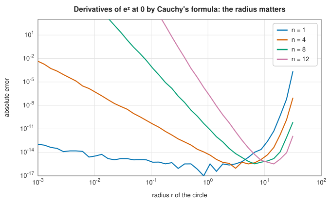
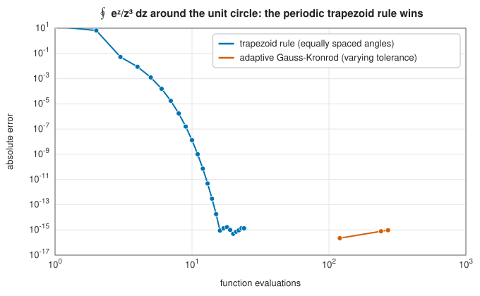

# Complex contour integration

<div class="entry-summary">

| | |
|---|---|
| **Problem** | Compute $\int_\Gamma f(z)\,dz$ along a path $\Gamma$ in the complex plane; residues, derivatives of analytic functions and winding numbers |
| **Devised by** | Augustin-Louis Cauchy (integral theorem 1825, residues 1826, integral formula 1831); numerical differentiation by contour integrals: James Lyness and Cleve Moler (1967) |
| **Accuracy** | Adaptive Gauss-Kronrod to a relative tolerance on each segment; the trapezoid rule on a circle converges exponentially |
| **Cost** | At least 60 evaluations per segment, more where the integrand varies quickly |
| **Read first** | [Newton-Cotes rules: midpoint, trapezoid and Simpson](newton-cotes.md), [Preliminaries: complex numbers](../preliminaries.md#complex-numbers) |
| **API** | [`contour_integral`](../../api/lib_jsl_integration/complex_path_integrals/fn.contour_integral.html), [`Contour`](../../api/lib_jsl_integration/complex_path_integrals/struct.Contour.html), [`PathSegment`](../../api/lib_jsl_integration/complex_path_integrals/enum.PathSegment.html), [`residue`](../../api/lib_jsl_integration/complex_path_integrals/fn.residue.html), [`cauchy_derivative`](../../api/lib_jsl_integration/complex_path_integrals/fn.cauchy_derivative.html), [`winding_number`](../../api/lib_jsl_integration/complex_path_integrals/fn.winding_number.html) |

</div>

## Overview

Integrals of complex functions along curves are the central tool of complex analysis, and they
are surprisingly practical. They turn difficult real integrals into easy ones, compute
derivatives of any order from function values alone, count the zeros of a function inside a
region, and evaluate inverse Laplace transforms and special functions. Numerically, a contour
integral is an ordinary integral in disguise: parametrise the path as $z(t)$ and integrate
$f\big(z(t)\big)\, z'(t)$ over the parameter, using any of the quadrature rules of this chapter.

The library integrates along **contours** built from straight lines, circular arcs and
arbitrary parametrised curves, with an adaptive Gauss-Kronrod rule on each piece. On top of this
are the classical tools: residues, Cauchy's formula for derivatives and the winding number.

## History

Complex integration grew out of attempts to evaluate real definite integrals. In 1814 Augustin-
Louis Cauchy presented a memoir on definite integrals in which he noticed that changing the order
of integration in certain double integrals gave different answers, and traced the difference to
singular points. His *Mémoire sur les intégrales définies prises entre des limites imaginaires*
(1825) states what is now **Cauchy's integral theorem**: the integral of an analytic function
between two points does not depend on the path. In 1826 he introduced the **calculus of residues**,
and in 1831, in exile in Turin, he published the **integral formula** that expresses an analytic
function, and all its derivatives, through its values on a surrounding curve.

The numerical use of these formulas came much later. In 1967 James Lyness and Cleve Moler showed
how to compute high derivatives of analytic functions accurately from contour integrals, and
Lyness and Leonard Delves used contour integrals to locate the zeros of analytic functions. Folkmar
Bornemann (2011) explained precisely how to choose the radius of the circle so that these
computations remain stable.

## The idea

### Parametrisation

If the path $\Gamma$ is traced by $z(t)$ for $t \in [t_0, t_1]$, then

$$
\int_\Gamma f(z)\,dz = \int_{t_0}^{t_1} f\big(z(t)\big)\, z'(t)\,dt,
$$

an ordinary integral of a complex-valued function of a real variable. A straight line from $p$ to
$q$ has $z(t) = p + t(q - p)$ and $z' = q - p$; a circular arc has
$z(\theta) = c + r e^{i\theta}$ and $z' = i r e^{i\theta}$. The real and imaginary parts can be
integrated together by any real quadrature rule with complex arithmetic.

### Cauchy's theorem and residues

> **Cauchy's integral theorem.** If $f$ is analytic on and inside a closed contour $\Gamma$, then
> $\oint_\Gamma f(z)\,dz = 0$.

When $f$ has isolated singularities $z_k$ inside $\Gamma$, the integral picks up a contribution from
each. Near $z_k$, $f$ has a Laurent series $\sum_n a_n (z - z_k)^n$, and of all its terms only
$a_{-1}/(z - z_k)$ survives integration around a small circle, since
$\oint (z - z_k)^n\,dz = 2\pi i$ for $n = -1$ and $0$ otherwise. The coefficient $a_{-1}$ is the
**residue**, and

$$
\oint_\Gamma f(z)\,dz = 2\pi i \sum_k \operatorname{Res}(f, z_k)
$$

for a counter-clockwise contour. [`residue`](../../api/lib_jsl_integration/complex_path_integrals/fn.residue.html)
computes $\operatorname{Res}(f, z_0)$ as $\frac{1}{2\pi i}\oint f\,dz$ around a small circle about
$z_0$.

### Real integrals by closing the contour

The residue theorem evaluates many real integrals. For $\int_{-\infty}^{\infty} \frac{dx}{1 + x^2}$,
close the real segment $[-R, R]$ with the semicircle $|z| = R$ in the upper half-plane. The only
pole inside is $z = i$, with residue $\frac{1}{2i}$, so the closed integral is $2\pi i \cdot \frac1{2i} = \pi$
for every $R > 1$. As $R$ grows the arc's contribution, bounded by $\pi R / (R^2 - 1)$, vanishes, and
the segment tends to the real integral. The library computes each piece:

<p class="caption" id="tab-2-12"><strong>Table 2.12.</strong> Contributions of the segment and the arc to a closed contour integral.</p>

{{#include ../generated/integration/contour_semicircle.md}}

The two parts change with $R$, but their sum is $\pi$ to every digit shown.

### Cauchy's integral formula and derivatives

> **Cauchy's integral formula.** If $f$ is analytic on and inside a circle $\Gamma$ about $z_0$,
> then for every $n \ge 0$
> $$f^{(n)}(z_0) = \frac{n!}{2\pi i} \oint_\Gamma \frac{f(z)}{(z - z_0)^{n+1}}\,dz.$$

This turns differentiation, the classic ill-conditioned numerical operation, into integration,
which is well-conditioned. [Finite differences](../../api/lib_jsl_derivatives/index.html) must balance truncation
error against cancellation and lose accuracy rapidly for high derivatives; the Cauchy formula only
needs values of $f$ on a circle.

The radius still matters, as the figure shows for $f = e^z$ at $z_0 = 0$:



<p class="caption" id="fig-2-12"><strong>Figure 2.12.</strong> Cauchy derivative error against radius.</p>

On a small circle the integrand $f(z)/z^{n+1}$ is huge, about $|f|/r^{n+1}$, while the result is of
order one: rounding errors in the integrand are amplified by roughly $n!/r^n$. On a large circle
$|f|$ itself becomes large ($e^r$ here) and the integral is a small difference of large values.
Between the two lies a range of radii where the derivative is accurate almost to machine
precision, and it moves outwards as $n$ grows. Bornemann showed that the optimal radius is related
to the growth of the Taylor coefficients of $f$; for an entire function like $e^z$, the best radius
for the $n$-th derivative is about $n$.

### The trapezoid rule on a circle

On a circle the integrand $f(z(\theta))\,z'(\theta)$ is a smooth **periodic** function of $\theta$, so
the [trapezoid rule](newton-cotes.md#the-trapezoid-rule-on-periodic-functions) with equally spaced
angles converges exponentially:

$$
\oint_{|z|=r} f(z)\,dz \approx \frac{2\pi}{N} \sum_{k=0}^{N-1} f(z_k)\, i z_k,
\qquad z_k = r e^{2\pi i k/N}.
$$

This is also a discrete Fourier transform: the Taylor coefficients of $f$ are, up to
scaling, the DFT of its values on a circle, which is why the FFT is the fast way to compute many
Taylor coefficients at once.



<p class="caption" id="fig-2-13"><strong>Figure 2.13.</strong> Trapezoid rule against Gauss-Kronrod on a circle.</p>

The trapezoid rule reaches machine precision with about 16 evaluations. The adaptive
Gauss-Kronrod rule, which does not know the integrand is periodic, starts with four 15-point
panels, so even its loosest tolerance costs over a hundred evaluations (and already gives full
accuracy here).
The library uses Gauss-Kronrod for every segment because it also handles lines and arbitrary
curves, where nothing is periodic, and because it provides an error estimate; when you integrate
around full circles many times, the trapezoid rule is the better tool (Exercise 2).

### The winding number

The **winding number** of a closed curve about a point $p$ counts how many times the curve goes
around $p$ counter-clockwise:

$$
n(\Gamma, p) = \frac{1}{2\pi i} \oint_\Gamma \frac{dz}{z - p}.
$$

For a polygon it can be computed exactly without quadrature: the integral is the total change in
the argument of $z - p$ along the edges, divided by $2\pi$, and the change along each edge is the
angle it subtends at $p$. [`winding_number`](../../api/lib_jsl_integration/complex_path_integrals/fn.winding_number.html)
adds these angles with `atan2`, returns an integer for any simple or self-intersecting polygon,
and returns `None` when $p$ lies on the boundary. The winding number appears in the general
residue theorem, where each residue is weighted by $n(\Gamma, z_k)$, and in computational
geometry as a robust point-in-polygon test.

## Algorithm

`contour_integral(f, Γ, tol)`: for each segment with parameter interval $[t_0, t_1]$:

1. Split $[t_0, t_1]$ into four panels and apply the 15-point Gauss-Kronrod rule to
   $g(t) = f\big(z(t)\big) z'(t)$ on each, estimating $S = \int |g|\,dt$. A non-finite value means the
   path passes through a singularity: fail.
2. Process panels from a stack: accept a panel when $|K - G| \le \text{tol} \cdot S \cdot w/W$ (its
   share, by width $w$ out of $W$, of the tolerance relative to $S$); otherwise bisect it.
3. Panels deeper than 40 levels, or beyond two million evaluations in total, are accepted as they
   are; if that leaves the total estimated error more than ten times the tolerance, fail.

Return the sum of the accepted Kronrod values over all segments, with the summed error estimates
and the number of evaluations.

## Implementation

The core is the 15-point Gauss-Kronrod rule of the
[previous entry](gauss-kronrod.md), applied to the complex integrand. Two details deserve comment.

**The scale of the tolerance.** The tolerance is relative to $\int |f(z)|\,|dz|$, not to the
integral itself. Contour integrals are often small because of cancellation: $\oint e^z/z^{13}\,dz$
is $2\pi i/12!$, about $10^{-8}$, while the integrand has modulus about $e^r/r^{13}$. Rounding errors
are proportional to $\int|f|\,|dz|$, so no method can deliver accuracy relative to the integral
itself, and asking for it only causes endless subdivision.

**Starting with several panels.** An integrand that oscillates many times along a segment, such
as $e^z/z^{13}$ around a circle, can be aliased by a single 15-point rule: both the Gauss and the
Kronrod estimates come out wrong but nearly equal, and the panel looks converged. Starting every
segment with four panels makes this much less likely. No finite set of samples can rule it out
entirely; when an integrand is known to oscillate rapidly, split the path into more segments.

## In practice

```rust,ignore
{{#include ../../../crates/integration/examples/quadrature_contour.rs}}
```

**Strengths**

- Turns hard real integrals, high derivatives and zero-counting into well-conditioned integrals.
- Paths of lines, arcs and arbitrary curves, with an error estimate.
- Exact winding numbers for polygons.

**Weaknesses**

- The path must keep away from singularities: a contour through or very close to a pole fails or
  needs very many evaluations.
- For full circles the adaptive rule is several times slower than the trapezoid rule.
- High derivatives need a well-chosen radius; too small or too large loses accuracy quickly.

## Exercises

1. Evaluate $\int_{-\infty}^\infty \frac{\cos x}{1 + x^2}\,dx = \pi/e$ by integrating $e^{iz}/(1 + z^2)$
   around a closed semicircle, and explain why $e^{iz}$ is used rather than $\cos z$.
2. Implement the trapezoid rule on a circle and use it to compute the first 20 Taylor coefficients
   of $1/(1 - z - z^2)$ at $0$. What are they? On which circles does the computation converge?
3. Use [`cauchy_derivative`](../../api/lib_jsl_integration/complex_path_integrals/fn.cauchy_derivative.html)
   to compute the 20th derivative of $\tan z$ at $0$. The poles nearest to 0 are at $\pm\pi/2$: how
   does this limit the radius, and the accuracy?
4. **Counting zeros.** The argument principle says $\frac{1}{2\pi i}\oint \frac{f'(z)}{f(z)}\,dz$ is the
   number of zeros minus the number of poles of $f$ inside the contour. Use it to count the zeros
   of $z^5 - 3z + 1$ inside $|z| = 1$, and check against the roots.
5. Show that $\oint_{|z|=1} \bar z\,dz = 2\pi i$ and confirm it numerically. Why does this not
   contradict Cauchy's theorem?

<details>
<summary>Hints and answers</summary>

1. Close the contour with a large upper semicircle. $|e^{iz}| = e^{-\operatorname{Im}z}$ decays in the upper half-plane, so the arc contributes nothing, whereas $\cos z$ grows like $e^{|\operatorname{Im}z|}$ there. The only pole inside is $z = i$, with residue $e^{-1}/(2i)$, so the integral is $2\pi i\cdot e^{-1}/(2i) = \pi/e$, whose real part is the cosine integral.
2. The coefficients are the Fibonacci numbers $1, 1, 2, 3, 5, 8, \ldots$. The series converges inside the circle through the nearest pole, at $z = (\sqrt5 - 1)/2 \approx 0.618$ (the other pole is at $-1.618$), so circles of radius below $0.618$ work.
3. Since $\tan$ is odd, its 20th derivative at 0 is exactly $0$, so this tests how close to zero the computed value comes. The contour radius must stay below $\pi/2$. Cauchy's formula for the 20th derivative divides by $r^{20}$, so a small radius amplifies rounding error by $r^{-20}$; a radius close to $\pi/2$ is best.
4. $|3z| = 3 > |z^5 + 1|$ on $|z| = 1$, so by Rouché's theorem $z^5 - 3z + 1$ has the same number of zeros inside as $-3z$, namely 1. The integral should come out as $1$ (to rounding); the real root near $0.334$ is the one inside.
5. On $|z| = 1$, $\bar z = 1/z$, so $\oint\bar z\,dz = \oint dz/z = 2\pi i$. Cauchy's theorem needs an analytic integrand and $\bar z$ is not analytic (it fails the Cauchy-Riemann equations). Green's theorem gives $2i\times\text{area} = 2\pi i$.

</details>

## Further reading

- A.-L. Cauchy, *Mémoire sur les intégrales définies prises entre des limites imaginaires*, Paris,
  1825.
- J. N. Lyness and C. B. Moler, "Numerical differentiation of analytic functions", *SIAM Journal on
  Numerical Analysis* 4 (1967) 202–210.
- J. N. Lyness and L. M. Delves, "On numerical contour integration round a closed contour",
  *Mathematics of Computation* 21 (1967) 561–577.
- F. Bornemann, "Accuracy and stability of computing high-order derivatives of analytic functions
  by Cauchy integrals", *Foundations of Computational Mathematics* 11 (2011) 1–63.
- L. N. Trefethen and J. A. C. Weideman, "The exponentially convergent trapezoidal rule", *SIAM
  Review* 56 (2014) 385–458, sections on contour integrals.
- T. Needham, *Visual Complex Analysis*, Oxford University Press, 1997. A geometric introduction
  to the theory used here.
