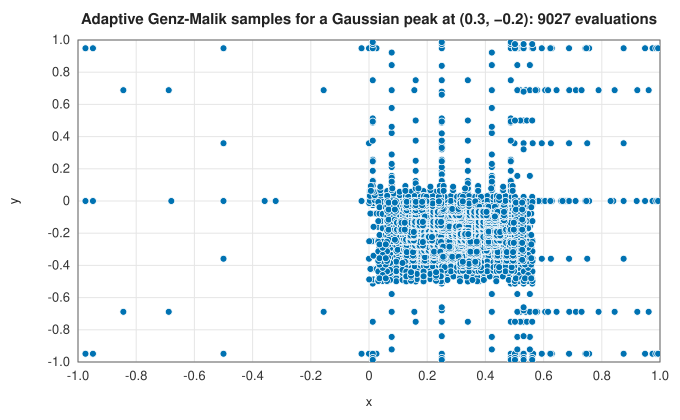
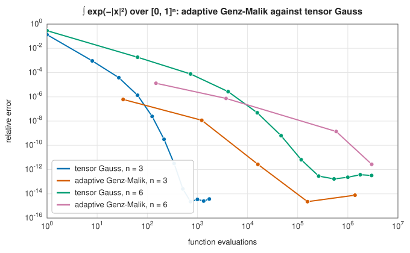
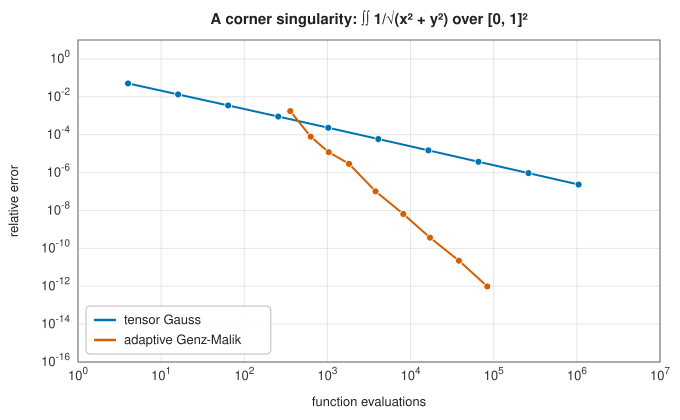

# Multidimensional cubature

<div class="entry-summary">

| | |
|---|---|
| **Problem** | Approximate $\int_{[a_1,b_1] \times \cdots \times [a_n,b_n]} f(\mathbf x)\,d\mathbf x$ over a box in $n$ dimensions |
| **Devised by** | Product rules: classical, after Gauss. Symmetric cubature: James Clerk Maxwell (1877), Arthur Stroud (1971). Adaptive degree-7 rule: Alan Genz and A. A. Malik (1980) |
| **Accuracy** | Tensor Gauss with $p$ points per axis: exact to degree $2p - 1$ in each variable. Genz-Malik: exact to total degree 7 on each region, with a degree-5 rule for the error estimate |
| **Cost** | Tensor rule: $p^n$ evaluations. Genz-Malik: $2^n + 2n^2 + 2n + 1$ per region |
| **Read first** | [Gaussian quadrature](gaussian-quadrature.md), [Adaptive Gauss-Kronrod quadrature](gauss-kronrod.md) |
| **API** | [`tensor_gauss_legendre`](../../api/lib_jsl_integration/cubature/fn.tensor_gauss_legendre.html), [`adaptive_cubature`](../../api/lib_jsl_integration/cubature/fn.adaptive_cubature.html), [`CubatureOptions`](../../api/lib_jsl_integration/cubature/struct.CubatureOptions.html), [`CubatureResult`](../../api/lib_jsl_integration/cubature/struct.CubatureResult.html) |

</div>

## Overview

Integrals over two, three or more variables arise everywhere: expected values of functions of
several random variables, moments of mass distributions, flux through a surface, averages over a
phase space. The rules of the previous entries generalise to several dimensions, but at a price
that grows dramatically with the dimension, a phenomenon Richard Bellman named the **curse of
dimensionality**.

This entry covers two ways to integrate over a box. The **tensor-product** Gauss rule applies a
one-dimensional Gauss rule along every axis; it is simple and extremely accurate for smooth
integrands in a few dimensions. **Adaptive cubature** with the Genz-Malik rule uses a cleverly
symmetric set of points that grows much more slowly with the dimension, estimates its own error,
and subdivides the box where the integrand is difficult. Beyond about ten dimensions, both give
way to the [Monte Carlo methods](monte-carlo.md) of the next entry.

## History

Product rules are as old as Gaussian quadrature itself: integrating one variable at a time is the
obvious extension. The first genuinely multidimensional rules were found by James Clerk Maxwell in
1877, who derived formulas for the square and the cube that use fewer points than products. The
subject grew with the computer. Arthur Stroud's *Approximate Calculation of Multiple Integrals*
(1971) collected hundreds of rules for squares, cubes, spheres and simplices, and Sergei Smolyak
(1963) showed how to combine one-dimensional rules into **sparse grids** that avoid most of the
cost of full products.

Adaptivity arrived in 1980, when Alan Genz and A. A. Malik published a degree-7 rule for
$n$-dimensional boxes with an embedded degree-5 rule for error estimation, together with a
heuristic for choosing the direction in which to split a region. Their algorithm, refined by
Berntsen, Espelid and Genz as DCUHRE (1991), is the basis of most adaptive cubature codes today,
including the `cubature` and `HCubature` packages and this library's implementation.

## The idea

### Tensor-product rules and the curse of dimensionality

If $\sum_i w_i g(x_i)$ is a one-dimensional Gauss rule with $p$ points on $[-1, 1]$, the product rule

$$
\int_{[-1,1]^n} f(\mathbf x)\,d\mathbf x \approx \sum_{i_1=1}^{p} \cdots \sum_{i_n=1}^{p} w_{i_1} \cdots w_{i_n}\, f(x_{i_1}, \ldots, x_{i_n})
$$

is exact whenever $f$ is a polynomial of degree at most $2p - 1$ *in each variable separately*, and
for smooth $f$ it inherits the exponential convergence of the one-dimensional rule. It costs $p^n$
evaluations. Four points per axis, enough for degree 7, cost 64 evaluations in three dimensions and
a million in ten.

The fundamental problem is not the product construction but the dimension itself. To reach an
error $\varepsilon$ with a rule of order $k$ in each direction needs about $\varepsilon^{-1/k}$ points
per axis, so $\varepsilon^{-n/k}$ in total. Exponential growth in $n$ is unavoidable for any method
that resolves the integrand along every axis.

### Fully symmetric rules

A rule of **total degree** $d$ must integrate every monomial
$x_1^{k_1} \cdots x_n^{k_n}$ with $k_1 + \cdots + k_n \le d$ exactly, not every monomial of degree $d$ in
each variable. That is a much weaker requirement: there are $\binom{n+d}{d}$ such monomials, a
polynomial in $n$ rather than an exponential. Symmetry reduces the work further. If the point set
is invariant under permutations of the coordinates and changes of sign, every monomial with an
odd exponent integrates to zero automatically, and monomials related by permuting the variables
give the same equation.

Such a **fully symmetric** rule is built from a few **generators**, each expanded into all its
signed permutations:

| generator | points | weight |
|---|---:|---|
| $(0, 0, \ldots, 0)$ | $1$ | $w_1$ |
| $(\lambda_2, 0, \ldots, 0)$ | $2n$ | $w_2$ |
| $(\lambda_3, 0, \ldots, 0)$ | $2n$ | $w_3$ |
| $(\lambda_4, \lambda_4, 0, \ldots, 0)$ | $2n(n-1)$ | $w_4$ |
| $(\lambda_5, \lambda_5, \ldots, \lambda_5)$ | $2^n$ | $w_5$ |

Requiring exactness for the even monomials up to degree 7 ($1$, $x_1^2$, $x_1^4$, $x_1^2 x_2^2$, $x_1^6$,
$x_1^4 x_2^2$, $x_1^2 x_2^2 x_3^2$) gives nonlinear equations for the $\lambda$'s and $w$'s. Genz and Malik
solved them in closed form: $\lambda_2 = \sqrt{9/70}$, $\lambda_3 = \lambda_4 = \sqrt{9/10}$,
$\lambda_5 = \sqrt{9/19}$, with weights that are rational functions of $n$. The rule uses
$2^n + 2n^2 + 2n + 1$ points in total; dropping the last generator and reweighting the rest gives
an **embedded** degree-5 rule on the same points, and the difference of the two estimates the
error.

<p class="caption" id="tab-2-13"><strong>Table 2.13.</strong> Points used by the Genz-Malik rule and a tensor Gauss rule by dimension.</p>

{{#include ../generated/integration/cubature_points.md}}

The Genz-Malik rule needs fewer points than there are monomials to integrate, thanks to symmetry,
and far fewer than the tensor rule from four dimensions on. Its $2^n$ corner points eventually
dominate, and above about fifteen dimensions it is no longer practical.

### Global adaptivity in several dimensions

The adaptive algorithm is the [global strategy](gauss-kronrod.md#local-and-global-adaptivity) of
one-dimensional Gauss-Kronrod quadrature: keep all regions in a priority queue keyed by their
error estimates, and repeatedly bisect the worst one until the estimates sum to less than the
tolerance. Only the direction of the cut is new. Splitting a box along every axis would multiply
the number of regions by $2^n$, so Genz and Malik cut along one axis, the one where the integrand
is roughest. The rule's own points measure this cheaply: the **fourth divided difference**

$$
\big|\,f(\mathbf c + \lambda_2 \mathbf e_i) + f(\mathbf c - \lambda_2 \mathbf e_i) - 2f(\mathbf c)
- \tfrac{\lambda_2^2}{\lambda_3^2}\big(f(\mathbf c + \lambda_3 \mathbf e_i) + f(\mathbf c - \lambda_3 \mathbf e_i) - 2f(\mathbf c)\big)\big|
$$

cancels the second-derivative term and estimates the fourth derivative along axis $i$.



<p class="caption" id="fig-2-14"><strong>Figure 2.14.</strong> Adaptive cubature samples.</p>

On a Gaussian peak the evaluation points pile up around the peak, and the narrow bands of points
along the axes through it show the single-axis cuts.

### Which method when?

The library's results on two integrands make the choice clear. On a smooth integrand the tensor
Gauss rule wins, in three dimensions and still in six:



<p class="caption" id="fig-2-15"><strong>Figure 2.15.</strong> Smooth integrand in 3 and 6 dimensions.</p>

Two effects work against the adaptive rule here. Its degree-7 rule converges more slowly than a
tensor Gauss rule of growing degree, and its error estimate, the difference from the degree-5
rule, is very pessimistic: at a requested relative tolerance of $10^{-2}$ it already delivers about
$10^{-6}$, so most of its work is spent on accuracy nobody asked for.

On a non-smooth integrand the picture reverses. The integral of $1/\sqrt{x^2 + y^2}$ over the unit
square has an integrable singularity at the corner, which spoils the convergence of every
polynomial-based rule. The tensor rule improves only algebraically, while the adaptive rule
concentrates regions at the corner and converges rapidly:



<p class="caption" id="fig-2-16"><strong>Figure 2.16.</strong> Corner singularity.</p>

In short: for smooth integrands in up to about five dimensions, use a tensor Gauss rule (and
increase the points until the answer stops changing); for integrands with peaks, kinks or
singularities, or when you need an error estimate, use adaptive cubature; beyond about ten
dimensions, use quasi-Monte Carlo.

## Algorithm

**Genz-Malik rule** on a box with centre $\mathbf c$ and half-widths $\mathbf h$: evaluate $f$ at the
centre, at $\mathbf c \pm \lambda_2 h_i \mathbf e_i$ and $\mathbf c \pm \lambda_3 h_i \mathbf e_i$ for each axis
(recording the fourth difference), at $\mathbf c \pm \lambda_4 h_i \mathbf e_i \pm \lambda_4 h_j \mathbf e_j$ for each
pair $i < j$, and at the $2^n$ points $\mathbf c + \lambda_5 (\pm h_1, \ldots, \pm h_n)$. Form the degree-7 and
degree-5 sums, scaled by the volume; return the degree-7 value, the difference as the error, and
the axis with the largest fourth difference.

**Adaptive cubature**:

1. Apply the rule to the whole box; put the region in a priority queue keyed by its error.
2. While the summed error exceeds $\max(\text{absolute}, \text{relative} \cdot |I|)$ and the budget
   allows two more regions: remove the worst region, halve it along its chosen axis, apply the rule
   to both halves, and insert them.
3. Return the summed values and errors, and whether the tolerance was met.

## Implementation

```rust,ignore
{{#include ../../../crates/integration/src/cubature.rs:genz_malik}}
```

- The five generator sums are accumulated while the points are visited, so each point is
  evaluated once and the degree-5 rule costs nothing extra.
- The corner points are enumerated by the bits of an integer, which is why the rule refuses
  more than 20 dimensions: $2^{20}$ corners per region is already a million evaluations.
- [`tensor_gauss_legendre`](../../api/lib_jsl_integration/cubature/fn.tensor_gauss_legendre.html)
  visits its $p^n$ points with an "odometer" of indices, so it needs no recursion and no storage
  beyond one point.

## In practice

```rust,ignore
{{#include ../../../crates/integration/examples/quadrature_cubature.rs}}
```

**Strengths**

- Tensor Gauss: exponential convergence for smooth integrands in low dimensions, with no
  parameters beyond the number of points.
- Adaptive Genz-Malik: an error estimate and automatic refinement around peaks, kinks and
  singularities, with a cost per region that grows only polynomially (until $2^n$ takes over).

**Weaknesses**

- The curse of dimensionality: both methods become impractical beyond roughly ten dimensions.
- The adaptive rule's error estimate is conservative, so on smooth integrands it does much more
  work than needed.
- Only boxes are supported. Other regions must be mapped to a box (for example with polar
  coordinates, whose Jacobian often removes a singularity, as in Exercise 3) or handled by
  multiplying the integrand by an indicator function, which creates a discontinuity.

## Exercises

1. Verify that the Genz-Malik rule is exact for $x_1^4 x_2^2$ but not for $x_1^8$ on $[-1, 1]^3$.
2. Count the monomials of total degree at most $d$ in $n$ variables and show the count is
   $\binom{n+d}{d}$. How many of them must a fully symmetric rule actually satisfy for $d = 7$?
3. Compute $\iint_{[0,1]^2} \frac{dx\,dy}{\sqrt{x^2+y^2}}$ by splitting the square along its diagonal
   and using polar coordinates on each triangle. Why does the singularity disappear?
4. The volume of the unit ball in $n$ dimensions is $\pi^{n/2}/\Gamma(n/2 + 1)$. Estimate it with
   adaptive cubature applied to the indicator function on $[-1, 1]^n$ for $n = 2, 3, 4$, and comment on
   the convergence.
5. Replace the error estimate by $|I_7 - I_5|/100$ and repeat the smooth-integrand comparison. When is
   such a scaling safe?

<details>
<summary>Hints and answers</summary>

1. The rule is exact for all polynomials of total degree at most 7. $x_1^4x_2^2$ has degree 6, so it is integrated exactly; $x_1^8$ has degree 8 and the rule's value differs from the exact $8/9$.
2. A monomial of total degree at most $d$ in $n$ variables corresponds to a choice of $n + 1$ non-negative exponents (including a slack exponent) summing to $d$: by stars and bars, $\binom{n+d}{d}$. For $d = 7$ a fully symmetric rule needs only the even monomials up to permutation of variables, which are $1, x_1^2, x_1^4, x_1^2x_2^2, x_1^6, x_1^4x_2^2, x_1^2x_2^2x_3^2$: seven conditions.
3. On the triangle $0 \le \theta \le \pi/4$, $0 \le r \le 1/\cos\theta$ the integrand $1/r$ is cancelled by the Jacobian $r$: $\int_0^{\pi/4}\sec\theta\,d\theta = \ln(1 + \sqrt2)$. The two triangles give $2\ln(1 + \sqrt2) \approx 1.7627$. The singularity is removed because it sits at the origin, which the Jacobian cancels.
4. The exact values are $\pi$, $4\pi/3 \approx 4.189$ and $\pi^2/2 \approx 4.935$. The indicator function has a jump along the sphere, so adaptive cubature converges only slowly, by repeatedly refining boxes along the boundary.
5. Dividing by 100 assumes the degree-5 rule is far worse than the degree-7 rule and that their difference overestimates the error of the degree-7 value by a known factor. That is safe only once the integrand is well resolved; before that, the difference can be small by accident and the scaled estimate unreliable.

</details>

## Further reading

- A. C. Genz and A. A. Malik, "An adaptive algorithm for numerical integration over an
  n-dimensional rectangular region", *Journal of Computational and Applied Mathematics* 6 (1980)
  295–302.
- J. Berntsen, T. O. Espelid and A. Genz, "An adaptive algorithm for the approximate calculation
  of multiple integrals", *ACM Transactions on Mathematical Software* 17 (1991) 437–451.
- A. H. Stroud, *Approximate Calculation of Multiple Integrals*, Prentice-Hall, 1971.
- J. C. Maxwell, "On approximate multiple integration between limits by summation", *Cambridge
  Philosophical Society Proceedings* 3 (1877) 39–47.
- S. A. Smolyak, "Quadrature and interpolation formulas for tensor products of certain classes of
  functions", *Soviet Mathematics Doklady* 4 (1963) 240–243. The origin of sparse grids.
- R. Cools, "Constructing cubature formulae: the science behind the art", *Acta Numerica* 6
  (1997) 1–54.
