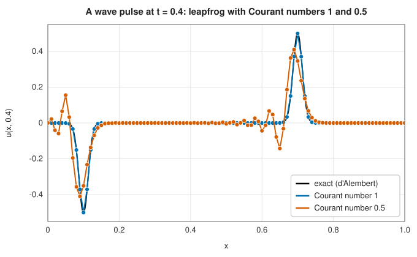

# Finite difference methods

<div class="entry-summary">

| | |
|---|---|
| **Problem** | Solve partial differential equations on simple domains: the heat equation $u_t = \alpha u_{xx}$, the wave equation $u_{tt} = c^2 u_{xx}$ and the Poisson equation $-\nabla^2 u = f$ |
| **Devised by** | Difference approximations: Brook Taylor and Euler (18th century); systematic use for PDEs: Lewis Fry Richardson (1910); stability: Courant, Friedrichs and Lewy (1928), John von Neumann (1940s); Crank and Nicolson (1947); conjugate gradients: Hestenes and Stiefel (1952) |
| **Accuracy** | Second order in space; first (explicit) or second (Crank-Nicolson, leapfrog) order in time |
| **Cost** | Explicit schemes: $O(N)$ per step, with a stability limit on the step. Crank-Nicolson: one tridiagonal solve per step. Poisson: conjugate gradient iterations, each $O(N)$ |
| **API** | [`heat_equation_1d`](../../api/lib_jsl_integration/pde/finite_differences/fn.heat_equation_1d.html), [`wave_equation_1d`](../../api/lib_jsl_integration/pde/finite_differences/fn.wave_equation_1d.html), [`poisson_2d`](../../api/lib_jsl_integration/pde/finite_differences/fn.poisson_2d.html), [`solve_tridiagonal`](../../api/lib_jsl_integration/pde/finite_differences/fn.solve_tridiagonal.html), [`conjugate_gradient`](../../api/lib_jsl_integration/pde/finite_differences/fn.conjugate_gradient.html) |

</div>

## Overview

A partial differential equation relates the rates of change of a function in several directions:
in time and space for heat flow and waves, in two space directions for the shape of a loaded
membrane or an electrostatic potential. **Finite difference methods** replace the function by its
values on a grid and each derivative by a difference quotient of neighbouring values. The PDE becomes
a large set of algebraic equations, one per grid point, that a computer can solve.

The three model equations treated here are the archetypes of the three classes of second-order
PDEs. The **heat equation** is *parabolic*: disturbances spread and smooth out. The **wave equation**
is *hyperbolic*: disturbances travel at a finite speed without decaying. The **Poisson equation** is
*elliptic*: there is no time, and the solution everywhere depends on the data everywhere. Each
class brings its own numerical lesson: stability limits for parabolic problems, dispersion and the
Courant condition for hyperbolic ones, and large sparse linear systems for elliptic ones.

## History

Difference quotients are as old as calculus, but their systematic use for PDEs began with Lewis
Fry Richardson. In 1910 he computed stresses in a masonry dam by finite differences, and during the
First World War, working as an ambulance driver, he attempted a numerical weather forecast by hand
(published in 1922): six weeks of calculation for a six-hour forecast, which went badly wrong for
reasons only understood decades later.

In 1928 Richard Courant, Kurt Friedrichs and Hans Lewy, studying the existence of solutions,
discovered that an explicit scheme for the wave equation converges only if the numerical domain of
dependence contains the physical one: the **CFL condition**. John von Neumann developed his
Fourier method for analysing stability at Los Alamos in the 1940s. John Crank and Phyllis Nicolson
(1947), computing heat flow in materials, introduced their unconditionally stable scheme. For
elliptic problems, Magnus Hestenes and Eduard Stiefel's **conjugate gradient method** (1952) became,
after decades of neglect, the standard iterative solver for large symmetric systems.

## The idea

### Difference quotients

By Taylor's theorem, with grid spacing $h$,

$$
\frac{u(x + h) - 2u(x) + u(x - h)}{h^2} = u''(x) + \frac{h^2}{12} u^{(4)}(x) + O(h^4).
$$

This **central second difference** is second-order accurate and uses three neighbouring points.
Writing $u_i^n \approx u(i\,\Delta x, n\,\Delta t)$, every scheme below combines it with a difference in time.

### The heat equation: explicit and implicit steps

The explicit **FTCS** scheme (forward in time, central in space) is

$$
u_i^{n+1} = u_i^n + r\,\big(u_{i-1}^n - 2u_i^n + u_{i+1}^n\big), \qquad r = \frac{\alpha\,\Delta t}{\Delta x^2}.
$$

**Von Neumann stability analysis** substitutes a Fourier mode $u_i^n = g^n e^{i k i \Delta x}$ and finds the
amplification factor $g = 1 - 4r\sin^2(k\Delta x/2)$. The scheme is stable, $|g| \le 1$ for all modes, only
when $r \le \tfrac12$. The step must therefore shrink with the *square* of the grid spacing: halving
$\Delta x$ quadruples the number of steps. This is the stiffness of the [previous entries](stiff-ode.md)
in another guise, since the discretised heat equation is a stiff system of ODEs.

The **Crank-Nicolson** scheme averages the explicit and implicit (backward Euler) differences:

$$
u_i^{n+1} - \tfrac r2\big(u_{i-1}^{n+1} - 2u_i^{n+1} + u_{i+1}^{n+1}\big)
= u_i^n + \tfrac r2\big(u_{i-1}^n - 2u_i^n + u_{i+1}^n\big).
$$

Its amplification factor $g = \big(1 - 2r\sin^2\big)/\big(1 + 2r\sin^2\big)$ satisfies $|g| \le 1$ for every
$r$, and the scheme is second order in time as well as space. Each step solves a **tridiagonal**
system, which the **Thomas algorithm** (Gaussian elimination without fill-in) does in $O(N)$
operations. For $u(x, 0) = \sin \pi x$, the library's results at $t = 0.1$:

<p class="caption" id="tab-2-17"><strong>Table 2.17.</strong> Columns: grid points, $\Delta x$, explicit steps ($r \le \tfrac12$), explicit error, and more.</p>

{{#include ../generated/integration/heat_convergence.md}}

Both errors fall by four when the grid is halved. The explicit scheme needs thousands of steps
because of its stability limit; Crank-Nicolson reaches comparable accuracy with a step equal to the
grid spacing.

### The wave equation: leapfrog and the CFL condition

The **leapfrog** scheme uses central differences in both time and space:

$$
u_i^{n+1} = 2u_i^n - u_i^{n-1} + C^2\big(u_{i-1}^n - 2u_i^n + u_{i+1}^n\big), \qquad C = \frac{c\,\Delta t}{\Delta x}.
$$

The **Courant number** $C$ compares the distance a wave travels in one step with the grid spacing. The
scheme is stable exactly when $C \le 1$: information on the grid moves at most one cell per step, so
the numerical domain of dependence contains the physical one only then (the CFL condition).

At $C = 1$ something remarkable happens: leapfrog becomes **exact** on the grid, because the exact
solution $f(x - ct) + g(x + ct)$ moves by exactly one cell per step. Below $C = 1$ the scheme is
stable but **dispersive**: short waves travel more slowly than long ones, and a sharp pulse sheds a
wake of oscillations:



<p class="caption" id="fig-2-25"><strong>Figure 2.25.</strong> A wave pulse with Courant numbers 1 and 0.5.</p>

### The Poisson equation and the five-point stencil

On a grid with spacings $\Delta x$, $\Delta y$, the **five-point stencil** approximates

$$
-\nabla^2 u \approx \frac{2u_{i,j} - u_{i-1,j} - u_{i+1,j}}{\Delta x^2} + \frac{2u_{i,j} - u_{i,j-1} - u_{i,j+1}}{\Delta y^2}.
$$

Requiring it to equal $f$ at every interior point, with the boundary values moved to the right-hand
side, gives a linear system $A\mathbf u = \mathbf b$ with one unknown per interior point. $A$ is enormous but
very sparse (five nonzeros per row), **symmetric** and **positive definite**. Gaussian elimination
would destroy the sparsity; instead the library uses **conjugate gradients**, which needs only the
product $A\mathbf v$, computed directly from the stencil without ever storing $A$ (matrix-free).

Conjugate gradients minimises the energy $\tfrac12\mathbf u^{\mathsf T}A\mathbf u - \mathbf b^{\mathsf T}\mathbf u$ over a growing
sequence of **Krylov subspaces** $\operatorname{span}\{\mathbf b, A\mathbf b, A^2\mathbf b, \ldots\}$, choosing each new search
direction $A$-orthogonal to the previous ones so that progress is never undone. In exact arithmetic it
finishes in at most $N$ steps; in practice its convergence depends on the condition number of $A$,
which grows like $h^{-2}$, so finer grids need more iterations. For $-\nabla^2 u = 2\pi^2\sin\pi x\sin\pi y$ on
the unit square:

<p class="caption" id="tab-2-18"><strong>Table 2.18.</strong> Columns: grid, $h$, maximum error, ratio.</p>

{{#include ../generated/integration/poisson_convergence.md}}

The ratio 4.00 confirms second-order accuracy.

## Algorithm

- **Heat, explicit**: check $r \le \tfrac12$; repeat the FTCS update for the interior points, holding the
  ends fixed.
- **Heat, Crank-Nicolson**: form the right-hand side from the explicit half step (with the boundary
  values added to the first and last rows) and solve the tridiagonal system
  $\big(-\tfrac r2, 1 + r, -\tfrac r2\big)$ by the Thomas algorithm.
- **Wave**: check $C \le 1$; take a Taylor first step $u^1 = u^0 + \Delta t\,v^0 + \tfrac{C^2}{2}\delta^2 u^0$, then
  leapfrog.
- **Poisson**: set the boundary values, move them to the right-hand side, and run conjugate gradients
  with the matrix-free stencil to a relative residual of $10^{-12}$.

## Implementation

The Thomas algorithm:

```rust,ignore
{{#include ../../../crates/integration/src/pde/finite_differences.rs:thomas}}
```

- The explicit heat and wave solvers refuse unstable step sizes rather than return growing noise.
- The Poisson solver stores only the grid: the stencil is applied on the fly, so memory is $O(N)$.
- [`conjugate_gradient`](../../api/lib_jsl_integration/pde/finite_differences/fn.conjugate_gradient.html)
  is public and works for any symmetric positive-definite operator given as a closure.

## In practice

```rust,ignore
{{#include ../../../crates/integration/examples/pde_finite_differences.rs}}
```

**Strengths**

- Simple to derive and to implement; the grid structure makes the linear algebra cheap.
- Well-understood stability and accuracy theory.
- Matrix-free elliptic solvers need little memory.

**Weaknesses**

- Rectangular grids fit simple domains only; curved boundaries need special treatment
  ([finite elements](finite-elements.md) handle them naturally).
- Second order is slow compared with [spectral methods](spectral-methods.md) for smooth solutions.
- Explicit schemes have stability limits; implicit ones need linear solves.

## Exercises

1. Derive the amplification factor of the FTCS scheme and confirm the stability limit $r \le \tfrac12$.
2. Show that leapfrog with $C = 1$ reproduces $u = f(x - ct)$ exactly on the grid.
3. Measure the number of conjugate gradient iterations for the Poisson problem as the grid is
   refined. How does it grow, and why? (Hint: the condition number of the five-point matrix is
   about $4/(\pi^2 h^2)$.)
4. Solve the heat equation with a discontinuous initial condition (a step) using Crank-Nicolson with
   a large $r$. What do you observe near the step, and why does the backward Euler scheme not show
   it? (Look at $g$ as $r \to \infty$.)
5. Modify the Poisson example to a $2 \times 1$ rectangle and compare the centre deflection with that of
   the square.

<details>
<summary>Hints and answers</summary>

1. Insert a Fourier mode $u_j^n = g^n e^{ikjh}$ in $u_j^{n+1} = u_j^n + r(u_{j+1}^n - 2u_j^n + u_{j-1}^n)$: $g = 1 - 4r\sin^2(kh/2)$. $|g| \le 1$ for all $k$ requires $4r \le 2$, i.e. $r \le \tfrac12$.
2. With $C = c\,\Delta t/\Delta x = 1$ leapfrog reads $u_j^{n+1} = u_{j+1}^n + u_{j-1}^n - u_j^{n-1}$. Substitute $u_j^n = f(x_j - ct_n) = f((j - n)\Delta x)$: both sides equal $f((j - n - 1)\Delta x)$, so it is exact.
3. Conjugate gradient iterations grow like $\sqrt\kappa \propto 1/h$: halving $h$ about doubles the iteration count.
4. The Crank-Nicolson amplification factor $(1 - 2r\sin^2)/(1 + 2r\sin^2) \to -1$ for large $r$ and high wavenumbers, so the high-frequency content of the step is not damped but flips sign each step, giving oscillations near the step. Backward Euler's factor $1/(1 + 4r\sin^2) \to 0$ damps them.
5. The deflection of the $2\times1$ rectangle is larger than that of the unit square at the centre of the long side, since the load is carried over a longer span; compare the maximum of $u$ in both cases.

</details>

## Further reading

- L. F. Richardson, *Weather Prediction by Numerical Process*, Cambridge University Press, 1922.
- R. Courant, K. Friedrichs and H. Lewy, "Über die partiellen Differenzengleichungen der
  mathematischen Physik", *Mathematische Annalen* 100 (1928) 32–74.
- J. Crank and P. Nicolson, "A practical method for numerical evaluation of solutions of partial
  differential equations of the heat-conduction type", *Proceedings of the Cambridge Philosophical
  Society* 43 (1947) 50–67.
- M. R. Hestenes and E. Stiefel, "Methods of conjugate gradients for solving linear systems",
  *Journal of Research of the National Bureau of Standards* 49 (1952) 409–436.
- R. J. LeVeque, *Finite Difference Methods for Ordinary and Partial Differential Equations*, SIAM,
  2007.
