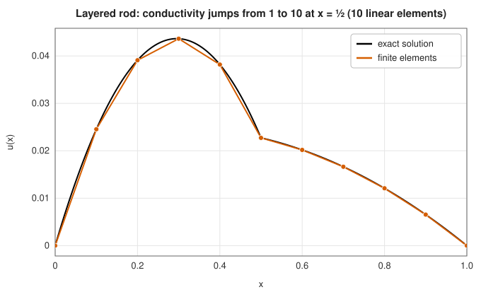

# Finite element methods

<div class="entry-summary">

| | |
|---|---|
| **Problem** | Solve elliptic boundary value problems such as $-(p u')' + q u = f$ in one dimension and $-\nabla\cdot(k\nabla u) = f$ on regions of the plane, including variable and discontinuous coefficients and irregular domains |
| **Devised by** | Variational methods: Walther Ritz (1909), Boris Galerkin (1915); piecewise-linear elements: Richard Courant (1943); engineering development: Turner, Clough, Martin and Topp (1956), Argyris (1954–55), Clough named the method (1960); mathematical theory: Strang and Fix (1973) |
| **Accuracy** | Linear elements: second order in the solution values, first order in the gradient (the energy norm) |
| **Cost** | Assembly $O(N)$; a sparse symmetric positive-definite system, solved here by a tridiagonal solver (1D) or preconditioned conjugate gradients (2D) |
| **API** | [`fem_1d`](../../api/lib_jsl_integration/pde/finite_elements/fn.fem_1d.html), [`EndCondition`](../../api/lib_jsl_integration/pde/finite_elements/enum.EndCondition.html), [`fem_poisson_2d`](../../api/lib_jsl_integration/pde/finite_elements/fn.fem_poisson_2d.html), [`TriangleMesh`](../../api/lib_jsl_integration/pde/finite_elements/struct.TriangleMesh.html) |

</div>

## Overview

[Finite differences](finite-differences.md) approximate the *equation*: derivatives become difference
quotients on a grid. **Finite elements** approximate the *solution*: it is sought among simple
functions, typically piecewise polynomials on a mesh of intervals or triangles, and the equation is
required to hold in an averaged ("weak") sense. The weak form needs only first derivatives, handles
coefficients that jump from one material to another without special treatment, imposes flux
boundary conditions naturally, and works on any mesh, so curved and irregular domains pose no
difficulty.

These properties made the finite element method the standard tool of structural engineering,
heat transfer, electromagnetics and many other fields. The library implements the simplest and most
widely used version, **linear (P1) elements**, in one dimension and on triangle meshes in two.

## History

The mathematical roots are variational. Walther Ritz (1909) approximated the solution of a
minimisation problem by a combination of a few chosen functions, and Boris Galerkin (1915), an
engineer who had been imprisoned for revolutionary activity, generalised the idea to equations that
are not minimisation problems. In a 1943 lecture on torsion Richard Courant used piecewise-linear
functions on triangles, the essential ingredient of the modern method, but the idea lay dormant.

It was reinvented by engineers analysing aircraft structures. John Argyris in London (1954–55) and
the Boeing team of Jon Turner, Ray Clough, Harold Martin and LeRoy Topp (1956) treated a structure as
an assembly of small elements whose stiffness could be computed individually. Clough named it the
"finite element method" in 1960. Mathematicians then recognised the Ritz-Galerkin method in the
engineers' work, and Gilbert Strang and George Fix's *An Analysis of the Finite Element Method* (1973)
established its convergence theory.

## The idea

### The weak form

Take the one-dimensional problem $-(p u')' + q u = f$ on $[a, b]$. Multiply by a **test function** $v$
that vanishes where $u$ is prescribed, and integrate by parts:

$$
\int_a^b \big(p\,u'\,v' + q\,u\,v\big)\,dx = \int_a^b f\,v\,dx + \big[p\,u'\,v\big]_a^b.
$$

This **weak form** asks for less than the original equation: $u$ needs only one derivative, and that
derivative may jump, which is exactly what happens at the interface between two materials. The
boundary term carries the flux $p u'$, so a prescribed flux enters the right-hand side directly; such
**natural** conditions need no special treatment. Values of $u$, by contrast, are **essential**
conditions imposed on the space of functions.

### Galerkin's method with hat functions

Choose a mesh $a = x_0 < x_1 < \cdots < x_m = b$ and the **hat functions** $\varphi_i$, piecewise linear with
$\varphi_i(x_j) = 1$ if $i = j$ and $0$ otherwise. Seek $u_h = \sum_j U_j\,\varphi_j$, and require the weak form
for every $v = \varphi_i$. The result is a linear system

$$
\sum_j \Big(\underbrace{\int p\,\varphi_i'\varphi_j' + q\,\varphi_i\varphi_j}_{K_{ij}}\Big)\,U_j = \underbrace{\int f\,\varphi_i}_{F_i} + \text{boundary terms}.
$$

The **stiffness matrix** $K$ is symmetric and, since each hat function overlaps only its neighbours,
**tridiagonal**. It is **assembled** element by element: each interval contributes a $2\times2$ block
computed by Gauss quadrature, added into the global matrix.

> **Galerkin orthogonality and Céa's lemma.** The error $u - u_h$ is orthogonal to every function in the
> finite element space in the energy inner product $a(u, v) = \int p u'v' + q uv$. Consequently $u_h$ is
> the best approximation to $u$ in the energy norm $\|v\|_a = \sqrt{a(v, v)}$:
> $\|u - u_h\|_a = \min_{v_h}\|u - v_h\|_a$.

Approximation theory then gives the rates: the best piecewise-linear approximation has gradient
error $O(h)$ and value error $O(h^2)$. For $-u'' + u = (\pi^2 + 1)\sin\pi x$:

{{#include ../generated/integration/fem_1d_convergence.md}}

The error at the element midpoints falls by four per refinement. The nodal values converge at the
same rate but are about fifteen times more accurate; with $q = 0$ they would be exact, as the next
section shows.

### Discontinuous coefficients

In one dimension with $q = 0$, linear finite elements reproduce the exact solution at the nodes,
whatever $p$ is, as long as the load is integrated accurately. (The Green's function of the problem
is piecewise linear in the right variable, so it lies in the finite element space.) This makes the
method ideal for layered materials:



The conductivity jumps from 1 to 10 at $x = \tfrac12$, the slope of $u$ jumps by the same factor, and
the finite element values sit exactly on the true solution. A finite difference scheme with a
naively averaged coefficient loses accuracy at the interface.

### Triangles in two dimensions

On a triangle mesh the hat functions are the piecewise-linear functions equal to 1 at one node and 0
at all others; on each triangle they are the **barycentric coordinates**. Their gradients are
constant on each triangle, so the element stiffness matrix of $-\nabla\cdot(k\nabla u)$ is simply

$$
K^{(T)}_{ab} = k\,|T|\,\nabla\varphi_a\cdot\nabla\varphi_b, \qquad a, b \in \{0, 1, 2\},
$$

with $k$ evaluated at the centroid and $|T|$ the triangle's area. The load is integrated with the
three-edge-midpoint rule, exact for quadratics. The global matrix is sparse (about seven nonzeros
per row on a regular mesh) and, after the prescribed values are eliminated, symmetric positive
definite; the library solves it by conjugate gradients with a diagonal (Jacobi) preconditioner. For
$-\nabla^2 u = 2\pi^2 \sin\pi x \sin\pi y$ on the unit square:

{{#include ../generated/integration/fem_2d_convergence.md}}

## Algorithm

**One dimension**: for each element, compute the $2\times2$ stiffness and mass contributions and the load
by two-point Gauss quadrature; add them into the tridiagonal matrix and load vector; add prescribed
fluxes to the end loads; replace the rows of Dirichlet ends by $U = $ value (moving the known column to
the right-hand side); solve with the Thomas algorithm.

**Two dimensions**: for each triangle, compute the barycentric gradients and area, add the $3\times3$
stiffness block and the load into sparse rows; subtract the contributions of the Dirichlet nodes
from the right-hand side; solve the reduced system by Jacobi-preconditioned conjugate gradients.

## Implementation

```rust,ignore
{{#include ../../../crates/integration/src/pde/finite_elements.rs:triangle_assembly}}
```

- The sparse rows are stored as ordered maps during assembly and converted to compressed rows for
  the solver.
- Nodes that belong to no triangle must be listed among the Dirichlet nodes, or the system is
  singular.
- Natural (zero-flux) conditions hold automatically on every boundary node that is not prescribed.

## In practice

```rust,ignore
{{#include ../../../crates/integration/examples/pde_finite_elements.rs}}
```

**Strengths**

- Any mesh, so irregular domains are no harder than squares.
- Variable and discontinuous coefficients and flux conditions are handled naturally.
- A best-approximation property and a complete error theory.

**Weaknesses**

- Mesh generation for complicated regions is a substantial task in its own right (the library only
  builds rectangles).
- Linear elements are second order; smooth problems on simple domains are solved far more
  accurately by [spectral methods](spectral-methods.md).
- Gradients (fluxes, stresses) are only first-order accurate and discontinuous between elements.

## Exercises

1. Compute the element stiffness matrix of $-u''$ on an interval of length $h$, and show that
   assembling it on a uniform mesh gives $\tfrac1h$ times the familiar $(-1, 2, -1)$ finite difference
   matrix.
2. Show that for $-u'' = f$ on a uniform mesh with $f$ integrated exactly, the nodal values are exact.
   (Use the Green's function $G(x, s)$, which is piecewise linear in $s$.)
3. Use [`fem_1d`](../../api/lib_jsl_integration/pde/finite_elements/fn.fem_1d.html) with a mesh that is
   fine near $x = 0$ to solve $-\varepsilon u'' + u = 1$, $u(0) = u(1) = 0$, for $\varepsilon = 10^{-4}$. How
   should the nodes be placed?
4. Build an L-shaped domain by removing the triangles of one quadrant from a rectangle mesh, and solve
   $-\nabla^2 u = 1$ with $u = 0$ on the boundary. Estimate the convergence rate by comparing successive
   refinements. Why is it slower than on the square?
5. Prove Galerkin orthogonality, $a(u - u_h, v_h) = 0$ for all $v_h$, from the weak forms satisfied by
   $u$ and $u_h$.

## Further reading

- R. Courant, "Variational methods for the solution of problems of equilibrium and vibrations",
  *Bulletin of the American Mathematical Society* 49 (1943) 1–23.
- M. J. Turner, R. W. Clough, H. C. Martin and L. J. Topp, "Stiffness and deflection analysis of
  complex structures", *Journal of the Aeronautical Sciences* 23 (1956) 805–823.
- G. Strang and G. J. Fix, *An Analysis of the Finite Element Method*, Prentice-Hall, 1973.
- C. Johnson, *Numerical Solution of Partial Differential Equations by the Finite Element Method*,
  Cambridge University Press, 1987. A clear introduction for students.
- S. C. Brenner and L. R. Scott, *The Mathematical Theory of Finite Element Methods*, 3rd ed.,
  Springer, 2008.
