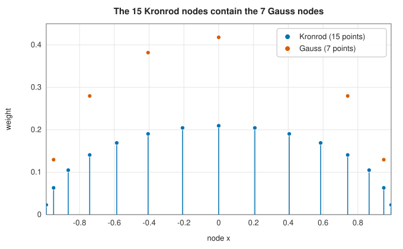
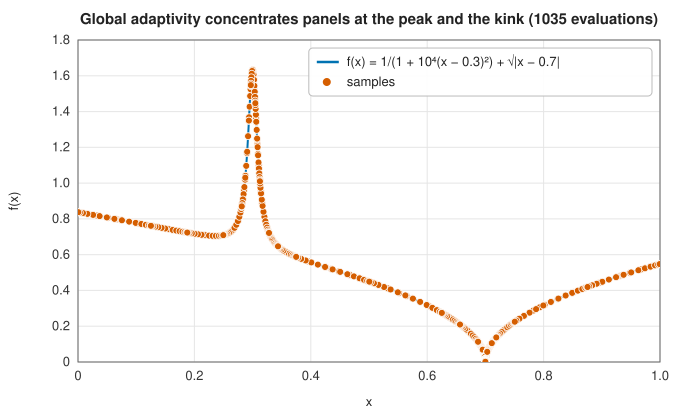

# Adaptive Gauss-Kronrod quadrature

<div class="entry-summary">

| | |
|---|---|
| **Problem** | Approximate $\int_a^b f(x)\,dx$ to a requested accuracy, with an error estimate, when $f$ may have peaks, kinks or integrable endpoint singularities |
| **Devised by** | Aleksandr Kronrod (1964), extending Gauss-Legendre rules using polynomials of Thomas Stieltjes (1894); global adaptive strategy from QUADPACK (Piessens, de Doncker-Kapenga, Überhuber and Kahaner, 1983) |
| **Accuracy** | Each 15-point panel is exact for polynomials of degree 23; panels are bisected until the estimated total error is below the tolerance |
| **Cost** | 15 evaluations for the first panel, then 30 per bisection |
| **API** | [`AdaptiveGL7K15IntegrationEngine`](../../api/lib_jsl_integration/adaptive_gl7k15_integration_engine/struct.AdaptiveGL7K15IntegrationEngine.html), [`integrate_with_error`](../../api/lib_jsl_integration/adaptive_gl7k15_integration_engine/struct.AdaptiveGL7K15IntegrationEngine.html#method.integrate_with_error) |

</div>

## Overview

[Gaussian quadrature](gaussian-quadrature.md) is the most accurate way to integrate a smooth
function with a given number of evaluations, but on its own it gives no indication of how
accurate the answer is. **Gauss-Kronrod quadrature** adds that missing piece cheaply. A 7-point
Gauss rule and a 15-point **Kronrod** rule share their 7 nodes, so evaluating $f$ at 15 points
gives two estimates of the integral; their difference measures the error.

Combined with **adaptive subdivision**, this becomes the workhorse of general-purpose numerical
integration. The routine repeatedly bisects the panel with the largest estimated error until the
estimates add up to less than the tolerance. Smooth integrands are finished in a single panel,
while peaks, kinks and integrable singularities attract panels until they are resolved. This is
the algorithm inside QUADPACK, `scipy.integrate.quad`, the GNU Scientific Library and MATLAB's
`quadgk`, and it is the right first choice when you know little about your integrand.

## History

Gauss's rules (1814) have one awkward property: the nodes of the $n$-point rule and the
$(n+1)$-point rule are different, so increasing $n$ to check the answer wastes every evaluation
already made. In 1894, in a letter to Charles Hermite, Thomas Stieltjes introduced a family of
polynomials whose zeros interlace with those of the Legendre polynomials, without connecting them
to quadrature. Gábor Szegő proved the interlacing property in 1935.

Aleksandr Kronrod, a Moscow mathematician who also led early Soviet work on computer chess, saw
the use. His 1964 monograph *Nodes and Weights of Quadrature Formulas* (English translation 1965)
tabulated rules that keep the $n$ Gauss nodes and add $n + 1$ new ones, chosen to make the
combined rule as accurate as possible. Thomas Patterson (1968) extended the idea to nested
sequences of 3, 7, 15, 31, … points.

The adaptive strategy matured in the 1970s. QUADPACK, published in 1983 by Robert Piessens,
Elise de Doncker-Kapenga, Christoph Überhuber and David Kahaner, made Gauss-Kronrod rules with
*global* adaptivity and a carefully calibrated error estimate the standard. Lawrence Shampine's
`quadgk` (2008), the default integrator in MATLAB, uses the same 7-15 pair as this library.

## The idea

### Embedding a rule in a better one

An $n$-point Gauss rule is exact for polynomials of degree $2n - 1$, the highest possible. We want
to add $m$ new nodes to its $n$ nodes and choose all $n + m$ weights, so that the combined rule is
as exact as possible. The new nodes and the $n + m$ weights give $2m + n$ free parameters, so we
can hope for exactness up to degree $2m + n - 1$. With $m = n + 1$ that is degree $3n + 1$.

Write $P_n$ for the Legendre polynomial whose zeros are the Gauss nodes, and $E_{n+1}$ for the
monic polynomial whose zeros are the new nodes. The combined rule is exact to degree $3n + 1$ if
and only if

$$
\int_{-1}^{1} P_n(x)\, E_{n+1}(x)\, x^k \,dx = 0 \qquad \text{for } k = 0, 1, \ldots, n.
$$

(Divide any polynomial $q$ of degree $3n+1$ by $P_n E_{n+1}$: the remainder is integrated exactly
by interpolation at the $2n+1$ nodes, and the quotient, of degree $n$, contributes nothing by this
condition.) $E_{n+1}$ is the **Stieltjes polynomial**: it is orthogonal to all polynomials of degree
$n$ with respect to the *sign-changing* weight $P_n(x)$. This unusual weight is why its existence
and the reality of its zeros needed proof. For the Legendre case, Szegő showed that the zeros are
real, lie in $(-1, 1)$ and interlace with those of $P_n$. For odd $n$ symmetry adds one more
degree, so the 15-point Kronrod extension of the 7-point Gauss rule is exact for all polynomials
of degree 23. The library's tests check exactly this.



The figure shows the pair. The Kronrod rule reuses the 7 Gauss nodes and interleaves 8 new ones,
including two beyond the outermost Gauss nodes; all weights are positive. The Gauss weights at the
shared nodes are different, so both sums must be formed, but every function value serves both.

### Estimating the error

The Kronrod value $K$ is far more accurate than the Gauss value $G$, so $|K - G| \approx |G - I|$
estimates the error of $G$, not of $K$. Returning $K$ with $|K - G|$ as its error bound is
therefore very pessimistic for smooth integrands. QUADPACK replaces the raw difference by an
empirically calibrated estimate,

$$
\varepsilon = \rho \, \min\!\left(1, \left(\frac{200\,|K - G|}{\rho}\right)^{3/2}\right),
\qquad \rho = \int_a^b \lvert f - \bar f \rvert \,dx,
$$

where $\bar f$ is the mean value of $f$ on the panel and $\rho$ is computed with the Kronrod
weights. The power $3/2$ encodes the observation that when $G$ is accurate to $d$ digits, $K$ is
typically accurate to about $1.5d$; the factor 200 keeps the estimate safely conservative when
the panel is not yet resolved. Finally, the estimate is never allowed below
$50\,\varepsilon_{\text{mach}} \int_a^b |f|$, the level of rounding error in the sum itself.

### Local and global adaptivity

There are two ways to subdivide. **Local** adaptivity, as in the
[adaptive trapezoid rule](newton-cotes.md#the-adaptive-trapezoid-rule), recursively splits every
panel whose own error exceeds its share of the tolerance. **Global** adaptivity keeps all panels
in a priority queue ordered by error estimate, and always bisects the panel with the largest
estimate. It stops as soon as the *sum* of the estimates is below the tolerance. Global adaptivity
spends evaluations only where they reduce the total error most, never refines a panel that is
already good enough, and terminates naturally with a subinterval limit.



Each dot is one evaluation. Away from the peak at $x = 0.3$ and the kink at $x = 0.7$, a handful
of wide panels suffice; near them, panels shrink geometrically. Because the nodes are interior,
the rule never evaluates the endpoints, so integrable singularities such as $\ln x$ at $x = 0$ can
be handled without special treatment: the panels next to the singularity simply keep halving.

## Algorithm

`panel(a, b)`: with $c = (a+b)/2$ and $h = (b-a)/2$, evaluate $f(c \pm h x_j)$ at the 15 Kronrod
nodes; form $K$, $G$, $\int|f|$ and $\rho$ from the weights; return $K$ and the calibrated
estimate $\varepsilon$.

1. Compute `panel(a, b)`; put it in a priority queue keyed by $\varepsilon$. Let
   $I = K$, $E = \varepsilon$.
2. While $E > \max(\text{tol}, 50\varepsilon_{\text{mach}} |I|)$ and the queue holds fewer than
   `max_subintervals` panels:
   1. Remove the panel with the largest estimate and bisect it.
   2. Compute both halves; update $I$ and $E$ by adding the halves' values and estimates and
      subtracting the parent's; insert both halves.
3. Return $\sum K$ and $\sum \varepsilon$ over the queue.

Each step costs 30 evaluations and $O(\log N)$ queue operations for $N$ panels.

## Implementation

The 7-point Gauss and 15-point Kronrod constants, to full double precision:

```rust,ignore
{{#include ../../../crates/integration/src/adaptive_gl7k15_integration_engine.rs:constants}}
```

One panel, with the error estimate:

```rust,ignore
{{#include ../../../crates/integration/src/adaptive_gl7k15_integration_engine.rs:gauss_kronrod_panel}}
```

The global strategy:

```rust,ignore
{{#include ../../../crates/integration/src/adaptive_gl7k15_integration_engine.rs:global_adaptivity}}
```

- Nodes are paired symmetrically, $c \pm h x_j$, and the Gauss rule uses every other Kronrod node.
- The running totals $I$ and $E$ make each step $O(1)$ apart from the queue; the final values are
  re-summed over the panels to discard the rounding accumulated by many updates.
- If a panel becomes too narrow to bisect in floating point, the loop stops: the tolerance cannot
  be met, and [`integrate`](../../api/lib_jsl_integration/adaptive_gl7k15_integration_engine/struct.AdaptiveGL7K15IntegrationEngine.html)
  reports an error while `integrate_with_error` returns the best estimate.
- A non-finite sample (for example $1/x$ evaluated at $x = 0$ after bisection) is reported as an
  error, since the integral is then not finite either, or the integrand is undefined at a point the
  rule needs.

## In practice

The library's results with tolerance $10^{-10}$, compared with the
[adaptive trapezoid rule](newton-cotes.md#the-adaptive-trapezoid-rule) at the same tolerance:

{{#include ../generated/integration/gauss_kronrod_table.md}}

A smooth integrand takes one panel. The peak needs 585 evaluations where the trapezoid rule needs
36 million. The estimated errors are always larger than the true errors, typically by orders of
magnitude for smooth parts of the integrand; that conservatism is deliberate. Strong
singularities such as $x^{-0.9}$ are reached by brute bisection and cost the most: the error
estimate on the panel next to the singularity falls slowly as the panel shrinks. For such
integrands [tanh-sinh quadrature](tanh-sinh.md) is far more efficient.

A complete program:

```rust,ignore
{{#include ../../../crates/integration/examples/quadrature_gauss_kronrod.rs}}
```

**Strengths**

- High order on each panel and a reliable, conservative error estimate.
- Handles peaks, kinks, discontinuities and integrable endpoint singularities without tuning.
- Never evaluates the endpoints.

**Weaknesses**

- Strong endpoint singularities cost many bisections; tanh-sinh quadrature is better there.
- The error estimate can be fooled. An integrand with a very narrow spike that falls between all
  15 nodes of the first panel looks smooth and is integrated "accurately" without the spike
  (Exercise 3). No method that samples $f$ at finitely many points can be immune.
- Oscillatory integrands over long intervals need many panels; specialised methods (Filon,
  Levin) exist for them.

## Exercises

1. Show that the 15-point Kronrod rule cannot be exact for degree 24 by computing
   $\int_{-1}^1 x^{24}\,dx$ with the library's rule.
2. Count the free parameters to show why $3n + 1$ is the best degree one can expect when adding
   $n + 1$ nodes to an $n$-point Gauss rule, and explain why symmetry raises it by one for odd
   $n$.
3. Integrate $f(x) = e^{-10^6 (x - 0.123)^2}$ over $[0, 1]$ (exact value $\sqrt{\pi} \cdot 10^{-3}$
   to excellent accuracy) with tolerance $10^{-10}$. What happens, and why? What if you split the
   interval at $0.123$?
4. Replace the calibrated estimate by the raw difference $|K - G|$ and repeat the table. How many
   more evaluations does each integrand need?
5. Compare the number of evaluations needed for $\int_0^1 x^{-0.9}\,dx$ with Gauss-Kronrod and with
   [tanh-sinh quadrature](tanh-sinh.md) at the same accuracy. Explain the difference by asking how
   fast the panel adjacent to $x = 0$ improves when it is halved.

<details>
<summary>Hints and answers</summary>

1. $\int_{-1}^{1}x^{24}\,dx = 2/25 = 0.08$; the 15-point rule is exact up to degree 23, so its value for $x^{24}$ differs from $0.08$ by a small but nonzero amount.
2. Adding $m = n + 1$ nodes gives $m$ free node positions and $n + m = 2n + 1$ weights: $3n + 2$ parameters, enough to satisfy conditions for degrees $0$ to $3n + 1$. The rule is symmetric for odd $n$, so odd-degree monomials integrate exactly by symmetry and one more even degree can be gained.
3. The Gaussian has width about $7\times10^{-4}$, narrower than the spacing of the 15 nodes on $[0, 1]$, so the first panel may miss it altogether and return nearly zero with a tiny error estimate: a false convergence. Splitting at $0.123$ puts nodes on the peak and the rule resolves it.
4. Using the raw difference overstates the error for smooth integrands (it measures the error of the Gauss rule, not of the Kronrod rule), so every integrand needs extra subdivisions; compare the evaluation counts in the table.
5. The integral over $[0, h]$ is $h^{0.1}/0.1$, so halving the panel next to 0 reduces its contribution only by $2^{-0.1} \approx 0.93$: Gauss-Kronrod must subdivide that panel many times. Tanh-sinh's change of variables makes the singularity vanish, so it needs far fewer evaluations.

</details>

## Further reading

- A. S. Kronrod, *Nodes and Weights of Quadrature Formulas*, Consultants Bureau, New York, 1965
  (Russian original 1964).
- G. Szegő, "Über gewisse orthogonale Polynome, die zu einer oszillierenden Belegungsfunktion
  gehören", *Mathematische Annalen* 110 (1935) 501–513.
- T. N. L. Patterson, "The optimum addition of points to quadrature formulae", *Mathematics of
  Computation* 22 (1968) 847–856.
- R. Piessens, E. de Doncker-Kapenga, C. W. Überhuber and D. K. Kahaner, *QUADPACK: A Subroutine
  Package for Automatic Integration*, Springer, 1983.
- L. F. Shampine, "Vectorized adaptive quadrature in MATLAB", *Journal of Computational and
  Applied Mathematics* 211 (2008) 131–140.
- W. Gautschi, "Gauss-Kronrod quadrature — a survey", in *Numerical Methods and Approximation
  Theory III*, Niš, 1988, 39–66. The theory of Stieltjes polynomials and Kronrod extensions.
