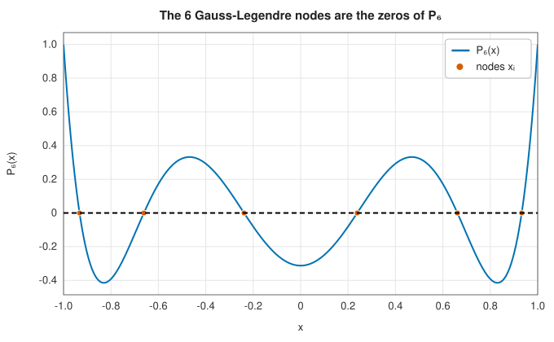
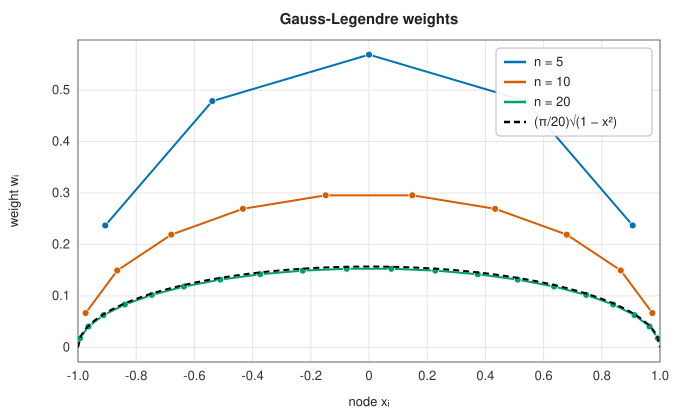

# Gaussian quadrature

<div class="entry-summary">

| | |
|---|---|
| **Problem** | Approximate $\int_a^b w(x) f(x)\,dx$ for a smooth $f$ and a fixed weight function $w$ |
| **Devised by** | Carl Friedrich Gauss (1814); recast with orthogonal polynomials by Carl Gustav Jacobi (1826); general weights by Elwin Bruno Christoffel (1858) |
| **Accuracy** | Exact for polynomials of degree $2n-1$ with $n$ nodes; error $\propto \rho^{-2n}$ for analytic $f$ |
| **Cost** | $n$ evaluations of $f$; computing the rule costs $O(n^2)$ once |
| **Read first** | [Newton-Cotes rules: midpoint, trapezoid and Simpson](newton-cotes.md), [Orthogonal polynomials and spherical harmonics](../special_functions/orthogonal-polynomials.md) |
| **API** | [`gauss_legendre`](../../api/lib_jsl_integration/gaussian_quadrature/fn.gauss_legendre.html), [`GaussLegendreEngine`](../../api/lib_jsl_integration/gaussian_quadrature/struct.GaussLegendreEngine.html), [`gauss_hermite`](../../api/lib_jsl_integration/gaussian_quadrature/fn.gauss_hermite.html), [`gauss_laguerre`](../../api/lib_jsl_integration/gaussian_quadrature/fn.gauss_laguerre.html), [`QuadratureRule`](../../api/lib_jsl_integration/gaussian_quadrature/struct.QuadratureRule.html) |

</div>

## Overview

A quadrature rule $Q_n[f] = \sum_{i=1}^n w_i f(x_i)$ has $2n$ free parameters: $n$ nodes and $n$
weights. Rules such as the trapezoid and Simpson rules fix the nodes at equal spacing and choose
only the weights. **Gaussian quadrature** chooses the nodes as well, and uses all $2n$ degrees of
freedom to integrate polynomials of the highest possible degree, $2n - 1$, exactly. The optimal
nodes turn out to be the roots of an orthogonal polynomial, and the resulting rules converge
exponentially fast for smooth integrands.

Gaussian quadrature is the method of choice when the integrand is smooth and each evaluation is
expensive. It is also the natural way to handle a known weight: Gauss-Hermite quadrature for
$\int_{-\infty}^{\infty} e^{-x^2} f(x)\,dx$, which appears in probability and quantum mechanics, and
Gauss-Laguerre quadrature for $\int_0^\infty x^\alpha e^{-x} f(x)\,dx$.

## History

Gauss presented the method to the Göttingen Society of Sciences in 1814 in *Methodus nova
integralium valores per approximationem inveniendi* ("A new method of finding approximate values
of integrals"). Building on Newton and Cotes's equally spaced rules, he asked what accuracy could
be gained by also choosing where to sample. Working through continued fractions of the
hypergeometric function, he found the nodes and weights for up to seven points and tabulated them
to sixteen digits by hand.

In 1826 Jacobi gave the modern explanation: the nodes are the zeros of the Legendre polynomials,
and the method's accuracy follows from their orthogonality. Christoffel extended the construction
to general weight functions in 1858, which is why the weights are sometimes called *Christoffel
numbers*. In 1969 Gene Golub and John Welsch showed that the nodes and weights are the eigenvalues
and eigenvector components of a symmetric tridiagonal matrix, the standard way to compute rules
for any weight. Since about 2010, asymptotic methods compute million-point rules in linear time.

## The idea

### Why the nodes should move

Start with the simplest cases on $[-1, 1]$. With one node, the best rule is the midpoint rule
$Q_1[f] = 2 f(0)$, which is exact for every linear function: one node, degree $1 = 2 \cdot 1 - 1$.
With two nodes, require exactness for $1, x, x^2, x^3$:

$$
w_1 + w_2 = 2, \quad w_1 x_1 + w_2 x_2 = 0, \quad w_1 x_1^2 + w_2 x_2^2 = \tfrac{2}{3}, \quad w_1 x_1^3 + w_2 x_2^3 = 0.
$$

By symmetry $x_2 = -x_1$ and $w_1 = w_2 = 1$, and then $2x_1^2 = 2/3$ gives
$x_{1,2} = \mp 1/\sqrt{3}$. Two well-placed points integrate every cubic exactly, which Simpson's
rule needs three points to do. Solving these nonlinear moment equations directly becomes hopeless
for larger $n$. The structure behind the solution is orthogonality.

### Orthogonal polynomials

Polynomials $p_0, p_1, p_2, \ldots$ with $\deg p_k = k$ are **orthogonal** with respect to the
weight $w(x) \ge 0$ on $[a, b]$ if

$$
\langle p_j, p_k \rangle = \int_a^b w(x)\, p_j(x)\, p_k(x)\,dx = 0 \qquad (j \ne k).
$$

For $w = 1$ on $[-1, 1]$ these are the **Legendre polynomials** $P_k$, normalised by $P_k(1) = 1$:
$P_0 = 1$, $P_1 = x$, $P_2 = (3x^2 - 1)/2$, and in general they obey Bonnet's three-term
recurrence

$$
(k+1)\,P_{k+1}(x) = (2k+1)\,x\,P_k(x) - k\,P_{k-1}(x).
$$

Two facts matter here. First, $p_n$ is orthogonal to *every* polynomial of degree less than $n$,
since such polynomials are combinations of $p_0, \ldots, p_{n-1}$. Second, $p_n$ has $n$ distinct
real zeros, all inside $(a, b)$. (If it changed sign at only $m < n$ points $z_1, \ldots, z_m$ in
the interval, then $p_n(x) \prod_k (x - z_k)$ would never change sign, so its weighted integral
could not vanish, contradicting orthogonality.)



<p class="caption" id="fig-2-7"><strong>Figure 2.7.</strong> The Gauss-Legendre nodes are the zeros of P₆.</p>

### Theorem: exactness to degree $2n - 1$

> Let $x_1, \ldots, x_n$ be the zeros of $p_n$, and choose the weights so that the rule integrates
> every polynomial of degree less than $n$ exactly (interpolatory weights,
> $w_i = \int_a^b w(x)\, \ell_i(x)\,dx$ with the Lagrange basis polynomials $\ell_i$). Then
> $\sum_i w_i\, q(x_i) = \int_a^b w(x)\, q(x)\,dx$ for every polynomial $q$ of degree at most
> $2n - 1$.

*Proof.* Divide $q$ by $p_n$: $q = s\, p_n + r$ with $\deg s \le n - 1$ and $\deg r \le n - 1$. Then

$$
\int_a^b w\, q\,dx = \underbrace{\int_a^b w\, s\, p_n\,dx}_{=\,0\ \text{(orthogonality)}} + \int_a^b w\, r\,dx
= \sum_{i=1}^{n} w_i\, r(x_i) = \sum_{i=1}^{n} w_i\, q(x_i),
$$

where the middle step uses exactness for degree $n - 1$, and the last uses $p_n(x_i) = 0$, so that
$q(x_i) = r(x_i)$. $\blacksquare$

No $n$-point rule can do better. The polynomial $\prod_{i=1}^n (x - x_i)^2$ has degree $2n$, is
positive except at the nodes, and so has a positive integral, yet every rule with those nodes
gives it the value zero.

### The weights are positive

Apply the theorem to $\ell_j(x)^2$, which has degree $2n - 2$ and satisfies
$\ell_j(x_i) = \delta_{ij}$:

$$
w_j = \sum_{i} w_i\, \ell_j(x_i)^2 = \int_a^b w(x)\, \ell_j(x)^2\,dx > 0.
$$

Positive weights make Gaussian quadrature numerically stable: since $\sum_i |w_i| = \sum_i w_i =
\int_a^b w$, rounding errors in the values $f(x_i)$ are never amplified. Equally spaced
Newton-Cotes rules of high order have weights of both signs that grow without bound, which is why
they are never used beyond a handful of points. For Legendre polynomials the weights have the
closed form

$$
w_i = \frac{2}{(1 - x_i^2)\,[P_n'(x_i)]^2}.
$$



<p class="caption" id="fig-2-8"><strong>Figure 2.8.</strong> Gauss-Legendre weights.</p>

The nodes crowd towards the endpoints and the weights shrink there, approaching
$(\pi/n)\sqrt{1 - x^2}$. This is the density of Chebyshev points, the same clustering that makes
polynomial interpolation stable.

### How accurate is it?

For an integrand with $2n$ continuous derivatives, the $n$-point Gauss-Legendre error on $[-1, 1]$
is

$$
I[f] - Q_n[f] = \frac{2^{2n+1}\,(n!)^4}{(2n+1)\,[(2n)!]^3}\, f^{(2n)}(\xi) \qquad \text{for some } \xi \in (-1, 1).
$$

By Stirling's formula the constant behaves like $4^{-2n}/(n!)^2$ up to slowly varying factors, so
it shrinks faster than exponentially, and the error vanishes faster than any power of $n$
unless the derivatives of $f$ grow comparably fast. A sharper statement uses complex analysis. If $f$
is analytic inside the **Bernstein ellipse** $E_\rho$, whose foci are $\pm 1$ and whose semi-axes
sum to $\rho > 1$, and bounded there by $M$, then (Trefethen, 2008)

$$
|I[f] - Q_n[f]| \le \frac{64\,M}{15\,(\rho^2 - 1)\,\rho^{2n}}.
$$

Convergence is exponential, with a rate set by the distance to the nearest singularity of $f$ in
the complex plane. The Runge function $1/(1 + 25x^2)$ has poles at $\pm i/5$, which gives
$\rho = (1 + \sqrt{26})/5 \approx 1.22$ and an error of order $1.22^{-2n}$: about $10^{-11}$ for
$n = 64$ and full double precision near $n = 100$, exactly as the
[convergence figure](index.md#the-central-trade-off) shows.

## Algorithm

To compute the $n$-point Gauss-Legendre rule:

1. For each of the $\lceil n/2 \rceil$ non-negative zeros (the others follow by symmetry), start
   from the asymptotic estimate $x \approx \cos\!\big(\pi (i - \tfrac14)/(n + \tfrac12)\big)$.
2. Evaluate $P_n(x)$ and $P_{n-1}(x)$ by the three-term recurrence, in $O(n)$ operations.
3. Obtain the derivative from $(x^2 - 1)\,P_n'(x) = n\,(x P_n(x) - P_{n-1}(x))$ and take a Newton
   step $x \leftarrow x - P_n(x)/P_n'(x)$. Repeat until the step is below $10^{-16}$; three or four
   steps usually suffice.
4. Set $w_i = 2 / \big((1 - x_i^2)\, P_n'(x_i)^2\big)$.

The total cost is $O(n^2)$, negligible next to the integrand evaluations for the sizes used in
practice. To integrate over $[a, b]$, map the nodes by $x = \tfrac{a+b}{2} + \tfrac{b-a}{2}\, t$ and
scale the weights by $\tfrac{b-a}{2}$.

The **Golub-Welsch algorithm** computes the same rule for *any* weight function: the recurrence
coefficients form a symmetric tridiagonal (Jacobi) matrix whose eigenvalues are the nodes, and the
weights come from the first components of its eigenvectors. For Legendre polynomials the matrix
has zero diagonal and off-diagonal entries $k/\sqrt{4k^2 - 1}$.

## Implementation

The library follows steps 1 to 4 directly. Here is the heart of
[`gauss_legendre`](../../api/lib_jsl_integration/gaussian_quadrature/fn.gauss_legendre.html):

```rust,ignore
{{#include ../../../crates/integration/src/gaussian_quadrature.rs:legendre_newton}}
```

Three details are worth noticing.

- **Recurrence, not formulas.** Evaluating $P_n$ through its explicit coefficients would suffer
  catastrophic cancellation for large $n$. Bonnet's recurrence is stable, and it delivers
  $P_{n-1}$ for free, which the derivative formula needs.
- **Symmetry.** Only half the zeros are computed and then mirrored. This halves the work and
  makes the computed rule exactly symmetric, so odd functions integrate to exactly zero.
- **The weight formula reuses the last Newton derivative**, so weights cost nothing extra.

[`gauss_hermite`](../../api/lib_jsl_integration/gaussian_quadrature/fn.gauss_hermite.html) and
[`gauss_laguerre`](../../api/lib_jsl_integration/gaussian_quadrature/fn.gauss_laguerre.html) use
the same pattern with their own recurrences and starting guesses. The Hermite rule uses the
*orthonormal* recurrence, because the classical Hermite polynomials grow so fast that they would
overflow for a few hundred points.

## In practice

The 5-point Gauss-Legendre rule computed by the library:

<p class="caption" id="tab-2-10"><strong>Table 2.10.</strong> Nodes and weights of a Gauss-Legendre rule.</p>

{{#include ../generated/integration/gauss_legendre_table.md}}

Exactness of the 3-point rule ends precisely at degree $2 \cdot 3 - 1 = 5$:

<p class="caption" id="tab-2-11"><strong>Table 2.11.</strong> Exactness of the 3-point Gauss rule on monomials.</p>

{{#include ../generated/integration/gauss_legendre_exactness.md}}

A complete program, from the repository's examples:

```rust,ignore
{{#include ../../../crates/integration/examples/quadrature_gauss_legendre.rs}}
```

**Strengths**

- The highest polynomial degree possible for the number of evaluations, and exponential
  convergence for analytic integrands.
- Positive weights, hence excellent numerical stability.
- Weight functions absorb known singular or decaying factors such as $e^{-x^2}$ or $x^\alpha$.

**Weaknesses**

- *Not nested.* The nodes of the $n$-point rule are not reused by the $2n$-point rule, so
  refining an estimate throws away all previous evaluations. Gauss-Kronrod rules add $n + 1$
  nodes to an $n$-point Gauss rule to obtain a free error estimate; adaptive integrators are built
  on them.
- *Needs smoothness.* A kink, a discontinuity or an endpoint singularity reduces convergence to a
  slow algebraic rate, as the $\sqrt{x}$
  [figure](index.md#the-central-trade-off) shows. Split the interval at the kink, or use
  [tanh-sinh quadrature](tanh-sinh.md) for endpoint singularities.
- *Not much better than Clenshaw-Curtis.* Clenshaw-Curtis quadrature, built on Chebyshev
  extrema, is exact only to degree $n - 1$, yet for most functions it converges at nearly the same
  rate as Gauss. That surprising fact is the subject of Trefethen's 2008 paper below.

## Exercises

1. Derive the 3-point Gauss-Legendre rule by hand: show that the nodes are $0$ and
   $\pm\sqrt{3/5}$ with weights $8/9$ and $5/9$, first from the moment equations and then from
   the zeros of $P_3(x) = (5x^3 - 3x)/2$.
2. Show that the $n$-point rule integrates $x^{2n}$ with an error of exactly
   $\int_{-1}^{1} \prod_i (x - x_i)^2\,dx$, and evaluate this for $n = 2$. Check your answer with
   [`gauss_legendre`](../../api/lib_jsl_integration/gaussian_quadrature/fn.gauss_legendre.html).
3. Compute $\int_{-1}^{1} |x|\,dx$ with $n = 2, 4, 8, \ldots, 512$ points. What rate do you
   observe, and why? Then split the interval at $0$ and repeat.
4. Using the Bernstein-ellipse bound, predict how many points are needed to integrate
   $1/(1 + x^2/\delta^2)$ to $10^{-12}$ for $\delta = 1, 0.1$ and $0.01$, and verify numerically.
5. Use [`gauss_hermite`](../../api/lib_jsl_integration/gaussian_quadrature/fn.gauss_hermite.html)
   to compute $\mathbb{E}[\cos X]$ for $X \sim \mathcal{N}(0, 1)$. (Substitute $x = \sqrt{2}\,t$.)
   Compare with the exact value $e^{-1/2}$.
6. Implement the Golub-Welsch algorithm for the Legendre weight with a symmetric eigensolver and
   compare its nodes and weights with `gauss_legendre(20)`.

<details>
<summary>Hints and answers</summary>

1. The moment equations $\sum w_i x_i^k = \int_{-1}^1 x^k\,dx$ for $k = 0..5$ with symmetric nodes $0, \pm a$ give $w_0 + 2w_1 = 2$, $2w_1a^2 = \tfrac23$, $2w_1a^4 = \tfrac25$, so $a^2 = 3/5$, $w_1 = 5/9$, $w_0 = 8/9$. The zeros of $P_3 = (5x^3 - 3x)/2$ are $0$ and $\pm\sqrt{3/5}$.
2. $x^{2n} = \prod_i(x - x_i)^2 + q(x)$ with $\deg q < 2n$. The rule integrates $q$ exactly and gives 0 for the product (it vanishes at the nodes), so the error is $\int\prod_i(x - x_i)^2dx$. For $n = 2$, the nodes are $\pm1/\sqrt3$ and $\int_{-1}^{1}(x^2 - \tfrac13)^2dx = \tfrac25 - \tfrac49 + \tfrac29 = \tfrac8{45}$.
3. The kink at 0 limits the convergence to algebraic: the error falls like $n^{-2}$. Splitting at 0 makes both pieces polynomials, so the rule is exact once $n \ge 2$ on each side.
4. The poles are at $\pm i\delta$, so the error behaves like $\rho^{-2n}$ with $\rho = \delta + \sqrt{1 + \delta^2}$: $\rho \approx 2.41, 1.105, 1.010$. For $10^{-12}$ this predicts about $16$, $140$ and $1400$ points.
5. With $x = \sqrt2t$, $\mathbb E[\cos X] = \dfrac1{\sqrt\pi}\int e^{-t^2}\cos(\sqrt2t)\,dt \approx \dfrac1{\sqrt\pi}\sum w_i\cos(\sqrt2t_i)$. The exact value is $e^{-1/2} \approx 0.60653$.
6. The Jacobi matrix for Legendre has zero diagonal and off-diagonal entries $k/\sqrt{4k^2 - 1}$ for $k = 1, \ldots, n - 1$. Its eigenvalues are the nodes and the weights are $2$ times the squared first components of the normalised eigenvectors.

</details>

## Further reading

- C. F. Gauss, "Methodus nova integralium valores per approximationem inveniendi",
  *Commentationes Societatis Regiae Scientiarum Gottingensis Recentiores* 3 (1816). The original
  paper, presented in 1814.
- C. G. J. Jacobi, "Ueber Gauß' neue Methode, die Werthe der Integrale näherungsweise zu finden",
  *Journal für die reine und angewandte Mathematik* 1 (1826) 301–308.
- G. H. Golub and J. H. Welsch, "Calculation of Gauss quadrature rules", *Mathematics of
  Computation* 23 (1969) 221–230.
- L. N. Trefethen, "Is Gauss quadrature better than Clenshaw–Curtis?", *SIAM Review* 50 (2008)
  67–87. A beautifully written account of convergence, and the source of the Bernstein-ellipse
  bound above.
- N. Hale and A. Townsend, "Fast and accurate computation of Gauss–Legendre and Gauss–Jacobi
  quadrature nodes and weights", *SIAM Journal on Scientific Computing* 35 (2013) A652–A674.
- P. J. Davis and P. Rabinowitz, *Methods of Numerical Integration*, 2nd ed., Academic Press,
  1984. The classic reference on quadrature.
- W. Gautschi, *Orthogonal Polynomials: Computation and Approximation*, Oxford University Press,
  2004.
- W. H. Press et al., *Numerical Recipes*, 3rd ed., Cambridge University Press, 2007, §4.6. The
  Newton iteration used here.
