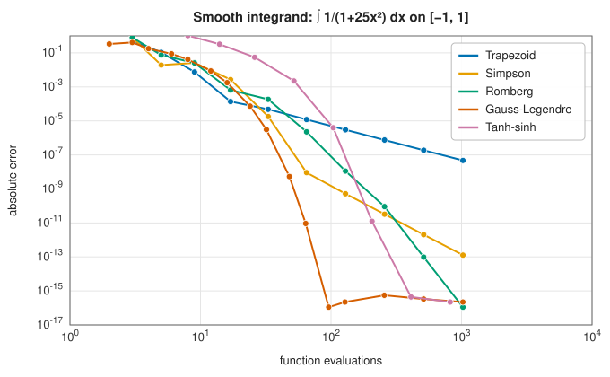
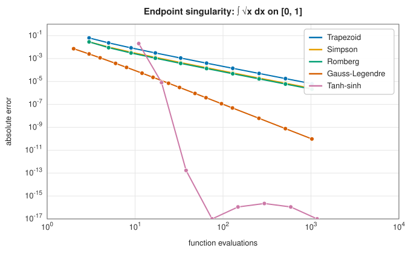

# Numerical integration

Most integrals that arise in science and engineering cannot be done in closed form. Even
$\int_0^1 e^{-x^2}\,dx$ has no elementary antiderivative, and the integrands met in practice are
often known only as computer procedures: a simulation, a measured curve, the solution of another
equation. **Numerical integration**, or **quadrature**, approximates

$$
I[f] = \int_a^b f(x)\,dx \qquad\text{by}\qquad Q_n[f] = \sum_{i=1}^{n} w_i\, f(x_i),
$$

a weighted sum of function values at chosen **nodes** $x_i$ with **weights** $w_i$. Every method
in this chapter is a strategy for choosing those nodes and weights. The word *quadrature* comes
from the classical problem of constructing a square (*quadratum*) with the same area as a given
figure.

## The central trade-off

A quadrature rule is judged by how quickly its error falls as the number of function evaluations
$N$ grows, and how robustly it does so when the integrand misbehaves.

- **Algebraic convergence**, $|I - Q_N| \propto N^{-p}$, is what you get from piecewise polynomial
  rules such as the trapezoid ($p = 2$) and Simpson ($p = 4$) rules. It is robust: the rate
  depends only on how many derivatives $f$ has.
- **Exponential convergence**, $|I - Q_N| \propto e^{-cN}$ or $\rho^{-N}$, is possible when $f$ is
  *analytic* (has a convergent Taylor series) on and near the interval. Gaussian quadrature,
  Romberg integration (in its limit) and the trapezoid rule for periodic functions all exploit
  analyticity.

The two figures below show the methods of this chapter on two integrands, plotted as error
against the number of function evaluations.

On the smooth Runge function $1/(1 + 25x^2)$, Gaussian quadrature reaches full double precision
with about 100 evaluations. The trapezoid rule, still at $10^{-7}$ after 1000 evaluations, would
need tens of millions to match it.
Romberg integration and tanh-sinh quadrature also converge faster than any power of $N$.

On $\sqrt{x}$, whose derivative is infinite at $x = 0$, the picture changes completely. Every
polynomial-based rule, Gauss included, falls back to slow algebraic convergence, and Romberg
extrapolation no longer helps. Only tanh-sinh quadrature, which is designed for endpoint
singularities, keeps its exponential rate.

## Choosing a method

| Your integrand | Recommended | Entry |
|---|---|---|
| Smooth, cheap to evaluate | Romberg integration | [Romberg integration](romberg.md) |
| Smooth, expensive to evaluate | Gauss-Legendre quadrature | [Gaussian quadrature](gaussian-quadrature.md) |
| Weight $e^{-x^2}$ on $\mathbb{R}$, or $x^\alpha e^{-x}$ on $[0, \infty)$ | Gauss-Hermite, Gauss-Laguerre | [Gaussian quadrature](gaussian-quadrature.md) |
| Singular or infinitely steep at an endpoint | Tanh-sinh quadrature | [Tanh-sinh quadrature](tanh-sinh.md) |
| Localised peaks, kinks or discontinuities inside the interval, or unknown behaviour | Adaptive Gauss-Kronrod | [Adaptive Gauss-Kronrod quadrature](gauss-kronrod.md) |
| Periodic over its interval | Trapezoid rule | [Newton-Cotes rules](newton-cotes.md#the-trapezoid-rule-on-periodic-functions) |
| Several dimensions | Cubature, then quasi-Monte Carlo above about ten | *(entries in preparation)* |

## Beyond quadrature

The same ideas underlie the rest of this chapter. Integrating an ordinary differential equation
$y' = f(t, y)$ is quadrature in which the integrand depends on the unknown solution. Runge-Kutta
methods are, at heart, quadrature rules applied stage by stage, and collocation methods for
boundary value problems are quadrature in disguise. Spectral methods for partial differential
equations rely on the same Chebyshev and Fourier approximations that make Gaussian and
trapezoid quadrature converge exponentially.

## In the library

The integration crate is `lib_jsl_integration`
([API reference](../../api/lib_jsl_integration/index.html)). Most one-dimensional rules implement
the trait [`CanIntegrate1D`](../../api/lib_jsl_integration/can_integrate/trait.CanIntegrate1D.html),
which sets the interval and integrates a closure `Fn(f64) -> f64`, so methods can be swapped
freely.
