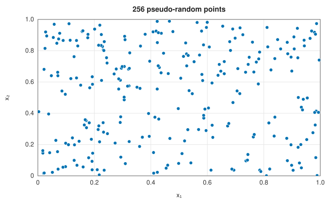
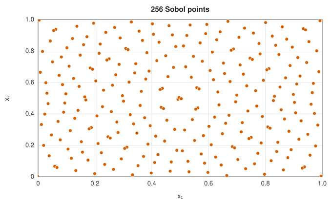
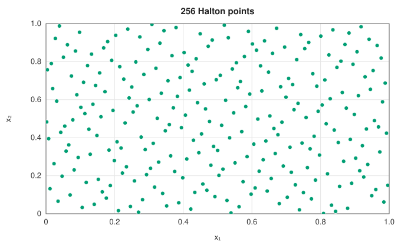
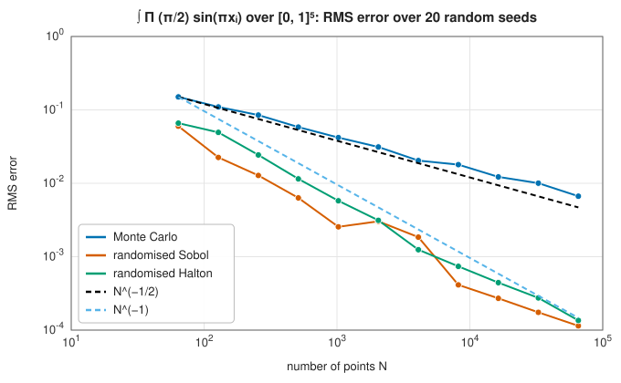

# Monte Carlo and quasi-Monte Carlo integration

<div class="entry-summary">

| | |
|---|---|
| **Problem** | Approximate integrals over boxes in many dimensions, where grids and cubature rules are too expensive |
| **Devised by** | Monte Carlo: Stanisław Ulam, John von Neumann and Nicholas Metropolis (1946–1949), after Buffon (1777). Low-discrepancy sequences: John Halton (1960), Ilya Sobol (1967). Random shifts: Roy Cranley and Thomas Patterson (1976) |
| **Accuracy** | Monte Carlo: standard error $\sigma/\sqrt N$ in every dimension. Quasi-Monte Carlo: often close to $1/N$ in practice for smooth integrands of low effective dimension (the bound is $(\log N)^d/N$) |
| **Cost** | One evaluation per point |
| **API** | [`monte_carlo`](../../api/lib_jsl_integration/monte_carlo_integration/fn.monte_carlo.html), [`monte_carlo_integration`](../../api/lib_jsl_integration/monte_carlo_integration/fn.monte_carlo_integration.html), [`quasi_monte_carlo_integration`](../../api/lib_jsl_integration/quasi_monte_carlo/fn.quasi_monte_carlo_integration.html), [`QuasiRandomSequence`](../../api/lib_jsl_integration/quasi_monte_carlo/enum.QuasiRandomSequence.html) |

</div>

## Overview

Every method in this chapter so far places its points deliberately, and pays for it in high
dimensions: a [cubature](cubature.md) rule that resolves the integrand along each axis needs a
number of points that grows exponentially with the dimension. **Monte Carlo integration** gives up
on deliberate placement. It averages the integrand at random points, and the law of large numbers
does the rest. Its error falls only like $1/\sqrt N$, slowly, but that rate does not depend on the
dimension at all, which makes Monte Carlo the method of choice from about ten dimensions upwards,
and the only practical one in hundreds.

**Quasi-Monte Carlo** keeps the simplicity of averaging but replaces random points by
**low-discrepancy sequences**, deterministic points spread more evenly than random ones could be.
For smooth integrands the error then falls nearly like $1/N$. Randomising the sequence, as the
library does, restores an honest error estimate.

## History

The idea of estimating a number by random experiment is old. In 1777 Georges-Louis Leclerc, Comte
de Buffon, showed that a needle dropped on ruled paper crosses a line with a probability involving
$\pi$, so that repeated throws estimate $\pi$. Enrico Fermi used random sampling privately in the
1930s to study neutron diffusion.

The method acquired its name and its place in computing at Los Alamos. Recovering from an illness
in 1946, the mathematician Stanisław Ulam wondered about the chance of winning a game of
solitaire and realised it was easier to play many games and count than to calculate. With John von
Neumann he saw that the same approach could solve the neutron transport problems of the weapons
programme on the new ENIAC computer. Nicholas Metropolis suggested the name, after the casino where
Ulam's uncle gambled, and Metropolis and Ulam published "The Monte Carlo method" in 1949.

Quasi-random points grew from number theory and the study of uniform distribution. John Halton
(1960) and Ilya Sobol (1967) constructed sequences whose points fill the unit cube far more evenly
than random ones, and the **Koksma-Hlawka inequality** (Jurjen Koksma 1942, Edmund Hlawka 1961)
explained why they integrate better. Roy Cranley and Thomas Patterson (1976) showed how to randomise
such points with a random shift, which brought back error estimates, and Art Owen (1995) introduced
the more powerful randomisation by scrambling.

## The idea

### Monte Carlo as an average

Let $V$ be the volume of the box $B$ and $\mathbf X$ a random point uniformly distributed in $B$. Then
$\int_B f = V\,\mathbb E[f(\mathbf X)]$, and with independent samples $\mathbf X_1, \ldots, \mathbf X_N$ the
natural estimate is

$$
Q_N = \frac{V}{N} \sum_{i=1}^N f(\mathbf X_i).
$$

It is **unbiased**, $\mathbb E[Q_N] = \int_B f$, and since the samples are independent its variance is
$V^2 \sigma^2 / N$, where $\sigma^2 = \operatorname{Var} f(\mathbf X)$. By the central limit theorem the error
is approximately normally distributed with standard deviation

$$
\text{standard error} = \frac{V \sigma}{\sqrt N}.
$$

Two facts make this remarkable. The dimension of the box appears nowhere: only the variance of
the integrand matters. And the error can be estimated from the same samples, by replacing $\sigma$
with the sample standard deviation. The price is the rate: one more correct digit costs a hundred
times as many samples.

{{#include ../generated/integration/monte_carlo_dimensions.md}}

For an integrand with the same variance in every dimension, the Monte Carlo error with $10^5$ points
is the same in one dimension as in fifty, while even the crudest product rule would need
$2^{50} \approx 10^{15}$ evaluations.

### An honest error estimate

The sample variance must be computed carefully. The textbook formula
$\overline{f^2} - \bar f^2$ subtracts two nearly equal numbers when the mean is large compared with
the spread. **Welford's algorithm** updates the mean and the sum of squared deviations one sample
at a time:

$$
\delta = y_n - \bar y_{n-1}, \qquad \bar y_n = \bar y_{n-1} + \frac{\delta}{n}, \qquad
M_n = M_{n-1} + \delta\,(y_n - \bar y_n),
$$

so that $\sigma^2 \approx M_n / (n - 1)$, without cancellation. The library's tests check that the
estimate is honest: over many seeds, about 68% of estimates lie within one standard error of the
true value, as the normal distribution predicts.

A stopping rule must use this standard error. It is tempting to stop "when the estimate stops
changing", but successive running averages share almost all their samples, so they agree with each
other long before they agree with the integral. [`monte_carlo_integration`](../../api/lib_jsl_integration/monte_carlo_integration/fn.monte_carlo_integration.html)
samples in batches until the standard error falls below the requested target.

### Low-discrepancy sequences

Random points leave gaps and clusters, and the $1/\sqrt N$ rate is the price of that unevenness.
The **star discrepancy** $D^*_N$ of a point set measures it: the largest difference, over all boxes
$[0, \mathbf t)$ anchored at the origin, between the fraction of points inside the box and its volume.
Random points have $D^*_N \approx 1/\sqrt N$. Low-discrepancy sequences achieve
$D^*_N = O\big((\log N)^d / N\big)$.

<div class="figure-row">

| | | |
|---|---|---|
|  |  |  |

</div>

The **Halton sequence** uses the radical inverse: write $i$ in base $b$, reflect its digits about the
decimal point ($i = 6 = 110_2 \mapsto 0.011_2 = 0.375$), and use a different prime base for each
coordinate. The **Sobol sequence** works in base 2 throughout, with carefully chosen "direction
numbers" for each coordinate, and its first $2^m$ points are stratified: in two dimensions every
box of the form $[a 2^{-j}, (a+1) 2^{-j}) \times [b 2^{-k}, (b+1) 2^{-k})$ with area $2^{-m}$ contains exactly
one of them, and in higher dimensions the same holds for somewhat larger boxes. Both are generated in the
[random crate](../../api/lib_jsl_random/quasi_random/index.html).

> **Koksma-Hlawka inequality.** For points $\mathbf x_1, \ldots, \mathbf x_N$ in $[0,1]^d$ and $f$ of bounded
> variation $V_{\mathrm{HK}}(f)$ in the sense of Hardy and Krause,
> $$\left| \frac1N \sum_{i=1}^N f(\mathbf x_i) - \int_{[0,1]^d} f \right| \le V_{\mathrm{HK}}(f)\, D^*_N.$$

The error therefore separates into a property of the integrand and a property of the points, and
low-discrepancy points give an error bound of order $(\log N)^d/N$. That bound is asymptotic and pessimistic: for
$d = 5$ and $N = 65\,536$, $(\ln N)^5 \approx 1.7\times10^5$ is larger than $N$, so the bound says nothing yet. The
$N^{-1}$ behaviour seen below is an observation about smooth integrands whose variation is concentrated in a few
coordinates, not a consequence of the inequality.

### Randomised quasi-Monte Carlo

Deterministic points have one drawback: the bound above is almost impossible to evaluate, so there
is no practical error estimate. The **Cranley-Patterson shift** adds the same uniformly random vector
$\mathbf u$ to every point, modulo 1. Each shifted point is uniformly distributed, so the estimate is
unbiased, while the even spacing of the set is preserved. Repeating with $R$ independent shifts gives
$R$ independent estimates, and their spread gives a standard error, exactly as in Monte Carlo.



For this smooth five-dimensional integrand, Monte Carlo follows the $N^{-1/2}$ line and the randomised
Sobol and Halton points follow $N^{-1}$: at $N = 65\,536$ they are about fifty times more accurate.
The advantage shrinks as the dimension grows and as the integrand becomes rougher. The last column of
the table above shows the randomised Halton error growing with the dimension, from $10^{-5}$ in one
dimension to $3 \times 10^{-4}$ in fifty.

## Algorithm

**Monte Carlo** (`monte_carlo`): for $i = 1, \ldots, N$, draw $\mathbf X_i$ uniformly in the box and update
Welford's mean and $M$ with $f(\mathbf X_i)$. Return $V \bar y$ and $V \sqrt{M / (N - 1) / N}$.

**Monte Carlo to a target** (`monte_carlo_integration`): sample in batches; after each batch, stop if
the standard error is below the target, or return the current estimate once the sample limit is
reached.

**Randomised QMC** (`quasi_monte_carlo_integration`): generate the first $N$ points of the Sobol or
Halton sequence; for $r = 1, \ldots, R$, draw a random shift, average $f$ over the shifted points
mapped to the box, and record the estimate. Return the mean of the $R$ estimates and their standard
error.

## Implementation

Welford's update and the standard error:

```rust,ignore
{{#include ../../../crates/integration/src/monte_carlo_integration.rs:welford}}
```

- The random generator is seeded explicitly, so results are reproducible.
- For Sobol points, use a power of two for $N$: the stratification property holds for the first
  $2^m$ points, and partial blocks integrate less evenly.
- With a single replicate the QMC standard error is not available (it is returned as NaN);
  8 to 32 replicates are typical.

## In practice

```rust,ignore
{{#include ../../../crates/integration/examples/quadrature_monte_carlo.rs}}
```

**Strengths**

- Works in any dimension, with an error that depends on the variance and not on the dimension.
- Needs nothing of the integrand beyond the ability to evaluate it; discontinuities, such as the
  indicator of a ball, are no obstacle.
- Gives an honest, cheap error estimate.
- Quasi-Monte Carlo is often ten to a thousand times more accurate for smooth integrands at no
  extra cost.

**Weaknesses**

- Slow: the $1/\sqrt N$ rate makes high accuracy prohibitively expensive.
- Integrands with large or infinite variance (for example strong singularities) converge slowly
  or not at all, and the error estimate then becomes unreliable too.
- The QMC advantage fades in very high dimensions unless the integrand depends mostly on a few
  variables or on low-order interactions.

The variance can often be reduced: by **importance sampling** (drawing points from a density
resembling $|f|$), **control variates** (subtracting a function with a known integral) or
**stratification**. These methods appear with the [random number generation](../../api/lib_jsl_random/index.html)
tools in a later chapter.

## Exercises

1. Show that $\mathbb E[Q_N] = \int_B f$ and $\operatorname{Var}[Q_N] = V^2\sigma^2/N$.
2. Estimate $\pi$ from the area of the unit disc with Monte Carlo, and determine how many points are
   needed for six correct digits.
3. Compute the first eight points of the base-2 and base-3 radical inverses by hand, and check them
   against [`HaltonSequence`](../../api/lib_jsl_random/quasi_random/struct.HaltonSequence.html).
4. Integrate $f(\mathbf x) = \prod_{i=1}^d (1 + (x_i - \tfrac12))$ over $[0,1]^d$ for $d = 2, 8, 32$ with
   Monte Carlo and randomised Sobol at $N = 2^{14}$. How does the advantage of QMC change, and why?
5. For $\int_0^1 x^{-1/2}\,dx = 2$, the variance of $f$ is infinite. What happens to the Monte Carlo
   estimate and its standard error as $N$ grows?

<details>
<summary>Hints and answers</summary>

1. $\mathbb E[Q_N] = \tfrac VN\sum\mathbb E f(\mathbf X_i) = V\,\mathbb E f = \int_Bf$. Independence makes variances add: $\operatorname{Var}Q_N = \tfrac{V^2}{N^2}\cdot N\sigma^2 = V^2\sigma^2/N$.
2. The hit fraction $p = \pi/4$ has standard deviation $\sqrt{p(1 - p)/N}$, so $\hat\pi = 4\hat p$ has standard error $4\sqrt{p(1 - p)/N} \approx 1.64/\sqrt N$. For six correct digits (error below $5\times10^{-7}$) you need $N \approx (1.64/5\times10^{-7})^2 \approx 10^{13}$.
3. Base 2: $\tfrac12, \tfrac14, \tfrac34, \tfrac18, \tfrac58, \tfrac38, \tfrac78, \tfrac1{16}$. Base 3: $\tfrac13, \tfrac23, \tfrac19, \tfrac49, \tfrac79, \tfrac29, \tfrac59, \tfrac89$. The library's Halton sequence starts after the origin, so these are its first terms.
4. The exact integral is 1. Each factor has variance $1/12$, so $\operatorname{Var}f = (13/12)^d - 1$, which grows from $0.17$ at $d = 2$ to about $12$ at $d = 32$. The function is a product of one-dimensional pieces with weak interactions, so QMC keeps a large advantage, which narrows as $d$ grows.
5. The mean is finite, so the estimate still converges (law of large numbers), but the variance is infinite, so the central limit theorem does not apply: convergence is slower than $1/\sqrt N$ and erratic, and the sample standard error is unreliable and tends to be too small.

</details>

## Further reading

- N. Metropolis and S. Ulam, "The Monte Carlo method", *Journal of the American Statistical
  Association* 44 (1949) 335–341.
- R. Eckhardt, "Stan Ulam, John von Neumann, and the Monte Carlo method", *Los Alamos Science* 15
  (1987) 131–137. The history, from those who were there.
- J. H. Halton, "On the efficiency of certain quasi-random sequences of points in evaluating
  multi-dimensional integrals", *Numerische Mathematik* 2 (1960) 84–90.
- I. M. Sobol, "On the distribution of points in a cube and the approximate evaluation of
  integrals", *USSR Computational Mathematics and Mathematical Physics* 7 (1967) 86–112.
- R. Cranley and T. N. L. Patterson, "Randomization of number theoretic methods for multiple
  integration", *SIAM Journal on Numerical Analysis* 13 (1976) 904–914.
- B. P. Welford, "Note on a method for calculating corrected sums of squares and products",
  *Technometrics* 4 (1962) 419–420.
- A. B. Owen, *Monte Carlo Theory, Methods and Examples*, 2013, online at
  <https://artowen.su.domains/mc/>. A modern textbook covering both methods.
