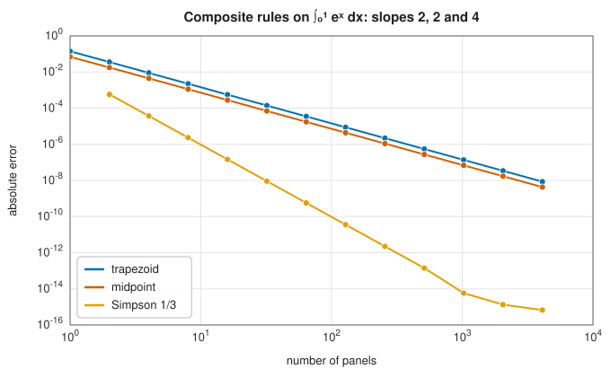
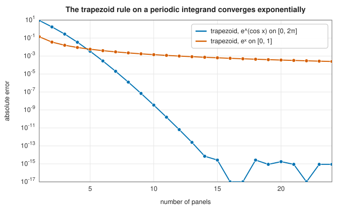
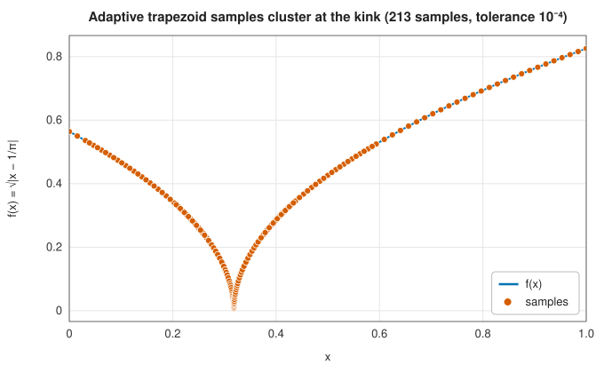

# Newton-Cotes rules: midpoint, trapezoid and Simpson

<div class="entry-summary">

| | |
|---|---|
| **Problem** | Approximate $\int_a^b f(x)\,dx$ from values of $f$ at equally spaced points |
| **Devised by** | Trapezoid areas: Babylonian astronomers (c. 350–50 BCE). General rules: Isaac Newton (1670s, published 1711) and Roger Cotes (1722). Simpson's rule: Cavalieri (1639), Gregory (1668), Thomas Simpson (1743). Adaptive subdivision: Kuncir and McKeeman (1962) |
| **Accuracy** | Composite midpoint and trapezoid: $O(h^2)$; composite Simpson: $O(h^4)$; trapezoid on smooth periodic integrands: exponential |
| **Cost** | One evaluation per point; the adaptive rule spends evaluations where they are needed |
| **API** | [`MidpointIntegrationEngine`](../../api/lib_jsl_integration/midpoint_integration_engine/struct.MidpointIntegrationEngine.html), [`TrapezoidalIntegrationEngine`](../../api/lib_jsl_integration/trapezoidal_integration_engine/struct.TrapezoidalIntegrationEngine.html), [`Simpson13Engine`](../../api/lib_jsl_integration/simpsons_1_3_integration_engine/struct.Simpson13Engine.html), [`AdaptiveTrapezoidIntegrationEngine`](../../api/lib_jsl_integration/adaptive_trapezoid_integration_engine/struct.AdaptiveTrapezoidIntegrationEngine.html), [`grid_points`](../../api/lib_jsl_integration/calculate_midpoints/fn.grid_points.html), [`panel_midpoints`](../../api/lib_jsl_integration/calculate_midpoints/fn.panel_midpoints.html) |

</div>

## Overview

The oldest way to integrate a function numerically is to replace it, piece by piece, with
something whose area is easy to compute. Replace $f$ on each small panel by a constant and you
get the **midpoint rule**. Replace it by a straight line and you get the **trapezoid rule**.
Replace it by a parabola through three points and you get **Simpson's rule**. Interpolating
with a polynomial through equally spaced points in general gives the **Newton-Cotes rules**.

These rules are the foundation of numerical integration and the building blocks of several more
powerful methods: [Romberg integration](romberg.md) extrapolates the trapezoid rule, the
trapezoid rule is the engine inside [tanh-sinh quadrature](tanh-sinh.md), and adaptive methods
apply simple rules on ever smaller panels. Used on their own, they converge slowly on general
integrands. There are two important exceptions: the trapezoid rule is exponentially accurate for
smooth *periodic* functions, and adaptive subdivision can isolate a kink or a jump that ruins
every fixed rule.

## History

The trapezoid rule is far older than calculus. In 2016 the historian of science Mathieu
Ossendrijver showed that Babylonian astronomers, writing on clay tablets between about 350 and
50 BCE, computed the distance travelled by Jupiter as the area of a trapezoid under a graph of
its velocity against time. Nothing comparable appears in Europe until the fourteenth century.

The general theory came with interpolation. Isaac Newton developed interpolation through equally spaced
points in the 1670s and published it, with rules for integrating the interpolating polynomial,
in *Methodus differentialis* (1711); the four-point rule with weights $\tfrac18(1, 3, 3, 1)$ is still called
**Newton's three-eighths rule**. Roger Cotes, who edited the second edition of Newton's
*Principia*, computed the weights of these rules for up to eleven points; they were published
after his early death in *Harmonia mensurarum* (1722). Hence **Newton-Cotes** rules.

The three-point rule has an even longer history. Johannes Kepler used an equivalent formula in
1615 to estimate the volume of wine barrels (German texts still call it *Keplersche Fassregel*,
Kepler's barrel rule), Bonaventura Cavalieri stated it in 1639 and James Gregory in 1668. Thomas
Simpson, a self-taught weaver turned mathematics teacher, gave it in his *Mathematical
Dissertations* of 1743, and his name stuck.

Adaptive quadrature arrived with the computer. In 1962 the *Communications of the ACM* published
two short ALGOL procedures, by G. F. Kuncir and W. M. McKeeman, that applied Simpson's rule
recursively, halving each panel until two estimates agreed. Walter Gander and Walter Gautschi
revisited the idea in 2000 and showed how to make such routines robust.

## The idea

All the rules in this entry share one structure: on a panel of width $h$, approximate $f$ by a
polynomial $p$ through a few equally spaced points and integrate $p$ exactly. The result is a
weighted sum $\sum_i w_i f(x_i)$ whose weights do not depend on $f$. A rule has **degree of
exactness** $d$ if it integrates every polynomial of degree at most $d$ exactly; its error is
then governed by the $(d+1)$-th derivative of $f$.

### The midpoint rule

On a single panel $[x_0, x_0 + h]$ with centre $m$, use the constant $f(m)$:

$$
\int_{x_0}^{x_0+h} f(x)\,dx \approx h\,f(m).
$$

How large is the error? Expand $f$ in a Taylor series about the centre $m$:

$$
f(x) = f(m) + (x - m) f'(m) + \tfrac12 (x - m)^2 f''(m) + \cdots
$$

and integrate term by term over the panel, which runs from $m - h/2$ to $m + h/2$. The constant
term gives $h\,f(m)$, which is the rule itself. The linear term gives zero, because $x - m$ is as
often negative as positive on a panel that is symmetric about $m$; the same is true of every odd
power. The first term that survives is the quadratic one:

$$
\int_{m-h/2}^{m+h/2} \tfrac12 (x - m)^2 f''(m)\,dx = \frac{h^3}{24} f''(m).
$$

A careful version of this argument, which keeps track of the neglected terms, replaces $f''(m)$ by
$f''(\xi)$ at some unknown point $\xi$ in the panel and makes the statement exact:

$$
\int_{x_0}^{x_0+h} f(x)\,dx - h\,f(m) = \frac{h^3}{24} f''(\xi).
$$

Since the error involves only $f''$, it vanishes whenever $f'' = 0$. A constant approximation is
therefore exact for straight lines, not just for constants: degree of exactness 1, a free bonus
from symmetry. The midpoint rule is an **open** rule: it never evaluates $f$ at the
endpoints, which matters when $f$ is undefined there.

### The trapezoid rule

Use the straight line through both endpoints:

$$
\int_{x_0}^{x_0+h} f(x)\,dx \approx \frac{h}{2}\big[f(x_0) + f(x_0 + h)\big].
$$

> **Error of the trapezoid rule.** If $f''$ is continuous, then for some $\xi$ in the panel
> $$\int_{x_0}^{x_0+h} f(x)\,dx - \frac{h}{2}\big[f(x_0) + f(x_0+h)\big] = -\frac{h^3}{12} f''(\xi).$$

*Proof.* Shift the panel to $[0, h]$ and let $K(x) = \tfrac12 x (h - x)$, so that $K(0) = K(h) = 0$,
$K'(x) = \tfrac h2 - x$ and $K'' = -1$. Integrating by parts twice,

$$
\int_0^h K f''\,dx = \big[K f'\big]_0^h - \int_0^h K' f'\,dx
= -\big[K' f\big]_0^h + \int_0^h K'' f\,dx
= \frac h2\big[f(0) + f(h)\big] - \int_0^h f\,dx.
$$

Since $K \ge 0$ on the panel, the mean value theorem for integrals gives
$\int_0^h K f''\,dx = f''(\xi) \int_0^h K\,dx = \tfrac{h^3}{12} f''(\xi)$. $\blacksquare$

The midpoint and trapezoid errors have the *same* form with opposite signs, and the midpoint
error is half as large. That observation leads directly to Simpson's rule.

### Composite rules

A single panel is rarely accurate enough. A **composite** rule divides $[a, b]$ into $n$ panels of
width $h = (b - a)/n$ and adds the single-panel rules. Summing $n$ local errors of size $h^3$
gives a global error of order $n h^3 = (b - a) h^2$:

$$
M_n - I = -\frac{(b-a) h^2}{24} f''(\xi), \qquad
T_n - I = \frac{(b-a) h^2}{12} f''(\eta),
$$

where $M_n = h \sum_i f\big(a + (i + \tfrac12)h\big)$ and
$T_n = h\big[\tfrac12 f(a) + f(a + h) + \cdots + f(b - h) + \tfrac12 f(b)\big]$. Halving $h$ divides
both errors by four. For $\int_0^1 e^x\,dx$ the library computes

<p class="caption" id="tab-2-4"><strong>Table 2.4.</strong> Columns: panels $n$, midpoint $M_n - I$, trapezoid $T_n - I$, ratio, and more.</p>

{{#include ../generated/integration/newton_cotes_midpoint_trapezoid.md}}

The ratio of the errors tends to exactly $-\tfrac12$, and the last column anticipates the next
section.

### Simpson's rules

The table shows that the midpoint error is very nearly minus one half of the trapezoid error.
Two estimates whose errors are in a known ratio can be combined so that the errors cancel. Write
$e = T_n - I$ for the trapezoid error, so that $M_n - I \approx -\tfrac12 e$. Then the weighted
average $(2 M_n + T_n)/3$ has error

$$
\frac{2 M_n + T_n}{3} - I = \frac{2(M_n - I) + (T_n - I)}{3} \approx \frac{2(-\tfrac12 e) + e}{3} = 0.
$$

The $h^2$ errors cancel, and what remains is of order $h^4$. Written out, the combination uses the panel endpoints and midpoints with weights
$\tfrac{h}{6}(1, 4, 1)$ per panel. With the step $h$ now denoting the distance between
neighbouring points and an even number $n$ of such sub-panels, this is the composite
**Simpson's 1/3 rule**:

$$
S_n = \frac{h}{3}\big[f(x_0) + 4 f(x_1) + 2 f(x_2) + 4 f(x_3) + \cdots + 4 f(x_{n-1}) + f(x_n)\big],
$$

$$
S_n - I = \frac{(b - a) h^4}{180} f^{(4)}(\xi).
$$

Equivalently, Simpson's rule integrates the parabola through three equally spaced points. A
parabola should only be exact for quadratics, but symmetry again gives a bonus degree: Simpson's
rule is exact for cubics, which is why its error involves $f^{(4)}$. It is also the first
column of the [Romberg tableau](romberg.md#the-tableau).

When the number of panels is odd, the 1/3 rule cannot cover the interval. **Simpson's 3/8 rule**,
Newton's four-point rule

$$
\int_{x_0}^{x_3} f(x)\,dx \approx \frac{3h}{8}\big[f(x_0) + 3 f(x_1) + 3 f(x_2) + f(x_3)\big],
$$

is also exact for cubics, and the library uses it on the last three panels in that case so the
whole result stays fourth order.

### Higher-order Newton-Cotes rules

Why not keep going, interpolating through more and more equally spaced points? The weights of the
closed rules on $[0, 1]$, computed by the library from the conditions
$\sum_i w_i x_i^k = 1/(k+1)$, show what goes wrong (only the first half of each symmetric list is
shown):

<p class="caption" id="tab-2-5"><strong>Table 2.5.</strong> Columns: points, weights on $[0, 1]$, degree, $\sum_i \lvert w_i \rvert$.</p>

{{#include ../generated/integration/newton_cotes_weights.md}}

Rules with an odd number of points gain a degree from symmetry, so the 3-point rule (Simpson) is
as exact as the 4-point rule, and the 5-point rule (Boole's) as the 6-point one. From 9 points on,
**negative weights** appear, and $\sum |w_i|$ grows rapidly. That sum bounds how much rounding
errors in the values $f(x_i)$ are amplified, and it is also a sign of a deeper problem: the
interpolating polynomials through equally spaced points oscillate wildly near the ends of the
interval (the Runge phenomenon). George Pólya proved in 1933 that Newton-Cotes rules do not
converge, as the number of points grows, even for some analytic functions.

The cure is to keep the degree low and add panels instead, as the composite rules do, or to give
up equal spacing altogether: [Gaussian quadrature](gaussian-quadrature.md) chooses the nodes as
well as the weights, and all its weights are positive.



<p class="caption" id="fig-2-3"><strong>Figure 2.3.</strong> Composite rules converge as h², h² and h⁴.</p>

### The trapezoid rule on periodic functions

The [Euler-Maclaurin formula](romberg.md#the-trapezoid-rule-and-its-error) gives the trapezoid
error as a series whose coefficients are differences of odd derivatives *at the endpoints*,
$f^{(2k-1)}(b) - f^{(2k-1)}(a)$. If $f$ is smooth and periodic with period $b - a$, every one of
these differences vanishes. The error is then smaller than any power of $h$, and for analytic
periodic $f$ it decreases exponentially in the number of points:



<p class="caption" id="fig-2-4"><strong>Figure 2.4.</strong> The trapezoid rule on a periodic integrand.</p>

With about 14 panels the trapezoid rule reaches machine precision for $\int_0^{2\pi} e^{\cos x}\,dx$,
while for the non-periodic $\int_0^1 e^x\,dx$ it has only about three correct digits. This is why the
trapezoid rule is the method of choice for Fourier coefficients, contour integrals around circles
and other periodic problems, and why the discrete Fourier transform is so accurate.

### The adaptive trapezoid rule

Fixed rules spread their points evenly, but integrands are rarely equally difficult everywhere.
An **adaptive** rule estimates its own error on each panel and subdivides only where the estimate
is too large:

1. On $[a, b]$ with midpoint $c$, compare the one-panel trapezoid value
   $T_1 = \tfrac{b-a}{2}\big(f(a) + f(b)\big)$ with the two-panel value
   $T_2 = \tfrac{b-a}{4}\big(f(a) + 2f(c) + f(b)\big)$.
2. Since $T_1 - I \approx 4(T_2 - I)$, the difference $|T_2 - T_1| \approx 3|T_2 - I|$ is a
   (conservative) estimate of the error. If it is below the tolerance, accept $T_2$.
3. Otherwise apply the procedure to $[a, c]$ and $[c, b]$, each with half the tolerance, so that
   the accepted errors add up to roughly the requested total.

Function values at the panel ends are passed down the recursion, so each subdivision costs one
new evaluation.

How well does this work? The library's answer, comparing the adaptive rule with the uniform
trapezoid rule given the *same number of evaluations*, on three integrands over $[0, 1]$: a
smooth peak $1/\big(10^{-3} + (x - 0.3)^2\big)$, a kink $\sqrt{\lvert x - 1/\pi \rvert}$ and a jump
from 0 to 1 at $x = 1/\pi$:

<p class="caption" id="tab-2-6"><strong>Table 2.6.</strong> Columns: integrand on $[0, 1]$, tolerance, evaluations, adaptive error, and more.</p>

{{#include ../generated/integration/adaptive_trapezoid_table.md}}

The results are instructive. On the smooth peak the uniform rule wins by orders of magnitude,
although the adaptive rule meets its tolerance. The uniform trapezoid rule enjoys a hidden
advantage: by the Euler-Maclaurin formula its local errors cancel across panels, leaving only the
endpoint terms, whereas the unequal panels of the adaptive rule destroy that cancellation. At a
**kink** inside the interval the uniform rule loses this advantage too, and the adaptive rule
wins by putting its points where the trouble is:



<p class="caption" id="fig-2-5"><strong>Figure 2.5.</strong> Adaptive trapezoid samples.</p>

At a **jump** the uniform rule is stuck at an $O(h)$ error, while the adaptive rule isolates the
discontinuity in a panel of width $2^{-50}$ and is exact to rounding error with about a hundred
evaluations. The lesson generalises: adaptivity pays for itself on non-smooth integrands, and on
smooth ones it is better combined with a high-order rule, as in
[adaptive Gauss-Kronrod quadrature](gauss-kronrod.md).

## Algorithm

**Composite rules.** With $x_i = a + ih$:

- Midpoint ($n$ panels, $h = (b-a)/n$): $M_n = h \sum_{i=0}^{n-1} f(x_i + h/2)$.
- Trapezoid ($n$ panels, $n + 1$ points): $T_n = h\big[\tfrac12 f_0 + f_1 + \cdots + f_{n-1} + \tfrac12 f_n\big]$.
- Simpson ($n$ even): $S_n = \tfrac h3\big[f_0 + 4f_1 + 2f_2 + \cdots + 4f_{n-1} + f_n\big]$; for odd
  $n$, Simpson 1/3 on the first $n - 3$ panels and the 3/8 rule on the last three.

Each costs one evaluation per point and $O(1)$ arithmetic per point.

**Adaptive trapezoid.** `refine(a, fa, b, fb, tol, depth)`:

1. $c = (a+b)/2$, $f_c = f(c)$, $T_1 = \tfrac{b-a}{2}(f_a + f_b)$, $T_2 = \tfrac{b-a}{4}(f_a + 2f_c + f_b)$.
2. If $|T_2 - T_1|$ is not finite, fail (the integrand has a singularity at a sample point).
3. If $|T_2 - T_1| <$ `tol`, or `depth` has reached 50, return $T_2$.
4. Return `refine(a, fa, c, fc, tol/2, depth+1) + refine(c, fc, b, fb, tol/2, depth+1)`.

## Implementation

The fixed rules share their structure: the sample points are computed by
[`grid_points`](../../api/lib_jsl_integration/calculate_midpoints/fn.grid_points.html) (trapezoid
and Simpson) or
[`panel_midpoints`](../../api/lib_jsl_integration/calculate_midpoints/fn.panel_midpoints.html)
(midpoint), optionally cached in the engine so that repeated integrals over the same interval do
not recompute them. The midpoint rule is then a single sum:

```rust,ignore
{{#include ../../../crates/integration/src/midpoint_integration_engine.rs:midpoint_rule}}
```

The trapezoid rule halves the two end values:

```rust,ignore
{{#include ../../../crates/integration/src/trapezoidal_integration_engine.rs:trapezoid_rule}}
```

Simpson's rule handles the odd-panel case with the 3/8 rule and falls back to the trapezoid rule
for two points:

```rust,ignore
{{#include ../../../crates/integration/src/simpsons_1_3_integration_engine.rs:simpson_rule}}
```

The adaptive rule is a short recursion:

```rust,ignore
{{#include ../../../crates/integration/src/adaptive_trapezoid_integration_engine.rs:adaptive_trapezoid}}
```

- The accepted value is $T_2$, not the extrapolated $T_2 + (T_2 - T_1)/3$. That combination is
  Simpson's rule, and using it turns the routine into adaptive Simpson quadrature, the subject of
  Exercise 5.
- The depth limit has two purposes. A non-finite sample (for example $1/\sqrt{x}$ at $x = 0$) is
  reported as an error instead of recursing until the stack overflows. And at a jump, where the
  difference $|T_2 - T_1|$ shrinks only as fast as the halved tolerance, the panel containing the
  jump is accepted once it is too small to matter.

**A counting convention to watch.** The midpoint engine's `number_of_points` is the number of
panels (each has one sample), while the trapezoid and Simpson engines count points, so $n$
panels need $n + 1$ points.

## In practice

A complete program comparing the rules:

```rust,ignore
{{#include ../../../crates/integration/examples/quadrature_newton_cotes.rs}}
```

**Strengths**

- Simple, transparent and cheap per point; easy to apply to tabulated data at equally spaced
  points, where no other choice of nodes is available.
- The trapezoid rule is exponentially accurate for smooth periodic integrands.
- Composite rules converge for every continuous integrand, at a rate set by its smoothness.
- Adaptive subdivision isolates kinks and jumps at low cost.

**Weaknesses**

- Low order: for smooth non-periodic integrands, [Gaussian quadrature](gaussian-quadrature.md)
  and [Romberg integration](romberg.md) reach the same accuracy with far fewer evaluations.
- High-order Newton-Cotes rules are unstable (negative weights) and need not converge.
- The adaptive trapezoid rule over-refines smooth integrands, because its local error estimate
  cannot see the cancellation that makes the uniform rule accurate.

## Exercises

1. Show that the midpoint rule and the trapezoid rule are both exact for straight lines, and find
   the quadratic for which their errors on $[0, 1]$ are $-\tfrac1{24}$ and $\tfrac1{12}$.
2. Show directly from the weights that $(2M_n + T_n)/3 = S_{2n}$, Simpson's rule with $2n$
   panels. Check it with the example program.
3. Derive the weights of the 4-point closed rule by solving $\sum_i w_i x_i^k = 1/(k+1)$ for
   $k = 0, 1, 2, 3$ with $x_i = 0, \tfrac13, \tfrac23, 1$, and confirm the three-eighths rule.
4. Integrate $\int_0^{2\pi} \frac{d\theta}{2 + \cos\theta} = \frac{2\pi}{\sqrt{3}}$ with the trapezoid
   rule. How many panels give machine precision? Repeat with $\int_0^{\pi}$, which is not a full
   period, and explain the difference.
5. Modify the adaptive rule to return $T_2 + (T_2 - T_1)/3$ (adaptive Simpson) and repeat the
   comparison table. Why does it now do much better on the smooth peak?
6. The trapezoid engine's error on $\int_0^1 \sqrt{x}\,dx$ decreases like $h^{3/2}$, not $h^2$.
   Measure this, and explain it from the fact that $f''$ is not integrable at 0.

<details>
<summary>Hints and answers</summary>

1. Take $f = x^2/2$ on $[0, 1]$. Exact $\tfrac16$; midpoint $\tfrac18$ (error $-\tfrac1{24}$); trapezoid $\tfrac14$ (error $+\tfrac1{12}$), with error defined as rule minus exact.
2. $T_{2n} = (T_n + M_n)/2$ (the trapezoid rule on twice as many panels averages $T_n$ and the midpoint rule), and Simpson's rule is $S_{2n} = (4T_{2n} - T_n)/3 = (2T_n + 2M_n - T_n)/3 = (2M_n + T_n)/3$.
3. The equations $\sum_iw_ix_i^k = 1/(k + 1)$ for the four nodes give $w = (1, 3, 3, 1)/8$ on $[0, 1]$, i.e. weights $\tfrac{3h}{8}(1, 3, 3, 1)$ with $h = \tfrac13$: the three-eighths rule.
4. The integrand is analytic and periodic, so the trapezoid error decreases geometrically like $e^{-1.317n}$ (the nearest singularity is at $\theta = \pi \pm i\,\operatorname{arccosh}2$): about 28 panels give machine precision. Over $[0, \pi]$ the endpoint corrections of Euler-Maclaurin do not vanish, and the error falls only like $h^2$.
5. Adaptive Simpson uses a fourth-order rule per panel, so panels converge like $h^4$ and far fewer subdivisions are needed on smooth parts of the integrand, such as the peak's flanks.
6. The Euler-Maclaurin expansion of the trapezoid error for $\sqrt x$ contains a term proportional to $h^{3/2}$ (from the behaviour of $f$ at 0), because $f''\sim x^{-3/2}$ is not integrable. Measure the error against $h$ on a log-log plot to see the slope $3/2$.

</details>

## Further reading

- M. Ossendrijver, "Ancient Babylonian astronomers calculated Jupiter's position from the area
  under a time-velocity graph", *Science* 351 (2016) 482–484.
- R. Cotes, *Harmonia mensurarum*, ed. R. Smith, Cambridge, 1722.
- G. Pólya, "Über die Konvergenz von Quadraturverfahren", *Mathematische Zeitschrift* 37 (1933)
  264–286. Why high-order Newton-Cotes rules need not converge.
- G. F. Kuncir, "Algorithm 103: Simpson's rule integrator", *Communications of the ACM* 5 (1962)
  347; W. M. McKeeman, "Algorithm 145: Adaptive numerical integration by Simpson's rule",
  *Communications of the ACM* 5 (1962) 604.
- W. Gander and W. Gautschi, "Adaptive quadrature — revisited", *BIT Numerical Mathematics* 40
  (2000) 84–101.
- L. N. Trefethen and J. A. C. Weideman, "The exponentially convergent trapezoidal rule", *SIAM
  Review* 56 (2014) 385–458.
- P. J. Davis and P. Rabinowitz, *Methods of Numerical Integration*, 2nd ed., Academic Press,
  1984, chapter 2. The classical reference for Newton-Cotes rules and their errors.
