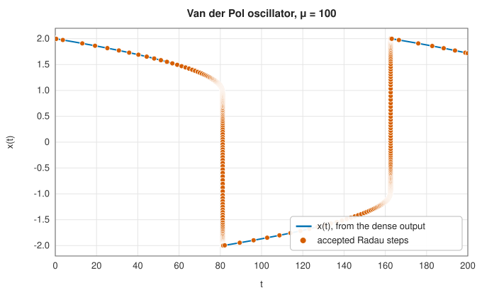
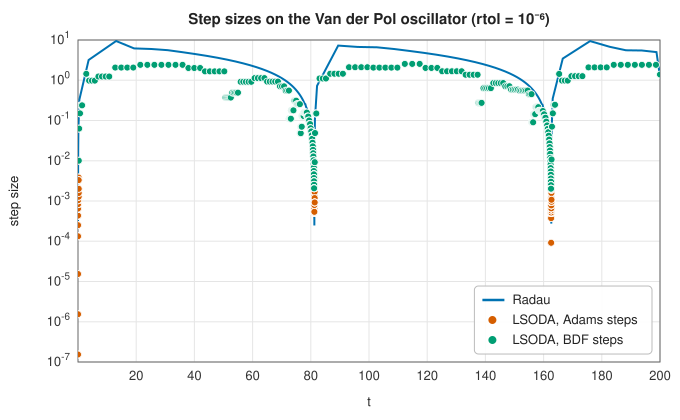

# Radau, LSODA and event location

<div class="entry-summary">

| | |
|---|---|
| **Problem** | Solve $\mathbf y' = \mathbf f(t, \mathbf y)$ accurately whether or not the problem is stiff, evaluate the solution anywhere (dense output), and find the times at which a function $g(t, \mathbf y)$ crosses zero (events) |
| **Devised by** | Radau quadrature: Rodolphe Radau (1880); Radau IIA methods: Owe Axelsson (1969), John Butcher (1964); the implementation: Ernst Hairer and Gerhard Wanner (1991); Nordsieck form: Arnold Nordsieck (1962); ODEPACK: Alan Hindmarsh (1980–83); automatic stiffness switching: Linda Petzold (1983) |
| **Accuracy** | Radau IIA: order 5, L-stable, dense output of order 3. LSODA: Adams orders 1–12, BDF orders 1–5. Radau matches SciPy step for step; events to machine precision on the interpolant |
| **Cost** | Radau: per step, 1–7 Newton iterations of 3 function evaluations, with one real and one complex $n \times n$ LU when the step changes. LSODA: 1–3 evaluations per step, plus an LU in BDF mode |
| **Read first** | [Runge-Kutta methods](runge-kutta.md), [Stiff ODE solvers](stiff-ode.md) |
| **API** | [`solve_ivp`](../../api/lib_jsl_integration/ivp/fn.solve_ivp.html), [`IvpMethod`](../../api/lib_jsl_integration/ivp/enum.IvpMethod.html), [`IvpOptions`](../../api/lib_jsl_integration/ivp/struct.IvpOptions.html), [`Event`](../../api/lib_jsl_integration/ivp/struct.Event.html), [`IvpSolution`](../../api/lib_jsl_integration/ivp/struct.IvpSolution.html), [`DenseOutput`](../../api/lib_jsl_integration/ivp/struct.DenseOutput.html) |

</div>

## Overview

The [previous entry](stiff-ode.md) solved stiff problems with Rosenbrock and BDF methods. This one adds the two stiff solvers of
SciPy's `solve_ivp` that the library lacked, and the two services that make a solver convenient:

- **Radau IIA** of order 5 is an implicit Runge-Kutta method. It is L-stable, so the fastest decaying modes are damped completely,
  and it is accurate at tight tolerances. Each step costs more than a BDF step, but there are far fewer of them.
- **LSODA** needs no decision about stiffness. It starts with Adams methods, which are cheap on non-stiff problems because they
  need no Jacobian. It switches to BDF when stability, not accuracy, limits the step, and switches back when the problem becomes non-stiff again.
- **Dense output**: every step leaves behind a polynomial, so the solution can be evaluated at any time without restricting the
  steps.
- **Event location**: the solver watches functions $g(t, \mathbf y)$ and reports the times at which they cross zero, such as a ball hitting the ground,
  and can stop the integration there.

## History

Rodolphe Radau (1880) studied quadrature rules that use one end point of the interval; collocation at those points gives the
Radau IIA Runge-Kutta methods, analysed by John Butcher (1964) and Owe Axelsson (1969). Ernst Hairer and Gerhard Wanner made
the 3-stage method practical in their Fortran code RADAU5 (1991), solving its $3n \times 3n$ Newton systems as one real and one complex $n \times n$
system, and SciPy's `Radau` follows it. Arnold Nordsieck (1962) proposed storing a multistep method's history as scaled derivatives,
which makes changes of step size and order easy. Charles William Gear's DIFSUB (1971) and Alan Hindmarsh's LSODE (1980), part of
ODEPACK, used this form for Adams and BDF methods of variable order. Linda Petzold (1983) added the switching between them that
became LSODA, which SciPy, R's `deSolve` and many other packages still call.

## The idea

### Radau IIA

An $s$-stage implicit Runge-Kutta method finds stage values $\mathbf Y_i = \mathbf y_n + h\sum_j a_{ij}\mathbf f(t_n + c_jh, \mathbf Y_j)$ and sets $\mathbf y_{n+1} = \mathbf Y_s$. Radau IIA chooses the $c_i$
as the zeros of a Radau polynomial, $c = \big(\tfrac{4 - \sqrt6}{10}, \tfrac{4 + \sqrt6}{10}, 1\big)$, so that it is the **collocation** method whose cubic matches the differential equation at
those three points. With $c_3 = 1$ the method is stiffly accurate, and therefore L-stable: its stability function vanishes at $h\lambda \to -\infty$.
It has order $2s - 1 = 5$, and the collocation cubic is the dense output.

The stage equations are $3n$ nonlinear equations. A simplified Newton iteration, with the Jacobian fixed for the step, would solve
$3n \times 3n$ systems with the matrix $I \otimes I - hA \otimes J$. Hairer and Wanner's trick diagonalises the $3 \times 3$ matrix $A^{-1} = T\Lambda T^{-1}$. It has one real eigenvalue $\gamma$
and a complex pair $\alpha \pm i\beta$, so in the transformed variables the system splits into

$$
\Big(\frac{\gamma}{h}I - J\Big)\Delta\mathbf w_1 = \mathbf r_1, \qquad \Big(\frac{\alpha + i\beta}{h}I - J\Big)(\Delta\mathbf w_2 + i\Delta\mathbf w_3) = \mathbf r_2 + i\mathbf r_3 ,
$$

one real and one complex $n \times n$ system, about 5 times cheaper than the full one. The error estimate comes from an embedded formula
of order 3, filtered through the real LU so that it stays small for stiff components. The library's `Radau` follows SciPy's
code line by line, including its step-size controller, Newton stopping rule and Jacobian reuse, and with the same Jacobian it takes
the same steps.

### Nordsieck multistep methods

A multistep method of order $q$ keeps a polynomial that fits the recent solution. In **Nordsieck form** the polynomial is stored as scaled
derivatives at the current time,

$$
\mathbf z_j = \frac{h^j}{j!}\,\mathbf y^{(j)}(t_n), \qquad j = 0, \ldots, q .
$$

A step predicts $\mathbf z(t_n + h)$ by multiplying by the Pascal matrix (Taylor's theorem for the polynomial), then corrects all components
with one vector $\boldsymbol\ell$ and one unknown, the correction $\mathbf e$:

$$
\mathbf z_j^{(n+1)} = \mathbf z_j^{\text{pred}} + \ell_j\,\mathbf e, \qquad \mathbf e = h\,\mathbf f\big(t_{n+1}, \mathbf z_0^{\text{pred}} + \ell_0\mathbf e\big) - \mathbf z_1^{\text{pred}} .
$$

The vector $\boldsymbol\ell$ alone decides the method: Adams-Moulton or BDF, of order $q$ (Hindmarsh's `cfode` computes them). Changing the step by a factor $r$
multiplies $\mathbf z_j$ by $r^j$. Changing the order adds or drops a component. The local error is a multiple of $\mathbf e$, and comparing the errors expected at orders $q - 1$, $q$
and $q + 1$ chooses the order. For Adams methods the corrector is solved by functional iteration, which needs no Jacobian. For BDF,
Newton's method with $I - h\ell_0J$ is used.

### Switching on stiffness

Adams methods have small stability regions: at order $q$ they are stable only while $h\|J\|$ stays below a constant $s_q$, from 0.5 at order 1 down to
0.025 at order 12. On a stiff problem this, not accuracy, limits the step. Every few steps LSODA compares two candidate steps:

- the Adams step allowed by accuracy, cut to the stability bound $s_q/\|J\|$. In Adams mode, $\|J\|$ is estimated from the contraction of the functional
  iteration, so no Jacobian is formed;
- the BDF step that the same error would allow, from the ratio of the two methods' error constants.

LSODA switches to BDF when the BDF step is at least 5 times larger, and back to Adams when Adams could take a step as large as BDF.
On the Van der Pol oscillator with $\mu = 100$ this happens in every cycle. The fast jumps are non-stiff and the slow stretches stiff:



<p class="caption" id="fig-2-23"><strong>Figure 2.23.</strong> Van der Pol solution.</p>



<p class="caption" id="fig-2-24"><strong>Figure 2.24.</strong> Step sizes.</p>

{{#include ../generated/integration/ivp_vdp_facts.md}} Radau takes fewer, longer steps, but each costs about 8 function evaluations
against LSODA's 2. Which is cheaper depends on the cost of $\mathbf f$ against that of the linear algebra.

### Dense output and events

Each accepted step defines a polynomial on its interval: Radau's collocation cubic, or the Nordsieck polynomial $\sum_j \mathbf z_j s^j$ with $s = (t - t_{n+1})/h$. Together they
form a continuous solution of the method's own order, which `DenseOutput::evaluate` returns at any time.

An **event** is a function $g(t, \mathbf y)$. After each step it is evaluated at the new point. If its sign has changed (in the requested direction), the root
of $g(t, \mathbf y(t))$ on the step's polynomial is found by Brent's method to machine precision. Events cost no extra steps and never
force the step to land on them. A **terminal** event ends the integration at its root after a given number of occurrences.

## Algorithm

**Radau step** (from $t$, $\mathbf y$, with step $h$):

1. Predict the stage increments from the previous step's collocation polynomial (zero at the first step).
2. Newton iteration in the transformed variables, at most 6 iterations, stopping when the estimated remaining error
   $\frac{\rho}{1-\rho}\|\Delta W\|$ falls below a tolerance, where $\rho$ is the observed contraction rate. If it diverges, re-evaluate the Jacobian once, then halve $h$.
3. Error estimate $(\gamma I/h - J)^{-1}(\mathbf f(t, \mathbf y) + \sum_i e_i\mathbf Z_i/h)$, in the RMS norm scaled by $\text{atol} + \text{rtol}\,|y|$. If it exceeds 1, shrink $h$
   with the predictive (Gustafsson) controller and retry.
4. Accept; the next step is the controller's choice, kept unchanged when the change would be less than 20% (so the LU can be reused).
   Re-evaluate the Jacobian if the Newton iteration was slow.

**LSODA step** (order $q$, method Adams or BDF):

1. Predict $\mathbf z$ by the Pascal matrix.
2. Correct: up to 3 functional (Adams) or Newton (BDF) iterations for $\mathbf e$. If they fail to converge, refresh the Jacobian (BDF) or cut $h$ by 4.
3. Error test $\|\mathbf e\|/\tau_q \le 1$. On failure, choose the better of orders $q$ and $q - 1$, with at most a fifth of the step after two failures, and
   restart at order 1 after three.
4. Accept: $\mathbf z_j \leftarrow \mathbf z_j^{\text{pred}} + \ell_j\mathbf e$. Every $q + 1$ steps, choose the order and step among $q - 1$, $q$ and $q + 1$, and test for a switch of method.

## Implementation

```rust,ignore
{{#include ../../../crates/integration/src/ivp.rs:collocation}}
```

```rust,ignore
{{#include ../../../crates/integration/src/ivp.rs:solve_ivp}}
```

- Radau is a direct port of SciPy's `Radau`. Without an analytic Jacobian it uses forward differences instead of SciPy's
  adaptive `num_jac`, so the step sequences then differ slightly.
- LSODA here is the library's own implementation of Petzold's scheme, with ODEPACK's coefficients and step and order rules. It is
  not a port of the Fortran code, whose many heuristics SciPy calls directly, so its steps differ from SciPy's.
- Integration runs forward in time only ($t_1 > t_0$), and tolerances are scalars.

## In practice

Both methods are compared with `scipy.integrate.solve_ivp` (SciPy 1.17.1; references from
`book/generator/data/make_ivp_refs.py`) on two stiff problems and a non-stiff one. The errors are relative to a reference solution at
$\mathrm{rtol} = 10^{-12}$, and $\mathrm{atol} = 10^{-3}\,\mathrm{rtol}$:

<p class="caption" id="tab-2-16"><strong>Table 2.16.</strong> Radau and LSODA against SciPy.</p>

{{#include ../generated/integration/ivp_scipy.md}}

With analytic Jacobians, Radau takes exactly SciPy's steps and reaches the same errors. LSODA's costs are within a factor of two of
ODEPACK's, sometimes lower. Its errors are similar on Van der Pol, but several times larger on Robertson's problem and more than a
hundred times larger on the Arenstorf orbit at $10^{-7}$. That orbit amplifies any local error by orders of magnitude along the trajectory. Neither LSODA handles Arenstorf at $10^{-4}$. The orbit needs a
tight tolerance or a high-order explicit method.

<p class="caption" id="tab-2-17"><strong>Table 2.17.</strong> Event location against reference event times.</p>

{{#include ../generated/integration/ivp_events.md}}

Events are located on the interpolant to machine precision, so their errors are the solution's errors. Radau's and SciPy's
Radau agree to all digits. The LSODA runs both find a spurious seventh crossing, because the orbit has drifted by the end.

**Strengths**

- Radau: L-stable, order 5, efficient at tight tolerances on stiff problems and on problems with eigenvalues near the imaginary axis.
- LSODA: no need to classify the problem, and cheap per step. Non-stiff stretches run without forming any Jacobian.
- Dense output and events with every method, at no extra cost in steps.

**Weaknesses**

- Radau's step costs grow quickly with $n$ (two LUs per step change, one of them complex). For large sparse systems, BDF with a sparse
  solver is better.
- The library's LSODA is not ODEPACK. On some problems its step and order heuristics are less economical or less accurate.
- No backward integration, vector tolerances, mass matrices or sparse Jacobians.

## Exercises

1. Show that the stability function of Radau IIA tends to zero as $h\lambda \to -\infty$, using $c_3 = 1$ (stiff accuracy).
2. Derive the Nordsieck vector $\boldsymbol\ell$ for the trapezoidal rule (Adams-Moulton of order 2) and check $\boldsymbol\ell = (\tfrac12, 1, \tfrac12)$.
3. Show that rescaling the Nordsieck array by $z_j \to r^jz_j$ represents the same polynomial with step $rh$.
4. Estimate when the Van der Pol oscillator is stiff from the eigenvalues of its Jacobian on the slow branch, and compare with the switching times
   in the figure.
5. A ball bounces with a coefficient of restitution of 0.8. Use a terminal event to stop at each impact, restart with the reflected velocity
   multiplied by 0.8, and check that the times between impacts shrink by the factor 0.8.

<details>
<summary>Hints and answers</summary>

1. The stability function is $R(z) = 1 + zb^{\mathsf T}(I - zA)^{-1}\mathbf 1$. For a stiffly accurate method, $b^{\mathsf T}$ is the last row of $A$, so $R(z) = e_s^{\mathsf T}(I - zA)^{-1}\mathbf 1$, which tends to $-e_s^{\mathsf T}A^{-1}\mathbf 1/z \to 0$.
2. With $z_0 = y$, $z_1 = hy'$, $z_2 = h^2y''/2$, the trapezoidal rule $y_{n+1} = y_n + \tfrac h2(y_n' + y_{n+1}')$ with the quadratic predictor gives $y_{n+1} - y^{\text{pred}} = \tfrac12 e$, $hy'_{n+1} - z_1^{\text{pred}} = e$,
   and the second derivative changes by $e/2$, so $\boldsymbol\ell = (\tfrac12, 1, \tfrac12)$.
3. $\sum_j z_j((t - t_n)/h)^j$ with $z_j \to r^jz_j$ and $h \to rh$ is unchanged.
4. On the slow branch $|x| > 1$, the Jacobian has an eigenvalue near $-\mu(x^2 - 1)$, which is large for $\mu = 100$. Adams at order $q$ then needs $h \lesssim s_q/(\mu(x^2 - 1))$, a few hundredths, while accuracy alone
   would allow steps of order 1.
5. Each flight lasts $2v_k/g$ with $v_{k+1} = 0.8v_k$, so the flight times form a geometric series with ratio 0.8.

</details>

## Further reading

- E. Hairer and G. Wanner, *Solving Ordinary Differential Equations II: Stiff and Differential-Algebraic Problems*, 2nd ed., Springer, 1996.
- A. C. Hindmarsh, "ODEPACK, a systematized collection of ODE solvers", in *Scientific Computing*, North-Holland, 1983, 55–64.
- L. R. Petzold, "Automatic selection of methods for solving stiff and nonstiff systems of ordinary differential equations", *SIAM Journal on Scientific and Statistical Computing* 4 (1983) 136–148.
- L. F. Shampine and M. W. Reichelt, "The MATLAB ODE suite", *SIAM Journal on Scientific Computing* 18 (1997) 1–22.
- E. Hairer, S. P. Nørsett and G. Wanner, *Solving Ordinary Differential Equations I: Nonstiff Problems*, 2nd ed., Springer, 1993, section II.6 (dense output).
