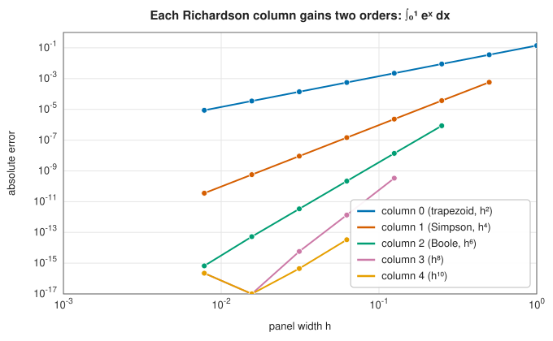

# Romberg integration

<div class="entry-summary">

| | |
|---|---|
| **Problem** | Approximate $\int_a^b f(x)\,dx$ for a smooth $f$ |
| **Devised by** | Werner Romberg (1955), building on Lewis Fry Richardson's extrapolation (1911, 1927) and the Euler-Maclaurin formula (Euler 1735, Maclaurin 1742) |
| **Accuracy** | Column $j$ of the tableau has error $O(h^{2j+2})$; the diagonal converges faster than any power of $h$ for analytic $f$ |
| **Cost** | $2^k + 1$ evaluations for $k$ levels; every evaluation is reused |
| **API** | [`RombergEngine`](../../api/lib_jsl_integration/romberg/struct.RombergEngine.html), [`integrate_with_error`](../../api/lib_jsl_integration/romberg/struct.RombergEngine.html#method.integrate_with_error), [`tableau`](../../api/lib_jsl_integration/romberg/struct.RombergEngine.html#method.tableau) |

</div>

## Overview

The trapezoid rule is the simplest quadrature rule, and on its own it converges slowly: halving
the step only quarters the error. **Romberg integration** turns it into a high-order method
without any new function evaluations. It computes trapezoid estimates with $1, 2, 4, 8, \ldots$
panels and combines them so that the leading error terms cancel, one order at a time. The result
is a triangular **tableau** whose columns converge at rates $h^2, h^4, h^6, \ldots$, and whose
diagonal converges very quickly for smooth integrands.

Romberg integration is a good default for smooth integrands that are cheap to evaluate, and it
is the textbook example of **Richardson extrapolation**, one of the most widely used ideas in
numerical analysis.

## History

The key ingredient is older than the method. In 1911 the meteorologist Lewis Fry Richardson,
solving differential equations for stresses in masonry dams, noticed that if a computed result
has an error proportional to $h^2$, then combining results at two step sizes eliminates that
error. With J. A. Gaunt he developed the idea in 1927 as "the deferred approach to the limit".

Werner Romberg, a German mathematician who emigrated in 1933, settled in Norway in 1938 and
later taught at the Norwegian Institute of Technology in Trondheim, published *Vereinfachte numerische Integration*
("Simplified numerical integration") in 1955. He observed that the trapezoid rule's error has a
particularly clean structure, containing only *even* powers of $h$, and that extrapolation could
therefore be repeated indefinitely. The method's convergence was analysed by Bauer, Rutishauser
and Stiefel in 1963, and it became a staple of early scientific computing libraries.

## The idea

### The trapezoid rule and its error

With $m$ panels of width $h = (b - a)/m$ and nodes $x_i = a + ih$, the composite trapezoid rule is

$$
T(h) = h\left[\tfrac12 f(x_0) + f(x_1) + \cdots + f(x_{m-1}) + \tfrac12 f(x_m)\right].
$$

Its error is not merely "$O(h^2)$". The **Euler-Maclaurin formula** describes it exactly: if $f$ is
smooth,

$$
T(h) = I + c_1 h^2 + c_2 h^4 + c_3 h^6 + \cdots, \qquad
c_k = \frac{B_{2k}}{(2k)!}\left[f^{(2k-1)}(b) - f^{(2k-1)}(a)\right],
$$

where $B_{2k}$ are the Bernoulli numbers ($B_2 = \tfrac16$, $B_4 = -\tfrac{1}{30}, \ldots$). Two
features make Romberg integration work. The coefficients $c_k$ do **not depend on $h$**, and only
**even powers** of $h$ appear. (Strictly the expansion is asymptotic rather than convergent, but
truncating it after any term leaves a remainder of the next order.)

### Richardson extrapolation

Write $T(h) = I + c_1 h^2 + O(h^4)$ and $T(h/2) = I + c_1 h^2/4 + O(h^4)$. The combination that
cancels $c_1$ is

$$
\frac{4\,T(h/2) - T(h)}{3} = I + O(h^4).
$$

This is exactly **Simpson's rule**, obtained here without ever thinking about parabolas. The new
estimates still have an expansion in even powers, now beginning at $h^4$, so the trick can be
repeated with factor $16$ to cancel $h^4$, then $64$ to cancel $h^6$, and so on.

### The tableau

Let $R(k, 0) = T\!\left((b - a)/2^k\right)$ and define

$$
R(k, j) = R(k, j-1) + \frac{R(k, j-1) - R(k-1, j-1)}{4^j - 1}, \qquad 1 \le j \le k.
$$

Each column removes one more term of the Euler-Maclaurin expansion, so

$$
R(k, j) = I + O\!\left(h_k^{2j+2}\right), \qquad h_k = (b - a)/2^k.
$$

Column 1 is Simpson's rule, column 2 is Boole's rule, and later columns are new rules that are
not Newton-Cotes rules. The figure shows each column of the tableau for $\int_0^1 e^x\,dx$ on
logarithmic axes: the slopes are 2, 4, 6, 8 and 10, as the theory predicts.



### Each level costs only the new midpoints

Halving $h$ keeps all the old nodes and adds the midpoints, so

$$
T(h/2) = \tfrac12\,T(h) + \frac{h}{2} \sum_{i=0}^{m-1} f\!\left(a + \left(i + \tfrac12\right) h\right).
$$

Level $k$ therefore needs only $2^{k-1}$ new evaluations, and the whole tableau up to level $k$
uses $2^k + 1$ values of $f$. The extrapolation itself is a few arithmetic operations per entry.

### When it does not help

Extrapolation assumes the Euler-Maclaurin expansion holds, which requires $f$ to be smooth on the
*closed* interval. With $f(x) = \sqrt{x}$ the derivatives blow up at $0$, the error expansion
contains fractional powers such as $h^{3/2}$, and extrapolating as though they were $h^2, h^4$ gains
almost nothing. The [singular convergence figure](index.md#the-central-trade-off) shows this.

The opposite extreme is just as instructive. If $f$ is **periodic** and smooth, all the
$c_k = 0$ because the endpoint derivatives cancel. The trapezoid rule is then already
exponentially accurate on its own, and extrapolation can only spoil it.

## Algorithm

1. $R(0, 0) = \tfrac{b - a}{2}\left[f(a) + f(b)\right]$.
2. For $k = 1, 2, \ldots$:
   1. $R(k, 0) = \tfrac12 R(k-1, 0) + h_k \sum_{i=1}^{2^{k-1}} f\!\left(a + (2i - 1) h_k\right)$.
   2. For $j = 1, \ldots, k$: $R(k, j) = R(k, j-1) + \big(R(k, j-1) - R(k-1, j-1)\big)/(4^j - 1)$.
   3. Stop when $|R(k, k) - R(k-1, k-1)|$ is below the tolerance (the library requires $k \ge 3$
      before stopping, to avoid accidental early agreement).
3. Return $R(k, k)$.

Only two rows need to be stored at any time.

## Implementation

[`integrate_with_error`](../../api/lib_jsl_integration/romberg/struct.RombergEngine.html#method.integrate_with_error)
keeps the previous row and builds the next one in place:

```rust,ignore
{{#include ../../../crates/integration/src/romberg.rs:romberg_level}}
```

- `factor` holds $4^j$ incrementally, so no powers are computed.
- The returned error estimate, $|R(k,k) - R(k-1,k-1)|$, is usually pessimistic. The diagonal
  converges so fast that the newer value is typically far more accurate than the difference
  suggests.
- [`tableau`](../../api/lib_jsl_integration/romberg/struct.RombergEngine.html#method.tableau)
  returns the whole triangle, which is useful for studying the method and for the exercises.

## In practice

The tableau for $\int_0^1 e^x\,dx$, as computed by the library:

{{#include ../generated/integration/romberg_tableau.md}}

Reading along a row, each extrapolation gains several digits. With 17 function evaluations,
$R(4, 4)$ is correct to about 14 digits, while the trapezoid rule with the same evaluations has
only three correct digits.

A complete program:

```rust,ignore
{{#include ../../../crates/integration/examples/quadrature_romberg.rs}}
```

**Strengths**

- Very simple, with high order obtained from the most basic rule.
- Nested: every function value is reused at all later levels.
- A built-in error estimate from successive diagonal entries.

**Weaknesses**

- Evaluation counts double at each level (17, 33, 65, …), so the granularity is coarse.
- It requires smoothness on the closed interval, including at the endpoints; singularities or
  kinks remove the benefit entirely.
- For expensive integrands, Gaussian quadrature reaches the same accuracy with fewer
  evaluations; compare the [smooth convergence figure](index.md#the-central-trade-off).

## Exercises

1. Show algebraically that $R(1, 1) = \tfrac{h}{3}\left[f(a) + 4 f(m) + f(b)\right]$, Simpson's
   rule, where $m$ is the midpoint and $h = (b-a)/2$.
2. Show that $R(2, 2)$ is Boole's rule, with weights proportional to $7, 32, 12, 32, 7$.
3. Use [`tableau`](../../api/lib_jsl_integration/romberg/struct.RombergEngine.html#method.tableau)
   on $\int_0^{2\pi} e^{\cos x}\,dx$. Why are the trapezoid values in column 0 already more
   accurate than the extrapolated ones?
4. Apply Romberg integration to $\int_0^1 \sqrt{x}\,dx$ and estimate the convergence rate of each
   column. Explain the result using the term $h^{3/2}$ in the error expansion.
5. Richardson extrapolation works for any expansion $A(h) = A + c\,h^p + \cdots$. Use it to
   improve the central difference $\big(f(x+h) - f(x-h)\big)/(2h)$, which has $p = 2$, and test
   it on $f = \sin$ at $x = 1$.

<details>
<summary>Hints and answers</summary>

1. With $T_1 = h[f(a) + f(b)]$ and $T_2 = \tfrac h2[f(a) + 2f(m) + f(b)]$, $R(1, 1) = (4T_2 - T_1)/3 = \tfrac h3[f(a) + 4f(m) + f(b)]$.
2. $R(2, 2) = (16R(2, 1) - R(1, 1))/15$ with $R(2, 1)$ the Simpson rule on 4 panels and $R(1, 1)$ on 2: combine the weights to find $\propto(7, 32, 12, 32, 7)$ with factor $2h/45$ for step $h$.
3. The integrand is periodic and analytic, so the trapezoid values converge geometrically and the Euler-Maclaurin series has no $h^2, h^4, \ldots$ terms to eliminate. Extrapolation then only mixes in rounding error.
4. The error expansion contains $h^{3/2}$ along with the even powers. Richardson steps remove $h^2, h^4, \ldots$ but not $h^{3/2}$, so every column converges at roughly the rate $h^{3/2}$ (the empirical rate of the limit) and Romberg's advantage is lost.
5. $D(h) = f'(x) + \tfrac16f'''(x)h^2 + O(h^4)$, so $(4D(h/2) - D(h))/3$ cancels the $h^2$ term and has error $O(h^4)$. For $\sin$ at $x = 1$ and $h = 0.1$ the error falls from about $9\times10^{-4}$ for the central difference to about $10^{-7}$.

</details>

## Further reading

- W. Romberg, "Vereinfachte numerische Integration", *Det Kongelige Norske Videnskabers Selskabs
  Forhandlinger* 28 (1955) 30–36.
- L. F. Richardson, "The approximate arithmetical solution by finite differences of physical
  problems involving differential equations", *Philosophical Transactions of the Royal Society A*
  210 (1911) 307–357.
- L. F. Richardson and J. A. Gaunt, "The deferred approach to the limit", *Philosophical
  Transactions of the Royal Society A* 226 (1927) 299–361.
- F. L. Bauer, H. Rutishauser and E. Stiefel, "New aspects in numerical quadrature",
  *Proceedings of Symposia in Applied Mathematics* 15, AMS (1963) 199–218.
- L. N. Trefethen and J. A. C. Weideman, "The exponentially convergent trapezoidal rule", *SIAM
  Review* 56 (2014) 385–458. Why the plain trapezoid rule is so good for periodic functions.
- G. Dahlquist and Å. Björck, *Numerical Methods in Scientific Computing*, Vol. 1, SIAM, 2008,
  §3.4 and §5.2. A thorough treatment of extrapolation methods.
