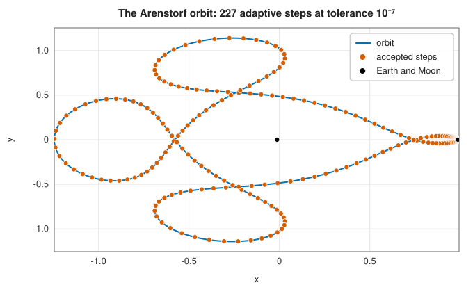
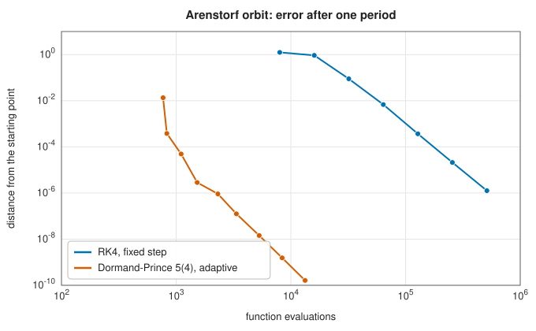

# Runge-Kutta methods

<div class="entry-summary">

| | |
|---|---|
| **Problem** | Solve the initial value problem $\mathbf y'(t) = \mathbf f(t, \mathbf y)$, $\mathbf y(t_0) = \mathbf y_0$, for a system of ordinary differential equations |
| **Devised by** | Leonhard Euler (1768); Carl Runge (1895), Karl Heun (1900) and Martin Kutta (1901); order theory by John Butcher (1963); embedded pairs by Erwin Fehlberg (1969); the 5(4) pair by John Dormand and Peter Prince (1980) |
| **Accuracy** | RK4: global error $O(h^4)$. Dormand-Prince: local error per step kept below the tolerance by adapting $h$ |
| **Cost** | RK4: 4 evaluations of $\mathbf f$ per step. Dormand-Prince: 6 per step (7 stages, one reused) |
| **API** | [`rk4_solve`](../../api/lib_jsl_integration/runge_kutta_4/fn.rk4_solve.html), [`dormand_prince_solve`](../../api/lib_jsl_integration/dormand_prince/fn.dormand_prince_solve.html), [`OdeOptions`](../../api/lib_jsl_integration/stiff_ode/struct.OdeOptions.html), [`OdeSolution`](../../api/lib_jsl_integration/stiff_ode/struct.OdeSolution.html) |

</div>

## Overview

A differential equation $\mathbf y' = \mathbf f(t, \mathbf y)$ tells us the direction in which the solution
moves at every point. Integrating it numerically means following those directions in steps of size
$h$. The simplest method, Euler's, takes one direction per step and follows it in a straight line;
its error is proportional to $h$, so it needs very many steps.

**Runge-Kutta methods** sample the direction field several times within each step, at carefully
chosen trial points, and combine the samples so that the step agrees with the true solution's
Taylor series to high order. The **classical fourth-order method** (RK4) uses four samples and has
global error $O(h^4)$. **Embedded pairs** such as Dormand-Prince 5(4) compute two solutions of
different orders from the same samples; their difference estimates the error, and the step size is
adapted so that each step is just accurate enough. Dormand-Prince is the default non-stiff solver
in MATLAB (`ode45`), SciPy (`RK45`) and Julia, and the method to try first for most initial value
problems.

## History

Leonhard Euler described the method of following tangent lines in his *Institutionum calculi
integralis* (1768). For more than a century it was the only general numerical method for
differential equations, used alongside series expansions.

In 1895 the German mathematician Carl Runge, studying the solution of equations by hand
computation, observed that one could gain accuracy by evaluating the slope at intermediate points,
in the spirit of the midpoint and Simpson rules for integrals. Karl Heun (1900) extended the idea,
and in 1901 Martin Kutta systematically derived methods of order up to five, including the
classical fourth-order method still taught today. Kutta also studied the "3/8 rule" variant, the
analogue of Simpson's three-eighths rule.

The theory remained ad hoc until John Butcher (1963) showed that the conditions a method must
satisfy to reach a given order correspond to **rooted trees**, which made it possible to construct
methods of high order systematically and gave us the **Butcher tableau** notation. Error control
arrived with Erwin Fehlberg's embedded pairs (1969), which estimate the error almost for free. John
Dormand and Peter Prince (1980) improved on Fehlberg by optimising the error of the
higher-order solution, which is the one actually used, and their 5(4) pair became the standard.

## The idea

### Euler's method and the order of a method

Euler's method is $\mathbf y_{n+1} = \mathbf y_n + h\,\mathbf f(t_n, \mathbf y_n)$. By Taylor's theorem the exact
solution satisfies $\mathbf y(t + h) = \mathbf y(t) + h\,\mathbf y'(t) + O(h^2)$, so each step makes a **local
error** of $O(h^2)$. Covering an interval of length $T$ takes $T/h$ steps, and the errors accumulate
to a **global error** of $O(h)$. A method with local error $O(h^{p+1})$ has **order** $p$ and global
error $O(h^p)$.

One could reach higher order by including more Taylor terms, $\tfrac{h^2}{2}\mathbf y''$ and so on, but
$\mathbf y'' = \mathbf f_t + \mathbf f_{\mathbf y}\mathbf f$ involves derivatives of $\mathbf f$ that are tedious or
impossible to supply. Runge-Kutta methods match the same Taylor terms using only values of $\mathbf f$.

### Stages and the Butcher tableau

An $s$-stage explicit Runge-Kutta method computes

$$
\mathbf k_i = \mathbf f\Big(t_n + c_i h,\; \mathbf y_n + h \sum_{j<i} a_{ij} \mathbf k_j\Big), \quad i = 1, \ldots, s,
\qquad
\mathbf y_{n+1} = \mathbf y_n + h \sum_{i=1}^s b_i \mathbf k_i.
$$

Each **stage** $\mathbf k_i$ is a slope evaluated at a trial point built from the earlier stages. The
coefficients are written in a **Butcher tableau**; for the classical RK4 method

| $c_i$ | $a_{i1}$ | $a_{i2}$ | $a_{i3}$ | |
|---:|---:|---:|---:|---:|
| $0$ | | | | |
| $\tfrac12$ | $\tfrac12$ | | | |
| $\tfrac12$ | $0$ | $\tfrac12$ | | |
| $1$ | $0$ | $0$ | $1$ | |
| $b_i$ | $\tfrac16$ | $\tfrac13$ | $\tfrac13$ | $\tfrac16$ |

that is: a slope at the start, two at the midpoint (the second using the first midpoint slope), and
one at the end, averaged with weights $1, 2, 2, 1$. When $\mathbf f$ does not depend on $\mathbf y$, the two
midpoint slopes coincide and the step is exactly [Simpson's rule](newton-cotes.md#simpsons-rules).

### Order conditions

Expanding $\mathbf y_{n+1}$ and the exact $\mathbf y(t_n + h)$ in powers of $h$ and matching terms gives
polynomial equations for the coefficients. For order 1, $\sum b_i = 1$; order 2 adds
$\sum b_i c_i = \tfrac12$; order 3 adds $\sum b_i c_i^2 = \tfrac13$ and $\sum_{i,j} b_i a_{ij} c_j = \tfrac16$;
order 4 adds four more. Butcher's insight was that there is one condition for each rooted tree with
up to $p$ nodes, each tree describing one of the ways derivatives of $\mathbf f$ combine in the Taylor
expansion. The number of conditions grows quickly (8 for order 4, 17 for order 5, 37 for order 6),
and with it the minimum number of stages: order 4 needs 4 stages, but order 5 needs 6, which is
why fourth order was the classical sweet spot.

### Error estimation with embedded pairs

The local error of a step is unknown, but it can be estimated by taking the same step with two
methods of different orders. An **embedded pair** shares all its stages and differs only in the
weights: $\mathbf y_{n+1} = \mathbf y_n + h \sum b_i \mathbf k_i$ of order 5 and
$\hat{\mathbf y}_{n+1} = \mathbf y_n + h\sum \hat b_i \mathbf k_i$ of order 4. Their difference is
dominated by the error of the lower-order solution and costs nothing extra. Dormand and Prince
chose their coefficients to make the *fifth*-order solution as accurate as possible, and the
method continues with it (**local extrapolation**).

Their pair has seven stages, but the seventh is evaluated at the new solution $(t_{n+1}, \mathbf y_{n+1})$,
so it is also the first stage of the next step. With this **first same as last** property each step
costs six evaluations.

```rust,ignore
{{#include ../../../crates/integration/src/dormand_prince.rs:tableau}}
```

### Step-size control

Each component's error is compared with its own tolerance, $\text{atol} + \text{rtol}\,|y_i|$, and the
worst ratio $\varepsilon$ decides the step. If $\varepsilon \le 1$ the step is accepted. Either way the next
step size follows from the error model $\varepsilon \propto h^5$ of the fourth-order solution:

$$
h_{\text{new}} = 0.9\, h\, \varepsilon^{-1/5},
$$

limited to between a fifth and five times the old step. The safety factor 0.9 makes the next step
likely to be accepted. Steps therefore shrink where the solution changes quickly and grow where it
is smooth, without any input beyond the tolerances.

The **Arenstorf orbit** is the classic demonstration. A small satellite moves under the gravity of
the Earth and the Moon, in a rotating frame in which both are fixed; Richard Arenstorf found this
periodic orbit in 1963 while working on the trajectories of the Apollo programme. Near the Moon the
satellite moves fast and its path curves sharply, and the accepted steps crowd together there:



A fixed step small enough for the close approach is wasted on the rest of the orbit. Measured by
the error after one period, adaptive Dormand-Prince is about a thousand times cheaper than RK4 with
a fixed step:



### Stability and stiffness

Applied to the test equation $y' = \lambda y$, any explicit Runge-Kutta step multiplies the solution
by a polynomial $R(h\lambda)$; for RK4, $R(z) = 1 + z + \tfrac{z^2}{2} + \tfrac{z^3}{6} + \tfrac{z^4}{24}$. If
$\lambda$ is large and negative, the true solution decays, but the numerical one is bounded only when
$|R(h\lambda)| \le 1$, which for RK4 requires $h|\lambda| \lesssim 2.79$. A system that combines a rapidly
decaying component with slow ones is **stiff**: an explicit method must keep $h$ small enough for the
fast component long after it has died away. The step-size controller then takes tiny steps and the
solver crawls. Implicit methods, the subject of the
[next entry](stiff-ode.md), remove this restriction.

## Algorithm

**RK4** with $N$ steps: $h = (t_1 - t_0)/N$; for each step, evaluate the four stages and update
$\mathbf y \leftarrow \mathbf y + \tfrac h6(\mathbf k_1 + 2\mathbf k_2 + 2\mathbf k_3 + \mathbf k_4)$.

**Dormand-Prince**:

1. Choose a starting step from the sizes of $\mathbf y_0$ and $\mathbf f(t_0, \mathbf y_0)$ (Hairer's heuristic).
2. Repeat until $t = t_1$:
   1. Shorten $h$ if it would pass $t_1$. Evaluate stages 2 to 7 (stage 1 is the previous stage 7).
   2. Form $\mathbf y_{n+1}$ and the error estimate $h\sum_j e_j \mathbf k_j$, and its weighted maximum
      $\varepsilon$.
   3. If $\varepsilon \le 1$, accept the step; otherwise count a rejection.
   4. $h \leftarrow h \cdot \operatorname{clamp}(0.9\,\varepsilon^{-1/5}, 0.2, 5)$; fail if $h$ underflows.

## Implementation

The RK4 step:

```rust,ignore
{{#include ../../../crates/integration/src/runge_kutta_4.rs:rk4_step}}
```

The adaptive Dormand-Prince step:

```rust,ignore
{{#include ../../../crates/integration/src/dormand_prince.rs:dopri_step}}
```

- The state is a slice, so one routine handles scalar equations and systems alike. A higher-order
  equation such as $y'' = -y$ is written as a first-order system for $(y, y')$.
- Integration may run backwards in time ($t_1 < t_0$); the step is applied with the sign of the span.
- A non-finite trial solution is treated as a failed step, which shrinks $h$; if the step
  underflows, the solver reports an error (often a sign of stiffness or of a solution that blows up
  in finite time).
- An earlier version of the library exposed functions named `runge_kutta_4` and `dormand_prince`
  that accepted $f(t)$ only, and so solved $y' = f(t)$, which is quadrature. They remain, deprecated,
  for compatibility.

## In practice

The Lotka-Volterra predator-prey equations conserve the quantity $x - \ln x + y - \ln y$, so its
drift measures the accumulated error:

```rust,ignore
{{#include ../../../crates/integration/examples/ode_runge_kutta.rs}}
```

**Strengths**

- Simple, self-starting (no history of previous steps is needed), and easy to apply to any system.
- Dormand-Prince adapts the step automatically and estimates its error at no extra cost.
- High accuracy per evaluation for smooth, non-stiff problems.

**Weaknesses**

- Explicit methods are inefficient for stiff problems.
- The tolerance controls the *local* error per step; the global error can be larger, and grows with
  the length of the integration, especially for unstable or chaotic systems.
- Long integrations of conservative systems drift (the invariant above is not exactly conserved);
  symplectic methods are designed to avoid this.

## Exercises

1. Show that the RK4 tableau satisfies the four order conditions for order 3 listed above.
2. Find all two-stage explicit methods of order 2 (a one-parameter family). Which member is the
   midpoint method, and which is Heun's method?
3. Solve $y' = -1000(y - \cos t)$, $y(0) = 0$, on $[0, 1]$ with Dormand-Prince. How many steps does it
   take, and how does the number change with the tolerance? Explain using the stability bound
   $h|\lambda| \lesssim 3.3$ of the Dormand-Prince method.
4. Apply RK4 to $y' = y$ with step $h$ and show that $y_{n+1} = R(h)\,y_n$ with $R$ the degree-4 Taylor
   polynomial of $e^h$.
5. Integrate the Arenstorf orbit over ten periods at tolerances $10^{-6}$ and $10^{-10}$. How far from
   periodic is each result, and why does the error grow so much faster than linearly with time?

## Further reading

- C. Runge, "Über die numerische Auflösung von Differentialgleichungen", *Mathematische Annalen* 46
  (1895) 167–178.
- W. Kutta, "Beitrag zur näherungsweisen Integration totaler Differentialgleichungen", *Zeitschrift
  für Mathematik und Physik* 46 (1901) 435–453.
- J. C. Butcher, "Coefficients for the study of Runge-Kutta integration processes", *Journal of the
  Australian Mathematical Society* 3 (1963) 185–201.
- J. R. Dormand and P. J. Prince, "A family of embedded Runge-Kutta formulae", *Journal of
  Computational and Applied Mathematics* 6 (1980) 19–26.
- L. F. Shampine and M. W. Reichelt, "The MATLAB ODE suite", *SIAM Journal on Scientific
  Computing* 18 (1997) 1–22.
- E. Hairer, S. P. Nørsett and G. Wanner, *Solving Ordinary Differential Equations I: Nonstiff
  Problems*, 2nd ed., Springer, 1993. The standard reference, the source of the Arenstorf example
  and of the step-size heuristics used here.
