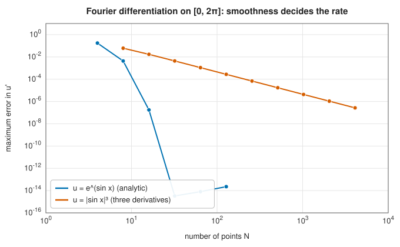
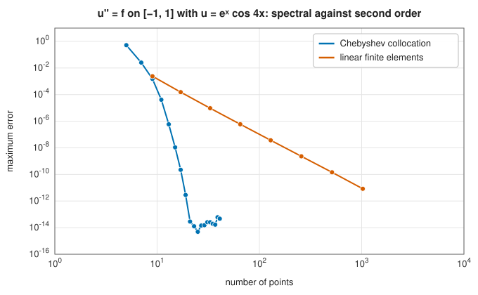

# Spectral methods

<div class="entry-summary">

| | |
|---|---|
| **Problem** | Solve differential equations with smooth solutions to very high accuracy: two-point problems $u'' + p u' + q u = f$, derivatives of periodic functions, and the periodic heat equation |
| **Devised by** | Fourier series for the heat equation: Joseph Fourier (1807–1822). Collocation methods: Cornelius Lanczos (1938). Pseudospectral methods: Heinz-Otto Kreiss and Joseph Oliger, Steven Orszag (early 1970s). Chebyshev differentiation matrices in their modern form: Lloyd N. Trefethen (2000) |
| **Accuracy** | Exponential in the number of points for analytic solutions; faster than any power for smooth ones |
| **Cost** | Chebyshev: a dense $(n+1) \times (n+1)$ system. Fourier: two FFTs, $O(N \log N)$ |
| **Read first** | [Polynomial interpolation](../interpolation/polynomial.md), [The fast Fourier transform](../fft/fft.md) |
| **API** | [`chebyshev_points`](../../api/lib_jsl_integration/pde/spectral/fn.chebyshev_points.html), [`chebyshev_differentiation_matrix`](../../api/lib_jsl_integration/pde/spectral/fn.chebyshev_differentiation_matrix.html), [`chebyshev_bvp`](../../api/lib_jsl_integration/pde/spectral/fn.chebyshev_bvp.html), [`fourier_derivative`](../../api/lib_jsl_integration/pde/spectral/fn.fourier_derivative.html), [`periodic_heat`](../../api/lib_jsl_integration/pde/spectral/fn.periodic_heat.html) |

</div>

## Overview

[Finite differences](finite-differences.md) and [finite elements](finite-elements.md) approximate a
solution locally, from a few neighbouring values, and converge at a fixed algebraic rate such as
$h^2$. **Spectral methods** approximate it globally, by a single polynomial or trigonometric series
through all the grid values, and differentiate that. For smooth solutions the error then falls
**exponentially** with the number of points: where a second-order method needs a thousand points
for ten digits, a spectral method may need thirty.

The same principle underlies [Gaussian quadrature](gaussian-quadrature.md) and the
[trapezoid rule for periodic functions](newton-cotes.md#the-trapezoid-rule-on-periodic-functions).
This entry covers its use for differential equations: **Fourier** methods for periodic problems,
where the FFT makes them extremely fast, and **Chebyshev** collocation for problems on an interval.

## History

Spectral ideas go back to Joseph Fourier, who solved the heat equation in his *Théorie analytique de
la chaleur* (1822) by expanding the temperature in sines and cosines, each of which simply decays in
time. Cornelius Lanczos (1938) introduced the use of Chebyshev polynomials and collocation at
selected points to solve differential equations approximately.

The methods became practical with fast computers and the fast Fourier transform (Cooley and Tukey,
1965). Heinz-Otto Kreiss and Joseph Oliger (1972) and Steven Orszag (1971–72) developed
**pseudospectral** methods for fluid dynamics and weather prediction, which compute derivatives in
spectral space and nonlinear terms on the grid. David Gottlieb and Orszag's monograph (1977)
established the theory, and Lloyd N. Trefethen's *Spectral Methods in MATLAB* (2000) made the
Chebyshev differentiation matrix, implemented here, a few lines of code.

## The idea

### Global interpolation and exponential convergence

Through $N$ points there is exactly one interpolating polynomial (or, on a periodic grid, one
trigonometric polynomial). Differentiating it gives approximations to $u'(x_j)$ at every point at
once, each using *all* the values. If $u$ is analytic, its interpolant converges exponentially, and
so do its derivatives. Algebraic methods, by contrast, are limited by the degree of the local
polynomial, whatever the smoothness of $u$.

### Fourier differentiation

For a periodic function sampled at $N$ equispaced points on $[0, L)$, the discrete Fourier transform
gives coefficients $\hat u_k$ such that $u(x) \approx \sum_k \hat u_k e^{2\pi i k x/L}$. Differentiation
multiplies each coefficient by $i\kappa_k$ with $\kappa_k = 2\pi k/L$:

$$
\widehat{u'}_k = i\kappa_k\, \hat u_k,
\qquad \widehat{u^{(m)}}_k = (i\kappa_k)^m\, \hat u_k.
$$

So: transform, multiply, transform back, $O(N\log N)$ operations with the FFT. One subtlety: for even
$N$ the mode $k = N/2$ is the same on the grid as $k = -N/2$, so an odd derivative of it is
ambiguous; the library sets it to zero. The rate of convergence is governed by how fast the Fourier
coefficients decay, which is governed by smoothness:



<p class="caption" id="fig-2-29"><strong>Figure 2.29.</strong> Fourier differentiation.</p>

For the analytic $e^{\sin x}$ the error reaches machine precision with 32 points. For $|\sin x|^3$, whose
third derivative jumps, the coefficients decay only like $k^{-4}$ and the derivative error like
$N^{-2}$: no better than finite differences.

### The heat equation in Fourier space

Fourier's own insight solves the periodic heat equation $u_t = \alpha u_{xx}$ exactly: each mode
satisfies $\hat u_k' = -\alpha\kappa_k^2\,\hat u_k$, so

$$
\hat u_k(t) = e^{-\alpha\kappa_k^2 t}\,\hat u_k(0).
$$

[`periodic_heat`](../../api/lib_jsl_integration/pde/spectral/fn.periodic_heat.html) applies this
factor in one step, with no time-stepping error and no stability restriction: high-frequency modes
are damped fastest, which is why diffusion smooths. The mean, mode $k = 0$, is conserved.

### Chebyshev points and differentiation matrices

On a non-periodic interval, equispaced polynomial interpolation fails (the Runge phenomenon of the
[Newton-Cotes entry](newton-cotes.md#higher-order-newton-cotes-rules)). The remedy is to cluster the
points towards the ends, at the **Chebyshev points**

$$
x_j = \cos\frac{\pi j}{n}, \qquad j = 0, 1, \ldots, n,
$$

the projections onto $[-1, 1]$ of equally spaced points on a semicircle. Interpolation at these
points converges for every analytic function. Differentiating the interpolant is a linear map from
the values $u_j$ to the derivative values, a matrix $D$ with explicit entries:

$$
D_{ij} = \frac{c_i}{c_j}\,\frac{(-1)^{i+j}}{x_i - x_j} \quad (i \ne j), \qquad
D_{ii} = -\sum_{j \ne i} D_{ij},
$$

with $c_0 = c_n = 2$ and $c_j = 1$ otherwise. Computing the diagonal as minus the row sum, rather than
from its closed form, makes $D$ exact on constants and much more accurate in floating point.

### Chebyshev collocation for boundary value problems

To solve $u'' + p(x)u' + q(x)u = f(x)$ with $u(a)$ and $u(b)$ given, map $[a, b]$ to $[-1, 1]$, replace
$u''$ by $D^2 u$ and $u'$ by $Du$ (scaled by the map), require the equation at the interior points,
and replace the first and last rows by the boundary conditions. The result is a dense linear system
of size $n + 1$, solved by LU factorisation. For $u = e^x\cos 4x$:



<p class="caption" id="fig-2-30"><strong>Figure 2.30.</strong> Chebyshev collocation against finite elements.</p>

Chebyshev collocation reaches $10^{-13}$ with about 25 points, where linear finite elements need a
thousand points for $10^{-11}$. The plateau beyond is rounding error, amplified by the
ill-conditioning of $D^2$, whose entries grow like $n^4$.

## Algorithm

- **Fourier derivative**: FFT; multiply mode $k$ by $(i\kappa_k)^m$ (zeroing the Nyquist mode for odd
  $m$ and even $N$); inverse FFT; take the real part.
- **Periodic heat**: FFT; multiply mode $k$ by $e^{-\alpha\kappa_k^2 t}$; inverse FFT.
- **Chebyshev BVP**: build $D$ and $D^2$; assemble
  $\big(\tfrac{2}{b-a}\big)^2 D^2 + p\,\tfrac{2}{b-a}D + q\,I$ at the interior points, with boundary rows
  $u_0 = u(b)$, $u_n = u(a)$; solve by LU.

## Implementation

The Chebyshev differentiation matrix:

```rust,ignore
{{#include ../../../crates/integration/src/pde/spectral.rs:cheb_matrix}}
```

- The Chebyshev points run from $1$ down to $-1$, so the returned solution runs from $b$ to $a$.
- The Fourier routines use the library's FFT, whose forward transform is unscaled and whose inverse
  divides by $N$.
- The Chebyshev system is dense, so the cost is $O(n^3)$; that is no burden, because spectral accuracy
  rarely needs more than a few hundred points.

## In practice

```rust,ignore
{{#include ../../../crates/integration/examples/pde_spectral.rs}}
```

**Strengths**

- Exponential convergence for smooth solutions: a handful of points give many digits.
- Fourier methods cost only two FFTs per derivative, and solve linear constant-coefficient periodic
  problems exactly in time.

**Weaknesses**

- Accuracy collapses to an algebraic rate if the solution is not smooth (shocks, kinks, interfaces),
  and discontinuities cause Gibbs oscillations.
- Simple geometries only: intervals, periodic domains and their products. Complex domains call for
  [finite elements](finite-elements.md) or spectral elements.
- Dense matrices with large condition numbers; very high derivatives amplify rounding.

## Exercises

1. Compute $D$ for $n = 1$ and $n = 2$ by hand and check that it differentiates $1, x, x^2$ exactly
   (for $n = 2$).
2. Show that the Fourier derivative of $\cos(Nx/2)$ sampled at $N$ points is zero, and explain why
   zeroing the Nyquist mode is the right choice.
3. Solve $u'' = e^{4x}$, $u(\pm1) = 0$ with [`chebyshev_bvp`](../../api/lib_jsl_integration/pde/spectral/fn.chebyshev_bvp.html)
   (Trefethen's Program 13) and find the smallest $n$ that gives 12 correct digits.
4. Use `periodic_heat` on a square pulse and plot the result at several times. Why do the corners
   round off first?
5. Replace the Chebyshev points by equally spaced points in the differentiation matrix formula
   (using the general barycentric weights) and repeat the convergence experiment for
   $u = 1/(1 + 25x^2)$. What happens?

<details>
<summary>Hints and answers</summary>

1. For $n = 1$ the nodes are $\pm1$ and $D = \begin{pmatrix}\tfrac12&-\tfrac12\\\tfrac12&-\tfrac12\end{pmatrix}$ (the slope of the line through two points). For $n = 2$ the nodes are $1, 0, -1$ and $D$ must give $D\mathbf 1 = 0$, $D\mathbf x = \mathbf 1$ and $D\mathbf x^2 = 2\mathbf x$; check the rows against these three conditions.
2. At the $N$ equispaced points $x_j = 2\pi j/N$, $\cos(Nx_j/2) = (-1)^j$, and the derivative $-\tfrac N2\sin(Nx/2)$ vanishes at every grid point, so the sampled derivative is 0. The Nyquist mode cannot be distinguished from its alias, and its derivative would be imaginary, so setting it to zero keeps the derivative of a real function real.
3. Increase $n$ until the error stops falling; the solution is smooth, so the error falls geometrically and 12 digits typically need a few dozen points.
4. The corners of the pulse are made of high wavenumbers, and each wavenumber $k$ decays like $e^{-k^2t}$, so the sharp features smooth out first.
5. Equally spaced points suffer from the Runge phenomenon: the error in the derivative grows exponentially with $n$ instead of decaying, and the differentiation matrix becomes extremely ill-conditioned.

</details>

## Further reading

- J. Fourier, *Théorie analytique de la chaleur*, Paris, 1822.
- C. Lanczos, "Trigonometric interpolation of empirical and analytical functions", *Journal of
  Mathematics and Physics* 17 (1938) 123–199.
- S. A. Orszag, "Comparison of pseudospectral and spectral approximation", *Studies in Applied
  Mathematics* 51 (1972) 253–259.
- D. Gottlieb and S. A. Orszag, *Numerical Analysis of Spectral Methods: Theory and Applications*,
  SIAM, 1977.
- L. N. Trefethen, *Spectral Methods in MATLAB*, SIAM, 2000. The source of the differentiation
  matrix and many of the examples here.
- J. P. Boyd, *Chebyshev and Fourier Spectral Methods*, 2nd ed., Dover, 2001.
