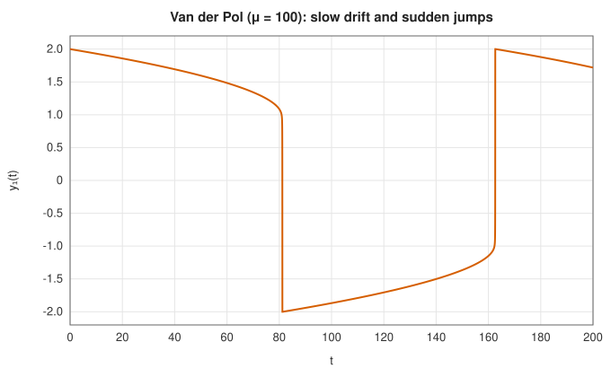
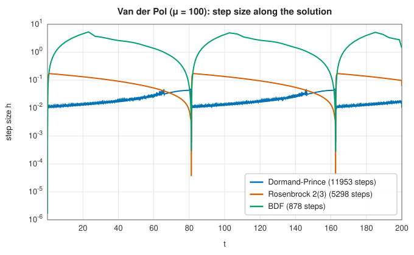

# Stiff ODE solvers: Rosenbrock and BDF

<div class="entry-summary">

| | |
|---|---|
| **Problem** | Solve $\mathbf y' = \mathbf f(t, \mathbf y)$ when the system mixes very fast and slow time scales, so that explicit methods are forced into tiny steps |
| **Devised by** | Stiffness: Charles Curtiss and Joseph Hirschfelder (1952). Backward differentiation formulas: Curtiss and Hirschfelder (1952), C. William Gear (1971). Rosenbrock methods: Howard Rosenbrock (1963); the 2(3) pair of Lawrence Shampine and Mark Reichelt (1997) |
| **Accuracy** | Rosenbrock 2(3): order 2 with an order-3 error estimate. BDF: orders 1 to 5, chosen by the user |
| **Cost** | Per step, one Jacobian and one LU factorisation of an $n \times n$ matrix, plus a few function evaluations (Rosenbrock) or Newton iterations (BDF) |
| **API** | [`rosenbrock23`](../../api/lib_jsl_integration/stiff_ode/fn.rosenbrock23.html), [`bdf`](../../api/lib_jsl_integration/stiff_ode/fn.bdf.html), [`OdeOptions`](../../api/lib_jsl_integration/stiff_ode/struct.OdeOptions.html) |

</div>

## Overview

Many systems contain processes on very different time scales: chemical reactions with fast and
slow steps, electrical circuits with small and large time constants, the diffusion term of a
discretised partial differential equation. After the fast components have decayed, the solution
changes slowly and should be easy to follow. Yet [explicit Runge-Kutta methods](runge-kutta.md)
must keep taking tiny steps, because a larger step would make the long-dead fast components grow
explosively. Such problems are called **stiff**.

**Implicit** methods evaluate the derivative at the *end* of the step, which makes them stable
for any step size on decaying components. Their step is then limited by accuracy alone. The price
is a system of equations to solve at every step, involving the Jacobian $\partial \mathbf f / \partial \mathbf y$.
The library offers two families. **Rosenbrock methods** linearise the implicit equations, so each
step needs one LU factorisation and a few linear solves; they are robust at loose tolerances.
**Backward differentiation formulas** (BDF) use several previous steps and solve the implicit
equation by Newton's method; at higher orders they are the most efficient choice for large stiff
systems at moderate to tight tolerances.

## History

Stiffness was recognised by Charles Curtiss and Joseph Hirschfelder in 1952, working on the
equations of chemical kinetics at the University of Wisconsin. They observed that standard
methods required absurdly small steps, coined the term "stiff", and proposed the backward
differentiation formulas as a remedy. In 1963 Germund Dahlquist laid the theoretical foundation
with the concept of **A-stability** and the famous **second Dahlquist barrier**: no A-stable linear
multistep method can have order greater than two.

C. William Gear's book *Numerical Initial Value Problems in Ordinary Differential Equations* (1971)
and his program DIFSUB made variable-step, variable-order BDF methods practical; their descendants
(LSODE, DASSL, CVODE, MATLAB's `ode15s`) remain the workhorses of stiff integration. In parallel,
the chemical engineer Howard Rosenbrock proposed in 1963 to avoid Newton iterations by building the
Jacobian into the method itself. Lawrence Shampine and Mark Reichelt's 2(3) Rosenbrock pair (1997),
the method of MATLAB's `ode23s`, is the one implemented here.

## The idea

### What makes a problem stiff

Near a solution, the system behaves like its linearisation $\mathbf y' = J\mathbf y$, and each eigenvalue
$\lambda$ of the Jacobian $J$ contributes a component $e^{\lambda t}$. Apply an explicit method to the
scalar test equation $y' = \lambda y$: each step multiplies $y$ by a polynomial $R(h\lambda)$ (for Euler,
$R(z) = 1 + z$), and the numerical solution stays bounded only if $|R(h\lambda)| \le 1$. For a polynomial
this holds only in a bounded region of the complex plane, so a decaying component with
$\lambda = -10^6$ forces $h \lesssim 10^{-6}$, even when that component is negligible and the rest of the
solution changes on a time scale of seconds. A problem is stiff when this stability limit, rather
than accuracy, governs the step.

The Van der Pol oscillator $y_1'' = \mu(1 - y_1^2)\,y_1' - y_1$ with $\mu = 100$ illustrates this. Its
solution drifts slowly, then jumps:



During the slow drift a large step would be accurate, but the Jacobian has an eigenvalue of size
$\mu(y_1^2 - 1)$, up to about $3\mu$, so an explicit method must keep $h \lesssim 3.3/(3\mu) \approx 10^{-2}$:



The Dormand-Prince step hovers around $10^{-2}$ throughout, constantly rejected and retried at its
stability limit. The implicit methods take steps as large as the accuracy allows, and shrink them
only at the jumps, where the solution really does change quickly.

### Implicit methods and A-stability

The **backward Euler** method $\mathbf y_{n+1} = \mathbf y_n + h\,\mathbf f(t_{n+1}, \mathbf y_{n+1})$ evaluates the
slope at the end of the step. On the test equation it gives $y_{n+1} = y_n/(1 - h\lambda)$, and
$|1/(1 - h\lambda)| \le 1$ whenever $\operatorname{Re}\lambda \le 0$, for **every** $h > 0$. A method with this property
is **A-stable**. Backward Euler is moreover **L-stable**: as $h\lambda \to -\infty$ its amplification
factor tends to zero, so infinitely stiff components are damped completely in one step. The price
is that $\mathbf y_{n+1}$ appears on both sides, so every step requires solving a nonlinear system.

### Backward differentiation formulas

A BDF method of order $k$ fits a polynomial through the new point $\mathbf y_{n+1}$ and the $k$ previous
points, and requires its derivative at $t_{n+1}$ to equal $\mathbf f(t_{n+1}, \mathbf y_{n+1})$:

$$
\sum_{j=0}^{k} \alpha_j\, \mathbf y_{n+1-j} = \mathbf f(t_{n+1}, \mathbf y_{n+1}),
$$

where the $\alpha_j$ are the derivatives at $t_{n+1}$ of the Lagrange basis polynomials on the nodes. For
order 1 this is backward Euler; with equal steps, order 2 is
$\tfrac{1}{h}\big(\tfrac32 \mathbf y_{n+1} - 2\mathbf y_n + \tfrac12 \mathbf y_{n-1}\big) = \mathbf f_{n+1}$. Because the coefficients
are computed from the actual node positions, the step can change freely.

Orders 1 and 2 are A-stable. Orders 3 to 6 are only stable in a wedge around the negative real
axis, which still contains the eigenvalues of most dissipative problems; beyond order 6 the
formulas are unstable altogether. The implicit equation is solved by Newton's method, starting from
the polynomial through the previous points **extrapolated** to $t_{n+1}$ (the predictor). Each Newton
step solves a linear system with the matrix $\alpha_0 I - J$, factorised once per step. The difference
between the corrected and the predicted solution estimates the local error.

### Rosenbrock methods

Newton iterations are costly and need a convergence test. A Rosenbrock method replaces them by
exactly one linear solve per stage, with the Jacobian built into the method's coefficients. The
2(3) pair of Shampine and Reichelt, with $d = 1/(2 + \sqrt 2)$ and $W = I - h d J$, computes

$$
\begin{aligned}
W \mathbf k_1 &= \mathbf f(t_n, \mathbf y_n) + h d\, \mathbf f_t, \\
W (\mathbf k_2 - \mathbf k_1) &= \mathbf f(t_n + \tfrac h2, \mathbf y_n + \tfrac h2 \mathbf k_1) - \mathbf k_1, \\
\mathbf y_{n+1} &= \mathbf y_n + h \mathbf k_2,
\end{aligned}
$$

and a third stage $\mathbf k_3$ at $(t_{n+1}, \mathbf y_{n+1})$ gives the error estimate
$\tfrac h6(\mathbf k_1 - 2\mathbf k_2 + \mathbf k_3)$. The method is L-stable and of order 2, with a single LU
factorisation per step. Its low order makes it most efficient at loose tolerances, and its
robustness makes it a good first try on a problem whose character is unknown.

### Comparing the solvers

The library's three solvers on three classic problems, all at relative tolerance $10^{-6}$ (Jacobians
formed by finite differences, which costs $n$ extra evaluations each):

{{#include ../generated/integration/stiff_table.md}}

The first problem is only mildly stiff ($\lambda = -1000$ on an interval of length 1), and Dormand-Prince
is competitive: its stability limit of about 300 steps is not much below what accuracy demands.
On Van der Pol and above all on Robertson's chemical kinetics, whose rate constants span nine
orders of magnitude, the explicit method needs tens of thousands of steps while BDF needs
hundreds. Note also that the error in the final value can exceed the tolerance: the tolerance
controls the error committed in each step, not its accumulation.

## Algorithm

**Rosenbrock 2(3)**, per step: form $J$ (supplied, or by forward differences) and $\mathbf f_t$ (by a
forward difference); factorise $W = I - hdJ$; solve for $\mathbf k_1, \mathbf k_2, \mathbf k_3$ with three function
evaluations; accept if the weighted error is at most 1; scale $h$ by $0.8\,\varepsilon^{-1/3}$, between 0.1
and 5.

**BDF** of maximum order $k$, per step:

1. Use order $\min(k, \text{number of past points})$, so the order rises from 1 as history accumulates.
2. Predict $\mathbf y_{n+1}$ by extrapolating the last points; compute the coefficients $\alpha_j$ for the
   actual nodes.
3. Factorise $\alpha_0 I - J$ at the predictor and apply up to 8 Newton iterations. If they fail to
   converge, quarter the step and retry.
4. Estimate the error from the corrector minus the predictor; accept if it is at most 1; scale $h$ by
   $0.9\,\varepsilon^{-1/(k+1)}$, allowing at most a factor 2 (orders 1–2) or 1.3 (higher orders) of growth.

## Implementation

The Rosenbrock step:

```rust,ignore
{{#include ../../../crates/integration/src/stiff_ode.rs:rosenbrock_step}}
```

The BDF corrector:

```rust,ignore
{{#include ../../../crates/integration/src/stiff_ode.rs:bdf_corrector}}
```

- Supplying the Jacobian, when it is known in closed form, saves $n$ evaluations of $\mathbf f$ per step
  and improves robustness; both solvers accept it as an optional argument.
- The linear systems are dense and solved by LU factorisation with partial pivoting. For large
  systems from discretised PDEs, whose Jacobians are sparse or banded, a sparse factorisation would
  be far cheaper; that is outside the library's scope.
- Limiting the growth of the step at higher BDF orders keeps the variable-coefficient formulas
  stable when the step changes.

## In practice

```rust,ignore
{{#include ../../../crates/integration/examples/ode_stiff.rs}}
```

Integrated to $t = 4 \times 10^5$, where the slow reaction is nearly complete, Robertson's problem
defeats the explicit method entirely, while BDF needs about 300 steps.

**Strengths**

- Step sizes set by accuracy alone, however stiff the problem.
- Rosenbrock: no Newton iteration, robust, a good first choice at loose tolerances.
- BDF: high order with few function evaluations per step; the standard for large stiff systems.

**Weaknesses**

- Each step needs a Jacobian and an $O(n^3)$ factorisation, wasteful for non-stiff problems.
- BDF of order above 2 is not A-stable: for lightly damped oscillations (eigenvalues near the
  imaginary axis) use orders 1–2 or the Rosenbrock method.
- For non-stiff problems, an explicit method such as Dormand-Prince is cheaper.

## Exercises

1. Show that backward Euler applied to $y' = \lambda y$ gives $y_{n+1} = y_n/(1 - h\lambda)$, and that the
   trapezoid rule $y_{n+1} = y_n + \tfrac h2(f_n + f_{n+1})$ is A-stable but not L-stable. What happens to
   a very stiff component under the trapezoid rule?
2. Derive the coefficients of the constant-step BDF2 formula from the Lagrange polynomial through
   three equally spaced points.
3. Solve $y' = -1000(y - \cos t)$ with BDF of maximum order 1, 2 and 5 at several tolerances. Which
   order is most efficient, and when?
4. Find the eigenvalues of the Robertson Jacobian at $\mathbf y = (1, 3.6\times 10^{-5}, 0)$ (near the
   quasi-steady state). Use them to estimate the largest stable step of Dormand-Prince.
5. Integrate the Van der Pol oscillator with $\mu = 1000$ with each solver. How does the number of
   steps scale with $\mu$ for the explicit and the implicit methods?

<details>
<summary>Hints and answers</summary>

1. Backward Euler: $y_{n+1} = y_n + h\lambda y_{n+1}$, so $y_{n+1} = y_n/(1 - h\lambda)$. The trapezoid rule has $R(z) = (1 + z/2)/(1 - z/2)$ with $|R| \le 1$ for $\operatorname{Re}z \le 0$ (A-stable) but $R(z) \to -1$ as $z \to -\infty$, so it is not L-stable: a very stiff component decays by a factor $\approx -1$ per step, oscillating with almost no damping.
2. Differentiate the quadratic through $(t_{n-1}, y_{n-1})$, $(t_n, y_n)$, $(t_{n+1}, y_{n+1})$ at $t_{n+1}$ and set it equal to $f_{n+1}$: $\tfrac{3y_{n+1} - 4y_n + y_{n-1}}{2h} = f_{n+1}$.
3. Compare the number of steps and of Jacobian evaluations at each tolerance. Higher orders pay off at tight tolerances, where larger steps are possible, while order 1 is competitive at loose ones.
4. At $\mathbf y = (1, 3.6\times10^{-5}, 0)$ the Jacobian has eigenvalues about $-2160$, $-0.4$ and $0$. The stiff eigenvalue limits Dormand-Prince to $h \lesssim 3.3/2160 \approx 1.5\times10^{-3}$, although the solution changes on a scale of a few units of time.
5. The explicit solver's step count grows in proportion to $\mu$ (its stability limit tracks the stiffness), while the implicit solvers' step count grows much more slowly.

</details>

## Further reading

- C. F. Curtiss and J. O. Hirschfelder, "Integration of stiff equations", *Proceedings of the
  National Academy of Sciences* 38 (1952) 235–243.
- G. Dahlquist, "A special stability problem for linear multistep methods", *BIT* 3 (1963) 27–43.
- H. H. Rosenbrock, "Some general implicit processes for the numerical solution of differential
  equations", *The Computer Journal* 5 (1963) 329–330.
- C. W. Gear, *Numerical Initial Value Problems in Ordinary Differential Equations*, Prentice-Hall,
  1971.
- L. F. Shampine and M. W. Reichelt, "The MATLAB ODE suite", *SIAM Journal on Scientific
  Computing* 18 (1997) 1–22.
- E. Hairer and G. Wanner, *Solving Ordinary Differential Equations II: Stiff and
  Differential-Algebraic Problems*, 2nd ed., Springer, 1996.
