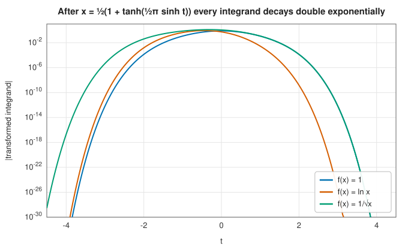

# Tanh-sinh quadrature

<div class="entry-summary">

| | |
|---|---|
| **Problem** | Approximate $\int_a^b f(x)\,dx$ when $f$ may be singular, or infinitely steep, at the endpoints |
| **Devised by** | Hidetosi Takahasi and Masatake Mori (1974) |
| **Accuracy** | Error $\approx \exp(-c\,N/\ln N)$ with $N$ evaluations, for $f$ analytic inside the interval, even with integrable endpoint singularities |
| **Cost** | $N$ evaluations; refinement halves the step and reuses every previous evaluation |
| **API** | [`TanhSinhEngine`](../../api/lib_jsl_integration/tanh_sinh/struct.TanhSinhEngine.html), [`integrate_with_error`](../../api/lib_jsl_integration/tanh_sinh/struct.TanhSinhEngine.html#method.integrate_with_error), [`integrate_with_complement`](../../api/lib_jsl_integration/tanh_sinh/struct.TanhSinhEngine.html#method.integrate_with_complement) |

</div>

## Overview

Integrals such as $\int_0^1 \ln x\,dx$, $\int_0^1 dx/\sqrt{x}$ or $\int_{-1}^{1} dx/\sqrt{1 - x^2}$
have integrands that blow up at an endpoint. Polynomial-based rules converge painfully slowly on
them, because no polynomial resembles $1/\sqrt{x}$ near $x = 0$. **Tanh-sinh quadrature** changes
variables so that the singularity disappears into an infinitely distant, exponentially flat tail,
then applies the humble trapezoid rule. The result converges almost exponentially, whether or
not the integrand is singular at the ends.

Tanh-sinh is the method of choice for endpoint singularities, for integrands whose behaviour at
the endpoints is unknown, and for very high precision computation. It is the default quadrature
in several arbitrary-precision systems.

## History

Hidetosi Takahasi and Masatake Mori introduced the **double exponential (DE) transformation** in
1974, in "Double exponential formulas for numerical integration". They were studying why the
trapezoid rule is so accurate for some integrals over the whole real line, and they asked what
change of variables would make a finite-interval integral look like the best possible such
integral. The answer, a transformation whose derivative decays like $\exp(-c\,e^{|t|})$, gave its
name to a family of methods, and Mori later wrote a historical account of the discovery (2005).

In 1997 Masaaki Sugihara proved that DE formulas are optimal, in a precise sense, for broad
classes of analytic functions. In the 2000s David Bailey, Jonathan Borwein and collaborators made
tanh-sinh the workhorse of *experimental mathematics*, where integrals are computed to hundreds
or thousands of digits to discover exact identities.

## The idea

### The trapezoid rule on the real line

For a function $g$ analytic in the strip $|\operatorname{Im} t| < d$ and decaying along the real
axis, the trapezoid rule

$$
\int_{-\infty}^{\infty} g(t)\,dt \approx h \sum_{k=-\infty}^{\infty} g(kh)
$$

has a *discretisation error* that decays like $e^{-2\pi d/h}$, exponentially in $1/h$. This
follows from the Poisson summation formula: the error consists of the Fourier transform of $g$
evaluated at multiples of $2\pi/h$, and analyticity in a strip makes that transform decay
exponentially. In practice the sum must also be **truncated** to $|k| \le K$, which adds an error
of the size of the neglected tail. The faster $g$ decays, the fewer terms are needed.

### Moving a finite interval to the real line

To use this, map $[-1, 1]$ to $\mathbb{R}$ with

$$
x = \phi(t) = \tanh\!\left(\tfrac{\pi}{2}\sinh t\right), \qquad
\phi'(t) = \frac{\tfrac{\pi}{2}\cosh t}{\cosh^2\!\left(\tfrac{\pi}{2}\sinh t\right)},
$$

so that

$$
\int_{-1}^{1} f(x)\,dx = \int_{-\infty}^{\infty} f\big(\phi(t)\big)\,\phi'(t)\,dt
\approx h \sum_{k=-K}^{K} w_k\, f(x_k), \qquad x_k = \phi(kh),\; w_k = \phi'(kh).
$$

As $|t| \to \infty$, the weight decays like $\exp\!\left(-\tfrac{\pi}{2} e^{|t|}\right)$, a
*double exponential*. An endpoint singularity such as $(1 - x)^{-1/2}$ grows only like a single
exponential in $t$, so the product still decays double exponentially. The singularity has been
neutralised.



The figure shows the transformed integrand for $f = 1$, $\ln x$ and $1/\sqrt{x}$ on $[0, 1]$. All
three fall below $10^{-30}$ by $|t| \approx 4$. The singular integrands decay more slowly on the
singular side, but still double exponentially.

### Balancing the two errors

With step $h$ and $2K + 1$ points, the discretisation error is about $e^{-2\pi d/h}$; the strip
half-width is $d = \pi/2$ for the tanh-sinh map. The truncation error is about
$\exp\!\left(-\tfrac{\pi}{2} e^{Kh}\right)$. Balancing the two gives $Kh \approx \ln(4d/h)$, and the
total error for $N = 2K + 1$ evaluations behaves like

$$
|I - Q_N| \approx \exp\!\left(-\frac{c\,N}{\ln N}\right).
$$

That is almost exponential, and remarkably it does not care whether $f$ is singular at the
endpoints, provided $f$ is analytic inside the interval. The clustering is extreme: at
$t = 3$ the node lies within about $10^{-13}$ of the endpoint, and at $t = 6$ within about
$10^{-275}$.

### Nested refinement

Halving $h$ keeps all existing points $kh$ and adds the odd multiples of $h/2$. As with
[Romberg integration](romberg.md), every function value is reused, and the change between
successive levels serves as an error estimate.

## Algorithm

For $\int_a^b f(x)\,dx$, with $u(t) = \tfrac{\pi}{2}\sinh t$:

1. Start with $h = 1$ and sum the contributions at $t = 0, \pm 1, \ldots, \pm t_{\max}$.
2. Halve $h$ and add the contributions at the new points $t = \pm h, \pm 3h, \ldots$.
3. The estimate is $\tfrac{b-a}{2}\, h \sum_k \phi'(t_k)\, f(x_k)$. Stop when two successive
   levels agree to the tolerance.

Each node is formed from its **distance to the nearer endpoint**,
$\tfrac{b-a}{2}\left(1 - \tanh u\right) = \tfrac{b - a}{1 + e^{2u}}$, rather than from
$\tanh u$ itself. Near the endpoint, $1 - \tanh u$ computed directly would round to zero long
before the true distance stops being representable, and the nodes that capture the singular tail
would be lost.

## Implementation

The contribution of each symmetric pair of nodes $\pm t$:

```rust,ignore
{{#include ../../../crates/integration/src/tanh_sinh.rs:tanh_sinh_pair}}
```

and the refinement loop, which adds only the odd multiples of each new step:

```rust,ignore
{{#include ../../../crates/integration/src/tanh_sinh.rs:tanh_sinh_levels}}
```

Numerical details that matter:

- **Endpoint offsets.** `offset = width / (1 + e^{2u})` is accurate to full relative precision
  even when it is $10^{-300}$, so the nodes really do approach the singularity. The sum runs to
  $t_{\max} = 6$, where the offsets reach the bottom of the double-precision range.
- **Points that round onto an endpoint.** For an interval such as $[-1, 1]$, $a + \text{offset}$
  rounds to $a$ long before the offset underflows, and $f(a)$ may be infinite.
  [`integrate_with_error`](../../api/lib_jsl_integration/tanh_sinh/struct.TanhSinhEngine.html#method.integrate_with_error)
  skips such points, which loses a tiny tail.
  [`integrate_with_complement`](../../api/lib_jsl_integration/tanh_sinh/struct.TanhSinhEngine.html#method.integrate_with_complement)
  passes the exact offset to the integrand as a second argument, so that it can evaluate
  $1/\sqrt{1 - x^2}$ as $1/\sqrt{\text{offset}\cdot(1 + x)}$ without cancellation.
- **Weights that underflow** are skipped rather than multiplied, avoiding $0 \cdot \infty$.

## In practice

Tanh-sinh compared with a 100-point Gauss-Legendre rule on singular integrands over $[0, 1]$:

{{#include ../generated/integration/tanh_sinh_table.md}}

With fewer evaluations, tanh-sinh reaches full double precision on every case, while Gauss
struggles, and fails completely on the nearly non-integrable $x^{-0.9}$.

A complete program, including the complement form:

```rust,ignore
{{#include ../../../crates/integration/examples/quadrature_tanh_sinh.rs}}
```

**Strengths**

- Near-exponential convergence regardless of endpoint singularities, so it is robust when the
  endpoint behaviour is unknown.
- Nested refinement with every evaluation reused, and a simple error estimate.
- Easy to implement at any precision; the nodes and weights are elementary functions.

**Weaknesses**

- *Interior* singularities, kinks and discontinuities are not helped. Split the interval at them
  so that they become endpoints.
- For smooth integrands Gaussian quadrature needs fewer evaluations; compare the
  [smooth convergence figure](index.md#the-central-trade-off).
- Singularities at endpoints away from zero need the complement form to avoid cancellation in
  $1 - x$.
- Poles or near-singularities just outside the interval, in the complex plane near it, shrink the
  strip of analyticity and slow convergence.

## Exercises

1. Show that $\phi(t) = \tanh\!\left(\tfrac{\pi}{2}\sinh t\right)$ maps $\mathbb{R}$ onto
   $(-1, 1)$, and derive $\phi'(t)$. How close to $1$ is $\phi(4)$?
2. For $f(x) = (1 - x)^{-1/2}$ on $[-1, 1]$, write down $f(\phi(t))\,\phi'(t)$ for large $t$ and
   show that it decays double exponentially.
3. Replace $\phi$ by the single exponential map $x = \tanh t$. Implement the resulting rule and
   compare its convergence with tanh-sinh on $\int_0^1 \ln x\,dx$.
4. Compute $\int_0^1 \frac{\ln x}{1 - x}\,dx = -\pi^2/6$ with the library. Which endpoint is
   singular, and what goes wrong if the integrand is evaluated naively at points near $x = 1$?
5. Compute $\int_0^1 |x - \tfrac13|^{-1/2}\,dx$ first over $[0, 1]$, then split at $x = 1/3$.
   Explain the difference.

## Further reading

- H. Takahasi and M. Mori, "Double exponential formulas for numerical integration",
  *Publications of the Research Institute for Mathematical Sciences* 9 (1974) 721–741.
- M. Mori, "Discovery of the double exponential transformation and its developments",
  *Publications of the Research Institute for Mathematical Sciences* 41 (2005) 897–935. The
  inventor's own account.
- M. Sugihara, "Optimality of the double exponential formula: functional analysis approach",
  *Numerische Mathematik* 75 (1997) 379–395.
- D. H. Bailey, K. Jeyabalan and X. S. Li, "A comparison of three high-precision quadrature
  schemes", *Experimental Mathematics* 14 (2005) 317–329.
- L. N. Trefethen and J. A. C. Weideman, "The exponentially convergent trapezoidal rule", *SIAM
  Review* 56 (2014) 385–458. The trapezoid rule on the real line and in a strip.
