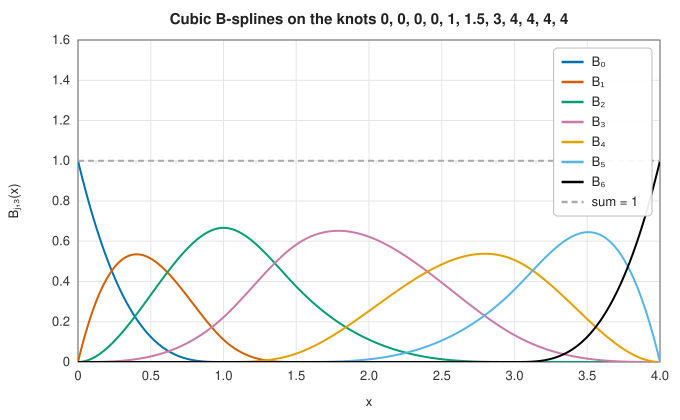
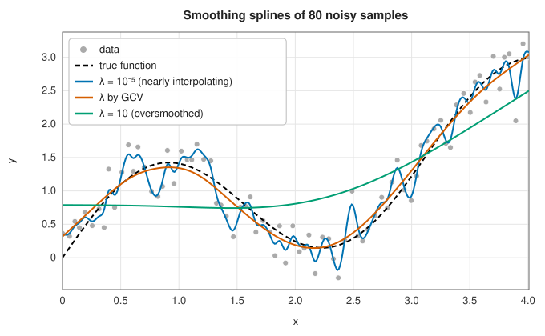

# B-splines and smoothing splines

<div class="entry-summary">

| | |
|---|---|
| **Problem** | Represent piecewise polynomials of any degree stably; interpolate data with a chosen end condition (not-a-knot, natural, clamped, periodic or given derivatives); fit splines to noisy data by least squares on given knots, or by a smoothing spline whose roughness is chosen by cross-validation |
| **Devised by** | Isaac Schoenberg (1946), splines and B-splines; Haskell Curry and Schoenberg (1947); Maurice Cox (1972) and Carl de Boor (1972), the recurrence; Schoenberg (1964) and Christian Reinsch (1967), smoothing splines; Peter Craven and Grace Wahba (1979), generalised cross-validation; Michael Hutchinson and Frank de Hoog (1985), the banded trace |
| **Accuracy** | A spline of degree $k$ with good end conditions: $O(h^{k+1})$. Agrees with `scipy.interpolate` to $10^{-13}$ or better, and the GCV choice of $\lambda$ to $2\times10^{-8}$ |
| **Cost** | Interpolation: one banded solve, $O(nk^2)$. Evaluation: a binary search and $O(k^2)$. Smoothing spline: $O(n)$ per value of $\lambda$, including the GCV score |
| **Read first** | [Piecewise and spline interpolation](splines.md) |
| **API** | [`BSpline`](../../api/lib_jsl_interpolation/one_d/b_spline/struct.BSpline.html), [`make_interp_spline`](../../api/lib_jsl_interpolation/one_d/b_spline/fn.make_interp_spline.html), [`BoundaryCondition`](../../api/lib_jsl_interpolation/one_d/b_spline/enum.BoundaryCondition.html), [`make_lsq_spline`](../../api/lib_jsl_interpolation/one_d/b_spline/fn.make_lsq_spline.html), [`make_interp_curve`](../../api/lib_jsl_interpolation/one_d/b_spline/fn.make_interp_curve.html), [`make_smoothing_spline`](../../api/lib_jsl_interpolation/one_d/smoothing_spline/fn.make_smoothing_spline.html) |

</div>

## Overview

The [previous entry](splines.md) built the natural cubic spline from its values and second derivatives at the data. That
approach does not generalise well: other degrees, other end conditions, smoothing and least-squares fitting each need their
own derivation. **B-splines** give one representation for all of them. Every spline of degree $k$ on a knot sequence is a
combination

$$
s(x) = \sum_j c_j\,B_{j,k}(x)
$$

of B-splines: non-negative bumps, each a piecewise polynomial of degree $k$ that is non-zero on only $k + 1$ knot intervals. Fitting
a spline becomes a small banded linear system for the coefficients $c_j$, and derivatives, integrals and evaluation follow from
simple recurrences. The library follows `scipy.interpolate`'s design: a `BSpline` type, and constructors for interpolating,
least-squares and smoothing splines.

## History

Isaac Schoenberg introduced splines in 1946, naming them after the draughtsman's flexible strip, and with Haskell Curry
described the B-spline basis in 1947. B-splines became practical with the stable recurrence found independently by Maurice
Cox and Carl de Boor in 1972. De Boor's *A Practical Guide to Splines* (1978) and its Fortran codes, and Paul Dierckx's FITPACK
(1975–1993), became the foundations of spline software; SciPy's `interpolate` module grew from FITPACK and, since 2016, from
de Boor's algorithms in Python. The smoothing spline goes back to Edmund Whittaker (1923) for discrete data. Schoenberg (1964)
showed that its continuous form is a natural cubic spline, and Christian Reinsch (1967) gave the banded algorithm. Grace Wahba
and Peter Craven (1979) proposed choosing its parameter by generalised cross-validation. Michael Hutchinson and Frank de Hoog
(1985) showed how to compute the GCV score in linear time.

## The idea

### The B-spline basis

Given knots $t_0 \le t_1 \le \cdots$, the B-splines are defined by the **Cox-de Boor recurrence**. Degree 0 is the indicator of a knot
interval, $B_{j,0}(x) = 1$ on $[t_j, t_{j+1})$ and 0 elsewhere. Each higher degree blends two neighbours of the degree below with weights that
rise and fall linearly:

$$
B_{j,k}(x) = \frac{x - t_j}{t_{j+k} - t_j}\,B_{j,k-1}(x) + \frac{t_{j+k+1} - x}{t_{j+k+1} - t_{j+1}}\,B_{j+1,k-1}(x).
$$

$B_{j,k}$ is non-zero only on $[t_j, t_{j+k+1})$, is non-negative, and the B-splines sum to one on the base interval $[t_k, t_n]$. A spline is
therefore a moving weighted average of its coefficients, and evaluating it involves only the $k + 1$ functions that are non-zero at
$x$. Repeating a knot lowers the continuity there: with $k + 1$ copies at each end, as in the figure, the spline starts and ends at its
first and last coefficient.



<p class="caption" id="fig-3-5"><strong>Figure 3.5.</strong> Cubic B-splines.</p>

The derivative of a spline is a spline of one degree less on the same knots, with coefficients

$$
c'_j = k\,\frac{c_{j+1} - c_j}{t_{j+k+1} - t_{j+1}},
$$

and the antiderivative is a spline of one degree more, with coefficients that are partial sums $\sum_{i \le j} c_i(t_{i+k+1} - t_i)/(k + 1)$. Integrals
are differences of the antiderivative.

### Interpolation and end conditions

A spline of degree $k$ through $n$ points has $n$ interpolation conditions $s(x_i) = y_i$. With knots at the data, there are $n + k - 1$
coefficients, so $k - 1$ conditions are still free: one at each end for a cubic. The choice matters most near the ends:

- **Not-a-knot** (the default) removes knots instead of adding conditions. For a cubic, the knots at $x_1$ and $x_{n-2}$ are dropped, so the first two
  and the last two intervals are each one cubic. It needs no information beyond the data.
- **Natural** sets $s'' = 0$ at both ends. This is the spline of the previous entry, and the smoothest interpolant in the sense of $\int s''^2$.
- **Clamped** sets $s' = 0$ at both ends (SciPy's meaning). The general form, **given derivatives**, sets any derivatives at the ends to known values.
- **Periodic** matches all derivatives up to order $k - 1$ across the ends, for periodic data.

The conditions form a banded linear system with bandwidth $k$, solved with partial pivoting in $O(nk^2)$ operations. The end
condition decides the rate of convergence for a smooth function sampled with spacing $h$:

<p class="caption" id="tab-3-3"><strong>Table 3.3.</strong> Largest error interpolating sin 2x + e^(x/3) on [0, 3] with n equally spaced points.</p>

{{#include ../generated/interpolation/bspline_convergence.md}}

Not-a-knot and exact end slopes give the full $O(h^4)$ of a cubic. The natural condition imposes $s'' = 0$ where $f''$ is not zero, and the
error near the ends falls only as $O(h^2)$. Clamping to zero slope is worse still, $O(h)$, unless the function really has zero slope there.
Wrong end conditions are a common cause of poor spline accuracy.

### Least-squares splines

With fewer knots than data, a spline cannot interpolate, but it can be fitted by least squares. `make_lsq_spline` minimises
$\sum_i (w_i(y_i - s(x_i)))^2$ on a given knot sequence. The design matrix $B_{ij} = B_j(x_i)$ has at most $k + 1$ non-zeros per row, and
the problem is solved with a QR factorisation. The solution is unique when each B-spline is non-zero at some data point in the
right order (the **Schoenberg-Whitney conditions**).

### Smoothing splines

The **smoothing spline** balances fidelity against roughness: it minimises

$$
\sum_i w_i\,(y_i - g(x_i))^2 + \lambda\int g''(x)^2\,dx
$$

over all twice-differentiable functions $g$. The minimiser is a natural cubic spline with knots at the data (Schoenberg's theorem),
so it is found exactly in a finite basis. In the cubic B-spline basis, the coefficients solve

$$
(B^{\mathsf T}WB + \lambda\,\Omega)\,\mathbf c = B^{\mathsf T}W\mathbf y, \qquad \Omega_{ij} = \int B_i''B_j'' ,
$$

with both matrices banded with half-bandwidth 3. Large $\lambda$ gives the least-squares straight line, and $\lambda \to 0$ the interpolating
natural spline. The fitted values are $\hat{\mathbf y} = A(\lambda)\mathbf y$, and the trace of the **influence matrix** $A$ counts the effective number of parameters,
from 2 to $n$.

**Generalised cross-validation** chooses $\lambda$ to minimise

$$
\mathrm{GCV}(\lambda) = \frac{\frac1n\|\mathbf y - \hat{\mathbf y}\|^2}{\big(1 - \operatorname{tr}A(\lambda)/n\big)^2},
$$

an estimate of the prediction error that needs no knowledge of the noise level. The trace needs only the entries of
$(B^{\mathsf T}WB + \lambda\Omega)^{-1}$ inside the band, and the recurrence of Hutchinson and de Hoog computes those from the $LDL^{\mathsf T}$ factors in
$O(n)$. The library minimises GCV over $0 < \lambda < n$ with the same bounded Brent search as SciPy, so the two choose the same $\lambda$:



<p class="caption" id="fig-3-6"><strong>Figure 3.6.</strong> Smoothing splines.</p>

<p class="caption" id="tab-3-4"><strong>Table 3.4.</strong> Smoothing splines of the data in the figure.</p>

{{#include ../generated/interpolation/smoothing_spline.md}}

The nearly interpolating spline follows the noise and has the smallest residual but a large error. The oversmoothed one misses the
signal. GCV picks about 7.5 effective parameters, and its error is less than half that of either extreme.

## Algorithm

**Evaluation**, `s(x)`: find the interval $t_l \le x < t_{l+1}$ by binary search (clamped to the first or last interval when extrapolating);
compute the $k + 1$ non-zero B-splines by the recurrence, raising the degree one step at a time (de Boor's `bsplvb`); return
$\sum_r c_{l-k+r}\,B_r$. Derivatives use the derivative recurrence on the lower-degree values.

**Interpolation**, `make_interp_spline(x, y, k, bc)`:

1. Choose the knots: for not-a-knot, the data points with $(k - 1)/2$ removed at each end for odd $k$ (midpoints between data points
   for even $k$), and $k + 1$ copies of each end; with derivative conditions, the data points with $k$ extra copies of each end.
2. One row per condition: the non-zero B-splines (or their derivatives) at the point.
3. Solve the banded system with partial pivoting. Periodic splines use $n - 1$ free coefficients with the last $k$ repeating the first,
   and solve the resulting cyclic system densely.

**Smoothing spline**, `make_smoothing_spline(x, y, w, λ)`: form $B^{\mathsf T}WB$, $B^{\mathsf T}W\mathbf y$ and $\Omega$ (by two-point Gauss quadrature on each interval,
exact because $B''$ is linear there); eliminate the two end coefficients with the natural conditions $s''(x_0) = s''(x_{n-1}) = 0$; and
solve by a banded $LDL^{\mathsf T}$ factorisation. Without $\lambda$, minimise the GCV score, computing each trace from the band of the inverse.

## Implementation

```rust,ignore
{{#include ../../../crates/interpolation/src/one_d/b_spline.rs:basis}}
```

```rust,ignore
{{#include ../../../crates/interpolation/src/one_d/b_spline.rs:make_interp_spline}}
```

```rust,ignore
{{#include ../../../crates/interpolation/src/one_d/smoothing_spline.rs:band_inverse}}
```

- `BSpline` holds knots, coefficients and degree, as SciPy's does. Its `extrapolate` field continues the end polynomials (the
  default), returns NaN, or wraps periodically.
- `make_lsq_spline` uses SciPy's convention that the weights multiply the residuals; `make_smoothing_spline` weights the squared
  residuals.
- `make_interp_curve` interpolates a parametric curve through points in any dimension, with the chord-length parameter that
  `splprep` uses.

## In practice

Every constructor is compared with `scipy.interpolate` from SciPy 1.17.1 (references from
`book/generator/data/make_bspline_refs.py`), on 15 irregular points and 141 evaluation points that include extrapolation
beyond both ends:

<p class="caption" id="tab-3-5"><strong>Table 3.5.</strong> B-splines against SciPy.</p>

{{#include ../generated/interpolation/bspline_scipy.md}}

The smoothing splines agree to $10^{-10}$, the conditioning of the penalised system. The GCV choice agrees to $2\times10^{-8}$: both run the same
search on the same function, but floating-point differences in the GCV score move its stopping point slightly.

**Strengths**

- One representation for every degree and end condition, with exact derivatives, antiderivatives and integrals.
- Banded systems: interpolation and smoothing cost $O(n)$ for fixed degree.
- The smoothing spline needs no knot placement, and GCV chooses its parameter automatically.

**Weaknesses**

- Periodic interpolation solves a dense $(n - 1) \times (n - 1)$ system; a cyclic banded solver would make it $O(n)$.
- No automatic knot selection for a given smoothing tolerance (FITPACK's `splrep` with `s > 0`); use `make_smoothing_spline` or
  `make_lsq_spline` with chosen knots instead.
- Splines are one-dimensional here; tensor products for grids are in [Interpolation on grids](grids.md).

## Exercises

1. Show from the recurrence that $\sum_j B_{j,k}(x) = 1$ on the base interval.
2. Show that the derivative formula for $c'_j$ follows from differentiating the recurrence, and check it on $B_{j,1}$.
3. Count the coefficients and conditions of a cubic interpolating spline with knots at the data, and explain why not-a-knot
   needs no extra conditions.
4. Explain why the natural spline converges only as $O(h^2)$ near the ends, and estimate the size of its error at $x_0 + h/2$.
5. Show that as $\lambda \to \infty$ the smoothing spline tends to the weighted least-squares straight line, and that $\operatorname{tr}A \to 2$.

<details>
<summary>Hints and answers</summary>

1. By induction on $k$: substituting the recurrence and collecting the terms that multiply each $B_{j,k-1}$ gives the weights
   $\frac{x - t_j}{t_{j+k} - t_j} + \frac{t_{j+k} - x}{t_{j+k} - t_j} = 1$.
2. Differentiate $s = \sum c_jB_{j,k}$ using $B'_{j,k} = k\big(B_{j,k-1}/(t_{j+k} - t_j) - B_{j+1,k-1}/(t_{j+k+1} - t_{j+1})\big)$ and shift the index in the second sum. For $k = 1$ the
   hat function has slopes $\pm 1/(t_{j+1} - t_j)$, as the formula gives.
3. With knots at the $n$ data points and 4 copies of each end, there are $n + 2$ coefficients and $n$ conditions. Not-a-knot removes 2 knots, leaving
   $n$ coefficients for $n$ conditions.
4. $s'' = 0$ at the end is wrong by $f''(x_0)$. The resulting error decays away from the end like a damped correction, of order
   $h^2|f''(x_0)|$ in the first intervals.
5. Dividing by $\lambda$, the objective tends to $\int g''^2$, whose minimisers are straight lines. Among them the fit term picks the least-squares
   line. $A$ becomes the projection onto lines, whose trace is 2.

</details>

## Further reading

- C. de Boor, *A Practical Guide to Splines*, revised ed., Springer, 2001.
- P. Dierckx, *Curve and Surface Fitting with Splines*, Oxford University Press, 1993.
- C. H. Reinsch, "Smoothing by spline functions", *Numerische Mathematik* 10 (1967) 177–183.
- P. Craven and G. Wahba, "Smoothing noisy data with spline functions", *Numerische Mathematik* 31 (1979) 377–403.
- M. F. Hutchinson and F. R. de Hoog, "Smoothing noisy data with spline functions", *Numerische Mathematik* 47 (1985) 99–106.
- T. Lyche and K. Mørken, *Spline Methods* (lecture notes), University of Oslo, 2008.
