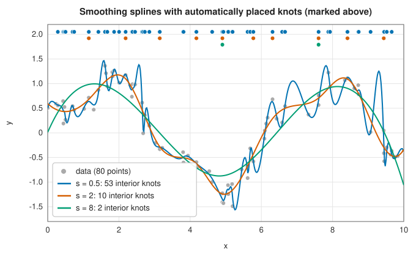
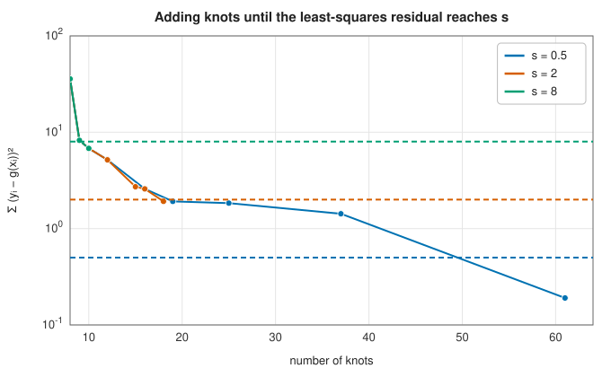
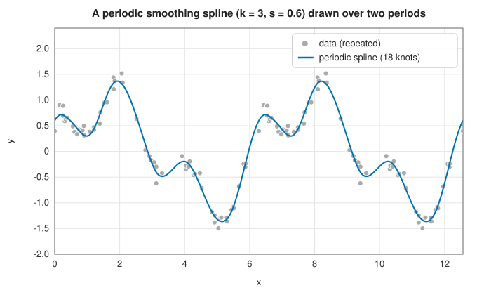

# Smoothing splines with automatic knots

<div class="entry-summary">

| | |
|---|---|
| **Problem** | Fit a smooth spline to noisy data with a chosen bound $s$ on the weighted sum of squared residuals, placing the knots automatically; do the same for a parametric curve; and represent piecewise polynomials in the Bernstein basis, built from derivatives at the breakpoints |
| **Devised by** | Paul Dierckx (1975, 1982), FITPACK's `curfit` and `parcur`; Sergei Bernstein (1912) and Pierre Bézier (1960s), the Bernstein basis and Bézier curves; Paul de Casteljau (1959), its evaluation |
| **Accuracy** | The residual within $10^{-3}s$ of $s$, as FITPACK; the same knots as SciPy's `make_splrep` and coefficients to $10^{-14}$ |
| **Cost** | Each least-squares fit is a banded QR by Givens rotations, $O(mk^2)$ for $m$ points; the knot search tries $O(\log n)$ to $O(n)$ knot sets for $n$ knots, and the smoothing parameter takes up to 20 more banded solves |
| **Read first** | [B-splines and smoothing splines](b-splines.md), [Piecewise polynomials, Hermite data and scattered interpolation](piecewise-scattered.md) |
| **API** | [`fitpack`](../../api/lib_jsl_interpolation/one_d/fitpack/index.html) ([`make_splrep`](../../api/lib_jsl_interpolation/one_d/fitpack/fn.make_splrep.html), [`make_splprep`](../../api/lib_jsl_interpolation/one_d/fitpack/fn.make_splprep.html), [`generate_knots`](../../api/lib_jsl_interpolation/one_d/fitpack/fn.generate_knots.html), [`SplrepOptions`](../../api/lib_jsl_interpolation/one_d/fitpack/struct.SplrepOptions.html), [`make_splrep_periodic`](../../api/lib_jsl_interpolation/one_d/fitpack/fn.make_splrep_periodic.html)); [`bisplrep`](../../api/lib_jsl_interpolation/two_d/smooth_bivariate/fn.bisplrep.html), [`bisplrep_lsq`](../../api/lib_jsl_interpolation/two_d/smooth_bivariate/fn.bisplrep_lsq.html), [`SmoothBivariateSpline`](../../api/lib_jsl_interpolation/two_d/smooth_bivariate/struct.SmoothBivariateSpline.html); [`BPoly`](../../api/lib_jsl_interpolation/one_d/bpoly/struct.BPoly.html) |

</div>

## Overview

[B-splines and smoothing splines](b-splines.md) fits splines whose knots are given (`make_lsq_spline`) or are all the data points (`make_smoothing_spline`). FITPACK, Paul Dierckx's Fortran library, chooses the knots itself. Given a **smoothing factor** $s$, `make_splrep` returns the smoothest spline whose weighted residual is at most $s$:
$$\sum_{i=1}^m \big(w_i(y_i - g(x_i))\big)^2 \le s,$$
where "smoothest" means that the jumps of $g^{(k)}$ at the interior knots are as small as possible. The spline has only as many knots as the data need: few where the data are smooth, more where they change quickly.

- $s = 0$ interpolates.
- A large $s$ gives the least-squares polynomial of degree $k$.
- With weights $w_i = 1/\sigma_i$, the expected residual of the true curve is $m$, and Dierckx recommends $s$ in $m \pm \sqrt{2m}$.

This is SciPy's `splrep(x, y, s=...)` and `UnivariateSpline`, in the form of SciPy's newer `make_splrep`, a reimplementation of the Fortran algorithm. `make_splprep` (SciPy's `splprep`) fits a curve through points in any number of dimensions with shared knots.

The entry also adds **`BPoly`**, piecewise polynomials in the **Bernstein basis** $b_{a,k}(s) = \binom ka s^a(1-s)^{k-a}$. Its coefficients are the control points of Bézier curves. `BPoly.from_derivatives` builds the piecewise polynomial matching any number of derivatives at each breakpoint, a generalisation of cubic Hermite interpolation.

## History

Paul Dierckx (1975) gave the algorithm for smoothing with automatic knots, and FITPACK (1982–1993), collected in his book *Curve and Surface Fitting with Splines*, extended it to periodic and parametric curves and to surfaces. SciPy wrapped FITPACK from its beginning in 2001. In 2024 (SciPy 1.15) Evgeni Burovski reimplemented the curve-fitting drivers in Python and C++ as `make_splrep`, `make_splprep` and `generate_knots`; this library follows that reimplementation.

Sergei Bernstein (1912) introduced his polynomials for a constructive proof of the Weierstrass approximation theorem. Paul de Casteljau at Citroën (1959) and Pierre Bézier at Renault (1960s) independently used them for car-body design, and de Casteljau's algorithm is still how Bézier curves are drawn.

## The idea

### Placing the knots

FITPACK starts with no interior knots (the least-squares polynomial) and repeats:

1. Fit the least-squares spline on the current knots and compute its residual $f_p$.
2. If $f_p \le s$, stop.
3. Otherwise add knots. Split the residuals into the knot intervals, counting a point on an interior knot half to each side. In the interval with the largest sum that holds more than one data point, insert a knot at the data point in its middle.

One knot is added at the first step. After that, the number added grows from the rate at which the residual fell, $\Delta f_p$ per knot: about $(f_p - s)/\Delta f_p$ more knots should reach $s$. That estimate is clamped between half and twice the previous number. If the knots reach $m + k + 1$, they are replaced by those of the interpolating spline.

### The smoothing parameter

With the knots fixed, the least-squares spline has $f_p \le s$, usually well below it, and the polynomial has $f_p > s$. Between them lies a one-parameter family: minimise
$$\sum_i \big(w_i(y_i - g(x_i))\big)^2 + \frac1{p^2}\sum_j \big(\text{jump of } g^{(k)} \text{ at } t_j\big)^2.$$
For $p \to \infty$ this is the least-squares spline, for $p \to 0$ the polynomial, and the residual $f(p)$ decreases monotonically in between. The jumps are linear in the coefficients, so for each $p$ the minimiser solves a least-squares problem. That problem is the observation matrix with the scaled jump rows $B/p$ appended.

FITPACK finds the $p$ with $f(p) = s$ by fitting a rational function $r(p) = (up + v)/(p + w)$ through three values and taking its zero. It keeps a bracket with $f > s$ on one side and $f < s$ on the other, and stops when $|f(p) - s| < 10^{-3}s$.

### Banded QR by Givens rotations

Each row of the observation matrix has $k + 1$ non-zero entries, the B-splines that are non-zero at $x_i$, so the triangular factor is banded. FITPACK rotates the rows into the triangle one at a time with Givens rotations, in $O(k^2)$ operations per row. A jump row has $k + 2$ entries, and rotating it in fills the band to width $k + 2$ all the way down. The row being rotated therefore travels along the band, one column per rotation, to the end of the matrix. The triangle of the data rows is computed once and reused for every $p$.

### The Bernstein basis

On $[x_j, x_{j+1}]$ with $s = (x - x_j)/h$, $p(x) = \sum_a c_a b_{a,k}(s)$, and:

- $p(x_j) = c_0$, $p(x_{j+1}) = c_k$, and the curve lies in the convex hull of the coefficients.
- **De Casteljau's algorithm** evaluates $p$ by $k$ rounds of convex combinations $c_a \leftarrow (1-s)c_a + sc_{a+1}$. It is numerically stable because every step is an average.
- **Derivatives** are again in the Bernstein basis: $c'_a = k(c_{a+1} - c_a)/h$.
- **Matching derivatives at the ends.** The $q$-th derivative at the left end involves only $c_0, \dots, c_q$, and at the right end only $c_{k-q}, \dots, c_k$. Prescribed derivatives at both ends therefore determine the coefficients one at a time from each end.

## Algorithm

**Knot placement** (`generate_knots`), with `acc` $= 10^{-3}s$:

1. $t$ = $k+1$ copies of each end; $n_{\text{plus}} = 1$.
2. Repeat:
   1. Fit the least-squares spline; if $f_p - s < $ `acc`, stop.
   2. Unless this is the first fit, set $n_{\text{plus}} \leftarrow \min(2n_{\text{plus}}, \max(\lfloor n_{\text{plus}}(f_p - s)/\Delta\rfloor, n_{\text{plus}}/2, 1))$, with $\Delta = f_p^{\text{old}} - f_p$; if $\Delta \le$ `acc`, use $2n_{\text{plus}}$ for the first argument.
   3. Add $n_{\text{plus}}$ knots, refitting between additions. Stop with the interpolating knots if there are $m + k + 1$, or at `nest`.

**Smoothing** (`make_splrep`):

1. Starting values: $p_0 = n_c / \sum_i R_{ii}$ with $R$ the triangular factor; the bracket $(0, f_{\text{poly}} - s)$, $(\infty, f_{\text{lsq}} - s)$.
2. Repeat up to 20 times:
   1. Rotate the rows $B/p$ into a copy of $R$, back-substitute, and evaluate $f(p) - s$; stop if it is below `acc`.
   2. If the bracket is not yet confirmed, move $p$ by a factor of 25 (or towards the other end).
   3. Otherwise take the zero of the rational interpolant through the bracket and the new point, and replace the bracket end of the same sign.

## Implementation

```rust,ignore
{{#include ../../../crates/interpolation/src/one_d/fitpack.rs:fpknot}}
```

```rust,ignore
{{#include ../../../crates/interpolation/src/one_d/fitpack.rs:smoothing}}
```

```rust,ignore
{{#include ../../../crates/interpolation/src/one_d/bpoly.rs:from_derivatives}}
```

- `make_splrep` returns the spline and a `SplrepInfo` with $f_p$ and whether the tolerance was met. SciPy warns instead.
- Periodic smoothing splines and smoothing surfaces were added in 2.19.0; see the section below.
- `BPoly` covers one-dimensional values. `extend` and `BPoly` with vector values are not implemented.

## In practice

The references are from SciPy 1.17.1, written by `book/generator/data/make_fitpack_refs.py`. The data are 80 noisy samples of $\sin x + 0.3\cos 3x$ with noise of standard deviation 0.15:

<p class="caption" id="tab-3-13"><strong>Table 3.13.</strong> Smoothing splines against SciPy's `make_splrep`, `make_splprep` and `generate_knots`, and against FITPACK's Fortran `splrep`.</p>

{{#include ../generated/interpolation/fitpack_splrep.md}}

The library places the same knots as SciPy's `make_splrep` in every case. Its coefficients agree to rounding, and so do its residuals.

FITPACK's Fortran `splrep` often places different knots. In the cubic case with $s = 2$ it uses 21 knots against 18, of which 10 interior knots are shared. Both meet the criterion, with $f_p = 2.00005$ and $1.99957$. SciPy's reimplementation, which the library follows, differs from the Fortran code in details of knot placement; for $s = 8$ and the polynomial, where they coincide, the coefficients agree to $3\times10^{-16}$.



<p class="caption" id="fig-3-15"><strong>Figure 3.15.</strong> Smoothing splines for three values of $s$. The noise variance gives an expected residual of $80 \times 0.15^2 = 1.8$. With $s = 2$ the spline follows the signal with 10 interior knots. With $s = 0.5$ it chases the noise with 53, and with $s = 8$ it is too stiff to follow the oscillation near $x = 2$.</p>



<p class="caption" id="fig-3-16"><strong>Figure 3.16.</strong> The residual of the least-squares spline on each knot vector FITPACK tries. The dashed lines mark $s$. The three runs share their first steps, and the number of knots added per step grows until the residual approaches $s$.</p>

<p class="caption" id="tab-3-14"><strong>Table 3.14.</strong> `BPoly` against SciPy, on four breakpoints with two or three derivatives each, evaluated at 23 points including extrapolation.</p>

{{#include ../generated/interpolation/fitpack_bpoly.md}}

### Periodic splines and smoothing surfaces

**Periodic splines.** `make_splrep_periodic` is SciPy's `make_splrep(bc_type='periodic')`, FITPACK's `percur`, for data that repeat with the period $x_e - x_b$:
- the last point stands for the first one shifted by a period;
- the boundary knots repeat the interior spacing across the ends;
- the last $k$ coefficients repeat the first $k$, which makes the spline and its first $k - 1$ derivatives continuous around the circle.

Knot placement and the iteration on $p$ are those of the non-periodic fit. Because the wrapped coefficients break the band structure, the library solves the small least-squares problems densely rather than with FITPACK's two-part Givens factorisation.

```rust,ignore
{{#include ../../../crates/interpolation/src/one_d/fitpack.rs:periodic}}
```

<p class="caption" id="tab-3-15"><strong>Table 3.15.</strong> Periodic smoothing splines against SciPy's.</p>

{{#include ../generated/interpolation/spl219_periodic.md}}

The knots are SciPy's, and so are the values to $10^{-13}$.



<p class="caption" id="fig-3-17"><strong>Figure 3.17.</strong> The periodic smoothing spline of noisy samples of a periodic function, drawn over two periods: it joins itself smoothly at $2\pi$.</p>

**Smoothing surfaces.** `bisplrep` fits scattered data $(x_i, y_i, z_i)$ with a tensor-product spline. Of the surfaces with $\sum (w_i(z_i - s(x_i, y_i)))^2 \le s$, it returns the one whose $k_x$-th $x$-derivatives and $k_y$-th $y$-derivatives jump least across the knots.
- Knots are added at the middle of the panel with the largest residual sum, in the direction with fewer knots so far. This keeps FITPACK's `surfit` strategy but not its exact rules.
- The penalty weight is found by the same rational iteration as for curves.

`bisplrep_lsq` is the least-squares surface on given knots: SciPy's `bisplrep(task=-1)` and `LSQBivariateSpline`. As in FITPACK, the boundary knots are moved to the data's range and points outside it are clamped.

```rust,ignore
{{#include ../../../crates/interpolation/src/two_d/smooth_bivariate.rs:bisplrep}}
```

<p class="caption" id="tab-3-16"><strong>Table 3.16.</strong> Smoothing surfaces against SciPy's bisplrep.</p>

{{#include ../generated/interpolation/spl219_surface.md}}

The least-squares surface is SciPy's to rounding. The smoothing surface meets the same target $s$ with a different set of knots. It differs from SciPy's by up to $0.08$ (the noise is $\sigma = 0.05$) and is slightly closer to the true function on this example.

**Strengths**

- The knots follow the data, so a smooth fit needs far fewer coefficients than an interpolating or penalised spline on all the data points.
- One parameter, $s$, has a statistical meaning: the residual one expects from the noise.
- The same knots as SciPy's `make_splrep`, so results transfer between the two.
- The Bernstein basis gives stable evaluation and a direct handle on derivatives at the breakpoints.

**Weaknesses**

- Knots are restricted to data points, and the greedy placement is not optimal. Free-knot splines can do better with fewer knots at much greater cost.
- A small $s$ with even degree can make the search for $p$ fail; `converged` then reports it.
- Smoothing surfaces place knots by the library's own rule, not FITPACK's `surfit`, so their knots differ from SciPy's.

## Exercises

1. Why does the least-squares spline on a knot vector have a smaller residual than any spline on fewer of the same knots?
2. Show that for $p \to 0$ the minimiser tends to a polynomial of degree $k$ on the whole interval. (Hint: what does zero jump of $g^{(k)}$ at every interior knot mean?)
3. Show that de Casteljau's algorithm with $k = 2$ evaluates $c_0(1-s)^2 + 2c_1 s(1-s) + c_2 s^2$.
4. From $p(x) = \sum_a c_a b_{a,k}(s)$, show that $p'(x_j) = k(c_1 - c_0)/h$.
5. With weights $1/\sigma_i$ and $m = 80$, what range of $s$ does Dierckx recommend?

<details>
<summary>Hints and answers</summary>

1. The splines on fewer knots are a subspace of those on more, and the least-squares fit minimises over the larger space.
2. Then the penalty dominates, forcing every jump to zero, so $g^{(k)}$ is constant across all knots and $g$ is a single polynomial; among those, the data term picks the least-squares one.
3. One round gives $(1-s)c_0 + sc_1$ and $(1-s)c_1 + sc_2$; the second combines them into the stated expression.
4. Only $b_{0,k}$ and $b_{1,k}$ have non-zero derivatives at $s = 0$, $-k$ and $k$, and $ds/dx = 1/h$.
5. $80 \pm \sqrt{160}$, about 67 to 93.

</details>

## Further reading

- P. Dierckx, "An algorithm for smoothing, differentiation and integration of experimental data using spline functions", *Journal of Computational and Applied Mathematics* 1 (1975) 165–184.
- P. Dierckx, "Algorithms for smoothing data with periodic and parametric splines", *Computer Graphics and Image Processing* 20 (1982) 171–184.
- P. Dierckx, *Curve and Surface Fitting with Splines*, Oxford University Press (1993).
- G. Farin, *Curves and Surfaces for CAGD: A Practical Guide*, 5th ed., Morgan Kaufmann (2002).
- R. T. Farouki, "The Bernstein polynomial basis: a centennial retrospective", *Computer Aided Geometric Design* 29 (2012) 379–419.
