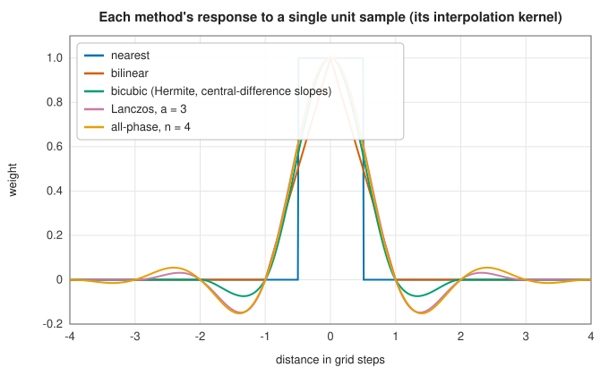

# Interpolation on grids

<div class="entry-summary">

| | |
|---|---|
| **Problem** | Interpolate values given on a rectilinear grid in two, three or more dimensions: images, terrain, physical fields, lookup tables |
| **Devised by** | Tensor-product interpolation: classical; bicubic convolution: Robert Keys (1981); Lanczos resampling: after Cornelius Lanczos's sigma factors (1956), popularised by Claude Duchon (1979); B-spline interpolation: Isaac Schoenberg, made fast by Michael Unser and colleagues (1991); all-phase interpolation: Hou Zhengxin and colleagues (2000s) |
| **Accuracy** | Nearest: $O(h)$. Bilinear and multilinear: $O(h^2)$. Bicubic, tricubic Lagrange and B-spline: up to $O(h^4)$. Fourier: exponential for smooth periodic data |
| **Cost** | Per evaluation: $1$, $2^n$, $4^n$ or $(2a)^n$ grid values in $n$ dimensions; B-splines need a prefilter pass once |
| **API** | 2D: [`Nearest2D`](../../api/lib_jsl_interpolation/two_d/nearest/struct.Nearest2D.html), [`Bilinear`](../../api/lib_jsl_interpolation/two_d/bilinear/struct.Bilinear.html), [`Bicubic`](../../api/lib_jsl_interpolation/two_d/bicubic/struct.Bicubic.html), [`CubicBasis2D`](../../api/lib_jsl_interpolation/two_d/cubic_basis/struct.CubicBasis2D.html), [`Lanczos2D`](../../api/lib_jsl_interpolation/two_d/lanczos/struct.Lanczos2D.html), [`AllPhase2D`](../../api/lib_jsl_interpolation/two_d/all_phase/struct.AllPhase2D.html), [`FourierInterpolator2D`](../../api/lib_jsl_interpolation/two_d/fourier_2d/struct.FourierInterpolator2D.html). 3D: [`Trilinear`](../../api/lib_jsl_interpolation/three_d/trilinear/struct.Trilinear.html), [`CubicLagrangian3D`](../../api/lib_jsl_interpolation/three_d/cubic_lagrangian/struct.CubicLagrangian3D.html), [`BSpline3D`](../../api/lib_jsl_interpolation/three_d/b_spline/struct.BSpline3D.html), [`FourierInterpolator3D`](../../api/lib_jsl_interpolation/three_d/fourier_3d/struct.FourierInterpolator3D.html). N-D: [`GridData`](../../api/lib_jsl_interpolation/nd/grid_data/struct.GridData.html), [`NearestND`](../../api/lib_jsl_interpolation/nd/nearest/index.html), [`CubicBasisND`](../../api/lib_jsl_interpolation/nd/cubic_basis/index.html) |

</div>

## Overview

Data on a grid is everywhere: the pixels of an image, the cells of a terrain model, the nodes of a
simulation, the entries of a multidimensional lookup table. Interpolating between grid values is
easier than interpolating scattered points, because the regular structure lets each one-dimensional
method extend to several dimensions as a **tensor product**: interpolate along one axis, then along
the next, and so on.

The methods differ in how many neighbouring values they use and how they weight them, which
decides their accuracy, their smoothness, and their behaviour in image processing, where the visual
result matters more than the error in a norm. This entry covers the classical polynomial methods
(nearest, multilinear, bicubic, tricubic, B-spline), the kernel methods of signal processing
(Lanczos, all-phase), and Fourier interpolation for periodic fields.

## History

Linear interpolation in two variables was used with tables of functions of two arguments long
before computers. Image processing made grid interpolation a central problem in the 1970s and 1980s:
Robert Keys (1981) derived the cubic convolution kernel used in most image software, and Claude Duchon
(1979) proposed filters based on Lanczos's "sigma factors" for reducing Gibbs oscillations, which
became the Lanczos resampling kernel. Michael Unser, Akram Aldroubi and Murray Eden (1991) showed how
to interpolate with B-splines by a fast recursive prefilter, making smooth high-quality spline
interpolation of images practical. All-phase interpolation and filtering were developed by Hou Zhengxin
and colleagues in the 2000s, from the idea of averaging over all window alignments.

## The idea

### Tensor products

Every one-dimensional interpolation method in the previous entries can be written as a weighted
sum of the data, $f(x) \approx \sum_i w_i(x)\,f_i$, where the weights $w_i(x)$ depend on where $x$
lies but not on the data. For linear interpolation between $x_0$ and $x_1$, for example, with
$s = (x - x_0)/(x_1 - x_0)$ the fraction of the way across, the weights are $1 - s$ and $s$.

On a two-dimensional grid with values $f_{ij}$ at the points $(x_i, y_j)$, apply the method in two
stages. First interpolate along $x$ within each grid row $j$, which gives a value
$g_j = \sum_i w_i(x)\,f_{ij}$ for each row. Then interpolate these row values along $y$:

$$
f(x, y) \approx \sum_j w_j(y)\,g_j = \sum_i \sum_j w_i(x)\, w_j(y)\, f_{ij}.
$$

The weight of each grid value is the *product* of a one-dimensional weight for each axis. This
construction is called a **tensor product**, and it works the same way in any number of
dimensions. The order of the axes does not matter, since the final formula is symmetric in them.

The simplest example is **bilinear** interpolation, which uses the two nearest values per axis
with linear weights. In a grid cell with corner values $f_{00}, f_{10}, f_{01}, f_{11}$ and
fractional position $(s, t)$,

$$
f \approx (1 - s)(1 - t)\,f_{00} + s(1 - t)\,f_{10} + (1 - s)t\,f_{01} + st\,f_{11}.
$$

Each corner is weighted by the area of the rectangle opposite to it. Despite the name, the result
is not a plane: it contains the product term $st$, so it is linear along each axis but curved along the
diagonals. **Multilinear** interpolation is the same in $n$ dimensions and uses the $2^n$ corners
of the enclosing cell. Both are exact for functions that are linear in each coordinate separately
and have error $O(h^2)$, like [linear interpolation](splines.md#linear-interpolation) in one
dimension.

### Cubic methods

Higher accuracy needs more neighbours. The cubic methods use four values per axis, so 16 values
in two dimensions and 64 in three. The library has three, all tensor products of one-dimensional
cubic methods.

- **Bicubic** interpolation is the tensor product of
  [cubic Hermite interpolation](splines.md#cubic-hermite-interpolation). In each cell it fits a
  patch that matches the values and the estimated derivatives $f_x$, $f_y$ and $f_{xy}$ at the four
  corners. When the derivatives are estimated by central differences it is the same method as the
  **Catmull-Rom cubic basis**, and the two give identical results in the table below.
- **Tricubic Lagrange** interpolation passes a cubic polynomial through the four nearest values
  along each axis, the tensor product of
  [polynomial interpolation](polynomial.md) at four points.
- The **B-spline** method is the tensor product of the
  [cubic spline](splines.md#cubic-splines). It writes the interpolant as a sum of shifted copies
  of one smooth bump, the cubic B-spline $B_3$, one copy centred on each grid point:
  $s(\mathbf u) = \sum_{\mathbf k} c_{\mathbf k}\,B_3(\mathbf u - \mathbf k)$. The bump $B_3$ is wider than one cell,
  so neighbouring bumps overlap and the coefficients $c_{\mathbf k}$ are *not* the data values. They
  must be found first, by solving a tridiagonal system along each axis (the **prefilter**), exactly
  as a spline's coefficients are found in one dimension. The result is twice continuously
  differentiable and fourth-order accurate.

### Interpolation as convolution

On a uniform grid there is a second way to look at all these methods. Measure position $u$ in
units of the grid spacing, so that the samples sit at the integers $k$. Every linear method can
then be written as

$$
f(u) \approx \sum_k K(u - k)\, f_k
$$

for some function $K$, called the **kernel** of the method. The formula says: place a copy of $K$
at each sample, scale it by the sample value, and add the copies up. This operation is a
[convolution](../filters/convolution.md). To find the kernel of a method, feed it data that are 1 at
one grid point and 0 everywhere else; the function it returns is $K$. The figure shows the
library's kernels, computed exactly that way:



Every kernel equals 1 at $u = 0$ and 0 at the other integers, which is what makes the method
interpolate. Linear interpolation has a triangular kernel; the cubic kernels are smoother and
have small negative lobes.

Signal processing suggests an ideal. If the data are samples of a **band-limited** function (one
containing no frequencies above half the sampling rate), the sampling theorem says the function
is recovered exactly with the kernel $\operatorname{sinc}(u) = \sin(\pi u)/(\pi u)$. The sinc function
decays slowly and extends to infinity, so it cannot be used as it stands. Two practical kernels
shorten it.

- **Lanczos** resampling multiplies the sinc by a wider copy of itself, which acts as a window
  and brings it smoothly to zero: $K(u) = \operatorname{sinc}(u)\operatorname{sinc}(u/a)$ for $|u| < a$, and 0 beyond.
- **All-phase** interpolation averages the sinc interpolations of all $n$-sample windows containing
  the point. The effect is a sinc tapered by a triangle, $K(u) = \operatorname{sinc}(u)(1 - |u|/n)$.

Both kernels have negative lobes that sharpen edges in images, at the price of slight ringing
(faint echoes beside sharp edges).

### Accuracy

The library's errors for interpolation from a $16 \times 16$ grid over $[0, 1)^2$:

{{#include ../generated/interpolation/grid_accuracy.md}}

Three lessons stand out. The cubic methods are the most accurate for smooth data, by a wide margin.
The windowed-sinc kernels are designed for images, not accuracy: Lanczos reproduces constants but not
straight lines, so its error on a smooth non-band-limited function falls only like $h$. And Fourier
interpolation is exact to rounding for smooth periodic data but useless for non-periodic data, whose
implied jump at the boundary causes Gibbs oscillations. Near the edges, every method that needs
values beyond the grid (here they are replicated from the edge) loses accuracy.

In three dimensions the same pattern holds; the B-spline overtakes the Lagrange interpolant as the
grid is refined, thanks to its global smoothness:

{{#include ../generated/interpolation/grid_3d.md}}

## Algorithm

**Set-up.** Most methods need none: they read the grid values directly. The B-spline interpolant
first replaces the data by coefficients, solving the tridiagonal system
$(c_{k-1} + 4c_k + c_{k+1})/6 = f_k$ along every line of the grid in each direction in turn (the
prefilter). The Fourier interpolants compute a multidimensional FFT of the data.

**Evaluation at a point**, for a method that uses $s$ values per axis in $n$ dimensions ($s = 2$
for multilinear, 4 for the cubic methods, $2a$ for a kernel of half-width $a$):

1. **Locate the cell.** For each axis, find the grid interval containing the coordinate: by
   binary search on a non-uniform axis, or by one division on a uniform one. This also gives the
   fractional position within the cell.
2. **Compute the weights.** For each axis, evaluate the method's $s$ one-dimensional weights at
   that fractional position.
3. **Sum.** Add up the $s^n$ neighbouring grid values, each multiplied by the product of its
   weights along the axes. Neighbours beyond the edge of the grid are supplied by the method's
   edge rule (see the implementation notes).

The cost per point is $O(s^n)$, so the cubic methods cost 16 values in two dimensions and 64 in
three.

## Implementation

```rust,ignore
{{#include ../../../crates/interpolation/src/nd/grid_data.rs:multilinear}}
```

- All grid interpolators validate that the axes are strictly increasing; the kernel methods and
  the B-spline also require uniform spacing.
- Outside the grid, the polynomial methods extend their edge cells; the kernel methods replicate edge
  values; the Fourier interpolants are periodic.

## In practice

```rust,ignore
{{#include ../../../crates/interpolation/examples/interpolation_grids.rs}}
```

**Strengths**

- Fast, local and simple, in any number of dimensions.
- Cubic and B-spline methods are fourth-order accurate for smooth data; Fourier interpolation is
  spectrally accurate for periodic data.

**Weaknesses**

- The cost grows as $4^n$ (cubic) or $2^n$ (linear) per evaluation in $n$ dimensions.
- Windowed-sinc kernels trade accuracy for visual quality.
- The data must lie on a full grid; for scattered data see [the next entry](scattered.md).

## Exercises

1. Show that bilinear interpolation on a cell is exact for $f = a + bx + cy + dxy$, and not for $x^2$.
2. Compute the Lanczos-2 weights for $u = 0.5$ and check whether $\sum_k K(0.5 - k)\,k = 0.5$. What does the
   answer imply about linear functions?
3. Show that the B-spline prefilter equations follow from requiring $s(k) = f_k$, using
   $B_3(0) = \tfrac23$, $B_3(\pm1) = \tfrac16$.
4. Downsample an image-like function such as a checkerboard with sharp edges by each method and
   compare the ringing near the edges.
5. Implement linear interpolation of a 5-dimensional lookup table with `GridData` and estimate how its
   cost grows with the dimension.

## Further reading

- R. G. Keys, "Cubic convolution interpolation for digital image processing", *IEEE Transactions on
  Acoustics, Speech, and Signal Processing* 29 (1981) 1153–1160.
- C. E. Duchon, "Lanczos filtering in one and two dimensions", *Journal of Applied Meteorology* 18 (1979)
  1016–1022.
- M. Unser, A. Aldroubi and M. Eden, "Fast B-spline transforms for continuous image representation and
  interpolation", *IEEE Transactions on Pattern Analysis and Machine Intelligence* 13 (1991) 277–285.
- P. Thévenaz, T. Blu and M. Unser, "Interpolation revisited", *IEEE Transactions on Medical Imaging* 19
  (2000) 739–758. A thorough comparison of interpolation kernels.
