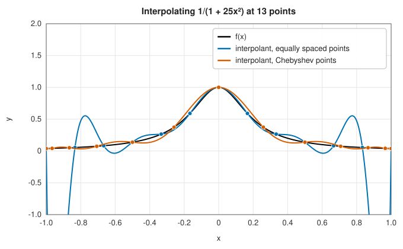

# Interpolation

Interpolation constructs a function that passes through given data points, in order to evaluate it
between them. It is how tables are read, how curves are drawn through measurements, how images are
resized, and how many other numerical methods (quadrature, differentiation, the solution of
differential equations) are built: almost every method in the [integration chapter](../integration/index.md)
integrates an interpolant.

## The central questions

Every interpolation problem raises three questions.

- **Where are the data?** On a line, on a grid, or scattered in space; equally spaced, or placed where
  you choose. Global polynomial interpolation is excellent at [Chebyshev points](polynomial.md#chebyshev-points)
  and disastrous at equally spaced ones; tensor-product methods need a grid.
- **How smooth is the function?** For analytic functions, global methods (polynomial, rational,
  Fourier) converge exponentially. For functions with kinks, steep gradients or noise, local methods
  (splines, Hermite cubics) are safer.
- **What must the interpolant preserve?** Monotonicity (PCHIP), positivity, smoothness of derivatives
  (splines), periodicity (Fourier), or simply the visual impression (image kernels).

<strong>Figure 3.1.</strong> Interpolation of the Runge function at 13 points.

The Runge phenomenon above, the failure of polynomial interpolation at equally spaced points, is the
single most important cautionary example in the subject.

## Choosing a method

| Your data | Recommended | Entry |
|---|---|---|
| A function you can evaluate anywhere | Chebyshev series | [Polynomial interpolation](polynomial.md#chebyshev-series) |
| Samples at Chebyshev or well-spread points | Barycentric polynomial interpolation | [Polynomial interpolation](polynomial.md) |
| Samples at equally spaced or irregular points, smooth function | Cubic spline, or Floater-Hormann | [Splines](splines.md), [Rational](rational.md#floater-hormann-interpolation) |
| Monotone data, or data with sudden changes | PCHIP or Akima | [Splines](splines.md#cubic-hermite-interpolation) |
| A function with poles or steep gradients nearby | AAA or Bulirsch-Stoer | [Rational interpolation](rational.md) |
| A Taylor series to extend beyond its radius | Padé approximants | [Rational interpolation](rational.md#padé-approximants) |
| Periodic samples | Trigonometric interpolation | [Trigonometric](trigonometric.md) |
| Damped oscillations, to analyse or extrapolate | Prony's method | [Trigonometric](trigonometric.md#pronys-method) |
| Noisy samples, to smooth or differentiate | Savitzky-Golay | [Savitzky-Golay smoothing](savitzky-golay.md) |
| Values on a 2D, 3D or N-D grid | Bicubic, tricubic, B-spline or multilinear | [Interpolation on grids](grids.md) |
| Scattered points in the plane or in space | Radial basis functions | [Scattered data](scattered.md) |

## Testing against SciPy

The references come from SciPy 1.17.1 and NumPy 2.4, written by `book/generator/data/make_interpolation_refs.py` on data that the generator rebuilds from the same formulas. Each row gives the largest difference between the library's interpolant and SciPy's, at 40 to 100 evaluation points:

<strong>Table 3.1.</strong> Columns: interpolant (SciPy reference), largest difference.

{{#include ../generated/interpolation/scipy_reference.md}}

The interpolants agree to rounding error. The radial basis functions with a shape parameter (Gaussian, multiquadric) differ more because their interpolation systems are ill-conditioned (condition numbers of $10^{9}$ to $3 \times 10^{11}$ here, against $7 \times 10^{5}$ for the cubic kernel), so each implementation's rounding is amplified; both still reproduce the data. The library's bicubic interpolant, whose node derivatives are finite-difference estimates, has no SciPy counterpart and is not listed.

## In the library

The interpolation crate is `lib_jsl_interpolation`
([API reference](../../api/lib_jsl_interpolation/index.html)). The one-dimensional interpolators of data
implement the [`InterpolationTrait`](../../api/lib_jsl_interpolation/interpolation_trait/trait.InterpolationTrait.html),
whose `interpolate_at` method locates the interval containing the point (by bisection, remembering the
last interval) and evaluates the method's formula there; the multidimensional interpolators implement
[`Interpolation2D`](../../api/lib_jsl_interpolation/two_d/trait.Interpolation2D.html),
[`Interpolation3D`](../../api/lib_jsl_interpolation/three_d/trait.Interpolation3D.html) or
[`InterpolationND`](../../api/lib_jsl_interpolation/nd/trait.InterpolationND.html).
