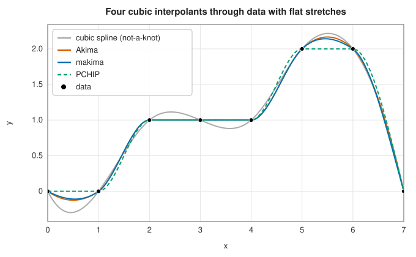
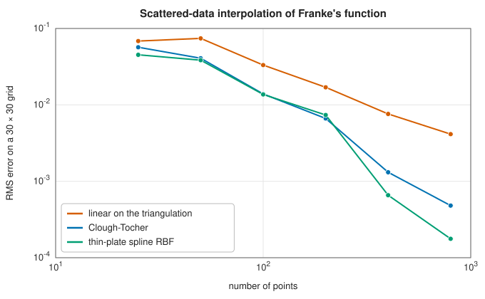

# Piecewise polynomials, Hermite data and scattered interpolation

<div class="entry-summary">

| | |
|---|---|
| **Problem** | Represent piecewise polynomials and differentiate, integrate and solve them; interpolate values together with derivatives; interpolate on a rectangular grid with tensor-product splines; interpolate data scattered in the plane or in any dimension |
| **Devised by** | Charles Hermite (1878), interpolation with derivatives; Fred Krogh (1970), the stable Newton form for it; Hiroshi Akima (1970) and Cosmin Ionita (2019, `makima`); Carl de Boor (1962), tensor-product splines; Boris Delaunay (1934); Ray Clough and James Tocher (1965), the split-triangle cubic element; Gregory Nielson (1983), global gradient estimation; Rolland Hardy (1971) and Jean Duchon (1976), radial basis functions and thin-plate splines |
| **Accuracy** | Agrees with SciPy to $10^{-14}$ relative or better in every case |
| **Cost** | `PPoly` evaluation: a binary search and Horner's rule; roots: a $k \times k$ eigenproblem per piece. `RectBivariateSpline`: $n_x + n_y$ banded solves. Triangulation: $O(n\log n)$; Clough-Tocher gradients: a few hundred sweeps of $O(n)$; RBF: an $O(n^3)$ dense solve |
| **Read first** | [Piecewise and spline interpolation](splines.md), [B-splines and smoothing splines](b-splines.md), [Scattered data interpolation](scattered.md) |
| **API** | [`PPoly`](../../api/lib_jsl_interpolation/one_d/ppoly/struct.PPoly.html), [`KroghInterpolator`](../../api/lib_jsl_interpolation/one_d/krogh/struct.KroghInterpolator.html), [`makima`](../../api/lib_jsl_interpolation/one_d/akima/fn.makima.html), [`RectBivariateSpline`](../../api/lib_jsl_interpolation/two_d/rect_bivariate_spline/struct.RectBivariateSpline.html), [`LinearNDInterpolator`](../../api/lib_jsl_interpolation/two_d/scattered/struct.LinearNDInterpolator.html), [`CloughTocher2DInterpolator`](../../api/lib_jsl_interpolation/two_d/scattered/struct.CloughTocher2DInterpolator.html), [`NearestNDInterpolator`](../../api/lib_jsl_interpolation/two_d/scattered/struct.NearestNDInterpolator.html), [`griddata`](../../api/lib_jsl_interpolation/two_d/scattered/fn.griddata.html), [`RbfInterpolator`](../../api/lib_jsl_interpolation/nd/rbf/struct.RbfInterpolator.html) |

</div>

## Overview

This entry completes the interpolation chapter's coverage of `scipy.interpolate`:

- **`PPoly`**, a piecewise polynomial in the power basis, with derivatives, antiderivatives, definite integrals and real roots. Every
  piecewise-cubic interpolant in the library (PCHIP, Akima, cubic Hermite, B-splines) converts to one.
- **Hermite data**: `PPoly::cubic_hermite` (SciPy's `CubicHermiteSpline`) for given slopes, and `KroghInterpolator` for one polynomial through
  values and derivatives of any order.
- **`makima`**, the modified Akima interpolant, which overshoots less than Akima's original.
- **`RectBivariateSpline`**, interpolating tensor-product splines on a grid, with partial derivatives and integrals over rectangles.
- **Scattered data in the plane**: piecewise linear (`LinearNDInterpolator`) and C¹ Clough-Tocher (`CloughTocher2DInterpolator`) interpolation on
  a Delaunay triangulation, nearest neighbour in any dimension, and the `griddata` front end.
- **`RbfInterpolator`**: radial basis functions in any number of dimensions, with SciPy's kernels, polynomial tails and smoothing.

## History

Charles Hermite (1878) generalised Lagrange interpolation to data that include derivatives. Fred Krogh (1970) showed how to compute it stably in
Newton form, with repeated nodes standing for derivatives. Hiroshi Akima (1970) designed a local cubic that avoids the wiggles of global splines.
MATLAB's `makima` (Cosmin Ionita, 2019) modified its weights to suppress the overshoot that remains.

Tensor-product splines go back to Carl de Boor (1962). Paul Dierckx's FITPACK (1980s), which SciPy wraps, fits them to gridded and scattered
data. For irregular points in the plane, Boris Delaunay's (1934) triangulation gives the natural mesh. The engineers Ray Clough and James Tocher
(1965) split each triangle into three cubic patches to obtain a C¹ finite element, and Gregory Nielson (1983) showed how to estimate the vertex
gradients it needs from the data alone. Rolland Hardy (1971) introduced multiquadric radial basis functions for topography, and Jean Duchon (1976)
derived the thin-plate spline as the minimiser of bending energy.

## The idea

### Piecewise polynomials

On interval $j$, a `PPoly` is $p_j(x) = \sum_{i=0}^{k}c_{ij}(x - x_j)^{k-i}$. Row 0 of the coefficient matrix holds the highest power, as in
SciPy. Evaluation finds the interval by binary search and applies Horner's rule. Derivatives scale the coefficients by falling factorials.

**Antiderivatives** divide by rising factorials, which leaves the new low-order coefficients free. They are set so that the antiderivative
is zero at $x_0$ and continuous, with as many continuous derivatives as were added. Interval by interval, each new coefficient is the previous
piece's derivative at the shared breakpoint divided by a factorial. A definite integral is then a difference of two antiderivative values.

**Roots.** On each piece, the roots of the polynomial are the eigenvalues of its companion matrix. Real ones (to a small tolerance) inside the
piece are kept and polished by a Newton step. The first and last pieces extend to $\mp\infty$ when extrapolating. A breakpoint where the
function jumps across the target value is reported too, as in SciPy's `solve(…, discontinuity=True)`.

### Hermite data

Given values $y_i$ and slopes $d_i$, each interval's cubic is fixed by its four end conditions. With $h$ the interval length and $s$ the secant slope,

$$
p(x_j + t) = y_j + d_jt + \frac{3s - 2d_j - d_{j+1}}{h}t^2 + \frac{d_j + d_{j+1} - 2s}{h^2}t^3 .
$$

Krogh's interpolant is a single polynomial through all the conditions. In Newton form,
$p(x) = c_0 + c_1(x - x_0) + c_2(x - x_0)(x - x_1) + \cdots$, the coefficients are divided differences. When a node is repeated, the divided
difference of $s + 1$ equal nodes becomes $f^{(s)}/s!$. Krogh's recurrence uses exactly that, and its derivatives come from a second recurrence on the products $\prod(x - x_i)$.

### Akima and makima

Akima's slope at $x_i$ is a weighted average of the neighbouring secants $m_{i-1}$ and $m_i$. The weights are the differences of the next
secants out, $w_1 = |m_{i+1} - m_i|$ and $w_2 = |m_{i-1} - m_{i-2}|$, so a slope follows the side where the data are changing least. On a
flat stretch both weights vanish and SciPy falls back to an average. `makima` adds half the secants' sizes to the weights,
$|m_{i+1} - m_i| + \tfrac12|m_{i+1} + m_i|$, which damps overshoot next to flat stretches. On the data of Figure 3.13 the not-a-knot spline
overshoots by 0.22 and ripples by 0.23 across the plateau. Akima overshoots by 0.17 and makima by 0.14, both with a flat plateau, and PCHIP never overshoots.



<p class="caption" id="fig-3-13"><strong>Figure 3.13.</strong> Four cubic interpolants through data with flat stretches. The global spline rings across the plateau. Akima and makima keep it flat and overshoot less at the peak; PCHIP preserves monotonicity at the cost of a sharper shape.</p>

### Tensor-product splines

On a grid $x_i \times y_j$ with values $z_{ij}$, the spline $s(x, y) = \sum_{ij}c_{ij}B_i(x)B_j(y)$ interpolates when $A_xCA_y^{\mathsf T} = Z$,
with $A_x$ and $A_y$ the one-dimensional collocation matrices. The system separates: interpolate each column of $Z$ along $x$, then each row of the
result along $y$. With smoothing $s = 0$, FITPACK places the interior knots at the data points except $(k + 1)/2$ at each end. For odd degree that
is the not-a-knot spline of [`make_interp_spline`](b-splines.md), so `RectBivariateSpline` uses it directly. Even degrees, where FITPACK uses other knots, are not supported.
Partial derivatives differentiate the one-dimensional bases. Integrals over a rectangle are $\sum c_{ij}I_iJ_j$, with $I_i$ and $J_j$ the integrals of the basis functions.

### Scattered data on a triangulation

The Delaunay triangulation of the data sites tiles their convex hull with triangles whose circumcircles contain no other site. Inside a
triangle, **linear** interpolation uses the barycentric coordinates $\lambda_1, \lambda_2, \lambda_3$ of the query point:
$f \approx \sum\lambda_kf_k$. The result is continuous, with kinks along the edges.

**Clough-Tocher** builds a C¹ surface. Each triangle is split at its centroid into three sub-triangles, each carrying a cubic in Bézier form.
Its 19 Bézier ordinates are fixed by three things:

- the values and gradients at the three vertices;
- C¹ continuity across the interior edges;
- the requirement that the derivative across each outer edge be linear along it, so that neighbouring triangles agree.

SciPy takes that cross-edge direction towards the neighbouring triangle's centroid rather than along the normal. Barycentric coordinates make this choice affine-invariant, so long thin triangles do not cause oscillations.

The gradients are not given, so they are **estimated** (Nielson, 1983). The Clough-Tocher interpolant restricted to an edge is a cubic in the
end values and the end directional derivatives. The integral of its squared second derivative is then a quadratic form in the gradients. Each
vertex's gradient minimises the sum over its edges, with the neighbours' gradients held fixed: a 2 × 2 system. Sweeping over the vertices
(Gauss-Seidel) until the largest change is below $10^{-6}$ gives the estimates. The sweep order is the point order, as in SciPy, so the library
reproduces SciPy's iterates, not just its limit.

### Radial basis functions in any dimension

A radial basis function interpolant is

$$
s(\mathbf x) = \sum_i a_i\,\varphi(\varepsilon\|\mathbf x - \mathbf y_i\|) + \sum_j b_jp_j(\mathbf x),
$$

with a polynomial tail $p_j$ up to the degree that makes the kernel's system solvable. The thin-plate spline $r^2\ln r$ and the cubic $r^3$ need
degree 1, the quintic $-r^5$ needs degree 2, and the linear $-r$ and multiquadric need degree 0. The Gaussian and the inverse kernels need none.
The coefficients solve

$$
\begin{pmatrix}K + \lambda I & P\\ P^{\mathsf T} & 0\end{pmatrix}\begin{pmatrix}\mathbf a\\ \mathbf b\end{pmatrix} = \begin{pmatrix}\mathbf d\\ 0\end{pmatrix},
$$

where $K_{ij} = \varphi(\varepsilon\|\mathbf y_i - \mathbf y_j\|)$ and $\lambda \ge 0$ smooths. The polynomial is built on coordinates
shifted and scaled into $[-1, 1]$ per dimension, which keeps $P$ well conditioned; that shift and scale are SciPy's. The library's existing 2-D
[`RadialBasisInterpolator`](scattered.md) remains; `RbfInterpolator` adds any dimension, all eight kernels, polynomial tails and smoothing.

## Algorithm

**`estimate_gradients_2d_global`**: set every gradient to zero; repeat up to 400 times: for each vertex $i$, accumulate over its neighbours $j$,
with $\mathbf e = \mathbf y_j - \mathbf y_i$ and $L = \|\mathbf e\|$,
$Q \mathrel{+}= 4\mathbf e\mathbf e^{\mathsf T}/L^3$ and $\mathbf s \mathrel{+}= (6(f_i - f_j) + 2\mathbf e\cdot\nabla f_j)\,\mathbf e/L^3$; set $\nabla f_i = -Q^{-1}\mathbf s$;
stop when the largest change, relative to the gradient when it exceeds 1, is below $10^{-6}$.

**`PPoly::solve(y)`**: for each piece, subtract $y$ from the constant coefficient, drop leading zeros, take the eigenvalues of the companion matrix,
keep those within $10^{-7}$ of the real axis and inside the piece (or beyond it, for the end pieces when extrapolating), polish each by up to three Newton steps, then sort and merge duplicates.

## Implementation

```rust,ignore
{{#include ../../../crates/interpolation/src/one_d/ppoly.rs:antiderivative}}
```

```rust,ignore
{{#include ../../../crates/interpolation/src/one_d/krogh.rs:krogh}}
```

```rust,ignore
{{#include ../../../crates/interpolation/src/one_d/akima.rs:akima_slopes}}
```

```rust,ignore
{{#include ../../../crates/interpolation/src/two_d/scattered.rs:gradients}}
```

```rust,ignore
{{#include ../../../crates/interpolation/src/nd/rbf.rs:rbf}}
```

- `PiecewiseHermite::to_ppoly` turns PCHIP, Akima and makima interpolants into `PPoly`s, and `PPoly::from_spline` does the same for B-splines.
  `from_spline` keeps only the distinct knots as breakpoints; SciPy also keeps zero-length intervals at repeated knots.
- `akima` now uses SciPy's exact weights, cutoff and fill value, so the two agree to rounding.
- Points outside a `RectBivariateSpline`'s grid are clamped to its edge, as in FITPACK.
- Point location uses a bucket grid over the triangles. Points on an edge are accepted with a slack of $100\varepsilon$ in the barycentric coordinates, as in Qhull.
- Linear and Clough-Tocher interpolation are 2-D only. SciPy's `LinearNDInterpolator` also handles 3-D and higher through Qhull.

## In practice

Every function is compared with SciPy 1.17.1 (references from `book/generator/data/make_piecewise_refs.py`). The scattered data are
60 random points in the unit square plus its corners, with $f = \sin 3x\cos 2y + x$, and the RBF data are 50 random points in $[-1, 1]^3$:

<p class="caption" id="tab-3-12"><strong>Table 3.12.</strong> Piecewise polynomials, Hermite data, tensor-product splines and scattered interpolation against SciPy.</p>

{{#include ../generated/interpolation/piecewise_scipy.md}}

How do the scattered-data methods compare as points are added? For Franke's test function, the RMS error falls like $n^{-1}$ for linear
interpolation (error $O(h^2)$ with $h \sim n^{-1/2}$). For Clough-Tocher it falls like $n^{-3/2}$ or faster once the triangles resolve the
function. From about 400 points on, the thin-plate spline is another 2–3 times more accurate:



<p class="caption" id="fig-3-14"><strong>Figure 3.14.</strong> Interpolating Franke's function from random points in the unit square. With 800 points, Clough-Tocher is about 9 times and the thin-plate spline about 23 times more accurate than linear interpolation. The RBF costs an 800 × 800 dense solve; the triangulation methods cost $O(n\log n)$.</p>

**Strengths**

- One piecewise-polynomial type with derivatives, integrals and roots for every piecewise interpolant.
- Clough-Tocher and RBF interpolation that reproduce SciPy to rounding, including its gradient iteration and polynomial scaling.
- Tensor-product splines with partial derivatives and rectangle integrals.

**Weaknesses**

- Triangulation-based methods are 2-D only; RBFs cover higher dimensions but cost $O(n^3)$, and there is no `neighbors` option for local RBF fits.
- `RectBivariateSpline` supports only odd degrees and $s = 0$ (no smoothing).
- No Bernstein-basis `BPoly`, and no `PPoly.extend`.

## Exercises

1. Show that the antiderivative coefficients of a piece are $c_{ij}/((k - i + 1)\cdots(k - i + \nu))$, and why the remaining $\nu$ coefficients are free.
2. Derive the cubic Hermite coefficients from $p(0) = y_0$, $p'(0) = d_0$, $p(h) = y_1$, $p'(h) = d_1$.
3. Show that the divided difference $f[x_0, x_0, \ldots, x_0]$ with $s + 1$ copies equals $f^{(s)}(x_0)/s!$.
4. Why does linear interpolation on a triangulation have error $O(h^2)$, and Clough-Tocher $O(h^4)$ for smooth data with exact gradients?
5. Show that the thin-plate spline system has a unique solution when the data sites are not collinear.

<details>
<summary>Hints and answers</summary>

1. Integrating $(x - x_j)^{k-i}$ $\nu$ times gives $(x - x_j)^{k-i+\nu}$ divided by the rising factorial. Polynomials of degree below $\nu$ have zero $\nu$-th derivative, so they can be added freely: they are fixed by continuity.
2. $p = y_0 + d_0t + at^2 + bt^3$; the conditions at $h$ give $ah^2 + bh^3 = y_1 - y_0 - d_0h$ and $2ah + 3bh^2 = d_1 - d_0$; solve for $a$ and $b$.
3. As the nodes coalesce, $f[x_0, \ldots, x_s] = f^{(s)}(\xi)/s!$ for some $\xi$ between them, by the mean-value theorem for divided differences; in the limit $\xi = x_0$.
4. Linear interpolation is exact for degree 1, so the error is governed by the second derivatives times $h^2$. Clough-Tocher is exact for cubics, so the error is $O(h^4)$; with estimated gradients the gradient error usually limits it to about $O(h^3)$.
5. The kernel is conditionally positive definite of order 2: $\mathbf a^{\mathsf T}K\mathbf a > 0$ for $\mathbf a \ne 0$ with $P^{\mathsf T}\mathbf a = 0$. Together with $P$ having full column rank (non-collinear sites), this makes the saddle-point matrix non-singular.

</details>

## Further reading

- F. T. Krogh, "Efficient algorithms for polynomial interpolation and numerical differentiation", *Mathematics of Computation* 24 (1970) 185–190.
- H. Akima, "A new method of interpolation and smooth curve fitting based on local procedures", *Journal of the ACM* 17 (1970) 589–602.
- C. de Boor, *A Practical Guide to Splines*, revised ed., Springer, 2001.
- P. Dierckx, *Curve and Surface Fitting with Splines*, Oxford University Press, 1993.
- R. W. Clough and J. L. Tocher, "Finite element stiffness matrices for analysis of plate bending", *Proceedings of the Conference on Matrix Methods in Structural Mechanics*, Wright-Patterson Air Force Base, 1965, 515–545.
- G. M. Nielson, "A method for interpolating scattered data based upon a minimum norm network", *Mathematics of Computation* 40 (1983) 253–271.
- G. E. Fasshauer, *Meshfree Approximation Methods with MATLAB*, World Scientific, 2007.
- R. Franke, "Scattered data interpolation: tests of some methods", *Mathematics of Computation* 38 (1982) 181–200.
