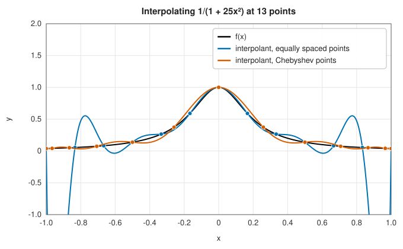
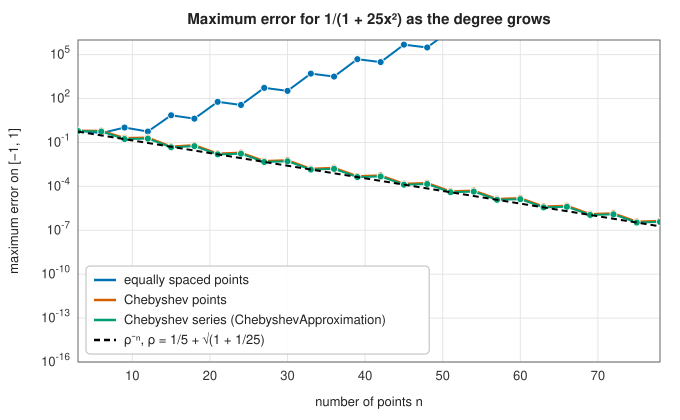

# Polynomial interpolation

<div class="entry-summary">

| | |
|---|---|
| **Problem** | Find the polynomial of degree $n - 1$ through $n$ points $(x_i, y_i)$, or approximate a function $f$ on an interval by a polynomial |
| **Devised by** | Newton's divided differences (1687, 1711); Lagrange's form (Waring 1779, Lagrange 1795); the barycentric form (Jacobi 1825, Taylor 1945, Salzer 1972; popularised by Berrut and Trefethen 2004); Chebyshev polynomials (Pafnuty Chebyshev, 1854); the Runge phenomenon (Carl Runge, 1901) |
| **Accuracy** | Through Chebyshev points: geometric convergence $O(\rho^{-n})$ for analytic $f$. Through equally spaced points: may diverge |
| **Cost** | Newton: $O(n^2)$ set-up, $O(n)$ per evaluation. Barycentric: $O(n^2)$ weights, $O(n)$ per evaluation. Chebyshev series: $O(n^2)$ fit, $O(n)$ Clenshaw evaluation |
| **API** | [`PolynomialInterpolator`](../../api/lib_jsl_interpolation/one_d/polynomial_interpolator/struct.PolynomialInterpolator.html), [`LagrangeInterpolant`](../../api/lib_jsl_interpolation/one_d/lagrange_interpolant/struct.LagrangeInterpolant.html), [`ChebyshevApproximation`](../../api/lib_jsl_interpolation/one_d/chebyshev_approximations/struct.ChebyshevApproximation.html) |

</div>

## Overview

Two points determine a straight line, and three points (not on a line) determine a parabola. The
pattern continues: given $n$ points with distinct abscissas $x_0, \ldots, x_{n-1}$, there is exactly
one polynomial of degree at most $n - 1$ passing through all of them. It is called the
**interpolating polynomial**, or **interpolant**. Finding it, and evaluating it between the
points, is the oldest problem in numerical analysis, and the foundation of numerical integration,
differentiation and much of approximation theory.

Although the interpolant is unique, it can be written down in several ways, and the ways differ
in cost and in numerical stability. The library offers three.

- **Newton's divided differences** build the polynomial one point at a time and evaluate it by
  Horner's rule.
- The **barycentric Lagrange formula** is the numerically preferred form for evaluating the
  interpolant at many points.
- A **Chebyshev series** approximates a function you can evaluate anywhere, not just at given
  data, to near machine precision with a few dozen terms.

The single most important fact about polynomial interpolation is that **the choice of points
matters enormously**. Equally spaced points can make the interpolant diverge wildly as $n$ grows,
the **Runge phenomenon**, while Chebyshev points converge for every Lipschitz-continuous function, and geometrically fast for analytic ones. How
fast depends on how far the nearest singularity of the function lies from the interval in the complex plane, and a
function that is only a few times differentiable converges only algebraically.
This entry first describes the two ways of computing the interpolant, then explains where the
error comes from and why the points matter so much.

## History

Interpolation tables were the computers of earlier centuries: astronomical, navigational and
mathematical tables listed values at regular steps, and users interpolated between them. Isaac
Newton's divided-difference formula (in the *Principia*, 1687, Book III, Lemma V, and *Methodus
differentialis*, 1711) remains the standard way to build an interpolant incrementally. The form now named after Joseph-Louis Lagrange
(1795) had been published by Edward Waring in 1779 and was known to Euler.

The barycentric form, a rearrangement of Lagrange's formula that is both cheaper and more stable,
appears in Jacobi's 1825 thesis and was rediscovered several times during the twentieth century; Jean-
Paul Berrut and Nick Trefethen's 2004 survey "Barycentric Lagrange interpolation" made it the
modern standard.

In 1901 Carl Runge showed that interpolating the innocent function $1/(1 + 25x^2)$ at equally spaced
points on $[-1, 1]$ gives polynomials that diverge near the ends of the interval. The cure lies in
the polynomials introduced by Pafnuty Chebyshev in 1854 in his study of steam-engine linkages: they
oscillate equally between $-1$ and $1$, and their extrema cluster towards the ends of the interval
exactly as interpolation points should.

## The idea

### Newton's divided differences

Newton's idea is to write the interpolant so that each new data point adds one new term and
leaves the earlier terms alone:

$$
p(x) = a_0 + a_1(x - x_0) + a_2(x - x_0)(x - x_1) + \cdots + a_{n-1}(x - x_0)\cdots(x - x_{n-2}).
$$

The term with coefficient $a_k$ contains the factors $(x - x_0), \ldots, (x - x_{k-1})$, so it
vanishes at $x_0, \ldots, x_{k-1}$. This lets us find the coefficients one at a time.

- At $x = x_0$ every term but the first vanishes, so $p(x_0) = a_0$, and we need $a_0 = y_0$.
- At $x = x_1$ only two terms survive: $p(x_1) = a_0 + a_1(x_1 - x_0) = y_1$, so
  $a_1 = (y_1 - y_0)/(x_1 - x_0)$. This is the slope of the line through the first two points.
- At $x = x_2$ three terms survive, giving one equation for $a_2$, and so on.

Solving these equations in turn produces a pattern. The coefficients are the
**divided differences** $a_k = f[x_0, \ldots, x_k]$, defined recursively by $f[x_i] = y_i$ and

$$
f[x_i, \ldots, x_{i+k}] = \frac{f[x_{i+1}, \ldots, x_{i+k}] - f[x_i, \ldots, x_{i+k-1}]}{x_{i+k} - x_i}.
$$

A divided difference over $k + 1$ points is the difference of two divided differences over $k$
points, divided by the distance between the outermost points. They are usually laid out in a
triangular table. For the three points $(0, 1)$, $(1, 3)$ and $(3, 13)$:

| $x_i$ | $f[x_i]$ | $f[x_i, x_{i+1}]$ | $f[x_0, x_1, x_2]$ |
|---|---|---|---|
| 0 | 1 | $(3 - 1)/(1 - 0) = 2$ | $(5 - 2)/(3 - 0) = 1$ |
| 1 | 3 | $(13 - 3)/(3 - 1) = 5$ | |
| 3 | 13 | | |

The coefficients are the top entries of the columns, $a_0 = 1$, $a_1 = 2$, $a_2 = 1$, so

$$
p(x) = 1 + 2(x - 0) + 1\,(x - 0)(x - 1) = x^2 + x + 1,
$$

and indeed $p(0) = 1$, $p(1) = 3$ and $p(3) = 13$.

The table has $n(n-1)/2$ entries, so it costs $O(n^2)$ operations; the library computes it in
place, overwriting the $y$ values. To evaluate $p(x)$, nest the products so that each factor
$(x - x_k)$ is multiplied in only once:

$$
p(x) = a_0 + (x - x_0)\Big(a_1 + (x - x_1)\big(a_2 + \cdots\big)\Big).
$$

This is **Horner's rule**, and it costs $O(n)$ operations per evaluation.

### The barycentric formula

Lagrange wrote the same polynomial in a different way. For each node $x_j$, build a polynomial
that equals 1 at $x_j$ and 0 at every other node:

$$
\ell_j(x) = \prod_{k \ne j} \frac{x - x_k}{x_j - x_k}.
$$

The numerator vanishes at every node except $x_j$, and the denominator scales the value at $x_j$
to 1. Then $p(x) = \sum_j y_j\,\ell_j(x)$ passes through all the data: at $x_i$ every term
vanishes except the $i$-th, which contributes $y_i$. This is **Lagrange's formula**. As written
it costs $O(n^2)$ per evaluation, because each of the $n$ products has $n - 1$ factors. A little
algebra removes the repetition.

*Step 1: separate what depends on $x$ from what does not.* Let
$\ell(x) = \prod_k (x - x_k)$ be the product over *all* nodes, and let
$w_j = 1/\prod_{k \ne j}(x_j - x_k)$. The numerator of $\ell_j$ is $\ell(x)$ with the factor
$(x - x_j)$ removed, so

$$
\ell_j(x) = \ell(x)\,\frac{w_j}{x - x_j}, \qquad\text{and}\qquad
p(x) = \ell(x) \sum_j \frac{w_j}{x - x_j}\,y_j.
$$

*Step 2: eliminate $\ell(x)$.* Apply the same formula to the data $y_j = 1$ for all $j$. The
interpolant of constant data is the constant 1, so

$$
1 = \ell(x) \sum_j \frac{w_j}{x - x_j}.
$$

*Step 3: divide.* Dividing the expression for $p(x)$ by this expression for 1 cancels $\ell(x)$
and gives the **barycentric formula**

$$
p(x) = \frac{\displaystyle\sum_{j} \frac{w_j}{x - x_j}\, y_j}{\displaystyle\sum_{j} \frac{w_j}{x - x_j}},
\qquad w_j = \frac{1}{\prod_{k \ne j} (x_j - x_k)}.
$$

The formula is a weighted average of the data values, with weights $w_j/(x - x_j)$ that grow as $x$
approaches $x_j$. The **barycentric weights** $w_j$ depend only on the nodes and are computed once, in
$O(n^2)$ operations; each evaluation is then $O(n)$. The formula is also remarkably stable. Any
error in a weight $w_j$ appears in both the numerator and the denominator and largely cancels, and
Higham (2004) proved the formula is forward stable for well-chosen points. The one special case is
$x = x_j$ exactly, where the formula would divide by zero; the code returns $y_j$ directly.

### The interpolation error and the Runge phenomenon

So far the data were just numbers. Now suppose they are samples $y_j = f(x_j)$ of a function $f$,
and ask how far the interpolant is from $f$ between the nodes.

> **Interpolation error.** If $f$ has $n$ continuous derivatives, then for each $x$ there is a $\xi$ in
> the interval spanned by $x$ and the nodes with
> $$f(x) - p(x) = \frac{f^{(n)}(\xi)}{n!}\, \prod_{j=0}^{n-1} (x - x_j).$$

The formula resembles the remainder of a Taylor series, and for good reason: a Taylor polynomial
is the limit of an interpolant as all the nodes merge into one. The error is a product of two
factors.

- The first, $f^{(n)}(\xi)/n!$, depends on $f$. It is small when the high derivatives of $f$ grow
  more slowly than $n!$.
- The second, the **node polynomial** $\prod_j (x - x_j)$, depends only on the points. It is zero
  at each node, as it must be, and its size between the nodes is something we can control by
  choosing the nodes.

For equally spaced points the node polynomial is far larger near the ends of the interval than
in the middle, by a factor that grows exponentially with $n$. Near the middle, $x$ is close to
many nodes and the product has many small factors; near an end, most nodes are far away. If
the derivatives of $f$ also grow fast, the error near the ends grows without bound as $n$
increases. Runge's example is $f(x) = 1/(1 + 25x^2)$ on $[-1, 1]$. It looks harmless on the real
line, but it has poles at $x = \pm i/5$ in the complex plane, close to the interval, and these make
its derivatives grow very quickly. The interpolant diverges near the ends:



<p class="caption" id="fig-3-2"><strong>Figure 3.2.</strong> The Runge phenomenon.</p>

Adding more equally spaced points makes the oscillations worse, not better.

### Chebyshev points

The cure is to choose nodes that make the node polynomial small everywhere. Take points equally
spaced in angle around the upper half of the unit circle, and project them down onto the real axis.
These are the **Chebyshev points**

$$
x_j = \cos\frac{\pi j}{n-1}, \qquad j = 0, \ldots, n-1.
$$

They cluster near the ends of $[-1, 1]$, with density proportional to $1/\sqrt{1 - x^2}$. The extra
nodes near the ends are exactly what is needed to tame the node polynomial there. With these
points the node polynomial is a close relative of a Chebyshev polynomial. It oscillates with
peaks of nearly the same height across the whole interval instead of growing towards the ends,
and its maximum is within a factor of two of the smallest that any choice of nodes can achieve. For the barycentric formula the weights are known
in closed form, with no products to compute: $w_j = (-1)^j$, halved at the two ends.

The resulting convergence theory is simple to state. Draw the ellipse in the complex plane with
foci $\pm 1$ whose semi-axes sum to $\rho > 1$ (a **Bernstein ellipse**). If $f$ is analytic
inside it, interpolation in Chebyshev points converges like $\rho^{-n}$: the further the nearest
singularity of $f$ lies from the interval, the larger $\rho$ can be and the faster the
convergence. For the Runge function, the largest such ellipse passes through the poles at
$\pm i/5$. Its semi-axes are $1/5$ and $\sqrt{1 + 1/25}$, so $\rho = 1/5 + \sqrt{1 + 1/25} \approx 1.22$:



<p class="caption" id="fig-3-3"><strong>Figure 3.3.</strong> Convergence for the Runge function.</p>

Equally spaced interpolation diverges, by a factor of $10^5$ at 50 points, while both Chebyshev
methods converge at exactly the predicted rate.

### Chebyshev series

When $f$ can be evaluated anywhere, we are free to choose the nodes, and it is natural to
represent the interpolant in a basis made for Chebyshev points. The **Chebyshev polynomials**
are defined by

$$
T_k(\cos\theta) = \cos k\theta.
$$

That this defines a polynomial in $x = \cos\theta$ follows from the trigonometric identities:
$T_0 = 1$, $T_1 = x$, and since $\cos 2\theta = 2\cos^2\theta - 1$, $T_2 = 2x^2 - 1$. The function
is expanded as

$$
f(x) \approx \tfrac12 c_0 + \sum_{k=1}^{n-1} c_k\, T_k(t), \qquad t = \frac{2x - a - b}{b - a},
$$

where the change of variable maps the interval $[a, b]$ onto $[-1, 1]$.

Substituting $t = \cos\theta$ turns the right side into $\tfrac12 c_0 + \sum_k c_k \cos k\theta$. A
Chebyshev series is therefore a Fourier cosine series in disguise, and it inherits the properties
of Fourier series. The coefficients are computed from samples of $f$ at Chebyshev points by a
discrete cosine sum. They decay as fast as $f$ is smooth, exponentially if $f$ is analytic, so
trailing coefficients below a tolerance can simply be dropped (`truncate`).

[`ChebyshevApproximation`](../../api/lib_jsl_interpolation/one_d/chebyshev_approximations/struct.ChebyshevApproximation.html)
evaluates the series by **Clenshaw's recurrence**, the analogue of Horner's rule for Chebyshev
polynomials: it uses the three-term recurrence $T_{k+1} = 2tT_k - T_{k-1}$ to sum the series in
$O(n)$ operations without ever forming the $T_k$. The series is differentiated or integrated by
simple recurrences on the coefficients. Chebyshev series are the basis of the Chebfun system and
of the [spectral methods](../integration/spectral-methods.md) for differential equations.

## Algorithm

**Newton form.** Input: $n$ points $(x_j, y_j)$ with distinct $x_j$.

1. *Set-up.* Copy the $y_j$ into an array $a$. For $k = 1, \ldots, n - 1$, and for $j$ running
   *downwards* from $n - 1$ to $k$, replace $a_j$ by $(a_j - a_{j-1})/(x_j - x_{j-k})$. Running
   downwards lets each column of the divided-difference table overwrite the previous one in the
   same array. At the end $a_k = f[x_0, \ldots, x_k]$. Cost: $O(n^2)$, once.
2. *Evaluation at $x$.* Start with $p = a_{n-1}$ and, for $k = n - 2$ down to 0, set
   $p \leftarrow a_k + (x - x_k)\,p$. Cost: $O(n)$ per point.

**Barycentric form.** Input as above.

1. *Set-up.* For each $j$, compute $w_j = 1/\prod_{k \ne j}(x_j - x_k)$. Cost: $O(n^2)$, once.
2. *Evaluation at $x$.* If $x$ equals some node $x_j$, return $y_j$. Otherwise accumulate the two
   sums $\sum_j \frac{w_j}{x - x_j}y_j$ and $\sum_j \frac{w_j}{x - x_j}$ in one loop and return their
   ratio. Cost: $O(n)$ per point.

**Chebyshev series.** Input: a function $f$, an interval $[a, b]$ and a number of terms $n$.

1. *Sample.* Evaluate $f$ at the $n$ points $x_k = \tfrac12(a + b) + \tfrac12(b - a)\cos\big(\pi(k + \tfrac12)/n\big)$,
   $k = 0, \ldots, n - 1$.
2. *Coefficients.* For $j = 0, \ldots, n - 1$, compute
   $c_j = \tfrac2n \sum_k f(x_k) \cos\big(\pi j (k + \tfrac12)/n\big)$. Cost: $O(n^2)$ as a direct sum.
3. *Evaluation at $x$ (Clenshaw).* Map $x$ to $t = (2x - a - b)/(b - a)$. Set
   $b_n = b_{n+1} = 0$ and, for $k = n - 1$ down to 1, $b_k = c_k + 2t\,b_{k+1} - b_{k+2}$. Return
   $\tfrac12c_0 + t\,b_1 - b_2$. Cost: $O(n)$ per point.

## Implementation

The barycentric evaluation, shared with the [Floater-Hormann](rational.md) rational interpolant:

```rust,ignore
{{#include ../../../crates/interpolation/src/one_d/lagrange_interpolant.rs:barycentric}}
```

- Both interpolating forms reject repeated abscissas. (The Newton form used to divide by zero and
  return infinite coefficients instead.)
- The barycentric weights are products of $n - 1$ differences and can overflow or underflow for
  hundreds of points on a wide interval; rescaling all weights by a common factor leaves the formula
  unchanged, which is the usual remedy.
- The Chebyshev series uses the points $\cos(\pi(k + \tfrac12)/n)$ (Chebyshev points of the first
  kind, which exclude the endpoints); the interpolation figure uses the second-kind points
  $\cos(\pi j/(n-1))$, which include them. Both cluster correctly.

## In practice

```rust,ignore
{{#include ../../../crates/interpolation/examples/interpolation_polynomial.rs}}
```

**Strengths**

- One global formula, smooth and easy to differentiate and integrate.
- With Chebyshev points, geometric convergence for analytic functions: often machine precision
  with a few dozen points.

**Weaknesses**

- With equally spaced points, high degrees are useless: the Runge phenomenon, and huge sensitivity to
  noise in the data. Use [piecewise interpolation](splines.md) or [rational](rational.md) methods
  for such data.
- A single global polynomial cannot follow a function with a kink or a jump; the error then falls
  only algebraically, with oscillations near the discontinuity.

## Exercises

1. Show that the Newton coefficients of $p$ through $(0, 1), (1, 2), (2, 0), (3, -1)$ are
   $1, 1, -\tfrac32, \tfrac23$, and use them to check $p(1.5) = 1.125$.
2. Show that the barycentric weights for the Chebyshev points $\cos(\pi j/n)$ are proportional to
   $(-1)^j$, halved at $j = 0$ and $j = n$.
3. Compute the maximum of $|\prod_j (x - x_j)|$ on $[-1, 1]$ for 11 equally spaced and 11 Chebyshev
   points. How different are they?
4. Interpolate $|x|$ in Chebyshev points. How does the error decrease with $n$? Compare with $e^x$.
5. Add noise of size $10^{-6}$ to samples of $e^x$ at 30 equally spaced points and interpolate. How
   large is the error? Repeat with Chebyshev points.

<details>
<summary>Hints and answers</summary>

1. Divided differences: $f[0,1] = 1$, $f[1,2] = -2$, $f[2,3] = -1$; then $f[0,1,2] = -\tfrac32$, $f[1,2,3] = \tfrac12$; then $f[0,1,2,3] = \tfrac23$. At $x = 1.5$: $1 + 1(1.5) - \tfrac32(1.5)(0.5) + \tfrac23(1.5)(0.5)(-0.5) = 1.125$.
2. The weight is $w_j = 1/\prod_{k \ne j}(x_j - x_k) = 1/\ell'(x_j)$ with $\ell(x) = \prod_k (x - x_k)$, which for these points is a multiple of $(x^2 - 1)U_{n-1}(x)$. Evaluating the derivative at $x_j = \cos(\pi j/n)$ gives a quantity proportional to $(-1)^j$, with the end points picking up half the value.
3. Equally spaced: about $8.5\times10^{-3}$. Chebyshev points of the first kind: $2^{-10} \approx 9.8\times10^{-4}$, the smallest possible value for monic degree 11 polynomials. Chebyshev extrema: about $1.9\times10^{-3}$. The Chebyshev choice is about nine times better here, and the gap grows exponentially with $n$.
4. For $|x|$ the error falls only like $1/n$ (the kink limits smoothness). For $e^x$ it falls faster than any power, essentially geometrically, until rounding level.
5. Noise is amplified by the Lebesgue constant, which for 30 equally spaced points is of the order of $10^{6}$ (it grows like $2^n/(en\ln n)$), so the error near the ends is of order one. For Chebyshev points the constant is about $(2/\pi)\ln n + 1 \approx 3$ and the error stays a few times $10^{-6}$.

</details>

## Further reading

- C. Runge, "Über empirische Funktionen und die Interpolation zwischen äquidistanten Ordinaten",
  *Zeitschrift für Mathematik und Physik* 46 (1901) 224–243.
- J.-P. Berrut and L. N. Trefethen, "Barycentric Lagrange interpolation", *SIAM Review* 46 (2004)
  501–517.
- N. J. Higham, "The numerical stability of barycentric Lagrange interpolation", *IMA Journal of
  Numerical Analysis* 24 (2004) 547–556.
- L. N. Trefethen, *Approximation Theory and Approximation Practice*, extended ed., SIAM, 2019. The
  modern account of Chebyshev interpolation and its convergence.
- W. H. Press, S. A. Teukolsky, W. T. Vetterling and B. P. Flannery, *Numerical Recipes*, 3rd ed.,
  Cambridge University Press, 2007, sections 3.2 and 5.8.
