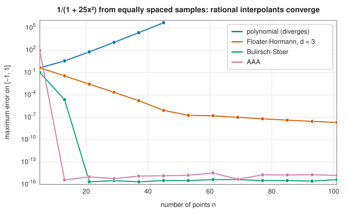

# Rational interpolation and approximation

<div class="entry-summary">

| | |
|---|---|
| **Problem** | Approximate a function by a ratio of polynomials $p(x)/q(x)$, from samples or from a Taylor series, so as to capture poles, steep gradients and behaviour beyond the reach of polynomials |
| **Devised by** | Padé approximants: Henri Padé (1892), after Jacobi and Frobenius. Rational extrapolation: Roland Bulirsch and Josef Stoer (1964). Barycentric rational interpolation: Jean-Paul Berrut (1988), Michael Floater and Kai Hormann (2007). AAA: Yuji Nakatsukasa, Olivier Sète and Lloyd N. Trefethen (2018) |
| **Accuracy** | Floater-Hormann: $O(h^{d+1})$ on any points. Bulirsch-Stoer and AAA: often geometric, exact for rational functions of sufficient degree. Padé: matches the Taylor series to order $L + M$ |
| **Cost** | Floater-Hormann: $O(nd)$ weights, $O(n)$ per point. Bulirsch-Stoer: $O(n^2)$ per point. AAA: an SVD per added term. Padé: one $M \times M$ linear solve |
| **API** | [`FloaterHormann`](../../api/lib_jsl_interpolation/one_d/floater_hormann/struct.FloaterHormann.html), [`BulirschStoer`](../../api/lib_jsl_interpolation/one_d/bulirsch_stoer/struct.BulirschStoer.html), [`AaaApproximation`](../../api/lib_jsl_interpolation/one_d/aaa/struct.AaaApproximation.html), [`PadeApproximant`](../../api/lib_jsl_interpolation/one_d/pade_approximants/struct.PadeApproximant.html) |

</div>

## Overview

A polynomial can never become infinite, and it grows without bound as $|x| \to \infty$. Many
functions do not behave like that: they have poles, approach constants, or change steeply near
singularities just off the interval of interest. A **rational function**, a ratio of two
polynomials, can do all of these things, and so rational approximations are often dramatically
better than polynomial ones of the same number of parameters.

The library offers four rational methods for different situations. **Floater-Hormann** interpolation
is a robust, pole-free alternative to polynomial interpolation at equally spaced or irregular points.
**Bulirsch-Stoer** interpolation builds the diagonal rational interpolant through all the data and
estimates its own error. The **AAA algorithm** chooses a small set of support points automatically
and finds a near-best rational approximation to sampled data. **Padé approximants** turn a Taylor
series into a rational function that is often accurate far beyond the series' radius of convergence.

## History

Rational approximations of power series were studied by Jacobi and Frobenius, but it was Henri Padé's
1892 thesis that organised them into the **Padé table** of all $[L/M]$ approximants and studied its
structure. Padé approximants became a standard tool of theoretical physics in the twentieth century,
for summing divergent perturbation series.

Roland Bulirsch and Josef Stoer (1964) devised a recursive tableau, like Neville's algorithm for
polynomials, for evaluating the diagonal rational interpolant, and used it in their extrapolation
method for differential equations. Barycentric rational interpolation grew from Jean-Paul Berrut's
observation (1988) that changing the weights of the barycentric formula gives rational interpolants
guaranteed to have no poles; Michael Floater and Kai Hormann (2007) found the family of such
interpolants with arbitrarily high order. Most recently, Yuji Nakatsukasa, Olivier Sète and Nick
Trefethen's **AAA algorithm** (2018, "adaptive Antoulas-Anderson") combined the barycentric form with
greedy point selection and least squares, and made rational approximation practical and automatic.

## The idea

### Barycentric rational functions

Three of the four methods rest on one observation about the
[barycentric formula](polynomial.md#the-barycentric-formula)

$$
r(x) = \frac{\sum_j \dfrac{w_j}{x - x_j}\, y_j}{\sum_j \dfrac{w_j}{x - x_j}}.
$$

For polynomial interpolation the weights $w_j$ were given by a specific formula. But the
expression interpolates the data for *any* nonzero weights. To see why, let $x$ approach a node
$x_k$. The term with $1/(x - x_k)$ grows without bound in both sums and swamps all the others, so

$$
r(x) \approx \frac{\dfrac{w_k}{x - x_k}\,y_k}{\dfrac{w_k}{x - x_k}} = y_k .
$$

The weight $w_k$ cancels: its value does not matter, as long as it is not zero.

What the weights do control is the behaviour *between* the nodes. Multiplying numerator and
denominator by $\prod_k (x - x_k)$ shows that $r$ is a ratio of two polynomials of degree at most
$n - 1$, that is, a rational function. Only for the special weights
$w_j = 1/\prod_{k\ne j}(x_j - x_k)$ does the denominator reduce to a constant, making $r$ a polynomial.
So the $n$ weights are free parameters, and the question becomes how to choose them. Floater-Hormann
interpolation and AAA give two different answers.

### Floater-Hormann interpolation

A single polynomial through many equally spaced points oscillates, but a polynomial of low degree
$d$ through just $d + 1$ neighbouring points is well behaved. Floater and Hormann's idea is to
**blend** these local interpolants. Let $p_i$ be the polynomial of degree $d$ through the run of
$d + 1$ consecutive points $x_i, \ldots, x_{i+d}$. The interpolant is the weighted average

$$
r(x) = \frac{\sum_i \lambda_i(x)\,p_i(x)}{\sum_i \lambda_i(x)}, \qquad
\lambda_i(x) = \frac{(-1)^i}{(x - x_i)\cdots(x - x_{i+d})}.
$$

The blending function $\lambda_i$ is large when $x$ is near the points of run $i$, so each local
polynomial dominates in its own neighbourhood. The alternating signs are what make the
denominator free of real zeros.

Rewriting this average in barycentric form (collecting the coefficient of each $1/(x - x_k)$)
gives the weights

$$
w_k = (-1)^{k - d} \sum_{i \in J_k} \prod_{\substack{j = i \\ j \ne k}}^{i + d} \frac{1}{|x_k - x_j|},
$$

where $J_k$ is the set of runs that contain $x_k$. The formula looks complicated, but it only says:
for each run containing $x_k$, take the polynomial barycentric weight of $x_k$ within that run, and
add them up. The interpolant has three useful properties.

- It has **no real poles**, for any $d$ and any distribution of points.
- It converges like $O(h^{d+1})$ for smooth functions, where $h$ is the largest spacing. This is
  the accuracy of the local polynomials.
- With $d = n - 1$ there is only one run, and it reduces to the polynomial interpolant.

A moderate $d$ (3 to 8) combines high order with stability at equally spaced points, exactly where
polynomials fail.

### Bulirsch-Stoer rational interpolation

Bulirsch and Stoer take the opposite approach: instead of choosing weights, they ask for *the*
rational function through all $n$ points whose numerator and denominator have equal degrees (or
degrees differing by one, when $n$ is even). This is the **diagonal** rational interpolant, and
its $n$ coefficients are fixed by the $n$ data points.

The interpolant is never written down. As in Neville's algorithm for polynomials, its value at a
given $x$ is built up in a triangular tableau. The first column holds the data values; each
later column combines neighbouring entries of the previous one into the value at $x$ of an
interpolant through one more point, raising the degree of the numerator or the denominator by one.
The size of the last correction applied is an estimate of the error.

The evaluation costs $O(n^2)$ per point. A rational function can have poles, and a pole of the
interpolant at the evaluation point is reported as an error. When the data come from a rational
function of lower degree, later corrections vanish and the library stops early; the error
estimate is then at rounding level.

### The AAA algorithm

AAA (for "adaptive Antoulas-Anderson", pronounced "triple-A") approximates sampled data
$f(z_i)$, $i = 1, \ldots, m$, by a barycentric rational function that interpolates only at a few
chosen samples, the **support points** $z_j$ with values $f_j$, and fits the rest in a
least-squares sense. Write the approximant as $r = n/d$ with

$$
n(z) = \sum_j \frac{w_j f_j}{z - z_j}, \qquad d(z) = \sum_j \frac{w_j}{z - z_j}.
$$

We would like $f(z_i) \approx n(z_i)/d(z_i)$ at the remaining samples. That condition is nonlinear
in the weights. Multiplying through by $d$ gives $f(z_i)\,d(z_i) - n(z_i) \approx 0$, which is
**linear** in the weights:

$$
f(z_i)\,d(z_i) - n(z_i) = \sum_j \frac{f(z_i) - f_j}{z_i - z_j}\,w_j = (A\mathbf w)_i,
\qquad A_{ij} = \frac{f(z_i) - f_j}{z_i - z_j}.
$$

$A$ is called the **Loewner matrix**. The weights can be rescaled without changing $r$, so we
fix $\|\mathbf w\| = 1$ and minimise $\|A\mathbf w\|$. The minimiser is the right singular vector of
$A$ belonging to its smallest singular value, read off from a
[singular value decomposition](../linear_algebra/svd.md). The algorithm is then a greedy loop:

1. Start with no support points and the approximation equal to the mean of $f$.
2. Find the sample where the current approximation is worst and make it a support point, so that
   the approximant now interpolates it.
3. Form the Loewner matrix over the remaining samples and take the weights from its smallest
   singular vector.
4. Repeat until the error at all samples is below the tolerance.

AAA typically finds an approximation within a few digits of the best rational approximation, with
remarkably few terms, and works on any set of sample points, real or complex. Its main pitfall is
**spurious poles**: occasionally a pole and a nearby zero almost cancel (a *Froissart doublet*),
producing a narrow spike between samples. Production codes detect such doublets and remove them;
the library leaves this to the user.

### Rational methods on equally spaced data

The Runge function $1/(1 + 25x^2)$ sampled at equally spaced points defeats polynomial interpolation
(see [polynomial interpolation](polynomial.md#the-interpolation-error-and-the-runge-phenomenon)). The
rational methods succeed:



<p class="caption" id="fig-3-5"><strong>Figure 3.5.</strong> Rational interpolation of the Runge function.</p>

Floater-Hormann with $d = 3$ converges algebraically, as its theory promises. Bulirsch-Stoer and AAA
reach machine precision with about twenty points, but this is partly a special case: the Runge
function is itself rational, of type $(0, 2)$, so any rational method of sufficient degree recovers it
exactly. For non-rational functions with nearby singularities they still converge geometrically, as
the `tan x` example below shows.

### Padé approximants

The methods above start from samples. A Padé approximant starts from a Taylor series
$f(x) = \sum_k c_k x^k$. The $[L/M]$ **Padé approximant** is the rational function $P_L(x)/Q_M(x)$,
with numerator of degree $L$, denominator of degree $M$ and $Q_M(0) = 1$, whose own Taylor series
agrees with that of $f$ through the term $x^{L+M}$. It has $L + M + 1$ free coefficients and matches
$L + M + 1$ terms of the series.

**Finding the coefficients.** Requiring $f = P_L/Q_M$ to that order is the same as requiring

$$
f(x)\,Q_M(x) - P_L(x) = O(x^{L+M+1}),
$$

which is linear in the unknown coefficients $p_i$ and $q_j$. Multiply out $f\,Q_M$ and compare
powers of $x$. The coefficient of $x^i$ in the product is $\sum_j q_j c_{i-j}$ (with $q_0 = 1$).

- For the powers $x^{L+1}, \ldots, x^{L+M}$ the polynomial $P_L$ contributes nothing, so the
  coefficient of the product must vanish by itself. This gives an $M \times M$ linear system for the
  denominator:

$$
\sum_{j=1}^M q_j\, c_{L+i-j} = -c_{L+i}, \qquad i = 1, \ldots, M.
$$

- For the powers $x^0, \ldots, x^L$ the coefficient of the product must equal $p_i$, which gives
  the numerator directly: $p_i = \sum_{j=0}^{\min(i, M)} q_j c_{i-j}$.

**A small example.** For $e^x = 1 + x + \tfrac12 x^2 + \cdots$ and $L = M = 1$, the system is the
single equation $q_1 c_1 = -c_2$, so $q_1 = -\tfrac12$. Then $p_0 = c_0 = 1$ and
$p_1 = c_1 + q_1 c_0 = \tfrac12$:

$$
e^x \approx \frac{1 + x/2}{1 - x/2} = 1 + x + \tfrac12 x^2 + \tfrac14 x^3 + \cdots,
$$

which agrees with the series of $e^x$ through $x^2$, as promised.

**Why it works so well.** A power series converges only inside a disc that reaches to the nearest
singularity of $f$. A rational function can have poles of its own, and it places them so as to
mimic the singularities of $f$; the approximant is then often accurate far outside the disc. For
$\ln(1 + x)$, whose Taylor series converges only for $|x| < 1$, the $[10/10]$ approximant built
from the same 21 coefficients remains accurate far beyond:

<p class="caption" id="tab-3-3"><strong>Table 3.3.</strong> Taylor polynomial against Padé approximant for $\ln(1 + x)$.</p>

{{#include ../generated/interpolation/pade_log.md}}

## Algorithm

**Floater-Hormann.** Input: points in increasing order and the blending degree $d$.

1. *Set-up.* For each node $k$, sum over the runs of $d + 1$ consecutive nodes that contain it
   the reciprocal of the product of the distances from $x_k$ to the other nodes of the run, and
   attach the sign $(-1)^{k-d}$. Cost: $O(nd^2)$.
2. *Evaluation.* The [barycentric formula](polynomial.md#algorithm), unchanged. Cost: $O(n)$ per
   point.

**Bulirsch-Stoer.** There is no set-up. For each evaluation point $x$:

1. find the data point nearest to $x$; if $x$ coincides with it, return its value;
2. initialise the first column of the tableau with the data values;
3. for each further column, combine neighbouring entries of the previous column into the
   corrections for interpolants through one more point, and add the correction that lies on the
   path leading away from the nearest point to the running value;
4. stop early when a correction is at rounding level; report an error if a denominator vanishes
   (a pole at $x$);
5. return the value, with the last correction as the error estimate.

Cost: $O(n^2)$ per point.

**AAA.** Input: samples $(z_i, f_i)$, a relative tolerance and a maximum number of terms.

1. Set the approximation to the mean of the $f_i$, and the support set to empty.
2. Find the sample with the largest current error. If that error is below the tolerance times
   the largest $|f_i|$, or the term limit has been reached, stop.
3. Move that sample into the support set.
4. Build the Loewner matrix, with one row for each remaining sample and one column for each
   support point.
5. Compute its SVD and take the right singular vector of the smallest singular value as the
   weights.
6. Evaluate the new approximation at the remaining samples, and go to 2.

With $m$ samples and $n$ support points at the end, the cost is $O(mn^3)$, dominated by the SVDs.

**Padé.** Input: Taylor coefficients $c_0, \ldots, c_{L+M}$.

1. Solve the $M \times M$ linear system for $q_1, \ldots, q_M$ (with $q_0 = 1$); report an error if
   it is singular.
2. Form $p_i = \sum_{j=0}^{\min(i,M)} q_jc_{i-j}$ for $i = 0, \ldots, L$.
3. To evaluate, compute $P_L(x)$ and $Q_M(x)$ by Horner's rule and divide.

## Implementation

The core of the AAA iteration:

```rust,ignore
{{#include ../../../crates/interpolation/src/one_d/aaa.rs:aaa_step}}
```

- All four methods require distinct abscissas; Floater-Hormann also requires them in increasing order.
- The AAA weights come from the [SVD in `lib_jsl_linalg`](../../api/lib_jsl_linalg/trait.SVD.html).
- The Padé system can be singular, when the Taylor coefficients make the requested $[L/M]$ degenerate;
  the constructor then reports an error, and a neighbouring entry of the Padé table should be used.

## In practice

```rust,ignore
{{#include ../../../crates/interpolation/examples/interpolation_rational.rs}}
```

**Strengths**

- Poles, steep gradients and asymptotic behaviour are captured with few parameters.
- Floater-Hormann gives stable, high-order interpolation on equally spaced data.
- AAA is automatic and often near-optimal; Padé extends power series beyond their radius of
  convergence.

**Weaknesses**

- Rational interpolants other than Floater-Hormann may have poles in the interval (Bulirsch-Stoer
  reports them; AAA may produce spurious ones).
- Bulirsch-Stoer costs $O(n^2)$ per evaluation.
- Padé systems can be ill-conditioned or singular, and the approximants may have spurious poles too.

## Exercises

1. Show that the barycentric formula interpolates $y_k$ at $x_k$ for any nonzero weights.
2. Compute the Floater-Hormann weights for $d = 0$ (Berrut's interpolant) on equally spaced points and
   show they are $\pm1$ up to a constant.
3. Compute the $[1/1]$ Padé approximant of $e^x$ and compare it with the degree-2 Taylor polynomial
   at $x = 1$.
4. Use AAA on samples of $|x|$ at 1000 points in $[-1, 1]$. How many terms are needed for $10^{-6}$?
   Where do the poles of the approximant lie? (Newman showed in 1964 that rational approximation of
   $|x|$ converges like $e^{-\pi\sqrt n}$, far faster than polynomials.)
5. Find data for which AAA produces a Froissart doublet, and remove it by deleting the corresponding
   support point and refitting.

<details>
<summary>Hints and answers</summary>

1. As $x \to x_j$ the $j$-th term $w_jy_j/(x - x_j)$ dominates both sums, so the ratio tends to $y_j$ whatever $w_j \ne 0$ is.
2. For $d = 0$ the Floater-Hormann weights on equally spaced points are $w_k = (-1)^k$ up to a constant factor (Berrut's first interpolant).
3. $[1/1]$: $e^x \approx (1 + x/2)/(1 - x/2)$. At $x = 1$ this gives $3$ against the true $2.718$, an error of $0.28$; the degree-2 Taylor polynomial gives $2.5$, an error of $0.22$. The Padé form has the same number of parameters but is not better here; its advantage is near poles and for large arguments.
4. Expect the poles to lie close to the imaginary axis and to cluster towards $x = 0$, as in Newman's construction. Count the support points the algorithm adds before the residual falls under $10^{-6}$ and compare with the degree a polynomial would need.
5. A Froissart doublet is a pole and zero that almost cancel. They appear when the tolerance is set below the noise level of the data, so add noise of size about $10^{-8}$ and ask for a tolerance of $10^{-13}$.

</details>

## Further reading

- H. Padé, *Sur la représentation approchée d'une fonction par des fractions rationnelles*, thesis,
  Paris, 1892.
- R. Bulirsch and J. Stoer, "Fehlerabschätzungen und Extrapolation mit rationalen Funktionen bei
  Verfahren vom Richardson-Typus", *Numerische Mathematik* 6 (1964) 413–427.
- M. S. Floater and K. Hormann, "Barycentric rational interpolation with no poles and high rates of
  approximation", *Numerische Mathematik* 107 (2007) 315–331.
- Y. Nakatsukasa, O. Sète and L. N. Trefethen, "The AAA algorithm for rational approximation", *SIAM
  Journal on Scientific Computing* 40 (2018) A1494–A1522.
- G. A. Baker and P. Graves-Morris, *Padé Approximants*, 2nd ed., Cambridge University Press, 1996.
