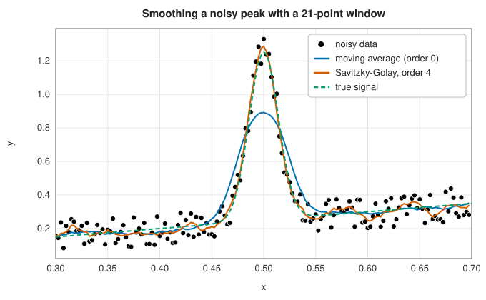

# Savitzky-Golay smoothing

<div class="entry-summary">

| | |
|---|---|
| **Problem** | Smooth noisy, equally spaced samples, or estimate their derivatives, without flattening peaks |
| **Devised by** | Abraham Savitzky and Marcel Golay (1964), building on the moving polynomial least squares of actuarial graduation (Sheppard, 1913; Whittaker and Robinson, 1924) |
| **Accuracy** | Reproduces polynomials of the filter's order exactly; reduces white-noise variance by roughly the window length |
| **Cost** | One convolution with a fixed set of coefficients: $O(n \cdot \text{window})$ |
| **API** | [`savitzky_golay`](../../api/lib_jsl_interpolation/one_d/savitzky_golay/fn.savitzky_golay.html), [`savitzky_golay_coefficients`](../../api/lib_jsl_interpolation/one_d/savitzky_golay/fn.savitzky_golay_coefficients.html) |

</div>

## Overview

Measured signals are noisy, and the simplest cure, averaging each value with its neighbours, works
against noise but also against the signal: a moving average flattens peaks and shifts their shapes.
A **Savitzky-Golay filter** replaces the average by a local **polynomial least-squares fit**: around
each sample, fit a polynomial of low degree to the samples in a window, and take the value (or a
derivative) of that polynomial at the centre. Because a polynomial can follow a peak, the filter
removes noise while preserving the shape, height and position of features much better than averaging.

The remarkable fact that makes the method practical is that, for equally spaced data, the fitted
value is a **fixed linear combination** of the samples in the window. The whole filter is a
convolution with a short set of coefficients, computed once.

## History

Fitting local polynomials to smooth data was practised by actuaries in the nineteenth and early
twentieth centuries, who "graduated" mortality tables with moving least-squares formulas. Abraham
Savitzky and Marcel Golay, chemists at the Perkin-Elmer Corporation, brought the idea to the
smoothing of spectra in a 1964 paper in *Analytical Chemistry*, with tables of coefficients for many
window sizes and polynomial degrees. It became one of the most cited papers in the history of the
journal. Their tables contained some errors, corrected by Steinier, Termonia and Deltour in 1972.

## The idea

### Local polynomial least squares

Take a window of $2m + 1$ samples centred on sample $i$, and number the samples in it by their
offsets $k = -m, \ldots, m$ from the centre. Fit a polynomial of degree $d$,
$q(k) = \sum_{j=0}^{d} b_j k^j$, by least squares: choose the coefficients $b_j$ to minimise the
sum of squared differences between the polynomial and the data,

$$
\min_{b} \sum_{k=-m}^{m} \big(q(k) - y_{i+k}\big)^2.
$$

The window must contain more samples than the polynomial has coefficients ($2m + 1 > d + 1$), so
that the polynomial cannot follow every sample and is forced to average out the noise.

**The fit is linear in the data.** Collect the samples of the window in a vector $\mathbf y$ and the
coefficients in a vector $\mathbf b$. The values of the polynomial at the offsets are $A\mathbf b$,
where $A$ is the **Vandermonde matrix** with entries $A_{kj} = k^j$. The
[least-squares solution](../linear_algebra/least-squares.md) is

$$
\mathbf b = A^{+}\mathbf y, \qquad A^{+} = (A^{\mathsf T}A)^{-1}A^{\mathsf T},
$$

where $A^{+}$ is called the pseudo-inverse of $A$. The important point is that $\mathbf b$ is a
matrix times $\mathbf y$: each coefficient is a fixed weighted sum of the samples in the window.

**Reading off the filter.** We do not need the whole polynomial, only its value at the centre of
the window, $q(0) = b_0$. That is the first row of $A^{+}$ applied to the window. Similarly the
$r$-th derivative at the centre is $q^{(r)}(0) = r!\,b_r$ in units of the sample offset, or
$r!\,b_r/\Delta^r$ for samples spaced $\Delta$ apart: row $r$ of $A^{+}$. The matrix $A$ depends only
on $m$ and $d$, not on the data or on the position $i$ of the window, so these rows are the
**filter coefficients**, the same for every position. For $m = 2$ and $d = 2$ the smoothing
coefficients are the classic $(-3, 12, 17, 12, -3)/35$: each smoothed value is this weighted sum
of the sample and its two neighbours on either side.

**Properties.** If the data in a window lie exactly on a polynomial of degree at most $d$, the
least-squares fit is that polynomial, and the filter returns the data unchanged. The filter
therefore does not distort features that are locally polynomial, while it pays for this with less noise reduction than a moving average of the same length. For white noise of variance
$\sigma^2$ the output variance is $\sigma^2\sum_i c_i^2$ (the squared weights, because the noise at different samples is
independent). The moving average has $\sum c_i^2 = 1/N$ for a window of $N$ points; a quadratic or cubic Savitzky-Golay
filter has about $9/(4N)$ for long windows, more than twice as much, which is the price of keeping peaks undistorted. The moving average is itself the special
case $d = 0$: the best constant fit to a window is its mean. Degree $d = 1$ gives the same weights,
because adding a slope to the fit over a symmetric window does not change its value at the centre.



The moving average cuts the peak to two-thirds of its height and widens it; the order-4 Savitzky-Golay
filter follows it.

### Derivatives of noisy data

Differentiating noisy data by [finite differences](../derivatives/finite-differences.md) divides
the noise by the sample spacing $\Delta$ and so amplifies it. This is the rounding-error problem
of numerical differentiation again, with the measurement noise playing the role of rounding error,
and a far larger one. The derivative of the local fit is much better behaved, because the fit
averages the noise over the window before differentiating. On the noisy peak above:

{{#include ../generated/interpolation/savitzky_golay_derivative.md}}

The best window balances two sources of error, just as the best step does for finite differences.
If the window is too short, too few samples are averaged and noise dominates. If it is too long, a
polynomial of degree $d$ cannot follow the signal across the whole window, and the fit is biased.

### Conditioning

The Vandermonde matrix in the raw offsets $k = -m, \ldots, m$ is badly conditioned for wide windows and
high orders (its columns $k^j$ range from 1 to $m^d$), and forming the normal equations $A^{\mathsf T}A$
squares the condition number. The library scales the offsets to $t = k/m \in [-1, 1]$ and computes the
pseudo-inverse from an SVD, then adjusts the derivative factors for the scaling. (An earlier version
formed the normal equations directly: a 51-point, order-8 filter reproduced its own polynomials only to
$10^{-5}$, and 101-point windows failed as singular.)

## Algorithm

Input: samples $y_i$ with spacing $\Delta$, a window of $2m + 1$ points, a polynomial degree $d$
and a derivative order $r$ (0 for smoothing).

1. **Build the design matrix.** Form the Vandermonde matrix in the scaled offsets,
   $A_{kj} = (k/m)^j$ for $k = -m, \ldots, m$ and $j = 0, \ldots, d$.
2. **Invert it once.** Compute the pseudo-inverse $A^{+}$ from the SVD of $A$.
3. **Extract the filter.** The coefficients are row $r$ of $A^{+}$, multiplied by
   $r!/(m\Delta)^r$. The factor $r!$ turns the polynomial coefficient into a derivative, and
   $(m\Delta)^r$ undoes the scaling of the offsets and converts to the units of the data.
4. **Filter the interior.** For every sample at least $m$ from both ends, the output is the sum
   of the coefficients times the samples in the window centred there (a correlation).
5. **Treat the ends.** For the first $m$ samples the centred window would run off the data.
   Instead fit one polynomial of degree $d$ to the first $2m + 1$ samples, and evaluate it (or
   its $r$-th derivative) at each of those $m$ positions. Do the same at the other end.

The set-up costs one SVD of a $(2m + 1) \times (d + 1)$ matrix. Filtering costs $2m + 1$
multiplications per sample.

## Implementation

```rust,ignore
{{#include ../../../crates/interpolation/src/one_d/savitzky_golay.rs:savitzky_golay}}
```

- The window must be odd and larger than the polynomial order; a derivative of order above the
  polynomial's is identically zero.
- The end treatment matches SciPy's `mode="interp"`, so the output has the same length as the input.

## In practice

```rust,ignore
{{#include ../../../crates/interpolation/examples/interpolation_savitzky_golay.rs}}
```

**Strengths**

- Preserves peak heights and widths far better than a moving average of the same noise reduction.
- Smoothing and differentiation in one cheap convolution.

**Weaknesses**

- Requires equally spaced samples (for uneven spacing, fit local polynomials directly).
- The window and order must be chosen; a too-high order follows the noise, a too-wide window flattens
  the signal.
- Its frequency response has ripples in the stop band, so it is a poorer low-pass filter than a
  designed one ([digital filters](../../api/lib_jsl_dsp/index.html)) when frequency selectivity matters.

## Exercises

1. Derive the 5-point quadratic smoothing coefficients $(-3, 12, 17, 12, -3)/35$ by hand from the
   normal equations.
2. Show that the smoothing coefficients for orders $2s$ and $2s + 1$ are identical. Why?
3. Compute the noise-reduction factor $\sum_k c_k^2$ of a 21-point filter of orders 0, 2 and 4, and
   compare with $1/21$.
4. Compute and plot the frequency response $\sum_k c_k e^{-i\omega k}$ of the 21-point order-4 filter.
5. Estimate the second derivative of the noisy peak with Savitzky-Golay filters of several windows
   and find the best.

## Further reading

- A. Savitzky and M. J. E. Golay, "Smoothing and differentiation of data by simplified least squares
  procedures", *Analytical Chemistry* 36 (1964) 1627–1639.
- J. Steinier, Y. Termonia and J. Deltour, "Comments on smoothing and differentiation of data by
  simplified least square procedure", *Analytical Chemistry* 44 (1972) 1906–1909.
- R. W. Schafer, "What is a Savitzky-Golay filter?", *IEEE Signal Processing Magazine* 28 (2011)
  111–117. The filter from the signal-processing point of view.
