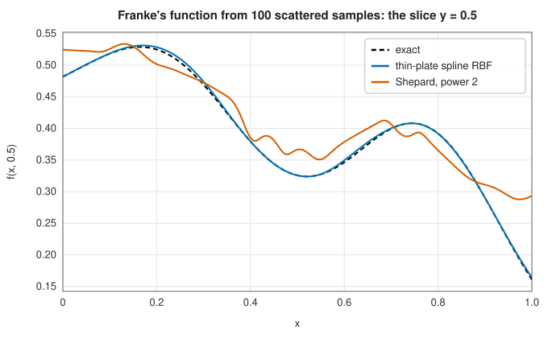

# Scattered data interpolation

<div class="entry-summary">

| | |
|---|---|
| **Problem** | Interpolate values $f_i$ given at arbitrary, irregularly placed points $\mathbf p_i$ in two or three dimensions |
| **Devised by** | Inverse distance weighting: Donald Shepard (1968). Radial basis functions: Rolland Hardy's multiquadrics (1971), Jean Duchon's thin-plate splines (1976); theory by Charles Micchelli (1986) |
| **Accuracy** | Shepard: low, with flat spots at the data points. Radial basis functions: high for smooth functions, depending on the kernel and the point spacing |
| **Cost** | Shepard: $O(n)$ per evaluation, no set-up. RBF: an $O(n^3)$ dense solve, then $O(n)$ per evaluation |
| **API** | [`RadialBasisInterpolator`](../../api/lib_jsl_interpolation/two_d/radial_basis_functions/struct.RadialBasisInterpolator.html), [`RadialKernel`](../../api/lib_jsl_interpolation/two_d/radial_basis_functions/enum.RadialKernel.html), [`Shepards`](../../api/lib_jsl_interpolation/three_d/shepards/struct.Shepards.html) |

</div>

## Overview

Measurements are often taken where they can be: weather stations, boreholes, sensors on a structure,
samples of an expensive simulation. Such **scattered data** have no grid, so the tensor-product
methods of the [previous entry](grids.md) do not apply. Two families of methods build interpolants
directly from the points and their distances.

**Shepard's method** (inverse distance weighting) takes a weighted average of the data, with weights
that grow without bound near each data point. It is simple and never overshoots, but crude.
**Radial basis functions** write the interpolant as a sum of identical bumps $\varphi(\|\mathbf p - \mathbf p_i\|)$
centred at the data points, plus a low-degree polynomial, with coefficients chosen so that it passes
through the data. They are accurate, smooth, work in any dimension, and underlie methods in machine
learning, meshless PDE solvers and computer graphics.

## History

Donald Shepard, a student at Harvard's Laboratory for Computer Graphics, proposed inverse distance
weighting in 1968 for mapping geographic data, and it remains a default in geographic information
systems. Rolland Hardy (1971), a geodesist at Iowa State University, introduced **multiquadrics**,
$\sqrt{1 + (\varepsilon r)^2}$, to interpolate topographic surfaces. Jean Duchon (1976) derived the **thin-plate
spline** $r^2 \ln r$ as the surface that interpolates the data with minimum bending energy, the
two-dimensional analogue of the [natural cubic spline](splines.md#cubic-splines). Charles Micchelli
(1986) proved that the interpolation matrices of these kernels are invertible for any distinct points,
which established radial basis functions as a sound general method.

## The idea

### Shepard's inverse distance weighting

$$
s(\mathbf p) = \frac{\sum_i w_i(\mathbf p)\, f_i}{\sum_i w_i(\mathbf p)}, \qquad w_i(\mathbf p) = \|\mathbf p - \mathbf p_i\|^{-\mu}.
$$

As $\mathbf p \to \mathbf p_i$, the weight $w_i$ dominates and $s \to f_i$, so the data are interpolated. Elsewhere
$s$ is a convex combination of the data, so it never exceeds their range. But for $\mu > 1$ the gradient
of $s$ vanishes at every data point, so the surface is flat there and bumpy in between: a poor model
of a smooth function. Larger $\mu$ localises the influence of each point.

### Radial basis functions

The RBF interpolant is

$$
s(\mathbf p) = \sum_{i=1}^n w_i\,\varphi\big(\|\mathbf p - \mathbf p_i\|\big) + a + b\,x + c\,y,
$$

with the $n + 3$ unknowns determined by the $n$ interpolation conditions $s(\mathbf p_i) = f_i$ and the
three **side conditions** $\sum_i w_i = \sum_i w_i x_i = \sum_i w_i y_i = 0$, a symmetric linear system:

$$
\begin{pmatrix} \Phi & P \\ P^{\mathsf T} & 0 \end{pmatrix}
\begin{pmatrix} \mathbf w \\ \mathbf c \end{pmatrix} =
\begin{pmatrix} \mathbf f \\ \mathbf 0 \end{pmatrix},
\qquad \Phi_{ij} = \varphi\big(\|\mathbf p_i - \mathbf p_j\|\big), \quad P_i = (1, x_i, y_i).
$$

The affine part makes the interpolant reproduce planes exactly with any kernel, and it is required for
the **cubic** $r^3$ and **thin-plate spline** $r^2 \ln r$ kernels, which are only *conditionally* positive
definite: the system is guaranteed solvable only together with the side conditions.

The kernels with a **shape parameter** $\varepsilon$ (Gaussian $e^{-(\varepsilon r)^2}$, multiquadric
$\sqrt{1 + (\varepsilon r)^2}$, inverse multiquadric $1/\sqrt{1 + (\varepsilon r)^2}$) can be very accurate for smooth
functions, but they pose a dilemma: as $\varepsilon \to 0$ the bumps flatten, the interpolant becomes more
accurate, and the matrix $\Phi$ becomes catastrophically ill-conditioned. Choosing $\varepsilon$ is an art; a
common rule is to make $1/\varepsilon$ comparable to the typical distance between points. The thin-plate
spline has no parameter and is a robust default.

### Comparison

Franke's function, a standard test surface with two peaks and a dip, sampled at 100 Halton points in
the unit square:

{{#include ../generated/interpolation/scattered_table.md}}



All the radial basis functions reach errors of a few thousandths; Shepard's method is ten times worse
and visibly bumpy, with flat spots wherever the slice passes near a data point.

## Algorithm

- **Shepard**: for each evaluation point, accumulate $w_i f_i$ and $w_i$ over all data; return $f_i$
  exactly at a data point.
- **RBF**: assemble the $(n + 3) \times (n + 3)$ system, solve it by LU factorisation, and evaluate the sum.

## Implementation

```rust,ignore
{{#include ../../../crates/interpolation/src/two_d/radial_basis_functions.rs:rbf_system}}
```

- The RBF system is dense: fine for a few thousand points, too slow beyond. Large problems use compactly
  supported kernels (sparse systems) or fast multipole methods.
- Duplicate points make the RBF system singular; collinear points make the affine part undetermined.
  Both are reported as errors.
- Shepard's method is implemented in three dimensions; two-dimensional data can use a constant third
  coordinate, as in the examples.

## In practice

```rust,ignore
{{#include ../../../crates/interpolation/examples/interpolation_scattered.rs}}
```

**Strengths**

- Any point locations, any dimension, no mesh.
- RBFs are smooth and accurate; the thin-plate spline needs no parameter.
- Shepard's method is trivial to implement and never overshoots.

**Weaknesses**

- RBFs cost $O(n^3)$ to set up, and shape-parameter kernels can be ill-conditioned.
- Shepard's method is inaccurate, with flat spots at the data.
- Extrapolation far from the data is unreliable for every method.

## Exercises

1. Show that Shepard's interpolant with $\mu = 2$ has zero gradient at each data point.
2. Solve the RBF system for three points and show why the side conditions are needed for the
   thin-plate spline.
3. Vary $\varepsilon$ for the Gaussian kernel on Franke's function from 0.5 to 20. Plot the error and the
   condition number of $\Phi$. Where is the best $\varepsilon$?
4. Compare RBF interpolation on 100 random points with 100 Halton points. Which gives the smaller
   maximum error, and why?
5. Interpolate the rainfall data of the example with Shepard's method for $\mu = 1, 2, 8$ and describe how
   the surface changes.

## Further reading

- D. Shepard, "A two-dimensional interpolation function for irregularly-spaced data", *Proceedings of
  the 1968 ACM National Conference*, 517–524.
- R. L. Hardy, "Multiquadric equations of topography and other irregular surfaces", *Journal of
  Geophysical Research* 76 (1971) 1905–1915.
- J. Duchon, "Interpolation des fonctions de deux variables suivant le principe de la flexion des plaques
  minces", *RAIRO Analyse Numérique* 10 (1976) 5–12.
- C. A. Micchelli, "Interpolation of scattered data: distance matrices and conditionally positive
  definite functions", *Constructive Approximation* 2 (1986) 11–22.
- G. E. Fasshauer, *Meshfree Approximation Methods with MATLAB*, World Scientific, 2007.
- R. Franke, "Scattered data interpolation: tests of some methods", *Mathematics of Computation* 38
  (1982) 181–200. The source of the test function.
