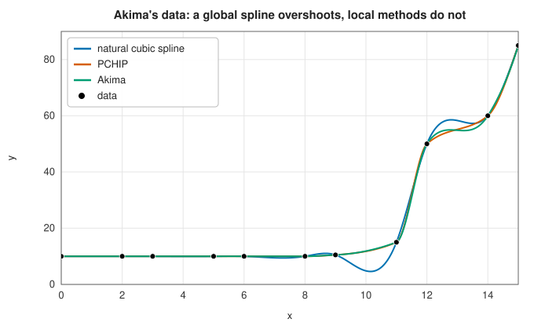

# Piecewise and spline interpolation

<div class="entry-summary">

| | |
|---|---|
| **Problem** | Interpolate data $(x_i, y_i)$, $x_0 < x_1 < \cdots$, by a function that is simple on each interval: lines or cubics |
| **Devised by** | Splines: Isaac Schoenberg (1946), after the draughtsman's flexible spline; algorithms: Carl de Boor (1960s–70s). Cubic Hermite methods: Akima (1970), Fritsch and Carlson's monotone PCHIP (1980), Catmull and Rom (1974) |
| **Accuracy** | Linear: $O(h^2)$. Natural cubic spline: $O(h^4)$ in the interior, $O(h^2)$ near ends where $f'' \ne 0$. PCHIP and Akima: $O(h^3)$ for smooth data |
| **Cost** | Linear and Hermite methods: $O(n)$ set-up; spline: one tridiagonal solve. Each evaluation: a binary search, then $O(1)$ |
| **API** | [`LinearInterpolator`](../../api/lib_jsl_interpolation/one_d/linear_interpolator/struct.LinearInterpolator.html), [`NaturalCubicSplineInterpolator`](../../api/lib_jsl_interpolation/one_d/natural_cubic_spline_interpolator/struct.NaturalCubicSplineInterpolator.html), [`pchip`](../../api/lib_jsl_interpolation/one_d/pchip/fn.pchip.html), [`akima`](../../api/lib_jsl_interpolation/one_d/akima/fn.akima.html), [`cubic_basis`](../../api/lib_jsl_interpolation/one_d/cubic_basis/fn.cubic_basis.html), [`PiecewiseHermite`](../../api/lib_jsl_interpolation/one_d/hermite/struct.PiecewiseHermite.html) |

</div>

## Overview

[Polynomial interpolation](polynomial.md) fits one polynomial through all the data, which is
excellent at well-chosen points and dangerous at equally spaced or irregular ones. **Piecewise**
interpolation instead fits a low-degree polynomial on each interval between neighbouring data
points. The result can be evaluated anywhere quickly, is not troubled by the number of points, and
a bad data point affects only its neighbourhood.

The methods in this entry differ in how they join the pieces. **Linear** interpolation joins
straight lines and has corners. **Cubic splines** choose cubics whose first and second derivatives
are continuous: the smoothest possible curve, but a global one, which can overshoot near steep
changes. **Cubic Hermite** methods (PCHIP, Akima, Catmull-Rom) choose a slope at each data point from
nearby data and fit each cubic to the end values and slopes: they are local, and PCHIP in particular
never overshoots monotone data.

## History

Before computers, draughtsmen drew smooth curves through points with a **spline**: a thin flexible
strip of wood or metal held in place by lead weights called ducks. A bent elastic strip minimises its
bending energy, approximately $\int (y'')^2\,dx$, and between the weights its shape is a cubic.

Isaac Schoenberg named and founded the mathematical theory of splines in 1946, working on smoothing
actuarial tables at the US Army's Ballistic Research Laboratory. The aircraft and automotive
industries adopted them in the 1960s for designing surfaces, and Carl de Boor's work, culminating in
*A Practical Guide to Splines* (1978), provided the stable algorithms still in use.

Hiroshi Akima (1970) proposed a local cubic interpolant that avoids the wiggles of global splines on
data that changes abruptly. Edwin Catmull and Raphael Rom (1974) introduced their spline for computer
graphics, where it still drives animation paths. Frederick Fritsch and Ralph Carlson (1980) derived
conditions under which a piecewise cubic Hermite interpolant preserves monotonicity, leading to PCHIP,
the shape-preserving interpolant of MATLAB and SciPy.

## The idea

Throughout, the data are $(x_0, y_0), \ldots, (x_{n-1}, y_{n-1})$ with the abscissas in increasing
order. The points $x_j$ are called **nodes** (or knots), $h_j = x_{j+1} - x_j$ is the width of
interval $j$, and $d_j = (y_{j+1} - y_j)/h_j$ is the slope of the straight line across it, called
the **secant**.

### Locating the interval

Every piecewise method first finds the interval $[x_j, x_{j+1}]$ containing the evaluation point.
Because the nodes are sorted, this is done by **bisection**: compare with the middle node, discard
the half that cannot contain the point, and repeat, which takes $O(\log n)$ steps. Interpolators are often
evaluated at many nearby points in sequence, as when drawing a curve. They remember the last
interval and check it first ("hunting"), which makes most evaluations $O(1)$. Bisection requires
the abscissas to be in increasing order, and the library's constructors check this.

### Linear interpolation

The simplest choice joins neighbouring points by straight lines. On $[x_j, x_{j+1}]$,

$$
p(x) = y_j + (x - x_j)\,\frac{y_{j+1} - y_j}{x_{j+1} - x_j}.
$$

How accurate is this if the data are samples of a function $f$? Each piece is the polynomial
interpolant through two points, so the
[interpolation error formula](polynomial.md#the-interpolation-error-and-the-runge-phenomenon)
applies with $n = 2$: the error is $\tfrac12 f''(\xi)(x - x_j)(x - x_{j+1})$. The product
$(x - x_j)(x - x_{j+1})$ is largest in magnitude at the midpoint, where it equals $h^2/4$. The
error is therefore at most $\tfrac{h^2}{8}\max|f''|$, with $h$ the largest interval. Linear
interpolation is second-order accurate, robust, and never leaves the range of the data, but the
curve has a corner at every data point.

### Cubic splines

To remove the corners we need curved pieces. Cubics are the lowest degree with enough freedom to
match the neighbours smoothly on both sides. A **cubic spline** is a function $S$ that is a cubic
on each interval and whose first and second derivatives are continuous at the interior nodes.

**Counting the conditions.** With $n$ points there are $n - 1$ cubics, each with 4 coefficients:
$4(n - 1)$ unknowns. The conditions are:

- each cubic passes through the data at both ends of its interval: $2(n - 1)$ equations;
- $S'$ is continuous at each of the $n - 2$ interior nodes: $n - 2$ equations;
- $S''$ is continuous at each interior node: $n - 2$ more.

That makes $4(n - 1) - 2$ equations, two short. Two **end conditions** complete the system. The
**natural** spline sets $S'' = 0$ at both ends. The name comes from the draughtsman's spline, a
thin flexible strip held against pins: beyond the last pin the strip is free, and a free strip is
straight.

**Reducing to a tridiagonal system.** Solving $4(n - 1)$ equations directly would be wasteful. A
better choice of unknowns makes most of them trivial. Write the cubic on interval $i$ as

$$
S_i(x) = y_i + b_i(x - x_i) + c_i(x - x_i)^2 + d_i(x - x_i)^3,
$$

so that $c_i = \tfrac12 S''(x_i)$. The plan is to express everything in terms of the $c_i$.

1. Continuity of $S''$: the second derivative $2c_i + 6d_i(x - x_i)$ must reach $2c_{i+1}$ at
   $x_{i+1}$, which gives $d_i = (c_{i+1} - c_i)/(3h_i)$.
2. Interpolation: $S_i(x_{i+1}) = y_{i+1}$, with $d_i$ from step 1, gives
   $b_i = \dfrac{y_{i+1} - y_i}{h_i} - \dfrac{h_i}{3}(2c_i + c_{i+1})$.
3. Continuity of $S'$: the slope at the right end of interval $i - 1$ must equal $b_i$, the slope
   at the left end of interval $i$. Substituting steps 1 and 2 leaves an equation in the $c$'s alone:

$$
h_{i-1}c_{i-1} + 2(h_{i-1} + h_i)\,c_i + h_i c_{i+1} = 3\left(\frac{y_{i+1} - y_i}{h_i} - \frac{y_i - y_{i-1}}{h_{i-1}}\right).
$$

There is one such equation for each interior node, and the natural end conditions supply
$c_0 = c_{n-1} = 0$. Each equation involves only three neighbouring unknowns, so the matrix of the
system is **tridiagonal**. It is also diagonally dominant (the diagonal entry $2(h_{i-1} + h_i)$ exceeds
the sum of the other two), which guarantees that elimination without pivoting is stable. The
system is solved in $O(n)$ operations, after which steps 1 and 2 give the remaining coefficients.

**Why splines are smooth.** The natural spline has a remarkable optimality property.

> **Minimum curvature.** Among all functions with a square-integrable second derivative that
> interpolate the data, the natural cubic spline minimises $\int_{x_0}^{x_{n-1}} \big(f''(x)\big)^2\,dx$.

The integral is approximately the bending energy of a thin elastic strip, so this is the
mathematical form of the draughtsman's tool: the strip settles into the shape of least energy. The
property explains the spline's smoothness and also its weakness. Because the curvature is spread
over the whole curve, a sudden rise in the data pulls the curve into oscillations on both sides.
Every data point affects the spline everywhere, though the influence dies away with distance.

**The price of the natural end condition.** If the underlying function has $f'' \ne 0$ at the
ends, the natural condition imposes something false there. The error near the ends is then only
$O(h^2)$, although it remains $O(h^4)$ in the interior. For $e^x$ on $[0, 1]$, whose second
derivative is nowhere zero, the library's results show this clearly:

{{#include ../generated/interpolation/spline_convergence.md}}

Each row halves $h$. The natural spline's maximum error falls by a factor of four per halving
(second order, from the ends). The middle-half column does not follow a single pattern: its ratios are
about 17, then far larger, then 16 again. The reason is that the end error does not stay at the ends.
It is a disturbance that dies out as one moves inward, by roughly a factor $2 - \sqrt3 \approx 0.27$
at every knot. The middle half lies a quarter of the interval from either end, which is a number of
knots that doubles each time $h$ is halved, so the leftover disturbance shrinks much faster than any
power of $h$ (hence the very large ratios) until it falls below the interior's own $O(h^4)$ error,
after which the ratio settles at sixteen. This is why the natural end condition is acceptable in
practice: its damage stays near the boundary. A **clamped** spline, which uses the true end slopes, or the **not-a-knot** condition, which
makes the first two and the last two pieces the same cubic, would restore fourth order everywhere.

### Cubic Hermite interpolation

A different way to make a smooth piecewise cubic is to decide the slope $m_j$ of the curve at
every node first. A cubic has four coefficients, and on each interval there are four conditions:
the values $y_j$, $y_{j+1}$ and the slopes $m_j$, $m_{j+1}$ at its two ends. So each interval has
a unique cubic, which can be written down directly:

$$
p(x) = h_{00}(t)\,y_j + h_{10}(t)\,h\,m_j + h_{01}(t)\,y_{j+1} + h_{11}(t)\,h\,m_{j+1}, \qquad t = \frac{x - x_j}{h},
$$

where $h$ is the width of the interval and $t$ runs from 0 to 1 across it. The four cubics

$$
h_{00} = 2t^3 - 3t^2 + 1, \quad h_{10} = t^3 - 2t^2 + t, \quad h_{01} = -2t^3 + 3t^2, \quad h_{11} = t^3 - t^2
$$

are the **Hermite basis**. Each one takes care of exactly one condition: $h_{00}$ has value 1 at
$t = 0$, value 0 at $t = 1$ and zero slope at both ends; $h_{10}$ has slope 1 at $t = 0$ and is
otherwise zero in value and slope at the ends; $h_{01}$ and $h_{11}$ do the same at $t = 1$. (The
factors of $h$ convert slopes with respect to $t$ into slopes with respect to $x$.)

Neighbouring pieces share the value and slope at their common node, so the result has a
continuous first derivative. The second derivative is in general discontinuous, so the curve
is slightly less smooth than a spline. In exchange the method is **local**: no linear system is
solved, and the curve on an interval depends only on nearby data. The methods differ only in how
they choose the slopes.

- **Catmull-Rom** (`cubic_basis` with tension 0): the slope of the line through the two neighbours,
  $m_j = (y_{j+1} - y_{j-1})/(x_{j+1} - x_{j-1})$, a central difference. Tension $\tau$ scales it
  by $1 - \tau$, flattening the curve at the nodes.
- **Akima**: a weighted average of the two neighbouring secants $d_{j-1}$ and $d_j$. The weight of
  each is the change in the secants on the *far* side of the node. Where the data change abruptly
  on one side, the slope follows the other, smoother side, which suppresses wiggles.
- **PCHIP** (piecewise cubic Hermite interpolating polynomial): zero where the data have a local
  extremum (the neighbouring secants differ in sign), and otherwise a weighted harmonic mean of
  the two secants. A harmonic mean is dominated by the smaller of its arguments, so the slope is
  never much steeper than the flatter neighbouring secant. Fritsch and Carlson showed that this keeps the
  interpolant monotone wherever the data are monotone.



Akima's classic data are flat and then rise steeply. The natural spline dips below the flat
values and overshoots the rise, the global oscillation described above. Akima's interpolant
follows the data with only a small ripple, and PCHIP is monotone throughout. In the example below,
only PCHIP stays within the range of the data: Akima and Catmull-Rom can still overshoot slightly.

## Algorithm

Every method has a set-up, done once, and an evaluation, done for each point.

**Locating the interval** (shared by all the methods). Given $x$:

1. if $x$ lies in the interval found by the previous call, use it;
2. otherwise bisect: keep two indices bracketing $x$, compare $x$ with the node midway between
   them, and move one index, until they are adjacent. Points outside the data use the first or
   the last interval.

**Linear.** No set-up. Evaluate the straight line through the two ends of the interval.

**Natural cubic spline.**

1. *Set-up.* Form the tridiagonal system for $c_1, \ldots, c_{n-2}$, with $c_0 = c_{n-1} = 0$.
   Solve it by the **Thomas algorithm**, which is Gaussian elimination specialised to three
   diagonals: one forward sweep eliminates the subdiagonal, and one backward sweep substitutes.
   Then compute $b_i$ and $d_i$ for each interval from the $c_i$ by the formulas above. Cost:
   $O(n)$.
2. *Evaluation.* Locate the interval $i$ and evaluate
   $y_i + \Delta\big(b_i + \Delta(c_i + \Delta\,d_i)\big)$ with $\Delta = x - x_i$.

**Hermite methods** (Catmull-Rom, Akima, PCHIP).

1. *Set-up.* Compute the secants $d_j = (y_{j+1} - y_j)/h_j$. Compute a slope $m_j$ at every node
   by the method's rule. The rules need neighbours on both sides, so the two ends are treated
   specially: PCHIP uses a three-point formula there, limited so that it cannot break
   monotonicity, and Akima extrapolates two extra secants beyond each end. Cost: $O(n)$.
2. *Evaluation.* Locate the interval, compute $t = (x - x_j)/h_j$, and evaluate the Hermite form
   with the values and slopes at its two ends.

## Implementation

The natural spline set-up:

```rust,ignore
{{#include ../../../crates/interpolation/src/one_d/natural_cubic_spline_interpolator.rs:natural_spline}}
```

- All Hermite methods share [`PiecewiseHermite`](../../api/lib_jsl_interpolation/one_d/hermite/struct.PiecewiseHermite.html),
  which also accepts any slopes you supply, for example derivatives known from the physics.
- Outside the data range every method extends its end piece; extrapolation far beyond the data is
  rarely meaningful.
- The linear interpolator tolerates repeated abscissas (it takes the left value), which is
  occasionally convenient for step-like tables; the other methods require strictly increasing $x$.

## In practice

A temperature profile across a thermocline:

```rust,ignore
{{#include ../../../crates/interpolation/examples/interpolation_splines.rs}}
```

**Strengths**

- Any number of points, irregular spacing, fast evaluation.
- Splines give the smoothest curve, and fourth-order accuracy away from the ends.
- PCHIP preserves monotonicity and never overshoots; Akima resists wiggles near abrupt changes.

**Weaknesses**

- Splines overshoot near steep changes and need good end conditions for full accuracy.
- Hermite methods have discontinuous second derivatives, which matters for some applications
  (curvature, acceleration).
- None of them reach the exponential accuracy of [polynomial](polynomial.md) or
  [rational](rational.md) interpolation for smooth functions at well-chosen points.

## Exercises

1. Derive the tridiagonal system for the natural spline from the continuity of $S'$ at the interior
   points.
2. Show that the Hermite basis functions satisfy $h_{00}(0) = 1$, $h_{00}(1) = h_{00}'(0) = h_{00}'(1) = 0$, and
   the analogous conditions for the others.
3. Compute the PCHIP and Akima end slopes for equally spaced data and show they agree. (This is why
   their errors coincide in the table.)
4. Add a clamped end condition (known $f'$ at the ends) to the spline and confirm fourth-order
   convergence for $e^x$.
5. Construct monotone data for which the Catmull-Rom spline is not monotone.

<details>
<summary>Hints and answers</summary>

1. With second derivatives $M_i = S''(x_i)$, continuity of $S'$ at $x_i$ gives $h_{i-1}M_{i-1} + 2(h_{i-1} + h_i)M_i + h_iM_{i+1} = 6\big(\frac{y_{i+1} - y_i}{h_i} - \frac{y_i - y_{i-1}}{h_{i-1}}\big)$; the natural condition sets $M_0 = M_n = 0$.
2. $h_{00}(t) = 2t^3 - 3t^2 + 1$, so $h_{00}(0) = 1$, $h_{00}(1) = 0$ and $h_{00}'(t) = 6t^2 - 6t$ vanishes at $0$ and $1$. The other three are checked the same way.
3. Write the PCHIP end formula (a one-sided three-point slope estimate) and the Akima end rule for equal spacing and compare them; where they agree, the interior treatment is what remains to separate the two methods.
4. Replace the first and last rows of the tridiagonal system by $f'$ conditions; for $e^x$ the maximum error should now fall by about 16 each time $h$ is halved.
5. Take a flat stretch next to a rise, such as $y = 0, 0, 1, 1$ at $x = 0, 1, 2, 3$. The Catmull-Rom tangent at $x = 1$ is $\tfrac12$, so on $[0, 1]$ the curve with $y_0 = y_1 = 0$ and a positive end slope dips below zero before returning, although the data never decrease.

</details>

## Further reading

- I. J. Schoenberg, "Contributions to the problem of approximation of equidistant data by analytic
  functions", *Quarterly of Applied Mathematics* 4 (1946) 45–99 and 112–141.
- C. de Boor, *A Practical Guide to Splines*, revised ed., Springer, 2001.
- H. Akima, "A new method of interpolation and smooth curve fitting based on local procedures",
  *Journal of the ACM* 17 (1970) 589–602.
- F. N. Fritsch and R. E. Carlson, "Monotone piecewise cubic interpolation", *SIAM Journal on
  Numerical Analysis* 17 (1980) 238–246.
- E. Catmull and R. Rom, "A class of local interpolating splines", in *Computer Aided Geometric
  Design*, Academic Press, 1974, 317–326.
