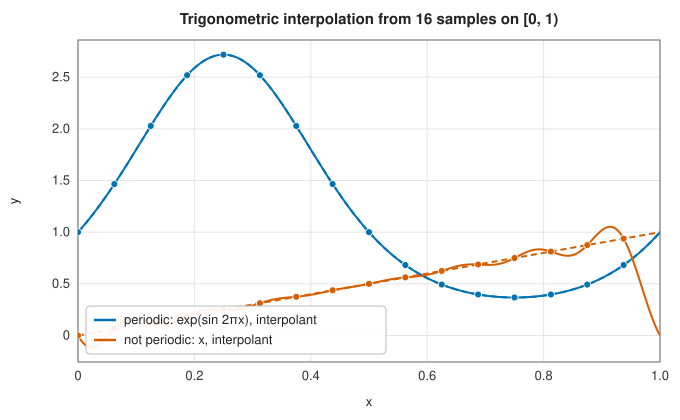
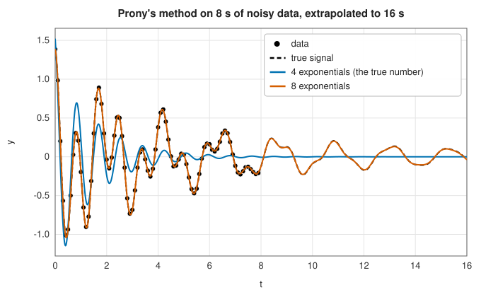

# Trigonometric interpolation and Prony's method

<div class="entry-summary">

| | |
|---|---|
| **Problem** | Interpolate equally spaced samples by sums of sines and cosines (periodic data), or of damped complex exponentials (decaying oscillations) |
| **Devised by** | Trigonometric interpolation: Alexis Clairaut (1754), Joseph-Louis Lagrange (1762), Carl Friedrich Gauss (1805, including the first FFT); Prony's method: Gaspard de Prony (1795) |
| **Accuracy** | Trigonometric: exponential for smooth periodic functions. Prony: exact for exact exponential sums; with noise, reliable when more exponentials are fitted than the signal contains |
| **Cost** | Trigonometric: $O(n^2)$ set-up (a direct DFT), $O(n)$ per evaluation. Prony: two least-squares problems and an eigenvalue problem of the model order |
| **API** | [`FourierInterpolator1D`](../../api/lib_jsl_interpolation/one_d/fourier_1d/struct.FourierInterpolator1D.html), [`PronyModel`](../../api/lib_jsl_interpolation/one_d/pronys_method/struct.PronyModel.html) |

</div>

## Overview

Polynomials are the natural building blocks for functions on an interval. For functions that
repeat, or that oscillate and decay, other building blocks fit far better. **Trigonometric
interpolation** passes a finite Fourier series through equally spaced samples of a periodic
function; for smooth periodic functions it converges exponentially, and it is the reason the
[discrete Fourier transform](../../api/lib_jsl_ffts/index.html) is such a powerful tool.

**Prony's method** goes one step further: it fits a sum of damped oscillations
$\sum_i c_i e^{s_i t}$ with *unknown* frequencies and damping rates, determined from the data
themselves. That makes it both an interpolator and a spectral analysis tool that can resolve
frequencies more finely than the Fourier transform of the same samples, and extrapolate the signal
beyond the data.

## History

Trigonometric interpolation was developed in the eighteenth century to predict the motions of
planets and comets, which are periodic. Clairaut (1754) and Lagrange (1762) gave formulas for the
coefficients, and in 1805 Gauss, computing the orbits of the asteroids Pallas and Juno, devised an
efficient way to evaluate them that is now recognised as the first fast Fourier transform, a century
and a half before Cooley and Tukey.

Gaspard de Prony, an engineer of the French revolutionary government, published his method in 1795
in a study of the expansion of gases, fitting measured pressures with sums of exponentials. It
remained a curiosity until the age of digital signal processing, when it became the ancestor of the
**linear prediction** and **high-resolution spectral estimation** methods (Pisarenko, MUSIC, ESPRIT,
the matrix pencil) used in radar, speech and the analysis of vibrations.

## The idea

### Trigonometric interpolation

Suppose $f$ is periodic with period $T$, and we have $n$ samples $y_j = f(x_j)$ at the equally
spaced points $x_j = x_0 + jT/n$ covering one period. We look for an interpolant made of the
simplest periodic functions, the complex exponentials $e^{2\pi i k (x - x_0)/T}$ with integer
frequency $k$ (each is a sine and a cosine with $k$ cycles per period).

With $n$ samples we can determine $n$ coefficients. They are given by the discrete Fourier
transform (DFT),

$$
\hat y_k = \frac1n \sum_{j=0}^{n-1} y_j\, e^{-2\pi i jk/n},
$$

and the inverse DFT states precisely that the samples are recovered from them:
$y_j = \sum_k \hat y_k\, e^{2\pi i jk/n}$. Since $(x_j - x_0)/T = j/n$, this says that the Fourier
series with coefficients $\hat y_k$ passes through every sample.

**Which frequencies?** There is a subtlety. At the sample points, frequency $k$ and frequency
$k + n$ are indistinguishable, because $e^{2\pi i j(k+n)/n} = e^{2\pi i jk/n}\,e^{2\pi i j}$ and
the last factor is 1. This is **aliasing**. Any set of $n$ consecutive frequencies would
interpolate the samples, but they would behave very differently *between* the samples. The right
choice is the set of lowest frequencies, from $-n/2$ to $n/2$, which wiggles as little as possible:

$$
p(x) = \sum_{|k| < n/2} \hat y_k\, e^{2\pi i k (x - x_0)/T} \;\; \Big[+\, \hat y_{n/2} \cos\big(\pi n (x - x_0)/T\big) \text{ for even } n\Big].
$$

Two details of this formula deserve a comment.

- For real data, $\hat y_{-k}$ is the complex conjugate of $\hat y_k$, so the terms for $+k$ and
  $-k$ add up to a real cosine and sine. Pairing $\pm k$ keeps the interpolant real.
- For even $n$ the highest frequency $n/2$, the **Nyquist** frequency, has no partner: $+n/2$ and
  $-n/2$ are aliases of each other. Splitting its coefficient evenly between the two gives the
  cosine term in brackets.

The interpolant $p$ passes through every sample, and it contains no frequencies higher than the
samples can resolve.

**Accuracy.** For a smooth periodic $f$ the Fourier coefficients decay exponentially, and so does
the interpolation error: 24 samples of $e^{\sin 2\pi x} + 0.3\cos 6\pi x$ give a maximum error of
$10^{-13}$. For data that are *not* periodic, the interpolant still assumes that the function
repeats, so it sees a jump between the last sample and the first. A Fourier series converges
slowly at a jump and overshoots on both sides of it, the **Gibbs oscillations** visible near the
ends:



### Prony's method

Trigonometric interpolation fixes the frequencies in advance and finds the amplitudes. Prony's
method treats the frequencies and the decay rates as unknowns too. The model is a sum of $p$
complex exponentials sampled at interval $\Delta t$,

$$
y_k = \sum_{i=1}^p c_i\, e^{s_i k\Delta t} = \sum_{i=1}^p c_i z_i^k, \qquad z_i = e^{s_i \Delta t}.
$$

The real part of $s_i$ is a growth (or, if negative, decay) rate and the imaginary part is an
angular frequency. Fitting the $z_i$ directly would be a difficult nonlinear problem. Prony's
insight was that it can be avoided.

**The key observation.** Start with one exponential, $y_k = c z^k$. Each sample is $z$ times the
one before: $y_{k+1} - z\,y_k = 0$. The samples satisfy a linear recurrence whose coefficient
reveals $z$. The same is true for $p$ exponentials. Let

$$
A(z) = z^p + a_1 z^{p-1} + \cdots + a_p
$$

be the polynomial whose roots are $z_1, \ldots, z_p$. Then for every $k$,

$$
y_{k+p} + a_1 y_{k+p-1} + \cdots + a_p y_k
= \sum_{i=1}^p c_i z_i^k \big(z_i^p + a_1 z_i^{p-1} + \cdots + a_p\big)
= \sum_{i=1}^p c_i z_i^k\,A(z_i) = 0,
$$

because each $z_i$ is a root of $A$. In words: every sample is a fixed linear combination of the
$p$ samples before it. The combination is the same everywhere in the signal, and its coefficients
encode the poles $z_i$.

**The method.** This turns one nonlinear problem into three linear ones.

1. **Linear prediction.** Write the recurrence for every available $k$. The samples are known and
   $a_1, \ldots, a_p$ are unknown, so this is a system of linear equations, usually with more
   equations than unknowns, solved by [least squares](../linear_algebra/least-squares.md).
2. **Poles.** The $z_i$ are the roots of $A(z)$, computed as the eigenvalues of its
   [companion matrix](../root_finding/polynomial-roots.md). Taking the logarithm,
   $s_i = \ln z_i/\Delta t$, gives the decay rate $-\operatorname{Re} s_i$ and the frequency
   $\operatorname{Im} s_i/2\pi$ of each component.
3. **Amplitudes.** With the $z_i$ known, the model $y_k = \sum c_i z_i^k$ is linear in the $c_i$:
   another least-squares problem, with a Vandermonde matrix of entries $z_i^k$.

For an exact exponential sum, step 1 needs $p$ equations, each involving $p + 1$ consecutive
samples, so $2p$ samples suffice to recover every frequency and damping rate exactly, however
close the frequencies are. A Fourier transform, by contrast, cannot separate two frequencies
closer than about one cycle over the length of the record. This is why Prony's method can
outperform Fourier analysis on short records.

### Prony's method and noise

The price of this resolution is sensitivity to noise. With measurement noise the recurrence no
longer holds exactly, and fitting exactly as many exponentials as the signal contains often gives
nonsense. The remedy, analysed by Ramdas Kumaresan and Donald Tufts, is to fit **more** exponentials
than expected: the extra poles absorb the noise as heavily damped components, and the true ones
emerge accurately. On data with 2% noise:

{{#include ../generated/interpolation/prony_table.md}}



With four exponentials (the true number) the fit finds a single, wrong oscillation. With eight it
recovers both true components to within a few per cent, and its extrapolation follows the true signal
long after the data end.

## Algorithm

- **Trigonometric**: compute the DFT coefficients directly; evaluate the paired series at any $x$,
  extended periodically.
- **Prony**: least squares for the prediction coefficients; companion matrix eigenvalues for the poles;
  complex least squares for the amplitudes; evaluate $\operatorname{Re}\sum_i c_i z_i^{(x - x_0)/\Delta t}$.

## Implementation

```rust,ignore
{{#include ../../../crates/interpolation/src/one_d/pronys_method.rs:prony_steps}}
```

- The trigonometric interpolant computes its coefficients with a direct $O(n^2)$ DFT, once; for long
  signals the [FFT](../../api/lib_jsl_ffts/index.html) does the same in $O(n\log n)$.
- Prony's least-squares problems and the companion eigenvalues use
  [`lib_jsl_linalg`](../../api/lib_jsl_linalg/index.html); the amplitudes are complex, and for real data
  they come in conjugate pairs, so the model's real part is the fitted signal.

## In practice

```rust,ignore
{{#include ../../../crates/interpolation/examples/interpolation_fourier_prony.rs}}
```

**Strengths**

- Trigonometric interpolation: exponential accuracy for smooth periodic data, and exact frequency
  content.
- Prony: frequencies and damping rates from short records, beyond the Fourier resolution limit, and
  meaningful extrapolation.

**Weaknesses**

- Trigonometric interpolation of non-periodic data suffers Gibbs oscillations.
- Prony's method is sensitive to noise and to the model order; overfitting the order helps, but the
  spurious components must be recognised (they are strongly damped) and discarded.

## Exercises

1. Show that the trigonometric interpolant of $\cos(2\pi m x)$ from $n > 2m$ samples is exact, and find what
   it becomes for $n = m$ (aliasing).
2. Derive the linear recurrence satisfied by $y_k = c_1 z_1^k + c_2 z_2^k$.
3. Generate two undamped sinusoids at 100 Hz and 103 Hz, sampled at 1 kHz for 0.1 s, so that the
   Fourier resolution is 10 Hz. Can the DFT separate them? Can Prony's method?
4. Repeat the noisy fit with model orders 4 to 20 and plot the fitted damping rates. Which poles
   are stable as the order increases?
5. Use a trigonometric interpolant of samples of $x(1 - x)$ (which is continuous but has a kink when
   extended periodically) and measure the convergence rate.

## Further reading

- G. R. de Prony, "Essai expérimental et analytique", *Journal de l'École Polytechnique* 1 (1795)
  24–76.
- M. T. Heideman, D. H. Johnson and C. S. Burrus, "Gauss and the history of the fast Fourier
  transform", *IEEE ASSP Magazine* 1 (1984) 14–21.
- R. Kumaresan and D. W. Tufts, "Estimating the parameters of exponentially damped sinusoids and
  pole-zero modeling in noise", *IEEE Transactions on Acoustics, Speech, and Signal Processing* 30
  (1982) 833–840.
- S. M. Kay, *Modern Spectral Estimation: Theory and Application*, Prentice-Hall, 1988.
- L. N. Trefethen, *Approximation Theory and Approximation Practice*, SIAM, 2019, on trigonometric
  interpolation and its convergence.
