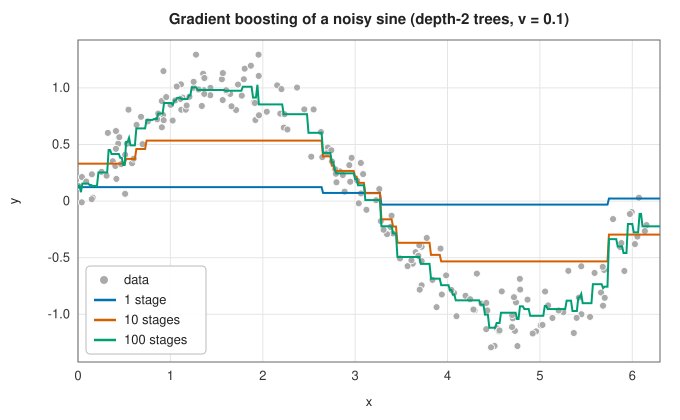
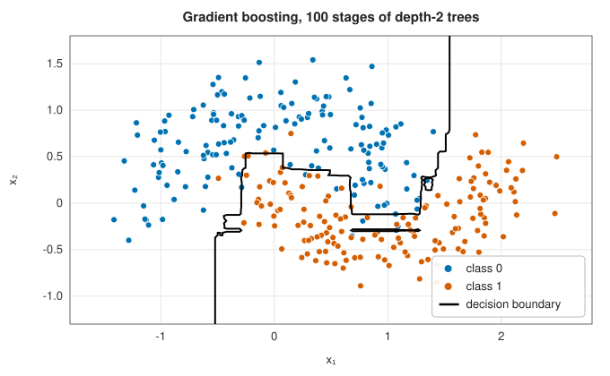
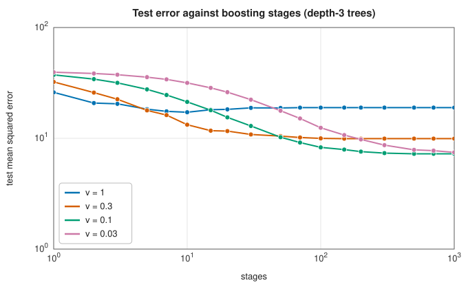

# Gradient boosting

<div class="entry-summary">

| | |
|---|---|
| **Problem** | Build an accurate predictor as a sum of many small regression trees, each fitted to the errors of the sum so far |
| **Devised by** | Robert Schapire (1990) and Yoav Freund and Schapire (1997), boosting and AdaBoost; Leo Breiman (1997), boosting as gradient descent; Jerome Friedman (2001), gradient boosting machines, and (2002), stochastic gradient boosting; Tianqi Chen and Carlos Guestrin (2016), XGBoost |
| **Accuracy** | Training loss decreases at every stage; test error is controlled by the learning rate, tree depth, subsampling and the number of stages |
| **Cost** | Each tree $O(dpn\log n)$ for depth $d$ (a sort per feature per level); $K$ trees per stage for $K$ classes |
| **API** | [`GradientBoostingRegressor`](../../api/lib_jsl_machine_learning/ensembles/struct.GradientBoostingRegressor.html) (`feature_importances`, `training_loss`), [`GradientBoostingClassifier`](../../api/lib_jsl_machine_learning/ensembles/struct.GradientBoostingClassifier.html) (`predict_proba`, `training_loss`), [`BoostingParameters`](../../api/lib_jsl_machine_learning/ensembles/struct.BoostingParameters.html) (`stages`, `learning_rate`, `max_depth`, `min_samples_leaf`, `subsample`, `seed`), [`RegressionTree`](../../api/lib_jsl_machine_learning/ensembles/struct.RegressionTree.html) |

</div>

## Overview

A [random forest](../machine_learning/decision-trees.md) averages deep trees grown independently. **Boosting** does the opposite: it grows *shallow* trees one after another, each
correcting what the previous ones got wrong. **Gradient boosting** makes this precise. At each stage it computes the gradient of the
loss with respect to the current predictions, fits a small regression tree to the negative gradient, and adds a fraction of that tree to
the model. It is gradient descent in the space of functions, with trees as steps. For squared error the negative gradient is
just the residual, so each tree fits what is left to explain. Gradient-boosted trees, in implementations such as XGBoost and LightGBM, are
the most successful general method for tabular data.

## History

Michael Kearns and Leslie Valiant (1988) asked whether "weak" learners, slightly better than guessing, could be combined into a
strong one. Robert Schapire (1990) proved they could, and Yoav Freund and Schapire's AdaBoost (1997) made it practical by
reweighting misclassified examples. Leo Breiman (1997) and Jerome Friedman, Trevor Hastie and Robert Tibshirani (2000) showed
that AdaBoost minimises an exponential loss stage by stage. Friedman (2001) generalised this to any differentiable loss as
gradient boosting, with shrinkage and Newton steps in the leaves, and (2002) added row subsampling. Tianqi Chen and Carlos
Guestrin's XGBoost (2016), Microsoft's LightGBM (2017) and Yandex's CatBoost (2017) added second-order splits, histograms and
careful engineering, and dominate machine-learning competitions on tabular data.

## The idea

### Functional gradient descent

**Boosting by fitting residuals.** Start with the simplest possible model for a regression
problem, a constant $F_0$ equal to the mean of the targets. It is wrong at every training point
by a residual $y_i - F_0$. Fit a small regression tree $h_1$ to those residuals: it captures the
largest pattern in what the constant missed. Add it to the model, compute the new residuals, fit
another tree to them, and continue. Each tree corrects the errors of the sum of its
predecessors. The final model is an additive expansion

$$
F_M(\mathbf x) = F_0 + \nu\sum_{m=1}^Mh_m(\mathbf x),
$$

where each $h_m$ is a small tree. The factor $\nu \in (0, 1]$, the **learning rate**, adds only a
fraction of each tree, so that no single tree is trusted too much.

**The connection with gradient descent.** For the squared-error loss
$L = \tfrac12(y - F)^2$, the derivative of the loss with respect to the prediction $F$ is
$-(y - F)$. The residual is therefore the *negative gradient* of the loss with respect to the
model's prediction at that point. Adding a tree that approximates the residuals moves the
predictions at all the training points a step in the direction of steepest descent. Boosting is
gradient descent, not on a vector of parameters, but on the function $F$ itself.

This observation, due to Friedman, generalises the method to any differentiable loss. At stage
$m$:

1. compute the **pseudo-residuals** $r_i = -\partial L(y_i, F)/\partial F$, evaluated at the
   current prediction $F = F_{m-1}(\mathbf x_i)$;
2. fit a regression tree $h_m$ to the pseudo-residuals by least squares;
3. add $\nu h_m$ to the model.

For squared error the pseudo-residuals are the ordinary residuals, and the description above is
recovered. For other losses, such as the cross-entropy used for classification, they are whatever
the gradient says would reduce the loss fastest.



<p class="caption" id="fig-13-3"><strong>Figure 13.3.</strong> Boosting a sine.</p>

One depth-2 tree, scaled by $\nu = 0.1$, barely moves from the mean. Ten stages capture the shape coarsely, and a hundred follow the
sine as a fine staircase.

### Newton steps in the leaves

A regression tree does two things: it divides the points into groups (its leaves), and it
assigns a value to each group. Fitting the tree to the pseudo-residuals by least squares is a
good way to find the groups. But the least-squares leaf value, the mean pseudo-residual, is only
the best value for the squared-error loss. For another loss, the value can be chosen to reduce
*that* loss as much as possible for the points in the leaf.

One step of [Newton's method](../optimization/newton-quasi-newton.md#newtons-method) on the
loss, restricted to the points $R$ of a leaf and to a single unknown $\gamma$, the leaf's value,
gives

$$
\gamma = \frac{\sum_{i \in R}g_i}{\sum_{i \in R}h_i},
$$

where $g_i$ is the negative gradient (the pseudo-residual) and $h_i$ the second derivative of
the loss at point $i$. For squared error $h_i = 1$, and $\gamma$ is the mean residual as before.

For classification with $K$ classes the model keeps one score $F_k$ per class, converts the
scores to probabilities $p_k$ by a softmax, and minimises the cross-entropy (the multinomial
deviance). The pseudo-residual for class $k$ is $y_{ik} - p_{ik}$, where $y_{ik}$ is 1 if point
$i$ belongs to class $k$ and 0 otherwise: the familiar prediction error. Each stage fits one
tree per class to these, with leaf values
$\frac{K - 1}{K}\sum(y - p)/\sum p(1 - p)$. (Friedman's factor $\frac{K - 1}{K}$ allows for the
fact that the softmax has one redundant degree of freedom: adding a constant to all the scores
changes nothing.)



<p class="caption" id="fig-13-4"><strong>Figure 13.4.</strong> Gradient boosting on moons.</p>

The boundary is built from axis-parallel pieces, like a tree's, but a hundred small trees give it far more resolution than one
deep tree.

### Shrinkage and the number of stages

The learning rate and the number of stages trade off. A small $\nu$ needs more stages but generalises better, a regularisation
effect Friedman found empirically, related to the lasso's path. On a nonlinear regression problem with 300 training points:



<p class="caption" id="fig-13-5"><strong>Figure 13.5.</strong> Test error against stages.</p>

{{#include ../generated/learning/gb_shrinkage.md}}

With $\nu = 1$ the test error bottoms out after 10 stages, then rises as the trees fit noise. With $\nu = 0.1$ it keeps improving to 1000 stages and
ends far lower. With $\nu = 0.03$, 1000 stages are not yet enough. In practice one sets a small $\nu$ and chooses the number of stages by
[cross-validation](model-selection.md) or a held-out set.

### Stochastic gradient boosting

Fitting each tree to a random fraction of the rows (`subsample`) both speeds training up and, by decorrelating the trees, reduces
overfitting:

<p class="caption" id="tab-13-4"><strong>Table 13.4.</strong> Columns: subsample (300 stages, ν = 0.1), test MSE (mean of 5 seeds).</p>

{{#include ../generated/learning/gb_subsample.md}}

Half the rows per tree gives the lowest error here. With subsampling the training loss is no longer guaranteed to fall at every
stage.

## Algorithm

**Training**, with $M$ stages, learning rate $\nu$, tree depth $d$ and subsample fraction $s$.

1. **Initial model.** Set $F_0$ to the mean of the targets (regression), or, for
   classification, set one score per class to the smoothed logarithm of the class's share of
   the training data.
2. **For each stage** $m = 1, \ldots, M$:
   - **subsample**: if $s < 1$, draw a random fraction $s$ of the rows for this stage;
   - **derivatives**: at the current predictions, compute for each row the pseudo-residual
     and the second derivative of the loss;
   - **grow a tree** of depth at most $d$ on the subsample, with the pseudo-residuals as
     targets, choosing at each node the split that most reduces their squared error;
   - **set the leaf values**: replace the value of each leaf by its Newton step, the sum of
     the pseudo-residuals of its rows divided by the sum of their second derivatives;
   - **update**: add $\nu$ times the tree's prediction to the model's prediction for *every*
     row, including those not in the subsample.

   For classification with $K$ classes, the last four steps are carried out once for each
   class, giving $K$ trees per stage.
3. **Feature importances.** Add up, over all the splits in all the trees, the reduction in
   squared error that each split achieved, grouped by the feature it used; divide by the total
   so that the importances sum to one.

**Prediction**: add $F_0$ and $\nu$ times the prediction of every tree. For classification,
apply the softmax to the $K$ scores.

## Implementation

```rust,ignore
{{#include ../../../crates/machine_learning/src/ensembles.rs:boost_regression}}
```

```rust,ignore
{{#include ../../../crates/machine_learning/src/ensembles.rs:boost_classification}}
```

- Split search sorts each feature at each node, $O(pn\log n)$ per level. Histogram-based implementations bin the features once and are much faster
  on large data.
- Classification leaf values are clamped to ±20 to avoid overflow when a leaf is pure.
- Predictions check the number of features. (Before this chapter, a row with too few features panicked.)

## In practice

```rust,ignore
{{#include ../../../crates/machine_learning/examples/ml_gradient_boosting.rs}}
```

```text
regression: test R² 0.855
feature importances [0.087, 0.108, 0.323, 0.210, 0.012, 0.046, 0.012, 0.202]
classification: test accuracy 0.889, training deviance 0.973 → 0.050
```

Feature 2, which enters both linearly (coefficient −2.41) and quadratically, is the most important. Features 3 and 7 have the
largest linear coefficients (−2.65 and −2.59); features 0 and 1 matter partly through their product, which trees can only
approximate in pieces; features 4 and 6, with coefficients 0.16 and −0.24, are almost unused. The classifier drives its
training deviance close to zero; the gap to its test accuracy is the usual warning that training loss says little about
generalisation.

**Strengths**

- State-of-the-art accuracy on tabular data; handles mixed feature scales, interactions and missing structure with little preprocessing.
- Any differentiable loss; feature importances come for free.

**Weaknesses**

- Sequential: stages cannot be trained in parallel, and many settings need tuning (rate, stages, depth, subsampling).
- Can overfit with too many stages or too large a rate; piecewise-constant predictions do not extrapolate.

## Exercises

1. Show that the pseudo-residual of the squared loss is the residual, and that of the absolute loss $|y - F|$ is the sign of the residual.
2. Derive the Newton leaf value for the binary logistic loss.
3. Show that boosting depth-1 trees (stumps) gives an additive model $\sum_jf_j(x_j)$ with no interactions.
4. Explain why the training loss of full-sample boosting with Newton leaves for squared error can never increase.
5. Implement early stopping: hold out 20% of the training data and stop when its error has not improved for 20 stages.

<details>
<summary>Hints and answers</summary>

1. For $L = \tfrac12(y - F)^2$ the negative gradient is $y - F$. For $L = |y - F|$ it is $\operatorname{sign}(y - F)$.
2. With $p = \sigma(F)$ the gradient is $p - y$ and the Hessian $p(1 - p)$, so the Newton leaf value is $\sum_{i\in\text{leaf}}(y_i - p_i)\big/\sum_{i\in\text{leaf}}p_i(1 - p_i)$.
3. Each stump depends on a single feature, so the sum of stumps is $\sum_jf_j(x_j)$ with $f_j$ collecting the stumps on feature $j$: no interaction terms.
4. With squared loss the Newton leaf value is the mean residual, which exactly minimises the squared error in each leaf; a leaf value of 0 (no change) is always available, so the loss cannot increase.
5. Track the validation loss after each stage and stop (returning to the best stage) once it has not improved for 20 consecutive stages.

</details>

## Further reading

- J. H. Friedman, "Greedy function approximation: a gradient boosting machine", *Annals of Statistics* 29 (2001) 1189–1232.
- J. H. Friedman, "Stochastic gradient boosting", *Computational Statistics and Data Analysis* 38 (2002) 367–378.
- T. Chen and C. Guestrin, "XGBoost: a scalable tree boosting system", *Proceedings of the 22nd ACM SIGKDD Conference* (2016) 785–794.
- T. Hastie, R. Tibshirani and J. Friedman, *The Elements of Statistical Learning*, 2nd ed., Springer, 2009, chapter 10.
