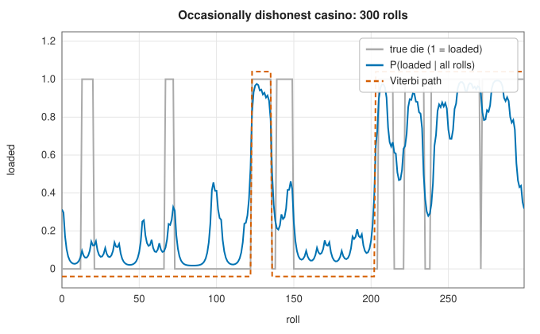
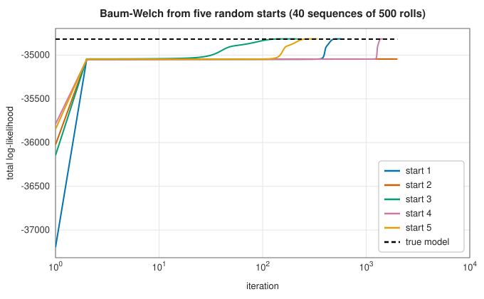

# Hidden Markov models: Viterbi, forward-backward and Baum-Welch

<div class="entry-summary">

| | |
|---|---|
| **Problem** | Model a sequence of observations produced by an unseen Markov chain; find the most likely hidden path, the probability of each hidden state, and the model's parameters from data |
| **Devised by** | Andrew Viterbi (1967), the decoding algorithm; Leonard Baum, Ted Petrie, George Soules and Norman Weiss (1966–1970), the forward-backward and re-estimation algorithms; Lawrence Rabiner (1989), the tutorial and scaling |
| **Accuracy** | Viterbi and forward-backward are exact; Baum-Welch increases the likelihood at every iteration and converges to a local maximum |
| **Cost** | $O(TN^2)$ time for a sequence of $T$ steps and $N$ states, per pass |
| **API** | [`viterbi_path`](../../api/lib_jsl_machine_learning/supervised/classification/viterbi_algorithm/fn.viterbi_path.html), [`HiddenMarkovModel`](../../api/lib_jsl_machine_learning/supervised/classification/viterbi_algorithm/struct.HiddenMarkovModel.html) (`new`, `random`, `sample`, `viterbi`, `log_likelihood`, `posteriors`, `baum_welch`), [`BaumWelchResult`](../../api/lib_jsl_machine_learning/supervised/classification/viterbi_algorithm/struct.BaumWelchResult.html) |

</div>

## Overview

In a **hidden Markov model** (HMM), a system moves between a few hidden states according to a Markov chain, and at each step emits an
observation whose distribution depends only on the current state. The observations are seen; the states are not. Examples include
speech, where phonemes are hidden and acoustic frames observed; genes, where coding and non-coding regions are hidden and bases
observed; and decoding, where transmitted bits are hidden and received signals observed. Three questions arise, each with a
dynamic-programming answer:

- the most likely hidden path (**Viterbi**);
- the probability of the observations and of each state at each time (**forward-backward**);
- the parameters that best explain the observations (**Baum-Welch**).

## History

Leonard Baum and colleagues at the Institute for Defense Analyses developed the statistical theory of probabilistic functions of
Markov chains between 1966 and 1970, including the forward-backward procedure and the re-estimation algorithm that bears Baum
and Lloyd Welch's names, an instance of what Dempster, Laird and Rubin (1977) would call EM. Andrew Viterbi (1967) devised his
algorithm to decode convolutional codes; it is used in every mobile phone, and G. David Forney (1973) recognised it as a
shortest-path search through a trellis. James Baker and Frederick Jelinek's groups applied HMMs to speech recognition in the
1970s, and Lawrence Rabiner's 1989 tutorial made them standard. Richard Durbin, Sean Eddy, Anders Krogh and Graeme Mitchison's
*Biological Sequence Analysis* (1998) brought them to genomics, along with the dishonest casino example used here.

## The idea

### The model

A discrete HMM with $N$ states and $M$ symbols has an initial distribution $\pi_s$, a transition matrix $A_{ij} = P(s_{t+1} = j \mid s_t = i)$, and an emission matrix $B_{jk} = P(o_t = k \mid s_t = j)$. A
path $s_1, \ldots, s_T$ and observations $o_1, \ldots, o_T$ have joint probability

$$
P(\mathbf s, \mathbf o) = \pi_{s_1}B_{s_1o_1}\prod_{t=2}^TA_{s_{t-1}s_t}B_{s_to_t}.
$$

In the **occasionally dishonest casino** (Durbin et al.), a croupier usually rolls a fair die but sometimes switches to a loaded one that shows six
half the time. The switch probabilities are 0.05 per roll from fair to loaded and 0.1 back. We see only the rolls.

### The Viterbi algorithm

The first question to ask of an HMM is **decoding**: given the observations, what is the most
likely sequence of hidden states? There are $N^T$ possible paths, far too many to try. But the
[principle of optimality](../optimization/dynamic-programming.md#bellmans-principle) applies.
Because each state depends only on the one before it, the best path that ends in state $j$ at
time $t$ must consist of the best path to *some* state $i$ at time $t - 1$, followed by the step
from $i$ to $j$. So it is enough to keep, for each state, the best path ending there.

Let $\delta_t(j)$ be the highest log probability of any path ending in state $j$ at time $t$,
together with the observations up to then. It starts as
$\delta_1(j) = \log\pi_j + \log B_{jo_1}$ and is updated by

$$
\delta_t(j) = \max_i\big(\delta_{t-1}(i) + \log A_{ij}\big) + \log B_{jo_t} .
$$

The first term chooses the best predecessor of $j$; the second accounts for emitting the
observed symbol from $j$. The maximising $i$ is stored as a **back-pointer**. At the end, the
state with the largest $\delta_T$ is the last state of the best path, and following the
back-pointers from it recovers the whole path. Each of the $T$ steps examines $N^2$ transitions,
so the cost is $O(TN^2)$ instead of $N^T$.

Working with logarithms turns the products of probabilities into sums and avoids underflow:
probabilities of long sequences fall below the smallest `f64` within a few hundred steps. The
library's [`viterbi_path`](../../api/lib_jsl_machine_learning/supervised/classification/viterbi_algorithm/fn.viterbi_path.html) takes the scores as closures, so the same code decodes HMMs, trellis codes or
any other chain of choices.

### The forward-backward algorithm

Two further questions have the same structure. What is the total probability $P(\mathbf o)$ of the
observations, summed over all possible paths? And what is the probability that the chain was in
a particular state at a particular time, given all the observations?

**Forward.** Define the **forward** variables
$\alpha_t(j) = P(o_1, \ldots, o_t, s_t = j)$: the probability of the observations so far, with the
chain in state $j$ now. They obey the Viterbi recurrence with the maximum replaced by a sum,
since we now add up over all predecessors instead of choosing the best:

$$
\alpha_1(j) = \pi_jB_{jo_1}, \qquad \alpha_t(j) = \Big(\sum_i\alpha_{t-1}(i)A_{ij}\Big)B_{jo_t} .
$$

At the end, $P(\mathbf o) = \sum_j\alpha_T(j)$: the sum over all $N^T$ paths, at a cost of $O(TN^2)$.

**Backward.** The **backward** variables
$\beta_t(i) = P(o_{t+1}, \ldots, o_T \mid s_t = i)$ are the probability of the *remaining*
observations, given the state now. They are computed from the end:

$$
\beta_T(i) = 1, \qquad \beta_t(i) = \sum_jA_{ij}B_{jo_{t+1}}\beta_{t+1}(j) .
$$

**Combining them.** The probability of all the observations together with state $i$ at time $t$
is the product $\alpha_t(i)\beta_t(i)$: the past and present, times the future. Dividing by the
total gives the **posterior** probability of each state at each time,

$$
\gamma_t(i) = P(s_t = i \mid \mathbf o) = \frac{\alpha_t(i)\beta_t(i)}{P(\mathbf o)} .
$$



<p class="caption" id="fig-13-7"><strong>Figure 13.7.</strong> The dishonest casino.</p>

The posterior probability of the loaded die rises during the loaded stretches. The Viterbi path finds the long ones and misses
the short runs near the start, where a few rolls are not enough evidence against the strong prior to stay fair. The two
decoders answer different questions. Viterbi gives the single most likely *sequence*; taking the most likely state at each time
(**posterior decoding**) maximises the expected number of correct labels, though the resulting sequence may be impossible as a whole:

<p class="caption" id="tab-13-8"><strong>Table 13.8.</strong> Columns: decoder (100 sequences of 300 rolls), fraction of rolls labelled correctly.</p>

{{#include ../generated/learning/hmm_decoding.md}}

### Baum-Welch

When the parameters are unknown, EM estimates them from the observations alone. The E-step computes, by forward-backward, the
expected number of times each state starts the sequence, each transition is taken ($\xi_t(i, j) \propto \alpha_t(i)A_{ij}B_{jo_{t+1}}\beta_{t+1}(j)$), and each symbol is emitted from each state.
The M-step sets each probability to its normalised expected count. As for [Gaussian mixtures](../unsupervised/gaussian-mixtures.md#expectation-maximisation), the likelihood never decreases, but
the method only finds a local maximum:



<p class="caption" id="fig-13-8"><strong>Figure 13.8.</strong> Baum-Welch from random starts.</p>

All five random starts move quickly to a plateau, a nearly symmetric model in which the two states are almost identical. They then stay there for
dozens to over a thousand iterations, until the symmetry breaks and the likelihood climbs to the level of the true model. One start
had not escaped after 2000 iterations. Several starts, and patience, are needed. The best run recovers the casino:

<p class="caption" id="tab-13-9"><strong>Table 13.9.</strong> Columns: parameter, true, Baum-Welch (best of five starts).</p>

{{#include ../generated/learning/hmm_parameters.md}}

The learned model's likelihood is slightly *higher* than the true model's, as expected of a maximum-likelihood fit to a finite sample.
EM cannot know which state is "fair"; the learned states are matched to the true ones by their probability of a six.

### Scaling

Forward and backward probabilities underflow for long sequences. Rabiner's remedy normalises $\alpha_t$ to sum to one at each step, with scale
factor $c_t$, and divides $\beta_t$ by the same factors. Then $\log P(\mathbf o) = \sum_t\log c_t$, $\gamma_t(i) = \hat\alpha_t(i)\hat\beta_t(i)$, and $\xi_t(i, j) = \hat\alpha_t(i)A_{ij}B_{jo_{t+1}}\hat\beta_{t+1}(j)/c_{t+1}$, all without leaving the range of `f64`.
The library uses scaling in Baum-Welch and log-sum-exp in `log_likelihood` and `posteriors`.

## Algorithm

For a sequence of $T$ observations and a model with $N$ states.

**Viterbi decoding.**

1. Initialise $\delta_1(j) = \log\pi_j + \log B_{jo_1}$ for every state $j$.
2. For $t = 2, \ldots, T$ and every state $j$: find the state $i$ maximising
   $\delta_{t-1}(i) + \log A_{ij}$; store it as the back-pointer $\psi_t(j)$; set $\delta_t(j)$ to
   that maximum plus $\log B_{jo_t}$.
3. The last state of the best path is $s_T = \arg\max_j\delta_T(j)$.
4. Trace back: for $t = T, \ldots, 2$, set $s_{t-1} = \psi_t(s_t)$.

**Forward-backward.**

1. Forward pass: compute $\alpha_1$, then $\alpha_t$ from $\alpha_{t-1}$ for $t = 2, \ldots, T$.
   After each step, divide $\alpha_t$ by its sum $c_t$ and keep $c_t$.
2. The log-likelihood is $\sum_t\log c_t$.
3. Backward pass: set $\beta_T = 1$ and compute $\beta_t$ from $\beta_{t+1}$ for
   $t = T - 1, \ldots, 1$, dividing by the same factors.
4. The posterior of state $i$ at time $t$ is the product of the scaled $\alpha_t(i)$ and
   $\beta_t(i)$.

Both cost $O(TN^2)$ operations and $O(TN)$ storage.

**Baum-Welch training**, from starting parameters. Repeat:

1. **E-step.** Run the scaled forward-backward pass on every training sequence, and accumulate
   three tables of expected counts: how often each state starts a sequence ($\gamma_1$); how
   often each transition $i \to j$ is taken ($\sum_t\xi_t(i, j)$); and how often each state
   emits each symbol ($\gamma_t(j)$ summed over the times at which that symbol was observed).
2. **M-step.** Divide each table by its row sums, so that each row is a probability
   distribution: these are the new $\pi$, $A$ and $B$.
3. **Test.** Stop when the log-likelihood improves by less than the relative tolerance, or at
   the iteration limit.

## Implementation

```rust,ignore
{{#include ../../../crates/machine_learning/src/supervised/classification/viterbi_algorithm.rs:viterbi}}
```

```rust,ignore
{{#include ../../../crates/machine_learning/src/supervised/classification/viterbi_algorithm.rs:baum_welch}}
```

- Each Viterbi step is a full $N \times N$ scan, so time grows as $N^2$:

<p class="caption" id="tab-13-10"><strong>Table 13.10.</strong> Columns: states N (1000 steps), Viterbi time (ms), ns per step per N².</p>

{{#include ../generated/learning/hmm_viterbi_time.md}}

- A row of expected counts that is zero (a state never visited) keeps its old probabilities instead of dividing by zero.
- `BaumWelchResult::log_likelihood` records the likelihood at the start of each iteration; the returned model has been re-estimated
  once more. (The documentation said "after each iteration" before this chapter was written.)

## In practice

```rust,ignore
{{#include ../../../crates/machine_learning/examples/ml_hidden_markov.rs}}
```

```text
rolls   666626666434466624362264346161126244366536465666542441311645
truth   111111100000111111111111111111111000011111111111100000000000
Viterbi 111111111111111111111111111111111111111111111111000000000000  (log probability -103.5)
log-likelihood of the rolls -98.8
Baum-Welch: 188 iterations, converged true
transition
[[0.894, 0.106],
 [0.054, 0.946]]
emission
[[0.108, 0.096, 0.090, 0.099, 0.103, 0.504],
 [0.163, 0.168, 0.171, 0.165, 0.168, 0.164]]
```

Viterbi bridges the two short fair stretches inside the loaded period: switching out and back costs more probability than the few
rolls justify. The learned model has numbered its states the other way round, with state 0 loaded. The probability of the most likely
path (−103.5) is a small part of the total over all paths (−98.8).

**Strengths**

- Exact, efficient inference for sequences; the same dynamic programme serves decoding, likelihoods and posteriors.
- Unsupervised training from observations alone; a principled probabilistic model.

**Weaknesses**

- The Markov assumption: the state carries all memory, and state durations are geometrically distributed.
- Baum-Welch finds local maxima, can stall on plateaus, and needs the number of states fixed in advance.
- Discrete emissions only in this implementation.

## Exercises

1. Show that the number of operations in the forward algorithm is $O(TN^2)$, while summing over paths directly costs $O(TN^T)$.
2. Show that posterior decoding can produce a path with probability zero under the model, and construct an example.
3. Derive the Baum-Welch update for the transition matrix from the expected complete-data log-likelihood.
4. Show that the expected time spent in the loaded state per visit is $1/0.1 = 10$ rolls, and that durations are geometric.
5. Extend the model to Gaussian emissions and derive the M-step for the means and variances.

<details>
<summary>Hints and answers</summary>

1. Each of the $T$ time steps does an $N\times N$ matrix-vector product, so $O(TN^2)$. Summing over all $N^T$ state paths, each costing $O(T)$, gives $O(TN^T)$.
2. Posterior decoding picks the most probable state at each time separately. If $A \to A$ has probability zero but the marginal probabilities favour $A$ at both times 1 and 2 (because the two likely paths are $A, B$ and $B, A$), the decoded path $A, A$ has probability zero.
3. Maximise $\sum_{t}\sum_{i,j}\xi_t(i, j)\ln a_{ij}$ subject to each row of $A$ summing to 1; the Lagrange condition gives $a_{ij} = \sum_t\xi_t(i, j)/\sum_t\gamma_t(i)$.
4. The state is left with probability $0.1$ each step, so the duration is geometric with $P(d) = 0.9^{d-1}\cdot0.1$ and mean $1/0.1 = 10$.
5. Weighting each observation by $\gamma_t(i)$, the M-step gives $\mu_i = \sum_t\gamma_t(i)x_t/\sum_t\gamma_t(i)$ and $\sigma_i^2 = \sum_t\gamma_t(i)(x_t - \mu_i)^2/\sum_t\gamma_t(i)$.

</details>

## Further reading

- L. R. Rabiner, "A tutorial on hidden Markov models and selected applications in speech recognition", *Proceedings of the IEEE* 77 (1989) 257–286.
- A. J. Viterbi, "Error bounds for convolutional codes and an asymptotically optimum decoding algorithm", *IEEE Transactions on Information Theory* 13 (1967) 260–269.
- G. D. Forney, "The Viterbi algorithm", *Proceedings of the IEEE* 61 (1973) 268–278.
- R. Durbin, S. Eddy, A. Krogh and G. Mitchison, *Biological Sequence Analysis*, Cambridge University Press, 1998, chapter 3.
- L. E. Baum, T. Petrie, G. Soules and N. Weiss, "A maximization technique occurring in the statistical analysis of probabilistic functions of Markov chains",
  *Annals of Mathematical Statistics* 41 (1970) 164–171.
