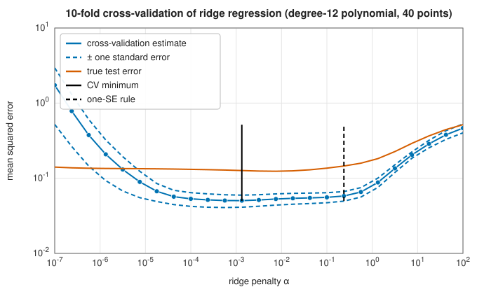

# Cross-validation and grid search

<div class="entry-summary">

| | |
|---|---|
| **Problem** | Estimate how well a model will predict new data, and choose hyperparameters, using only the data at hand |
| **Devised by** | Seymour Geisser (1975) and Mervyn Stone (1974), cross-validation; Peter Lachenbruch and M. Ray Mickey (1968), leave-one-out; Ron Kohavi (1995), stratified folds; Leo Breiman et al. (1984), the one-standard-error rule; Gavin Cawley and Nicola Talbot (2010), selection bias |
| **Accuracy** | Nearly unbiased for a model trained on $(k - 1)/k$ of the data, with a variance that is hard to estimate |
| **Cost** | $k$ fits per candidate setting; a grid over $m$ settings costs $mk$ fits |
| **API** | [`k_fold`](../../api/lib_jsl_machine_learning/model_selection/fn.k_fold.html), [`stratified_k_fold`](../../api/lib_jsl_machine_learning/model_selection/fn.stratified_k_fold.html), [`cross_validate_regressor`](../../api/lib_jsl_machine_learning/model_selection/fn.cross_validate_regressor.html), [`cross_validate_classifier`](../../api/lib_jsl_machine_learning/model_selection/fn.cross_validate_classifier.html), [`parameter_grid`](../../api/lib_jsl_machine_learning/model_selection/fn.parameter_grid.html), [`grid_search`](../../api/lib_jsl_machine_learning/model_selection/fn.grid_search.html), [`mean_score`](../../api/lib_jsl_machine_learning/model_selection/fn.mean_score.html) |

</div>

## Overview

Every model in these chapters has a knob: a penalty, a depth, a number of neighbours, a kernel width, a learning rate. The training
error always favours the most flexible setting, so it cannot choose. A single held-out test set can, but it wastes data and gives a
noisy answer. **k-fold cross-validation** splits the data into $k$ parts, trains on $k - 1$ of them and tests on the remaining one, rotates so that every
point is tested exactly once, and averages. **Grid search** repeats this for every combination of candidate settings and keeps the best.
Both are simple. The subtleties lie in what the estimate means, how variable it is, and how much the act of choosing biases it.

## History

Holding data out to test a prediction rule is old. Peter Lachenbruch and M. Ray Mickey (1968) proposed leaving out one
observation at a time to estimate discriminant error rates. Mervyn Stone (1974) and Seymour Geisser (1975) set out
cross-validation as a general method for choosing and assessing predictors. Leo Breiman, Jerome Friedman, Richard Olshen and
Charles Stone (1984) used ten-fold cross-validation and the one-standard-error rule to prune trees. Ron Kohavi (1995)
recommended stratified ten-fold cross-validation from a large empirical study. Yoshua Bengio and Yves Grandvalet (2004) showed that no
unbiased estimator of its variance exists, and Gavin Cawley and Nicola Talbot (2010) documented the bias of reporting the best
cross-validated score.

## The idea

### k-fold cross-validation

Partition the indices into $k$ folds $F_1, \ldots, F_k$ of nearly equal size, after shuffling. For each $j$, fit the model on the other folds and score it on $F_j$. The
cross-validation estimate is the average score. Each point is predicted by a model that did not see it, so the estimate measures
generalisation, but of a model trained on $(k - 1)/k$ of the data. **Leave-one-out** ($k = n$) uses nearly all the data for each fit but needs $n$ fits.

### Bias and variance of the estimate

The two words here refer to the *error estimate*, not to the model; for the model's own bias and variance see the [background section](../machine_learning/index.md#background-bias-variance-and-generalisation) of the machine learning chapter.

For a 7-nearest-neighbour classifier on 200 independent data sets of 60 points, compared with the true error of the model fitted to
all 60 points (measured on 5000 fresh points):

<p class="caption" id="tab-13-5"><strong>Table 13.5.</strong> Columns: folds (7-NN, 60 points, 200 data sets), mean estimate, standard deviation, RMS difference from the true error.</p>

{{#include ../generated/learning/cv_folds.md}}

Every estimate is pessimistic, because each fold's model saw fewer points than the final one. Two folds, training on only 30
points, are the most pessimistic and the most variable. Five and ten folds are close to each other. Leave-one-out has the
smallest bias but no smaller error overall: its $n$ training sets overlap almost completely, so their errors are correlated and
do not average out. Even the best estimate is off by about 0.04, more than half the error being estimated. With small data
sets, cross-validation is a rough guide.

### Stratification

With imbalanced classes, random folds can miss the minority class entirely, making those folds' scores meaningless. **Stratified**
folds deal each class out in turn, so every fold has the overall class proportions:

<p class="caption" id="tab-13-6"><strong>Table 13.6.</strong> Columns: 10 folds of 100 points, 10 in the minority class, minority points in each test fold, folds with none.</p>

{{#include ../generated/learning/cv_stratified.md}}

### Choosing a hyperparameter

Ridge regression of a degree-12 polynomial on 40 noisy points, with 10-fold cross-validation over 25 values of the penalty:



<p class="caption" id="fig-13-6"><strong>Figure 13.6.</strong> Cross-validation of ridge regression.</p>

{{#include ../generated/learning/cv_choice.md}}

The cross-validation curve has the right shape, high for both too little and too much penalty, and its minimum lands close to the
best possible choice. The **one-standard-error rule** (Breiman et al.) picks the simplest model, here the largest penalty, whose estimate is
within one standard error of the minimum, on the grounds that the curve is too noisy to distinguish them. Here it chose a
more heavily penalised model with a worse true error: the rule trades some accuracy for simplicity and stability. The
cross-validation estimates are also well below the true test error, and even below the noise variance of 0.09, which no model
can beat on new data. A single estimate from 40 points can be far off, as the previous table showed.

### Grid search

**Grid search** evaluates every combination of candidate values, such as $C \in \{0.1, 1, 10, 100\}$ and $\gamma \in \{0.1, 1, 10, 100\}$ for an [RBF support vector machine](../machine_learning/support-vector-machines.md#the-kernel-width),
by cross-validation, and keeps the best. Its cost multiplies with every axis, so grids are usually coarse and logarithmic. Random
search over the same ranges (James Bergstra and Yoshua Bengio, 2012) finds good settings with fewer evaluations when only a few
hyperparameters matter.

### The winner's curse

The best of many noisy estimates is optimistically biased: some candidate will look good by luck. On data whose labels are pure
coin flips, so that no model can beat 50%, a search over $k = 1, \ldots, 40$ for $k$-nearest neighbours gives:

<p class="caption" id="tab-13-7"><strong>Table 13.7.</strong> Columns: random labels, 60 points, 50 repetitions, mean, standard deviation.</p>

{{#include ../generated/learning/cv_selection_bias.md}}

The winning cross-validated accuracy averages 62%, but the chosen models score exactly chance on new data. The score used to
choose a model is therefore not an estimate of its performance. Report performance on a test set that played no part in the
choice, or use **nested cross-validation**, in which an inner loop chooses the hyperparameters within each outer training fold.

## Algorithm

**k-fold splitting** of $n$ samples.

1. List the indices $0, \ldots, n - 1$, and shuffle them if a seed is given.
2. Fold $j$ consists of positions $\lfloor jn/k\rfloor$ to $\lfloor(j + 1)n/k\rfloor - 1$ of the list,
   for $j = 0, \ldots, k - 1$. The fold sizes differ by at most one.
3. Split $j$ uses fold $j$ as the test set and all the other folds as the training set.

**Stratified splitting.**

1. Group the indices by class, and shuffle within each class.
2. Deal the indices out to the folds one at a time, in rotation, like cards: the first index
   to fold 0, the next to fold 1, and so on, going straight on from one class to the next
   without restarting at fold 0. Every fold then has each class in nearly its overall
   proportion, and the folds have nearly equal sizes.

**Cross-validation** of a model on a set of splits. For each split:

1. build a fresh, untrained model;
2. fit it on the training rows;
3. predict the test rows and compute the score.

Return the scores; their mean is the cross-validation estimate, and their standard deviation
divided by $\sqrt k$ a rough standard error.

**Grid search** over a list of candidate settings.

1. For each candidate, compute its score, usually the mean cross-validation score.
2. Skip any candidate whose evaluation fails or returns NaN.
3. Return the candidate with the best score, and the scores of all of them.

The cost is (number of candidates) × (number of folds) model fits.

## Implementation

```rust,ignore
{{#include ../../../crates/machine_learning/src/model_selection.rs:stratified}}
```

```rust,ignore
{{#include ../../../crates/machine_learning/src/model_selection.rs:grid_search}}
```

- The cross-validation functions take a closure that builds a fresh model, so no state leaks between folds.
- Scores are any function of (truth, prediction). For errors such as the MSE, pass `greater_is_better = false` to `grid_search`.
- Preprocessing (scaling, feature selection) must be done inside each fold, on the training rows only, or information from the test
  fold leaks into the fit.

## In practice

```rust,ignore
{{#include ../../../crates/machine_learning/examples/ml_model_selection.rs}}
```

```text
C =   0.1, γ =   0.1: cross-validated accuracy 0.820
C =   0.1, γ =     1: cross-validated accuracy 0.903
C =   0.1, γ =    10: cross-validated accuracy 0.940
C =   0.1, γ =   100: cross-validated accuracy 0.880
C =     1, γ =   0.1: cross-validated accuracy 0.850
C =     1, γ =     1: cross-validated accuracy 0.947
C =     1, γ =    10: cross-validated accuracy 0.950
C =     1, γ =   100: cross-validated accuracy 0.927
C =    10, γ =   0.1: cross-validated accuracy 0.887
C =    10, γ =     1: cross-validated accuracy 0.940
C =    10, γ =    10: cross-validated accuracy 0.957
C =    10, γ =   100: cross-validated accuracy 0.900
C =   100, γ =   0.1: cross-validated accuracy 0.927
C =   100, γ =     1: cross-validated accuracy 0.940
C =   100, γ =    10: cross-validated accuracy 0.930
C =   100, γ =   100: cross-validated accuracy 0.897
best: C = 10, γ = 10 with 0.957
```

Several settings are within 0.02 of the best, less than two standard errors of an accuracy measured on 300 points (about 0.013). The 0.957 is the winner's score and
slightly optimistic.

**Strengths**

- Uses all the data for both fitting and evaluation; works with any model and score.
- Stratification and the one-standard-error rule make it more reliable at little cost.

**Weaknesses**

- $k$ fits per setting, multiplied by the size of the grid.
- High variance on small data; no unbiased variance estimate; the best score is optimistic.
- Assumes independent rows: time series and grouped data need folds that respect the order or the groups.

## Exercises

1. Show that the training sets of two leave-one-out folds share $n - 2$ of their $n - 1$ points.
2. For ordinary least squares, show that the leave-one-out residual is $e_i/(1 - h_{ii})$, where $h_{ii}$ is the leverage, so leave-one-out needs only one fit.
3. Explain why choosing features on the whole data set before cross-validating gives optimistic estimates. Construct an example with pure noise.
4. Implement nested cross-validation and apply it to the random-label experiment above.
5. Implement random search and compare it with grid search on the SVM example for the same number of evaluations.

<details>
<summary>Hints and answers</summary>

1. The training set of fold $i$ is all points but $i$, that of fold $j$ is all points but $j$; they share all points except $i$ and $j$, which is $n - 2$ of the $n - 1$.
2. Deleting point $i$ changes the fit by $\hat{\mathbf w}_{(i)} = \hat{\mathbf w} - (X^{\mathsf T}X)^{-1}\mathbf x_ie_i/(1 - h_{ii})$ (Sherman-Morrison), so the prediction error at $i$ is $e_i/(1 - h_{ii})$ with $h_{ii} = \mathbf x_i^{\mathsf T}(X^{\mathsf T}X)^{-1}\mathbf x_i$.
3. Selecting the features that correlate best with the labels on all the data uses the validation labels in the selection, so the validation score is biased upward. With 5000 pure-noise features and 50 samples, the best 10 features correlate with the labels by chance and give cross-validated accuracy well above 50%.
4. In nested cross-validation the inner loop selects features or hyperparameters using only the outer training fold; on random labels the outer score should then be about 50%.
5. Random search samples hyperparameters from distributions; for the same budget it covers each individual hyperparameter more densely than a grid, which helps when only a few of them matter.

</details>

## Further reading

- M. Stone, "Cross-validatory choice and assessment of statistical predictions", *Journal of the Royal Statistical Society B* 36 (1974) 111–147.
- R. Kohavi, "A study of cross-validation and bootstrap for accuracy estimation and model selection", *Proceedings of IJCAI* (1995) 1137–1143.
- G. C. Cawley and N. L. C. Talbot, "On over-fitting in model selection and subsequent selection bias in performance evaluation",
  *Journal of Machine Learning Research* 11 (2010) 2079–2107.
- Y. Bengio and Y. Grandvalet, "No unbiased estimator of the variance of k-fold cross-validation", *Journal of Machine Learning Research* 5 (2004) 1089–1105.
- T. Hastie, R. Tibshirani and J. Friedman, *The Elements of Statistical Learning*, 2nd ed., Springer, 2009, section 7.10.
