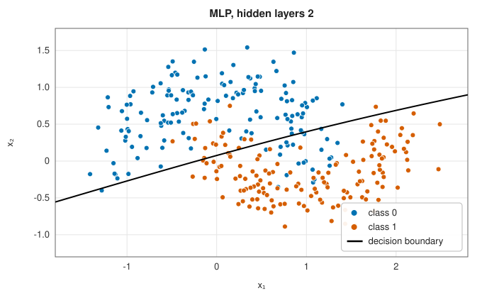
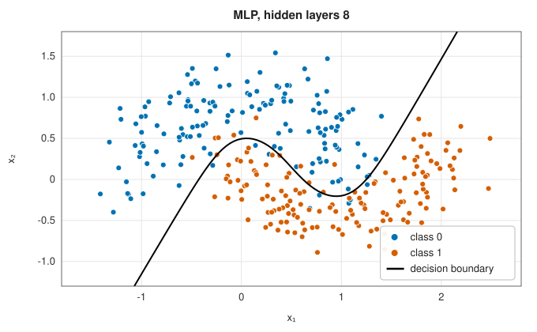
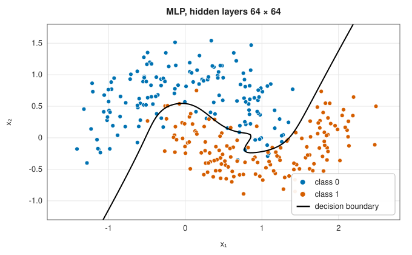
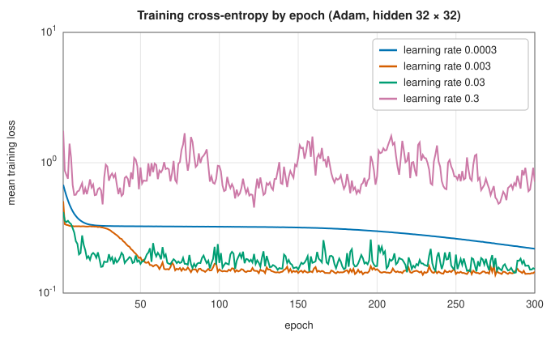
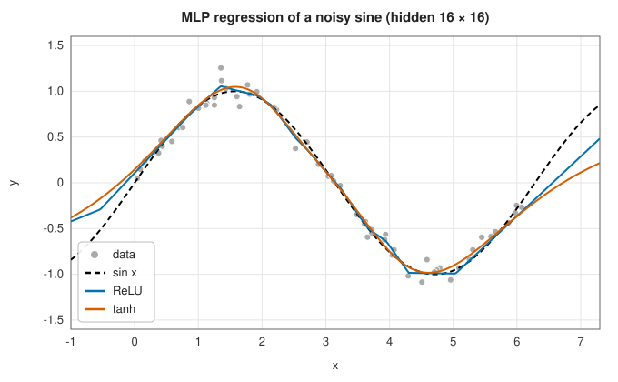

# Multilayer perceptrons and backpropagation

<div class="entry-summary">

| | |
|---|---|
| **Problem** | Fit a flexible nonlinear function, built from layers of weighted sums and simple nonlinearities, to regression targets or class labels |
| **Devised by** | Warren McCulloch and Walter Pitts (1943), the artificial neuron; Frank Rosenblatt (1958), the perceptron; Seppo Linnainmaa (1970), reverse-mode differentiation; Paul Werbos (1974) and David Rumelhart, Geoffrey Hinton and Ronald Williams (1986), backpropagation; George Cybenko (1989) and Kurt Hornik (1991), universal approximation; Diederik Kingma and Jimmy Ba (2014), Adam |
| **Accuracy** | Backpropagation gives exact gradients, checked against finite differences in the tests; training finds a local minimum of a nonconvex loss |
| **Cost** | Forward and backward passes each $O(B\sum_lh_{l-1}h_l)$ per mini-batch of $B$ rows, for layer widths $h_l$ |
| **API** | [`MlpClassifier`](../../api/lib_jsl_machine_learning/neural_network/struct.MlpClassifier.html) (`predict_proba`, `training_loss`), [`MlpRegressor`](../../api/lib_jsl_machine_learning/neural_network/struct.MlpRegressor.html), [`MlpParameters`](../../api/lib_jsl_machine_learning/neural_network/struct.MlpParameters.html) (`hidden`, `activation`, `learning_rate`, `epochs`, `batch_size`, `weight_decay`, `seed`), [`Activation`](../../api/lib_jsl_machine_learning/neural_network/enum.Activation.html) |

</div>

## Overview

A **multilayer perceptron** (MLP) composes simple layers: each multiplies its input by a weight matrix, adds a bias, and applies a
fixed nonlinear **activation** elementwise. The last layer gives a number for regression or class probabilities for classification.
With enough hidden units, such networks can approximate any continuous function. The weights are learned by gradient descent
on a loss, with the gradient computed by **backpropagation**, the chain rule applied layer by layer from the output back to
the input. The MLP is the simplest neural network and the building block of deep learning. On small tabular problems it competes
with, rather than beats, kernel machines and boosted trees.

## History

Warren McCulloch and Walter Pitts (1943) modelled neurons as threshold units, and Frank Rosenblatt's perceptron (1958) learned
the weights of one such layer. Marvin Minsky and Seymour Papert (1969) showed that a single layer cannot represent XOR, and
interest faded. Reverse-mode automatic differentiation was described by Seppo Linnainmaa (1970) and applied to networks by
Paul Werbos (1974). David Rumelhart, Geoffrey Hinton and Ronald Williams (1986) demonstrated that backpropagation trains hidden
layers that learn useful features, which revived the field. George Cybenko (1989) and Kurt Hornik (1991) proved universal
approximation. Better initialisation (Xavier Glorot and Yoshua Bengio, 2010; Kaiming He et al., 2015), ReLU activations
(Vinod Nair and Hinton, 2010), and adaptive optimisers such as Adam (Diederik Kingma and Jimmy Ba, 2014) made deep networks
trainable.

## The idea

### Layers and activations

With input $\mathbf a^{(0)} = \mathbf x$, layer $l$ computes

$$
\mathbf z^{(l)} = W^{(l)}\mathbf a^{(l-1)} + \mathbf b^{(l)}, \qquad \mathbf a^{(l)} = f(\mathbf z^{(l)}),
$$

where $f$ is the activation: **ReLU** $\max(0, z)$, **tanh**, or the **sigmoid** $1/(1 + e^{-z})$. The output layer is linear for regression, with a squared-error loss, and a
**softmax** $p_c = e^{z_c}/\sum_ke^{z_k}$ for classification, with the cross-entropy loss $-\log p_y$. Without the nonlinearities the whole network would collapse to one linear map.
With them, each hidden unit contributes a ridge-shaped function, and the network adds them up into curved decision boundaries:

| | | |
|:---:|:---:|:---:|
|  |  |  |

Two hidden units give little more than a straight line. Eight already follow the moons. Two layers of 64 units, trained for 500
epochs, start to bend around individual points.

### Backpropagation

Training needs the gradient of the loss with respect to every weight. Write $\boldsymbol\delta^{(l)} = \partial L/\partial\mathbf z^{(l)}$. For the output layer of both pairings (linear output with squared error,
softmax with cross-entropy), it takes the same simple form $\boldsymbol\delta^{(L)} = \hat{\mathbf y} - \mathbf y$. The chain rule then runs backwards through the layers:

$$
\boldsymbol\delta^{(l-1)} = \big(W^{(l)\mathsf T}\boldsymbol\delta^{(l)}\big) \odot f'(\mathbf z^{(l-1)}), \qquad \frac{\partial L}{\partial W^{(l)}} = \boldsymbol\delta^{(l)}\mathbf a^{(l-1)\mathsf T}, \qquad \frac{\partial L}{\partial\mathbf b^{(l)}} = \boldsymbol\delta^{(l)}.
$$

One backward pass costs a small multiple of the forward pass, whatever the number of weights. That is the point of reverse-mode
differentiation, and the reason networks with millions of parameters can be trained. The derivatives are written through the
activation values ($f' = 1 - a^2$ for tanh, $a(1 - a)$ for the sigmoid), so the forward pass's stored activations are all the backward pass needs.

### Adam and mini-batches

Each step uses a **mini-batch** of rows (32 by default), shuffled each **epoch**, a full pass over the data. The gradient is therefore noisy but cheap.
**Adam** keeps exponentially decaying averages of the gradient $\mathbf m$ and of its square $\mathbf v$ (rates 0.9 and 0.999), corrects their bias towards zero
at the start, and steps each weight by $-\eta\,\hat m/(\sqrt{\hat v} + \epsilon)$. Each weight is thus scaled by its own recent gradient size, which makes
the learning rate $\eta$ far less sensitive than in plain gradient descent, though it still matters:



At $\eta = 0.0003$ training is slow; at $0.003$ and $0.03$ it converges; at $0.3$ the steps are too large and the loss bounces around a value several times higher.

### Initialisation and scaling

Weights start random and small, so that units differ and signals neither vanish nor explode through the layers: Glorot's
variance $2/(n_{\text{in}} + n_{\text{out}})$ for tanh and sigmoid, He's $2/n_{\text{in}}$ for ReLU. The library standardises the inputs, and for regression the targets, before training,
because gradient-based training is sensitive to scales.

### Activations and smoothness



A ReLU network is piecewise linear, with kinks wherever a unit switches on. A tanh network is smooth. Both fit the sine
where there are data. Beyond the data, on the right, both continue along straight lines, since every unit is saturated or linear there.
Neural networks do not extrapolate. On the two classification benchmarks:

{{#include ../generated/learning/mlp_activations.md}}

The sigmoid trains slowest. Its derivative is at most 1/4, so gradients shrink at every layer, the **vanishing gradient** problem that ReLU avoids.

### Overfitting and weight decay

A network with thousands of weights can memorise 120 points. **Weight decay** adds $\frac\lambda2\sum w^2$ to the loss, shrinking the weights towards
zero as ridge regression does:

{{#include ../generated/learning/mlp_weight_decay.md}}

Without decay the network reaches 100% training accuracy and 91% on test data. A little decay trades training accuracy for
test accuracy; too much flattens the network into a constant. Early stopping, dropout and more data are the other remedies.

## Algorithm

1. Standardise the inputs (and regression targets). Initialise the weights (Glorot or He) and zero the biases.
2. For each epoch, shuffle the rows; for each mini-batch, run the forward pass, compute the loss, backpropagate the gradients
   (adding $\lambda W$ for weight decay), and take an Adam step on every weight and bias.
3. Record the mean training loss per epoch; stop with an error if it becomes infinite or NaN.

## Implementation

```rust,ignore
{{#include ../../../crates/machine_learning/src/neural_network.rs:backprop}}
```

```rust,ignore
{{#include ../../../crates/machine_learning/src/neural_network.rs:adam}}
```

- The weight gradient is assigned into a row-major array. Writing this chapter found that with a single input feature the matrix
  product came back column-major, and the Adam step, which reads gradients and weights as flat slices, panicked: no
  one-feature network with two hidden layers could be trained.
- Predictions check the number of features. (Before this chapter they broadcast a one-column input against two training features
  without complaint.)
- Training is deterministic for a given `seed`, which sets both the initial weights and the shuffling.

## In practice

```rust,ignore
{{#include ../../../crates/machine_learning/examples/ml_neural_network.rs}}
```

```text
cross-entropy: epoch 1 0.407, epoch 50 0.059, epoch 200 0.043
test accuracy 0.964
P(class 1) at (0.5, 0.25): 0.159; at (-1, 0.5): 0.000
sine: MSE against sin x 0.00377
```

**Strengths**

- Universal approximators that learn their own features; one method for regression and multi-class classification.
- Training scales linearly with the data, by mini-batches.

**Weaknesses**

- Nonconvex training with many settings (architecture, learning rate, epochs, decay) that interact; results vary with the seed.
- On small tabular data, usually no better than kernel machines or boosted trees, and slower to train.
- No extrapolation, and probabilities that can be overconfident far from the data.

## Exercises

1. Show that a network with linear activations, of any depth, is a linear function of its input.
2. Derive $\boldsymbol\delta^{(L)} = \hat{\mathbf y} - \mathbf y$ for softmax with cross-entropy.
3. Construct a network with two hidden ReLU units that computes XOR exactly.
4. Show that Adam's bias correction makes $\hat m$ an unbiased estimate of the mean gradient when the gradients are stationary.
5. Train the same network with ten different seeds and report the spread of the test accuracy.

## Further reading

- D. E. Rumelhart, G. E. Hinton and R. J. Williams, "Learning representations by back-propagating errors", *Nature* 323 (1986) 533–536.
- D. P. Kingma and J. Ba, "Adam: a method for stochastic optimization", arXiv:1412.6980, 2014.
- I. Goodfellow, Y. Bengio and A. Courville, *Deep Learning*, MIT Press, 2016, chapters 6–8.
- X. Glorot and Y. Bengio, "Understanding the difficulty of training deep feedforward neural networks", *Proceedings of AISTATS* (2010) 249–256.
