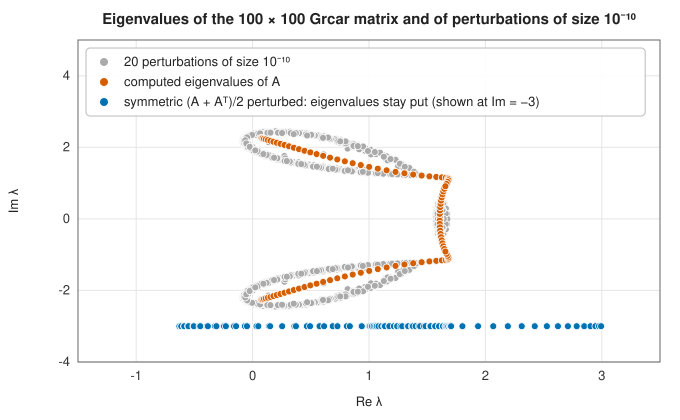
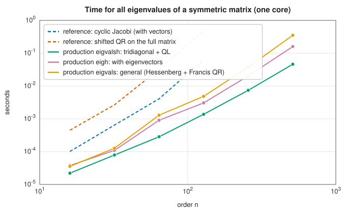

# Symmetric and general eigensolvers

<div class="entry-summary">

| | |
|---|---|
| **Problem** | Compute all eigenvalues, and optionally eigenvectors, of a dense Hermitian (real symmetric) or general square matrix, real or complex |
| **Devised by** | Householder tridiagonalisation: Alston Householder (1958), Wallace Givens (1954, by rotations); the implicit QL algorithm: Hilary Bowdler, Roger Martin, Christian Reinsch and James Wilkinson (1968); Hessenberg reduction and the implicit double-shift QR step: John Francis (1961); balancing: Beresford Parlett and Christian Reinsch (1969) |
| **Accuracy** | Backward stable: the eigenvalues of $A + \delta A$ with $\|\delta A\| \approx \varepsilon\|A\|$. For Hermitian matrices this bounds the eigenvalue errors by $\varepsilon\|A\|$; for non-normal matrices the errors can be much larger |
| **Cost** | Hermitian: $\tfrac43n^3$ flops for eigenvalues, about $9n^3$ with vectors. General: about $10n^3$ for eigenvalues, $25n^3$ with vectors |
| **API** | [`Eigh`](../../api/lib_jsl_linalg/trait.Eigh.html), [`EigValsh`](../../api/lib_jsl_linalg/trait.EigValsh.html), [`Eig`](../../api/lib_jsl_linalg/trait.Eig.html), [`EigVals`](../../api/lib_jsl_linalg/trait.EigVals.html) |

</div>

## Overview

The QR algorithm of the [previous entry](eigen-iterations.md) is the core of every dense eigensolver, but
applied to a full matrix it costs $O(n^3)$ per step. Production codes add three ingredients. A one-time
**reduction** by orthogonal similarity to tridiagonal form (Hermitian) or upper Hessenberg form (general)
makes each QR step $O(n)$ or $O(n^2)$, because the QR algorithm preserves these forms. **Implicit** shifted steps
apply the shift without ever forming $A - \mu I$, and for real matrices use complex conjugate pairs of shifts while
staying in real arithmetic. **Balancing** rescales a general matrix to reduce its norm before iterating.

Symmetric and general problems behave very differently. Hermitian matrices have real eigenvalues and an
orthonormal basis of eigenvectors, and their eigenvalues are perfectly conditioned: a perturbation of size
$\delta$ moves them by at most $\delta$. General matrices can have complex eigenvalues, may lack a full set of eigenvectors,
and their eigenvalues can be extraordinarily sensitive to perturbations.

## History

Wallace Givens (1954) reduced symmetric matrices to tridiagonal form by rotations, and Alston Householder
(1958) by reflections, at half the cost. The tridiagonal QL algorithm, the QR algorithm run from the bottom
up, was published with ALGOL procedures by Hilary Bowdler, Roger Martin, Christian Reinsch and James Wilkinson
in 1968, in the series that became the *Handbook for Automatic Computation* (1971) and then the EISPACK library.
John Francis's 1961 papers already contained the Hessenberg reduction and the implicit double-shift step for
real matrices. Beresford Parlett and Christian Reinsch (1969) introduced balancing. LAPACK (1992) blocked the
reductions; Karen Braman, Ralph Byers and Roy Mathias (2002) introduced the small-bulge multishift QR algorithm
with aggressive early deflation, which makes LAPACK much faster on large general matrices.

## The idea

### Hermitian matrices: tridiagonalisation and QL

The [QR algorithm](eigen-iterations.md#the-qr-algorithm) applied to a full matrix costs $O(n^3)$
per step. Production solvers avoid that with a two-phase plan: first transform the matrix, once
and in a finite number of operations, to a form with many zeros that the QR algorithm preserves;
then iterate cheaply on that form.

**Phase one: reduction to tridiagonal form.** It would be ideal to reduce the matrix straight to
diagonal form, but no finite sequence of operations can do that (it would amount to a formula
for the roots of a polynomial). The next best thing is **tridiagonal** form, nonzero only on the
main diagonal and the two diagonals beside it. [Householder reflections](qr.md#householder-reflections)
achieve it. In the QR factorisation a reflection applied from the left zeroes a column below the
diagonal. Here each reflection must be applied from both sides, $H A H$, to keep the
transformation a similarity, and so it is designed to zero the column below the *sub*diagonal;
applying it from the right then leaves those zeros intact and, by symmetry, zeroes the matching
part of the row. After $n - 2$ reflections $Q^{\mathsf H}AQ = T$ is tridiagonal, at a cost of
$\tfrac43n^3$ flops. For a complex Hermitian matrix, a diagonal unitary scaling then makes the
off-diagonal of $T$ real and non-negative, so the rest of the work is in real arithmetic.

**Phase two: iteration on the tridiagonal matrix.** A shifted QR step applied to a tridiagonal
matrix gives another tridiagonal matrix, and it can be carried out with $n - 1$ plane (Givens)
rotations in $O(n)$ operations instead of $O(n^3)$. The library uses the **implicit QL algorithm**,
a variant that works from the opposite corner of the matrix. "Implicit" means that the shift is
never actually subtracted from the diagonal: the first rotation is computed from the shifted
matrix, and the remaining rotations are determined by the requirement to restore tridiagonal
form, which they do by chasing a single unwanted nonzero entry along the diagonal and off the
end. About two steps per eigenvalue are needed, as before.

The eigenvectors of $A$ are $Q$ times the product of the rotations. $Q$ is accumulated in blocks
(in the compact WY form, which represents a product of reflections so that it can be applied by
matrix multiplications), and the product is formed with the matrix-multiply kernel.

### General matrices: Hessenberg reduction and Francis's algorithm

A nonsymmetric matrix is handled by the same two-phase plan, with three complications.

**The reduced form is Hessenberg.** Without symmetry, the reflections that zero a column below
the subdiagonal do nothing for the corresponding row. The result is **upper Hessenberg** form:
zero below the first subdiagonal, full above. The QR algorithm preserves this form too, and a
step costs $O(n^2)$.

**Real matrices can have complex eigenvalues.** They come in conjugate pairs. A real shift can
never converge to a complex eigenvalue, and a complex shift would force the whole computation
into complex arithmetic. **Francis's double-shift step** resolves the dilemma by taking two steps
at once, with a conjugate pair of shifts $\mu_1, \mu_2$, the eigenvalues of the trailing
$2 \times 2$ block. The combined effect of the two steps is governed by the matrix
$(H - \mu_1I)(H - \mu_2I)$, which is real because the shifts are conjugates. The step is carried
out implicitly: compute only the first column of that product, apply a $3 \times 3$ reflection
determined by it, which disturbs the Hessenberg form with a small "bulge" of unwanted nonzeros,
and chase the bulge down the matrix with further reflections until it falls off the bottom. A
result called the **implicit Q theorem** guarantees that the outcome is the same as two explicit
shifted QR steps, although no complex number ever appears.

**The limit is triangular, not diagonal.** A nonsymmetric matrix cannot in general be
diagonalised by an orthogonal similarity, but it can always be made upper triangular. In real
arithmetic the iteration converges to the **real Schur form**, which is "quasi-triangular": its
diagonal carries $1 \times 1$ blocks for real eigenvalues and $2 \times 2$ blocks for complex pairs.
The library then triangularises each $2 \times 2$ block to obtain the complex **Schur form**
$A = ZTZ^{\mathsf H}$, with $T$ upper triangular and the eigenvalues on its diagonal. (Complex input
matrices use single shifts and Givens rotations throughout.) The eigenvectors of a triangular
matrix follow by back substitution, and multiplying by $Z$ maps them back to eigenvectors of $A$.

### Balancing

The rounding errors of the QR algorithm are proportional to $\|A\|$. **Balancing** replaces $A$ by $D^{-1}AD$ for a diagonal $D$
chosen so that each row and the corresponding column have similar norms. With the entries of $D$ powers of 2 the
eigenvalues are unchanged, not even rounded, and the norm can fall by many orders of magnitude. It matters most for
badly scaled matrices: without it, this library's solver returned 18 zeros and a wild complex pair for the companion
matrix of Wilkinson's polynomial ([polynomial roots](../root_finding/polynomial-roots.md#balancing)); it is
now always applied, as in LAPACK's `geev`.

### Accuracy and conditioning

Both solvers are backward stable:

{{#include ../generated/linear_algebra/eigen_accuracy.md}}

For Hermitian matrices, backward stability guarantees accurate eigenvalues, because eigenvalues of Hermitian matrices
move by no more than the perturbation (Weyl's theorem). For **non-normal** matrices there is no such guarantee: the
sensitivity of an eigenvalue is measured by the angle between its left and right eigenvectors, and can be enormous. The
Grcar matrix, a Toeplitz matrix with $-1$ on the subdiagonal and $1$ on the diagonal and three superdiagonals, is the classic
example:



Perturbations of size $10^{-10}$ move its eigenvalues by up to $0.4$, and even the computed eigenvalues of the unperturbed matrix
are those of a matrix within rounding error of it. The eigenvalues of its symmetric part, on the other hand, do not move
visibly. For non-normal matrices the **pseudospectra**, the sets of eigenvalues of all nearby matrices, are often more
meaningful than the eigenvalues themselves.

### Speed



The reduction to tridiagonal form makes the production symmetric solver roughly two orders of magnitude faster than the
reference QR algorithm on the full matrix at $n = 128$. Against OpenBLAS's LAPACK, the symmetric solver is about as fast, and the general
solver is as fast for small matrices but 2.5 times slower at $n = 256$, for want of multishift QR with aggressive early
deflation ([issue #9](https://github.com/jwkunz/lib_jsl/issues/9)).

## Algorithm

**`eigh`**, for a Hermitian matrix.

1. **Tridiagonalise.** Apply $n - 2$ Householder reflections from both sides, giving
   $Q^{\mathsf H}AQ = T$.
2. **Make $T$ real.** For a complex matrix, scale by a diagonal unitary matrix $D$ so that the
   off-diagonal entries become real and non-negative.
3. **Diagonalise $T$** by the implicit QL algorithm with shifts. If eigenvectors are wanted,
   accumulate the rotations into a matrix $Z$. Whenever an off-diagonal entry becomes negligible
   the problem splits there.
4. **Sort** the eigenvalues into ascending order, permuting the columns of $Z$ to match.
5. **Form the eigenvectors** as the product $QDZ$.

**`eig`**, for a general matrix.

1. **Balance** by a diagonal similarity with powers of 2.
2. **Reduce to Hessenberg form** by Householder reflections, accumulating them into $Z$.
3. **Iterate to Schur form.** Apply Francis double-shift steps (real matrices) or single-shift
   steps (complex matrices). After each step, set negligible subdiagonal entries to zero; when
   the trailing $1 \times 1$ or $2 \times 2$ block separates, deflate it and continue on the rest.
4. **Triangularise** each remaining $2 \times 2$ block, which holds a complex conjugate pair, to
   obtain the complex Schur form $A = ZTZ^{\mathsf H}$. The diagonal of $T$ holds the eigenvalues.
5. **Eigenvectors of $T$.** For each eigenvalue $t_{kk}$, solve the triangular system
   $(T - t_{kk}I)\mathbf y = \mathbf 0$ by back substitution, with $y_k = 1$ and zeros below.
6. **Map back**: multiply by $Z$, undo the balancing, and normalise each vector.

Both solvers cost $O(n^3)$: about $\tfrac43n^3$ flops for the tridiagonal reduction and
$\tfrac{10}3n^3$ for the Hessenberg reduction, plus the iteration and the accumulation of
vectors.

## Implementation

The implicit QL algorithm for the tridiagonal matrix (after Numerical Recipes' `tqli`, with the norm-relative deflation test of
EISPACK's `tql2`, without which the iteration failed on rank-deficient matrices such as the centred kernel matrices of
[kernel PCA](../unsupervised/pca.md#kernel-pca)):

```rust,ignore
{{#include ../../../crates/linalg/src/eigh.rs:tql}}
```

Balancing:

```rust,ignore
{{#include ../../../crates/linalg/src/eig.rs:balance}}
```

- `eigh(uplo)` reads one triangle and returns ascending eigenvalues and orthonormal eigenvectors; `eigvalsh` skips the vectors.
- `eig` returns complex eigenvalues (in Schur order) and unit-norm complex eigenvectors for real or complex input; `eigvals` skips
  the vectors.

## In practice

```rust,ignore
{{#include ../../../crates/linalg_reference/examples/linalg_eigen.rs}}
```

**Strengths**

- Complete, backward-stable dense eigensolvers for real and complex, Hermitian and general matrices.
- The Hermitian solver matches LAPACK's speed.

**Weaknesses**

- The general solver lacks multishift QR and aggressive early deflation, and falls behind LAPACK for large matrices.
- No generalised eigenproblem ($A\mathbf v = \lambda B\mathbf v$; for symmetric positive definite $B$, reduce with the Cholesky factor of $B$), and no
  iterative methods for a few eigenvalues of large sparse matrices.
- Eigenvalues of non-normal matrices may be inaccurate, as for any method.

## Exercises

1. Show that the QR algorithm preserves upper Hessenberg form and symmetric tridiagonal form.
2. Count the flops of Householder tridiagonalisation.
3. Compute the eigenvalues of the companion matrix of $\prod_{k=1}^{20}(x - k)$ with and without balancing, and explain the difference.
4. Compute the condition numbers $1/|\mathbf y^{\mathsf H}\mathbf x|$ (with unit left and right eigenvectors) of the eigenvalues of the Grcar matrix.
5. Solve the generalised problem $K\mathbf v = \omega^2M\mathbf v$ for a mass-spring system with non-uniform masses by transforming with $M^{-1/2}$.

<details>
<summary>Hints and answers</summary>

1. If $A_k = QR$ is upper Hessenberg, $R$ is upper triangular and $Q$ is upper Hessenberg, so $RQ$ is upper Hessenberg. In the symmetric case the result is symmetric and Hessenberg, hence tridiagonal.
2. Reducing a symmetric matrix to tridiagonal form with Householder reflections costs about $\tfrac43n^3$ flops (without forming $Q$); count the cost of the reflection at step $k$ (about $4(n - k)^2$) and sum.
3. The companion matrix of $W$ has entries spanning many orders of magnitude, so its eigenvalues are very sensitive to rounding. Balancing scales rows and columns to reduce the norm and typically improves the accuracy of the eigenvalues noticeably; compare the errors with and without it.
4. The Grcar matrix is highly non-normal and its eigenvalues are very ill-conditioned: expect condition numbers that grow rapidly with the dimension, even though the matrix is only a banded Toeplitz matrix.
5. With $\mathbf y = M^{1/2}\mathbf v$, $K\mathbf v = \omega^2M\mathbf v$ becomes $(M^{-1/2}KM^{-1/2})\mathbf y = \omega^2\mathbf y$, a symmetric standard eigenproblem; transform the eigenvectors back by $\mathbf v = M^{-1/2}\mathbf y$.

</details>

## Further reading

- J. H. Wilkinson, *The Algebraic Eigenvalue Problem*, Oxford University Press, 1965.
- J. H. Wilkinson and C. Reinsch, *Handbook for Automatic Computation, Volume II: Linear Algebra*, Springer, 1971.
- D. S. Watkins, *The Matrix Eigenvalue Problem: GR and Krylov Subspace Methods*, SIAM, 2007.
- K. Braman, R. Byers and R. Mathias, "The multishift QR algorithm. Part II: aggressive early deflation", *SIAM Journal on
  Matrix Analysis and Applications* 23 (2002) 948–973.
- L. N. Trefethen and M. Embree, *Spectra and Pseudospectra*, Princeton University Press, 2005.
