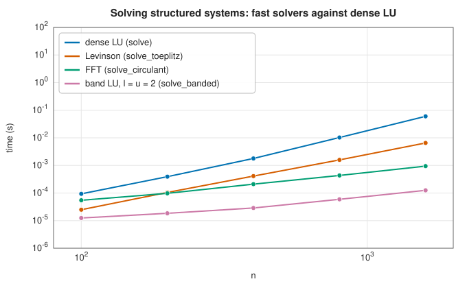

# Generalised eigenproblems and structured matrices

<div class="entry-summary">

| | |
|---|---|
| **Problem** | Solve $A\mathbf x = \lambda B\mathbf x$; build Toeplitz, Hankel, circulant and other structured matrices; and solve linear systems with them faster than $O(n^3)$ |
| **Devised by** | Cleve Moler and G. W. Stewart (1973), the QZ algorithm; Norman Levinson (1947) and William Trench (1964), Toeplitz solvers; James Cooley and John Tukey (1965), the FFT; Jacques Hadamard (1893) and James Sylvester (1867), Hadamard matrices |
| **Accuracy** | Generalised eigenvalues and eigenvectors agree with SciPy (LAPACK) to $2 \times 10^{-14}$; constructors exactly; fast solvers to $10^{-15}$–$10^{-12}$ |
| **Cost** | `eigh_generalized`: a Cholesky factorisation and two triangular solves, about $\tfrac73n^3$, plus `eigh`; `qz`/`eig_generalized`: about $30n^3$–$66n^3$; `solve_toeplitz`: $4n^2$; `solve_circulant`: three FFTs, $O(n\log n)$; `solve_banded`: $O(n\,l(l + u))$; `solveh_banded`: $O(nw^2)$ |
| **Read first** | [Symmetric and general eigensolvers](eigensolvers.md), [Cholesky factorisation](cholesky.md), [Further factorisations](factorizations.md) |
| **API** | [`eigh_generalized`](../../api/lib_jsl_linalg/fn.eigh_generalized.html), [`eig_generalized`](../../api/lib_jsl_linalg/fn.eig_generalized.html), [`qz`](../../api/lib_jsl_linalg/fn.qz.html), [`toeplitz`](../../api/lib_jsl_linalg/fn.toeplitz.html), [`hankel`](../../api/lib_jsl_linalg/fn.hankel.html), [`circulant`](../../api/lib_jsl_linalg/fn.circulant.html), [`solve_toeplitz`](../../api/lib_jsl_linalg/fn.solve_toeplitz.html), [`solve_circulant`](../../api/lib_jsl_linalg/fn.solve_circulant.html), [`solve_banded`](../../api/lib_jsl_linalg/fn.solve_banded.html), [`solveh_banded`](../../api/lib_jsl_linalg/fn.solveh_banded.html), and the constructors `hadamard`, `block_diag`, `companion`, `pascal`, `invpascal`, `hilbert`, `invhilbert`, `leslie`, `dft`, `convolution_matrix`, `fiedler` |

</div>

## Overview

**Generalised eigenproblems** $A\mathbf x = \lambda B\mathbf x$ are the natural form of many physical problems. In vibration analysis $K\mathbf x = \omega^2M\mathbf x$, with stiffness $K$ and mass $M$.
The finite element method gives such pairs, and so does every linear DAE $B\dot{\mathbf x} = A\mathbf x$. Multiplying by $B^{-1}$ reduces the problem to a standard one, but it destroys
symmetry, loses accuracy when $B$ is ill-conditioned, and fails when $B$ is singular. In that last case the pencil has **infinite eigenvalues**, which are legitimate and
correspond to algebraic constraints. The library offers:

- `eigh_generalized` for $A$ Hermitian and $B$ positive definite, by a Cholesky reduction that keeps symmetry. The eigenvectors are $B$-orthonormal.
- `qz` and `eig_generalized` for general pencils, by the QZ algorithm. It works with $A$ and $B$ together, never inverts $B$, and returns infinite eigenvalues as such.

**Structured matrices** are determined by $O(n)$ numbers instead of $n^2$:

- **Toeplitz** matrices, constant along diagonals, from stationary processes and convolutions;
- **Hankel** matrices, constant along anti-diagonals, from moment problems and system identification;
- **circulant** matrices, the periodic convolutions;
- **banded** matrices, from finite differences and splines.

Exploiting the structure brings an $O(n^3)$ solve down to $O(n^2)$ (Levinson), $O(n\log n)$ (FFT) or $O(n)$ (band LU), and the storage down likewise.

## History

Kronecker and Weierstrass (1860s–1890) classified matrix pencils $A - \lambda B$, including their infinite eigenvalues. The first stable algorithm was Cleve Moler and G. W. Stewart's **QZ
algorithm** (1973). It applies the QR algorithm to $AB^{-1}$ implicitly, with unitary transformations on the left ($Q$) and right ($Z$), and became EISPACK's `qzhes`/`qzit` and later LAPACK's `gges`.

Norman Levinson (1947) solved the symmetric Toeplitz systems of Wiener's prediction theory in $O(n^2)$ operations. James Durbin (1960) specialised it to Yule-Walker equations,
and William Trench (1964) and Shalhav Zohar (1969) extended it to nonsymmetric matrices. The FFT of James Cooley and John Tukey (1965) made circulant systems cost $O(n\log n)$, and
superfast Toeplitz solvers built on it followed. James Sylvester (1867) constructed the Hadamard matrices of order $2^k$. Jacques Hadamard (1893) showed that they attain the largest
possible determinant among matrices with entries of modulus at most 1.

## The idea

### Symmetric-definite pencils: Cholesky reduction

If $B = LL^{\mathsf H}$, then $A\mathbf x = \lambda B\mathbf x$ is equivalent to

$$
C\mathbf y = \lambda\mathbf y, \qquad C = L^{-1}AL^{-\mathsf H}, \qquad \mathbf x = L^{-\mathsf H}\mathbf y .
$$

$C$ is Hermitian, so its eigenvalues are real and its eigenvectors orthonormal. The $\mathbf x$ are then $B$-orthonormal, $X^{\mathsf H}BX = I$, which is the normalisation that LAPACK's `sygv`
and SciPy's `eigh(a, b)` return. The method is stable when $B$ is well conditioned. Its accuracy degrades with $\kappa(B)$, since $L^{-1}$ appears twice.

### The QZ algorithm

For a general pencil, QZ computes the **generalised Schur form**: unitary $Q$ and $Z$ with

$$
A = QSZ^{\mathsf H}, \qquad B = QTZ^{\mathsf H}, \qquad S, T \text{ upper triangular},
$$

so that $\det(A - \lambda B) = \prod_i(S_{ii} - \lambda T_{ii})$, and the eigenvalues are $\lambda_i = S_{ii}/T_{ii}$. They are written as the pair $(\alpha_i, \beta_i) = (S_{ii}, T_{ii})$, so that
$\beta_i = 0$, an infinite eigenvalue, causes no division. It proceeds in three steps:

1. **Triangularise $B$** by a QR factorisation, $B = Q_0R_0$, and replace $A$ by $Q_0^{\mathsf H}A$.
2. **Hessenberg-triangular reduction.** Givens rotations from the left zero $A$ below its subdiagonal, column by column from the bottom. Each one creates a single nonzero just below $B$'s diagonal,
   which a rotation from the right removes. That rotation leaves $A$'s new zero intact.
3. **QZ sweeps.** These are the implicitly shifted QR algorithm applied to $ST^{-1}$, without forming it. The shift $\sigma$ is the eigenvalue of the trailing $2 \times 2$ pencil closer to $S_{mm}/T_{mm}$.
   A left rotation determined by $(S_{ll} - \sigma T_{ll}, S_{l+1,l})$ creates a bulge, which alternating right and left rotations chase down to the bottom. When a subdiagonal entry of $S$
   becomes negligible, the problem splits.

A zero on the diagonal of $T$ is an infinite eigenvalue. Rotations from the left move the zero down to the bottom row, each followed by a right rotation that restores $S$'s Hessenberg form, and a final rotation
deflates it. The library works in complex arithmetic, which needs only single shifts. Like LAPACK's `zhgeqz`, it makes the diagonal of $T$ real and non-negative.

Right eigenvectors follow from the triangular pencil. $(\beta_kS - \alpha_kT)\mathbf y = \mathbf 0$ is solved by back substitution with $y_k = 1$, then $\mathbf x = Z\mathbf y$ is normalised to unit
length, as SciPy normalises.

### Toeplitz systems: Levinson recursion

For a Toeplitz matrix $T_{ij} = t_{i-j}$, every leading principal submatrix $T_m$ is again Toeplitz, and so is the reversed matrix $JT_mJ$, with $J$ the reversal. Levinson's recursion grows the solution
of $T_m\mathbf x_m = \mathbf b_m$ one size at a time. Alongside it, it keeps the solutions $\mathbf g_m$, $\mathbf h_m$ of two auxiliary systems whose right-hand sides are the next column and row of $T$. Extending to size
$m + 1$ needs only inner products of length $m$ and a few scalar divisions:

$$
\mathbf x_{m+1} = \begin{pmatrix} \mathbf x_m - x_{m+1}\,J\mathbf g_m \\ x_{m+1} \end{pmatrix}, \qquad x_{m+1} = \frac{b_{m+1} - \mathbf r_m^{\mathsf T}\mathbf x_m}{t_0 - \mathbf r_m^{\mathsf T}J\mathbf g_m},
$$

with similar updates for $\mathbf g$ and $\mathbf h$. The total cost is about $4n^2$ operations, against $\tfrac23n^3$ for LU. The recursion divides by quantities that vanish when a leading principal minor is singular. Because it does not pivot,
it can be unstable for indefinite or nearly singular matrices, while it is reliable for positive definite ones.

### Circulant systems: the FFT

A circulant matrix is a polynomial in the cyclic shift, and the DFT diagonalises the cyclic shift. Therefore $C = F^{-1}\operatorname{diag}(F\mathbf c)F$, with $F$ the DFT matrix and $\mathbf c$ the first
column, and

$$
\mathbf x = F^{-1}\bigl(F\mathbf b \oslash F\mathbf c\bigr) ,
$$

which costs three FFTs. The eigenvalues of $C$ are the entries of $F\mathbf c$, so the system is singular when one of them vanishes. The library then returns an error, as SciPy does by default.

### Banded systems

Gaussian elimination on a matrix with $l$ subdiagonals and $u$ superdiagonals creates no fill outside the band, except that row interchanges can widen $U$'s upper band to $l + u$. With
partial pivoting restricted to the $l + 1$ candidate rows, the work is $O(nl(l + u))$ and the storage $O(n(2l + u))$. SciPy's band storage, `ab[u + i − j, j] = A[i, j]`, keeps each diagonal in a row of
`ab`. For a Hermitian positive definite band, Cholesky needs no pivoting and keeps the bandwidth exactly, at half the cost.

## Algorithm

**`eig_generalized(A, B)`:**

1. $B = Q_0R_0$; $S = Q_0^{\mathsf H}A$, $T = R_0$, $Q = Q_0$, $Z = I$.
2. For $j = 1, \dots, n - 2$ and $i = n, \dots, j + 2$: a left rotation on rows $i - 1, i$ zeros $S_{ij}$, then a right rotation on columns $i - 1, i$ zeros $T_{i,i-1}$.
3. Repeat until the active block is empty. Deflate negligible subdiagonal entries of $S$. Chase any zero diagonal entry of $T$ to the bottom and deflate it. Otherwise do a single-shift QZ sweep, using an
   exceptional shift every tenth iteration.
4. Make $T$'s diagonal real and non-negative. Set $\lambda_i = S_{ii}/T_{ii}$ ($\infty$ if $T_{ii} = 0$), and compute the eigenvectors by back substitution.

**`solve_banded((l, u), ab, b)`:** for $k = 1, \dots, n$, pick the largest $|a_{ik}|$ for $k \le i \le k + l$, swap it into row $k$, eliminate the rows below, and update $\mathbf b$. Then back-substitute with
$U$'s band of width $l + u$. Each stored row holds the columns of its current position's window, and moves with the row when it is interchanged.

## Implementation

The QZ algorithm:

```rust,ignore
{{#include ../../../crates/linalg/src/generalized.rs:qz}}
```

The symmetric-definite reduction:

```rust,ignore
{{#include ../../../crates/linalg/src/generalized.rs:eigh_generalized}}
```

Levinson recursion and the FFT solver:

```rust,ignore
{{#include ../../../crates/linalg/src/structured.rs:solve_toeplitz}}
```

```rust,ignore
{{#include ../../../crates/linalg/src/structured.rs:solve_circulant}}
```

- `qz` returns only the complex form (SciPy's `output='complex'`). The real QZ form with $2 \times 2$ blocks is not implemented.
- The Toeplitz solver follows the classic `toeplz`, as SciPy's does, and takes `r = conj(c)` when no first row is given, so that the default matrix is Hermitian.
- `solve_circulant` uses the library's FFT, which handles any length.
- The banded solvers take one right-hand side. SciPy's also accept several columns.

## In practice

The references are from SciPy 1.17.1, written by `book/generator/data/make_genstruct_refs.py`. Generalised eigenproblems, with eigenvectors compared after aligning the arbitrary phase
(or sign) of each:

<p class="caption" id="tab-7-15"><strong>Table 7.15.</strong> Generalised eigenproblems against SciPy.</p>

{{#include ../generated/linear_algebra/generalized_scipy.md}}

The library's complex QZ and LAPACK's real QZ find the same eigenvalues, to the accuracy the pencils allow, and the same eigenvectors up to phase. With $B = \operatorname{diag}(1, 1, 0)$, both report
one infinite eigenvalue and the same two finite ones.

<p class="caption" id="tab-7-16"><strong>Table 7.16.</strong> Structured matrices and fast solvers against SciPy.</p>

{{#include ../generated/linear_algebra/structured_scipy.md}}

The constructors agree exactly. The real Toeplitz solve is identical too, since both follow the same recursion, and the complex one agrees to rounding. The banded solve with pivoting differs by $10^{-12}$. Its matrix has a small diagonal,
so the solution has entries up to 30 for a right-hand side of size 1, and the condition number amplifies the different rounding of the two eliminations.



<p class="caption" id="fig-7-11"><strong>Figure 7.11.</strong> Solving structured systems of size n, against dense LU. Dense LU grows like $n^3$, Levinson like $n^2$, the FFT like $n\log n$ and band LU like $n$. At $n = 1600$ the Toeplitz system takes 6 ms by Levinson against 60 ms by LU, and the banded one 0.1 ms.</p>

**Strengths**

- QZ handles singular and ill-conditioned $B$ and infinite eigenvalues, without ever inverting $B$.
- Generalised eigenvalues and eigenvectors identical to LAPACK's up to rounding (and phase).
- Fast solvers for the common structures, with the same storage conventions as SciPy.

**Weaknesses**

- Unblocked QZ, with no aggressive early deflation: slower than LAPACK for large pencils.
- No real QZ form, and no reordering of the generalised Schur form (`ordqz`).
- Levinson recursion is unstable for indefinite Toeplitz matrices with nearly singular leading sections. Use `solve`, or the circulant preconditioning of iterative solvers, for those.

## Exercises

1. Show that the eigenvalues of a symmetric-definite pencil are real, and that eigenvectors for distinct eigenvalues are $B$-orthogonal.
2. Find the eigenvalues of $A = \begin{pmatrix} 1 & 2 \\ 0 & 3 \end{pmatrix}$, $B = \begin{pmatrix} 1 & 0 \\ 0 & 0 \end{pmatrix}$. What does $\det(A - \lambda B)$ look like?
3. Show that the DFT matrix diagonalises every circulant matrix, and find the eigenvalues of the circulant with first column $(2, -1, 0, \dots, 0, -1)$.
4. Count the operations of Levinson's recursion, and compare with LU for $n = 1000$.
5. For a tridiagonal matrix ($l = u = 1$), how many nonzeros can row interchanges add to $U$? How does this compare with the band of width $l + u$?

<details>
<summary>Hints and answers</summary>

1. With $B = LL^{\mathsf T}$, the eigenvalues are those of the symmetric $L^{-1}AL^{-\mathsf T}$, so they are real. If $A\mathbf x = \lambda B\mathbf x$ and $A\mathbf y = \mu B\mathbf y$, then $\mathbf y^{\mathsf T}A\mathbf x = \lambda\mathbf y^{\mathsf T}B\mathbf x = \mu\mathbf y^{\mathsf T}B\mathbf x$, so $\mathbf y^{\mathsf T}B\mathbf x = 0$ when $\lambda \ne \mu$.
2. $\det(A - \lambda B) = (1 - \lambda)\cdot3$, a polynomial of degree 1 instead of 2. The finite eigenvalue is $\lambda = 1$. The missing degree is the infinite eigenvalue, which QZ reports as $\beta = 0$.
3. The cyclic shift $P$ satisfies $P\mathbf f_k = \omega^k\mathbf f_k$ for the Fourier vectors $\mathbf f_k$, and $C = \sum_jc_jP^j$. The eigenvalues are $2 - 2\cos(2\pi k/n)$, those of the periodic second difference.
4. Each step costs about $4m$ operations, so $\sum_m 4m \approx 2n^2$ for $\mathbf x$, and about as much again for the auxiliary vectors: $4n^2 = 4 \times 10^6$ for $n = 1000$, against $\tfrac23n^3 \approx 6.7 \times 10^8$ for LU.
5. One extra superdiagonal: $U$ has bandwidth 2, which is $l + u$. LAPACK's tridiagonal solver `gtsv` stores exactly that.

</details>

## Further reading

- C. B. Moler and G. W. Stewart, "An algorithm for generalized matrix eigenvalue problems", *SIAM Journal on Numerical Analysis* 10 (1973) 241–256.
- G. H. Golub and C. F. Van Loan, *Matrix Computations*, 4th ed., Johns Hopkins University Press, 2013: section 7.7 (QZ), section 8.7 (symmetric-definite pencils), sections 4.3 and 4.7 (banded and Toeplitz systems).
- N. Levinson, "The Wiener RMS (root mean square) error criterion in filter design and prediction", *Journal of Mathematics and Physics* 25 (1947) 261–278.
- W. F. Trench, "An algorithm for the inversion of finite Toeplitz matrices", *Journal of the Society for Industrial and Applied Mathematics* 12 (1964) 515–522.
- P. J. Davis, *Circulant Matrices*, Wiley, 1979.
- W. H. Press, S. A. Teukolsky, W. T. Vetterling and B. P. Flannery, *Numerical Recipes*, 3rd ed., Cambridge University Press, 2007, section 2.8 (Vandermonde and Toeplitz matrices).
- E. Anderson et al., *LAPACK Users' Guide*, 3rd ed., SIAM, 1999.
