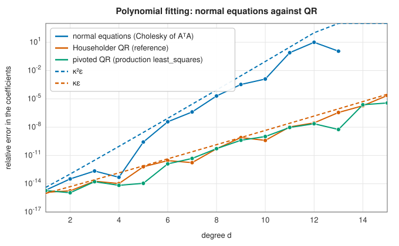

# Linear least squares

<div class="entry-summary">

| | |
|---|---|
| **Problem** | Find $\mathbf x$ minimising $\|A\mathbf x - \mathbf b\|_2$ for an $m \times n$ matrix $A$: the best fit to an overdetermined system, or the minimum-norm solution of an underdetermined or rank-deficient one |
| **Devised by** | Adrien-Marie Legendre (1805) and Carl Friedrich Gauss (1809), least squares and the normal equations; Gene Golub (1965), solution by Householder QR; Eliakim Moore (1920) and Roger Penrose (1955), the pseudoinverse; Golub and William Kahan (1965), solution by the SVD |
| **Accuracy** | QR: backward stable, error $\propto \kappa(A)\varepsilon$ (plus $\kappa^2\varepsilon$ times the relative residual). Normal equations: error $\propto \kappa(A)^2\varepsilon$ |
| **Cost** | QR: $2mn^2 - \tfrac23n^3$ flops. Normal equations: $mn^2 + \tfrac13n^3$. SVD: several times more |
| **Read first** | [QR factorisation](qr.md), [Cholesky factorisation](cholesky.md) |
| **API** | [`LeastSquaresSvd`](../../api/lib_jsl_linalg/trait.LeastSquaresSvd.html) (`least_squares`), [`LeastSquaresResult`](../../api/lib_jsl_linalg/struct.LeastSquaresResult.html); reference: [`least_squares`](../../api/lib_jsl_linalg_reference/least_squares/index.html) (`normal_equations`, `qr_least_squares`) |

</div>

## Overview

When there are more equations than unknowns, as in fitting a model with a few parameters to many
measurements, $A\mathbf x = \mathbf b$ generally has no solution, and the **least-squares** solution minimises the sum of
squared residuals instead. It is the maximum-likelihood estimate when the errors are independent and
Gaussian, and the most widely used method of data fitting. When there are fewer equations than unknowns,
or the columns of $A$ are dependent, there are infinitely many minimisers, and the natural choice is the one
of smallest norm.

There are three standard methods, in increasing order of cost and robustness: the **normal equations**,
**QR factorisation**, and the **singular value decomposition**. The first squares the condition number; the
second does not; the third also handles rank deficiency gracefully.

## History

Adrien-Marie Legendre published the method of least squares in 1805, and Carl Friedrich Gauss in 1809,
claiming priority and justifying it by the normal distribution of errors. Both solved the **normal
equations** $A^{\mathsf T}A\mathbf x = A^{\mathsf T}\mathbf b$ by elimination, and for a century and a half this was the method, done by hand for the
geodetic surveys of Europe. Gene Golub's 1965 paper showed that Householder QR avoids forming $A^{\mathsf T}A$ and
its squared condition number, and made QR the standard. Eliakim Moore (1920) and Roger Penrose (1955)
defined the **pseudoinverse**, which gives the minimum-norm solution, and Golub and William Kahan (1965)
showed how to compute it stably through the SVD.

## The idea

### The normal equations

The problem is to choose $\mathbf x$ to minimise the length of the **residual**
$\mathbf r = \mathbf b - A\mathbf x$, where $A$ is $m \times n$ with $m > n$.

**The geometry.** As $\mathbf x$ varies, $A\mathbf x$ ranges over all combinations of the columns of $A$,
the **column space**, an $n$-dimensional subspace of $\mathbb R^m$. The vector $\mathbf b$ generally
lies outside it. The closest point of a subspace to an outside point is the foot of the
perpendicular, so at the minimum the residual is perpendicular to the column space. That means
it is perpendicular to every column of $A$:

$$
A^{\mathsf T}\mathbf r = A^{\mathsf T}(\mathbf b - A\mathbf x) = \mathbf 0 .
$$

Rearranged, these are the **normal equations** ("normal" in the sense of perpendicular),

$$
A^{\mathsf T}A\,\mathbf x = A^{\mathsf T}\mathbf b ,
$$

a square $n \times n$ system. (The same equations follow from setting the gradient of
$\|\mathbf b - A\mathbf x\|^2$ to zero.)

**An example.** Fit a line $y = c_0 + c_1t$ to the three points $(0, 1)$, $(1, 2)$, $(2, 2)$. Each
point gives one equation, $c_0 + c_1t_i = y_i$:

$$
A = \begin{pmatrix} 1 & 0 \\ 1 & 1 \\ 1 & 2 \end{pmatrix}, \quad \mathbf b = \begin{pmatrix} 1 \\ 2 \\ 2 \end{pmatrix}, \qquad
A^{\mathsf T}A = \begin{pmatrix} 3 & 3 \\ 3 & 5 \end{pmatrix}, \quad A^{\mathsf T}\mathbf b = \begin{pmatrix} 5 \\ 6 \end{pmatrix}.
$$

Solving $3c_0 + 3c_1 = 5$ and $3c_0 + 5c_1 = 6$ gives $c_1 = \tfrac12$ and $c_0 = \tfrac76$. The
residuals are $(-\tfrac16, \tfrac13, -\tfrac16)$; they sum to zero and are orthogonal to
$(0, 1, 2)$, as the normal equations require.

**The catch.** If the columns of $A$ are independent, $A^{\mathsf T}A$ is symmetric positive
definite, and [Cholesky](cholesky.md) solves the system cheaply. But the method has a numerical
flaw: $\kappa(A^{\mathsf T}A) = \kappa(A)^2$. Forming the product squares the
[condition number](lu.md#conditioning), so the solution loses twice as many digits as the
problem itself requires. With $\kappa(A) = 10^6$, a careful method keeps ten digits and the normal
equations keep four. For $\kappa(A) > 10^8$ the squared condition number exceeds $1/\varepsilon$, and the
computed $A^{\mathsf T}A$ may not even be positive definite.

### QR factorisation

The [QR factorisation](qr.md) solves the same problem without ever forming $A^{\mathsf T}A$. The idea
is to rotate the problem into coordinates in which it is trivial.

Write $A = QR$ with $Q$ of size $m \times n$ (the **thin** QR), and let $Q_\perp$ hold $m - n$ further
orthonormal columns that complete $Q$ to a full orthogonal matrix. Multiplying a vector by an
orthogonal matrix does not change its length, so the residual can be measured in the new
coordinates. Its components along the columns of $Q$ are
$Q^{\mathsf T}(A\mathbf x - \mathbf b) = R\mathbf x - Q^{\mathsf T}\mathbf b$, and its components along the columns of
$Q_\perp$ are $-Q_\perp^{\mathsf T}\mathbf b$, because $Q_\perp^{\mathsf T}A = 0$. Hence

$$
\|A\mathbf x - \mathbf b\|^2 = \|R\mathbf x - Q^{\mathsf T}\mathbf b\|^2 + \|Q_\perp^{\mathsf T}\mathbf b\|^2 .
$$

The second term does not depend on $\mathbf x$ at all: it is the part of $\mathbf b$ that no choice of
$\mathbf x$ can reach. The first term can be made exactly zero, by solving the triangular system

$$
R\mathbf x = Q^{\mathsf T}\mathbf b
$$

by back substitution. That is the least-squares solution, and the minimum residual is
$\|Q_\perp^{\mathsf T}\mathbf b\|$. With Householder QR, $Q^{\mathsf T}\mathbf b$ is computed by applying the
reflections to $\mathbf b$, and $Q$ is never formed.

The error of this method is proportional to $\kappa(A)\varepsilon$, not $\kappa(A)^2\varepsilon$. (There is an
additional $\kappa^2\varepsilon$ term multiplied by the relative size of the residual. It is inherent
in the least-squares problem and no method avoids it, but it is small when the fit is good.)

Fitting a polynomial of degree $d$ in the monomial basis, whose Vandermonde matrix becomes more ill-conditioned as $d$
grows, shows the difference:



<p class="caption" id="fig-7-4"><strong>Figure 7.4.</strong> Normal equations against QR.</p>

The normal equations follow $\kappa^2\varepsilon$ and fail outright (Cholesky finds $A^{\mathsf T}A$ indefinite) beyond degree 13; both QR
methods follow $\kappa\varepsilon$. (Better still, fit in an orthogonal basis such as
[Chebyshev polynomials](../interpolation/polynomial.md#chebyshev-series), whose matrix is well conditioned.)

### Rank deficiency and the minimum-norm solution

So far the columns of $A$ were assumed independent. If they are not, so that $A$ has rank
$r < n$, there is some nonzero $\mathbf z$ with $A\mathbf z = \mathbf 0$, and adding any multiple of $\mathbf z$ to
a minimiser gives another minimiser with the same residual. The minimisers form a whole family,
and a rule is needed to choose one. The standard rule is to take the minimiser of smallest norm.

The [singular value decomposition](svd.md) $A = U\Sigma V^{\mathsf T}$ makes this choice explicit. In
the orthonormal bases given by the columns $\mathbf u_i$ of $U$ and $\mathbf v_i$ of $V$, the matrix acts
as a simple scaling: it maps $\mathbf v_i$ to $\sigma_i\mathbf u_i$. To undo it, take the component of
$\mathbf b$ along each $\mathbf u_i$, divide by $\sigma_i$, and place the result along $\mathbf v_i$. The
directions with $\sigma_i = 0$ cannot be undone; they are left out, which is exactly what makes the
solution as short as possible:

$$
\mathbf x = A^+\mathbf b = \sum_{i=1}^{r}\frac{\mathbf u_i^{\mathsf T}\mathbf b}{\sigma_i}\,\mathbf v_i .
$$

The matrix $A^+$ defined by this formula is the **pseudoinverse** of $A$.

Numerically, rank is a matter of degree. Rounding turns singular values that should be exactly
zero into tiny nonzero numbers, and dividing by them would give a huge, meaningless solution.
Singular values below a threshold, here $\max(m, n)\,\varepsilon\,\sigma_1$, are therefore treated as zero.

The library's `least_squares` combines the methods. It factorises with **pivoted QR** and, if the diagonal of $R$ shows
full column rank, solves by back substitution. Otherwise, or when the system is underdetermined, it uses the SVD
and returns the minimum-norm solution. It reports the numerical rank, the singular values and the residual sum of
squares:

<p class="caption" id="tab-7-5"><strong>Table 7.5.</strong> Least squares on rank-deficient systems.</p>

{{#include ../generated/linear_algebra/rank_deficient.md}}

On the full-rank path, the singular values used to be computed as the square roots of the eigenvalues of $R^{\mathsf H}R$,
which reintroduces the squared condition number. For a matrix with singular values $1$, $10^{-5}$ and $10^{-10}$ the
smallest came out as $3.5 \times 10^{-9}$. They now come from the SVD of $R$.

## Algorithm

`least_squares(A, b)`, for an $m \times n$ matrix $A$:

1. **Overdetermined or square** ($m \ge n$). Factor $AP = QR$ by Householder QR with column
   pivoting, and apply the reflections to $\mathbf b$ to get $\mathbf c = Q^{\mathsf H}\mathbf b$.
2. **Test the rank.** The diagonal of $R$ decreases in magnitude. If every
   $|r_{ii}| > 10^3\max(m, n)\,\varepsilon\,|r_{11}|$, the matrix has full column rank numerically: go
   to step 3. Otherwise go to step 4.
3. **Full rank.** Solve the triangular system $R\mathbf z = \mathbf c_{1:n}$ by back substitution and
   undo the column permutation, $\mathbf x = P\mathbf z$. The residual sum of squares is the squared norm
   of the remaining components $\mathbf c_{n+1:m}$, and the singular values reported are those of
   $R$, from its SVD. Done.
4. **Rank deficient or underdetermined** ($m < n$, or the test failed). Compute the thin SVD
   $A = U\Sigma V^{\mathsf H}$. Count as the rank $r$ the singular values above
   $\max(m, n)\,\varepsilon\,\sigma_1$. Return the minimum-norm solution
   $\mathbf x = \sum_{i\le r}\sigma_i^{-1}(\mathbf u_i^{\mathsf H}\mathbf b)\,\mathbf v_i$.

The full-rank path costs one QR factorisation; the other costs one SVD, several times more.

## Implementation

The normal equations (reference):

```rust,ignore
{{#include ../../../crates/linalg_reference/src/least_squares.rs:normal_equations}}
```

The production solver:

```rust,ignore
{{#include ../../../crates/linalg/src/mod.rs:least_squares}}
```

- Works for real and complex matrices.
- For weighted least squares, scale each row of $A$ and $\mathbf b$ by the square root of its weight; for nonlinear models, see
  [nonlinear least squares](../optimization/least-squares.md).

## In practice

```rust,ignore
{{#include ../../../crates/linalg_reference/examples/linalg_least_squares.rs}}
```

**Strengths**

- Backward-stable QR for full-rank problems, the SVD for rank-deficient ones, chosen automatically.
- Reports the rank and singular values, which diagnose ill-conditioning.

**Weaknesses**

- Dense: very large or sparse problems need iterative methods (LSQR, conjugate gradients on the normal equations).
- The rank threshold is a judgement: noisy data may need a larger threshold (truncated SVD) or regularisation.

## Exercises

1. Derive the normal equations by setting the gradient of $\|A\mathbf x - \mathbf b\|^2$ to zero.
2. Show that $\kappa_2(A^{\mathsf T}A) = \kappa_2(A)^2$ using the SVD.
3. Show that the minimum-norm solution is orthogonal to the null space of $A$.
4. Fit a degree-15 polynomial on $[0, 1]$ in the monomial and in the Chebyshev basis, and compare the condition numbers and
   the errors.
5. Add Tikhonov regularisation, $\min\|A\mathbf x - \mathbf b\|^2 + \lambda^2\|\mathbf x\|^2$, by augmenting $A$ with $\lambda I$, and study the effect of $\lambda$ on an ill-conditioned fit.

<details>
<summary>Hints and answers</summary>

1. $\nabla\|A\mathbf x - \mathbf b\|^2 = 2A^{\mathsf T}(A\mathbf x - \mathbf b) = 0$ gives $A^{\mathsf T}A\mathbf x = A^{\mathsf T}\mathbf b$.
2. With $A = U\Sigma V^{\mathsf T}$, $A^{\mathsf T}A = V\Sigma^2V^{\mathsf T}$, whose singular values are $\sigma_i^2$, so $\kappa_2(A^{\mathsf T}A) = \sigma_1^2/\sigma_n^2 = \kappa_2(A)^2$.
3. Any solution is $\mathbf x_0 + \mathbf n$ with $\mathbf n$ in the null space. The minimum-norm solution has no component in the null space, i.e. it lies in its orthogonal complement, the row space of $A$.
4. The monomial Vandermonde matrix on $[0, 1]$ with degree 15 has a condition number far above $10^{10}$ (and many digits are lost); the Chebyshev basis on the same interval has a condition number of order 10, and the fit is accurate to nearly rounding level.
5. The least-squares solution of $\begin{pmatrix}A\\ \lambda I\end{pmatrix}\mathbf x \approx \begin{pmatrix}\mathbf b\\ \mathbf 0\end{pmatrix}$ minimises $\|A\mathbf x - \mathbf b\|^2 + \lambda^2\|\mathbf x\|^2$. Plot the residual norm against the solution norm as $\lambda$ varies (the L-curve).

</details>

## Further reading

- G. H. Golub, "Numerical methods for solving linear least squares problems", *Numerische Mathematik* 7 (1965)
  206–216.
- Å. Björck, *Numerical Methods for Least Squares Problems*, SIAM, 1996.
- C. L. Lawson and R. J. Hanson, *Solving Least Squares Problems*, Prentice-Hall, 1974 (SIAM reprint, 1995).
- L. N. Trefethen and D. Bau, *Numerical Linear Algebra*, SIAM, 1997, lectures 11, 18 and 19.
