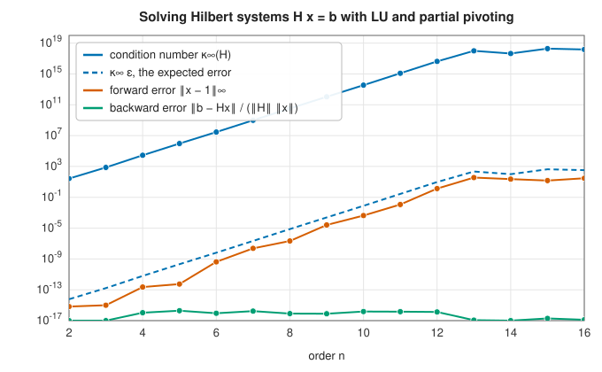
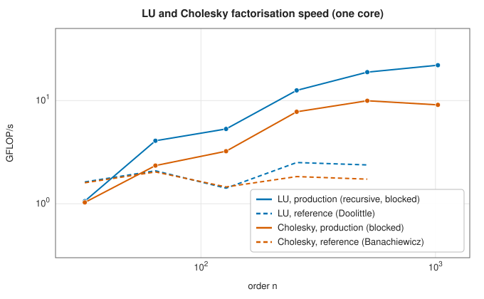

# Gaussian elimination and LU factorisation

<div class="entry-summary">

| | |
|---|---|
| **Problem** | Solve a square linear system $A\mathbf x = \mathbf b$; factor $PA = LU$ to solve many systems, compute the determinant, or invert $A$ |
| **Devised by** | Elimination: Chinese mathematicians of the *Nine Chapters* (around 200 BC), Carl Friedrich Gauss (1809); the factorisation: Myrick Doolittle (1878), Prescott Crout (1941), Alan Turing (1948); error analysis: John von Neumann and Herman Goldstine (1947), James Wilkinson (1961); recursive LU: Sivan Toledo (1997) |
| **Accuracy** | Backward stable in practice with partial pivoting: the computed solution solves a system perturbed by a small multiple of $\varepsilon$ times the growth factor, which is almost always small |
| **Cost** | $\tfrac23n^3$ flops to factor, $2n^2$ per right-hand side, $2n^3$ for the inverse |
| **API** | [`Solve`](../../api/lib_jsl_linalg/trait.Solve.html), [`Factorize`](../../api/lib_jsl_linalg/trait.Factorize.html), [`LuFactorization`](../../api/lib_jsl_linalg/struct.LuFactorization.html), [`Determinant`](../../api/lib_jsl_linalg/trait.Determinant.html), [`Inverse`](../../api/lib_jsl_linalg/trait.Inverse.html), [`SolveTriangular`](../../api/lib_jsl_linalg/trait.SolveTriangular.html); reference: [`gaussian_elimination`](../../api/lib_jsl_linalg_reference/gaussian_elimination/index.html), [`lu`](../../api/lib_jsl_linalg_reference/lu/index.html) |

</div>

## Overview

**Gaussian elimination** solves $A\mathbf x = \mathbf b$ by subtracting multiples of each equation from the ones below it
until the system is upper triangular, then solving that from the bottom up. It is the oldest
algorithm in numerical linear algebra and still the method of choice for dense square systems.
Recorded properly, elimination computes a factorisation $PA = LU$ into a permutation, a unit lower
triangular matrix of multipliers and an upper triangular matrix. The factorisation is the useful
object: it solves further systems with the same matrix in $O(n^2)$, and gives the determinant for free.

Two refinements make it work on computers. **Partial pivoting**, swapping rows to use the largest
available pivot, makes it stable. **Blocking** reorganises the arithmetic around matrix-matrix
products, which run near the peak speed of modern processors. The reference crate implements the
first, the production crate both.

## History

The *Nine Chapters on the Mathematical Art*, compiled in China around 200 BC, solve systems of up to
five equations by elimination on a counting board, column by column, with the *fangcheng* rule.
Gauss described elimination for the normal equations of least squares in his *Theoria motus* (1809) and
used it in 1810 for the orbit of the asteroid Pallas; his notation made it standard in geodesy and
astronomy. Myrick Doolittle of the
US Coast and Geodetic Survey (1878) organised the hand calculation as a factorisation, and Prescott
Crout (1941) gave the version with a unit upper triangle; Alan Turing (1948) described elimination
explicitly as LU factorisation and introduced the condition number.

When computers arrived, John von Neumann and Herman Goldstine (1947) feared that rounding errors would
make elimination useless beyond a few dozen equations. James Wilkinson (1961) showed, by **backward
error analysis**, that with partial pivoting it is stable unless the elements grow, and that growth is
almost never large in practice, though it can be in contrived examples. The LAPACK project (1992)
blocked the algorithm for cache memories, and Sivan Toledo (1997) proposed the recursive formulation
that LAPACK adopted as `getrf2` and that this library uses.

## The idea

### Gaussian elimination and pivoting

**Elimination by example.** Take the system

$$
\begin{pmatrix} 2 & 1 & 1 \\ 4 & 3 & 3 \\ 8 & 7 & 9 \end{pmatrix}
\begin{pmatrix} x_1 \\ x_2 \\ x_3 \end{pmatrix} =
\begin{pmatrix} 4 \\ 10 \\ 24 \end{pmatrix}.
$$

Subtracting 2 times the first equation from the second, and 4 times the first from the third,
removes $x_1$ from both. Then subtracting 3 times the new second equation from the new third
removes $x_2$ from it:

$$
\left(\begin{array}{ccc|c} 2 & 1 & 1 & 4 \\ 4 & 3 & 3 & 10 \\ 8 & 7 & 9 & 24 \end{array}\right)
\ \to\
\left(\begin{array}{ccc|c} 2 & 1 & 1 & 4 \\ 0 & 1 & 1 & 2 \\ 0 & 3 & 5 & 8 \end{array}\right)
\ \to\
\left(\begin{array}{ccc|c} 2 & 1 & 1 & 4 \\ 0 & 1 & 1 & 2 \\ 0 & 0 & 2 & 2 \end{array}\right).
$$

The system is now **upper triangular**, and can be solved from the bottom up: the last equation
gives $x_3 = 1$, then the second gives $x_2 = 2 - x_3 = 1$, then the first gives
$x_1 = (4 - x_2 - x_3)/2 = 1$. This last stage is **back substitution**.

**In general.** At step $k$, each row $i > k$ is replaced by row $i$ minus
$\ell_{ik} = a_{ik}/a_{kk}$ times row $k$, which zeroes the entries below the diagonal entry
$a_{kk}$, called the **pivot**. The numbers $\ell_{ik}$ are the **multipliers** (2, 4 and 3 in the
example). After $n - 1$ steps $A$ has become an upper triangular matrix $U$ and $\mathbf b$ a vector
$\mathbf c$, and back substitution computes $x_i = (c_i - \sum_{j>i}u_{ij}x_j)/u_{ii}$ for
$i = n, n - 1, \ldots, 1$. Elimination costs about $\tfrac23n^3$ arithmetic operations (flops) and
back substitution $n^2$.

**Why pivoting is needed.** The algorithm divides by the pivot. A zero pivot stops it, even for a
perfectly good system (swap the two equations of $x_2 = 1$, $x_1 = 2$ and nothing is wrong). A
*small* pivot is more insidious: the algorithm runs, and returns a wrong answer. Consider, with
$\varepsilon = 10^{-20}$,

$$
\begin{pmatrix}\varepsilon & 1\\ 1 & 1\end{pmatrix}\mathbf x = \begin{pmatrix}1\\ 2\end{pmatrix},
$$

whose solution is very close to $(1, 1)$. The multiplier is $1/\varepsilon = 10^{20}$, and the second
row becomes $(0,\ 1 - 10^{20} \mid 2 - 10^{20})$. In double precision, with 16 digits, both
$1 - 10^{20}$ and $2 - 10^{20}$ round to $-10^{20}$: the original entries 1 and 2 of the second
equation, which distinguished it from any other, have been wiped out. Back substitution gives
$x_2 = 1$, correctly, and then $x_1 = (1 - x_2)/\varepsilon = 0$, which is completely wrong.

{{#include ../generated/linear_algebra/small_pivot.md}}

**Partial pivoting.** The damage was done by the huge multiplier. The cure is to swap rows before
each step so that the pivot is the largest entry (in magnitude) in its column, on or below the
diagonal. Every multiplier then satisfies $|\ell_{ik}| \le 1$, and multiples of the pivot row can
no longer swamp the rows they are subtracted from. In the example the rows are exchanged, the
multiplier is $\varepsilon$, the second row becomes $(0,\ 1 - \varepsilon \mid 1 - 2\varepsilon)$, and the
computed solution is $(1, 1)$.

**How stable is it?** The right way to state the accuracy of elimination is due to Wilkinson. The
computed solution $\hat{\mathbf x}$ is not the exact solution of the given system, but it is the exact
solution of a *nearby* system, $(A + \delta A)\hat{\mathbf x} = \mathbf b$, with

$$
\frac{\|\delta A\|_\infty}{\|A\|_\infty} \le c\,n^3\rho\,\varepsilon, \qquad \rho = \frac{\max_{i,j,k}|a_{ij}^{(k)}|}{\max_{i,j}|a_{ij}|}.
$$

Here $\varepsilon$ is the machine epsilon, $c$ a modest constant, and $a_{ij}^{(k)}$ the entries of the
matrix after $k$ steps. An algorithm with this property, giving the exact answer to a slightly
perturbed problem, is called **backward stable**, and $\delta A$ is the **backward error**. The
bound contains the **growth factor** $\rho$, which measures how much larger the entries become
during elimination than they were at the start. Pivoting keeps the multipliers small, but entries
can still grow, because each step can at most double them. In the worst case $\rho = 2^{n-1}$.
Wilkinson's example has 1 on the diagonal and in the last column and $-1$ below the diagonal:
partial pivoting never swaps, and the last column doubles at every step.

{{#include ../generated/linear_algebra/wilkinson_growth.md}}

Such matrices are almost never met in practice: for random matrices the growth is about $n^{2/3}$, and the
error is at the level of rounding, as the last column shows. **Complete pivoting**, which searches
the whole remaining submatrix for the largest entry and swaps columns as well as rows, bounds the
growth far better but costs $O(n^3)$ comparisons and is rarely used.

### LU factorisation

Elimination does more than solve one system. If the multipliers are kept instead of thrown away,
they record everything that was done to $A$. Put them in a lower triangular matrix $L$, with
$\ell_{ik}$ in position $(i, k)$ and ones on the diagonal (a **unit** lower triangular matrix). In
the example,

$$
\underbrace{\begin{pmatrix} 2 & 1 & 1 \\ 4 & 3 & 3 \\ 8 & 7 & 9 \end{pmatrix}}_{A} =
\underbrace{\begin{pmatrix} 1 & 0 & 0 \\ 2 & 1 & 0 \\ 4 & 3 & 1 \end{pmatrix}}_{L}
\underbrace{\begin{pmatrix} 2 & 1 & 1 \\ 0 & 1 & 1 \\ 0 & 0 & 2 \end{pmatrix}}_{U},
$$

as multiplying out confirms. Each row of the product says that a row of $A$ is the matching row
of $U$ plus the multiples of earlier rows that elimination subtracted. With row swaps the
statement becomes $PA = LU$, where $P$ is the permutation matrix that applies all the swaps.

The factorisation separates the expensive part of the work, which depends only on $A$, from the
cheap part, which depends on $\mathbf b$. To solve $A\mathbf x = \mathbf b$:

1. permute the right-hand side, $P\mathbf b$;
2. solve $L\mathbf y = P\mathbf b$ from the top down (**forward substitution**);
3. solve $U\mathbf x = \mathbf y$ from the bottom up (back substitution).

This is correct because $LU\mathbf x = L\mathbf y = P\mathbf b = PA\mathbf x$. The two triangular solves cost
$2n^2$ flops together, against $\tfrac23n^3$ for the factorisation, so each further right-hand
side is almost free.

Two by-products:

- The **determinant** is the product of the pivots, $\det A = \pm\prod_iu_{ii}$, with a minus sign
  if the number of row swaps is odd. In the example, $\det A = 2\cdot1\cdot2 = 4$.
- The **inverse** can be found by solving for each column of the identity. It costs $2n^3$
  flops, three times the factorisation, and is rarely needed: to compute $A^{-1}\mathbf b$, solving
  the system is both more accurate and cheaper than forming the inverse and multiplying.

### Conditioning

Backward stability says that the computed solution exactly solves a nearby problem. It does not
say that the solution is close to the true one. That depends on how sensitive the solution is to
small changes in the data, which is a property of the matrix, not of the algorithm. It is
measured by the **condition number**

$$
\kappa(A) = \|A\|\,\|A^{-1}\|,
$$

and the rule is

$$
\text{relative error in } \mathbf x \ \lesssim\ \kappa(A) \times \text{relative backward error}.
$$

With a backward error near $\varepsilon \approx 10^{-16}$, a matrix with $\kappa = 10^6$ loses about six
of the sixteen digits. The notoriously ill-conditioned **Hilbert matrices**
$H_{ij} = 1/(i + j - 1)$ show both halves of the statement: the error grows exactly as
$\kappa\varepsilon$, while the backward error stays at the level of rounding.



Beyond order 13, $\kappa(H)$ exceeds $1/\varepsilon$: the computed inverse used to estimate it is itself meaningless, and
the "solution" has no correct digits, although it still satisfies the system to rounding accuracy.
A small residual $\mathbf b - A\hat{\mathbf x}$ is therefore not evidence of an accurate solution.

### Blocked and recursive factorisation

The textbook algorithm performs $\tfrac23n^3$ flops as updates of single rows, each reading and writing
memory: on modern processors it runs at the speed of memory, not of arithmetic. Reorganising the same
operations into multiplications of blocks lets each number fetched from memory be used many times.
**Recursive LU** splits the columns in half:

1. factor the left half $\begin{pmatrix}A_{11}\\ A_{21}\end{pmatrix} = \begin{pmatrix}L_{11}\\ L_{21}\end{pmatrix}U_{11}$ recursively, with pivoting;
2. solve $L_{11}U_{12} = A_{12}$ for the top right block;
3. update the bottom right block, $A_{22} \leftarrow A_{22} - L_{21}U_{12}$, with one matrix multiplication;
4. factor the updated $A_{22}$ recursively.

Nearly all the arithmetic is in step 3, at every level of the recursion, so the factorisation runs at
close to the speed of the matrix-multiply kernel. The library factors narrow panels (32 columns) in
column-major order, where the pivot searches run along contiguous memory, and solves triangular
systems in blocks the same way:



On this laptop the reference Doolittle LU stays near 2 GFLOP/s, limited by memory; the recursive LU
reaches about 20 GFLOP/s at $n = 1024$, and LAPACK with OpenBLAS is 1.1 to 1.6 times faster still
([issue #10](https://github.com/jwkunz/lib_jsl/issues/10)).

## Algorithm

**Gaussian elimination with partial pivoting** (reference): for $k = 1, \ldots, n - 1$: find the largest $|a_{ik}|$, $i \ge k$; swap
rows; for each $i > k$, subtract $\ell_{ik}$ times row $k$ from row $i$ (and from $\mathbf b$). Then back substitute.

**Recursive LU** (production): as above, on panels of at most 32 columns factorised in column-major order
with an inner recursion; a singular pivot (below $10^{-3}\varepsilon\max|a_{ij}|$) is reported as an error.

## Implementation

The textbook algorithm:

```rust,ignore
{{#include ../../../crates/linalg_reference/src/gaussian_elimination.rs:partial_pivoting}}
```

Doolittle LU, keeping the multipliers:

```rust,ignore
{{#include ../../../crates/linalg_reference/src/lu.rs:doolittle}}
```

The production recursion:

```rust,ignore
{{#include ../../../crates/linalg/src/lu.rs:recursive_lu}}
```

- All production routines work for `f64` and `Complex<f64>` through the `Scalar` trait.
- `solve` factorises and solves; `factorize` returns an `LuFactorization` to reuse; `solve_t` and `solve_h`
  solve with $A^{\mathsf T}$ and $A^{\mathsf H}$.
- The inverse is computed as $U^{-1}L^{-1}P$, using the triangularity of $L^{-1}$ to save a third of the work, as
  LAPACK's `getri` does.

## In practice

```rust,ignore
{{#include ../../../crates/linalg_reference/examples/linalg_lu.rs}}
```

**Strengths**

- The general-purpose dense solver: stable in practice, $\tfrac23n^3$ flops, near peak speed when blocked.
- The factorisation is reusable, and gives determinants.

**Weaknesses**

- Not guaranteed stable: exponential growth is possible, though almost never met.
- Dense storage and $O(n^3)$ cost: large sparse systems need sparse or iterative methods.
- Ignores structure: use Cholesky for symmetric positive definite matrices, at half the cost.

## Exercises

1. Count the flops of Gaussian elimination and show that the leading term is $\tfrac23n^3$.
2. Show that the inverse of a unit lower triangular matrix is unit lower triangular, and that the
   multipliers of elimination are the entries of $L$.
3. Prove that partial pivoting gives growth factor at most $2^{n-1}$, and that Wilkinson's matrix attains it.
4. Solve $H\mathbf x = \mathbf b$ for the Hilbert matrix of order 10 with $\mathbf b = H\mathbf 1$, perturb one entry of $\mathbf b$ by $10^{-10}$, and
   compare the change in $\mathbf x$ with $\kappa(H)$.
5. Use the factorisation to compute $\det A$ for a random $200 \times 200$ matrix scaled by 10. Why can the determinant
   overflow even when the matrix is well conditioned, and how would you compute $\ln|\det A|$ instead?

## Further reading

- G. H. Golub and C. F. Van Loan, *Matrix Computations*, 4th ed., Johns Hopkins University Press, 2013,
  chapter 3.
- N. J. Higham, *Accuracy and Stability of Numerical Algorithms*, 2nd ed., SIAM, 2002, chapter 9.
- L. N. Trefethen and D. Bau, *Numerical Linear Algebra*, SIAM, 1997, lectures 20–23.
- S. Toledo, "Locality of reference in LU decomposition with partial pivoting", *SIAM Journal on Matrix
  Analysis and Applications* 18 (1997) 1065–1081.
- J. F. Grcar, "Mathematicians of Gaussian elimination", *Notices of the American Mathematical Society*
  58 (2011) 782–792.
