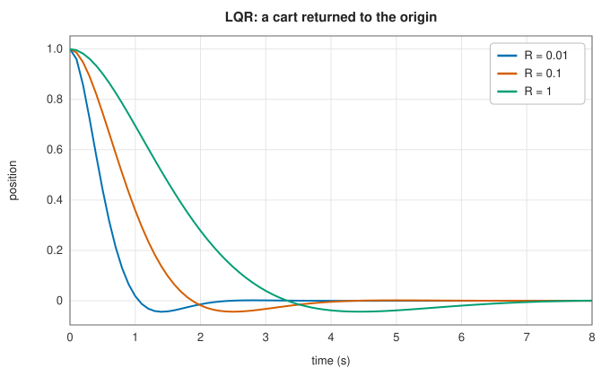

# Matrix functions and matrix equations

<div class="entry-summary">

| | |
|---|---|
| **Problem** | Compute the matrix exponential $e^A$; solve the linear matrix equations of Sylvester ($AX + XB = Q$) and Lyapunov ($AX + XA^{\mathsf H} = Q$, $AXA^{\mathsf H} - X + Q = 0$); find the stabilising solutions of the continuous and discrete algebraic Riccati equations, which give optimal (LQR) controllers and steady-state Kalman filters |
| **Devised by** | James Joseph Sylvester (1884); Aleksandr Lyapunov (1892), stability; Jacopo Riccati (1724); Richard Bartels and G. W. Stewart (1972), the Schur method; Cleve Moler and Charles Van Loan (1978), "nineteen dubious ways"; Nicholas Higham (2005), scaling and squaring; John Roberts (1971), the matrix sign function; David Kleinman (1968) and Gary Hewer (1971), Newton's method; Eric Chu, Hung-Yuan Fan, Wen-Wei Lin and Chern-Shuh Wang (2004), the doubling algorithm |
| **Accuracy** | Agrees with SciPy to $10^{-15}$ for `expm`, Sylvester and Lyapunov, and to $10^{-13}$ for the Riccati equations, with residuals as small as SciPy's |
| **Cost** | `expm`: 6 to 10 matrix products and one LU, plus one product per halving of the norm. Sylvester and Lyapunov: two Schur forms and $O(n^3)$ triangular solves. Riccati: about 10 iterations of $O(n^3)$ each, then 1 to 3 Lyapunov solves |
| **Read first** | [Symmetric and general eigensolvers](eigensolvers.md), [Control: state-space models, PID controllers and the Kalman filter](../comms/controls.md) |
| **API** | [`expm`](../../api/lib_jsl_linalg/fn.expm.html), [`schur_complex`](../../api/lib_jsl_linalg/fn.schur_complex.html), [`solve_sylvester`](../../api/lib_jsl_linalg/fn.solve_sylvester.html), [`solve_continuous_lyapunov`](../../api/lib_jsl_linalg/fn.solve_continuous_lyapunov.html), [`solve_discrete_lyapunov`](../../api/lib_jsl_linalg/fn.solve_discrete_lyapunov.html), [`solve_continuous_are`](../../api/lib_jsl_linalg/fn.solve_continuous_are.html), [`solve_discrete_are`](../../api/lib_jsl_linalg/fn.solve_discrete_are.html) |

</div>

## Overview

Linear systems of differential equations $\dot{\mathbf x} = A\mathbf x$ are solved by the **matrix exponential**: $\mathbf x(t) = e^{At}\mathbf x(0)$. It turns a
continuous-time model into the discrete-time one that a computer simulates or controls, and it is the most used function of a
matrix. Questions about such systems lead to equations whose unknown is itself a matrix:

- the **Sylvester equation** $AX + XB = Q$, linear in $X$;
- the **Lyapunov equations** $AX + XA^{\mathsf H} = Q$ (continuous) and $AXA^{\mathsf H} - X + Q = 0$ (discrete), which give the energy and the
  covariance of a stable system, and prove its stability;
- the **algebraic Riccati equations**, quadratic in $X$, whose solutions give the optimal linear-quadratic regulator and the
  steady-state Kalman filter:

$$
A^{\mathsf H}X + XA - XBR^{-1}B^{\mathsf H}X + Q = 0, \qquad A^{\mathsf H}XA - X - A^{\mathsf H}XB(R + B^{\mathsf H}XB)^{-1}B^{\mathsf H}XA + Q = 0 .
$$

The library follows SciPy's names and conventions for all of them.

## History

The exponential series $e^A = I + A + A^2/2! + \cdots$ is as old as matrices, but computing it well is not: in "Nineteen dubious ways
to compute the exponential of a matrix" (1978), Cleve Moler and Charles Van Loan showed how each obvious method fails on
some matrix. Their recommendation, scaling and squaring with a Padé approximant, became the standard, and Nicholas Higham
(2005) made it precise, choosing the degree and the scaling to reach full accuracy at the least cost; SciPy and MATLAB use his
algorithm and its refinements.

Sylvester studied $AX = XB$ in 1884. Aleksandr Lyapunov's 1892 thesis on the stability of motion introduced the energy functions
that lead to his equation. Richard Bartels and G. W. Stewart (1972) solved both by reducing the coefficients to Schur form, the
method LAPACK and SciPy still use. The quadratic equation is named after Jacopo Riccati's study of a scalar differential
equation (1724); Rudolf Kálmán (1960) showed that its matrix form gives the optimal regulator and filter. David Kleinman (1968)
and Gary Hewer (1971) solved it by Newton's method, John Roberts (1971) by the matrix sign function, and Alan Laub (1979) by
the Schur vectors of the Hamiltonian matrix. The structure-preserving doubling algorithm of Eric Chu, Hung-Yuan Fan, Wen-Wei
Lin and Chern-Shuh Wang (2004) converges quadratically without needing an invertible $A$.

## The idea

### The matrix exponential

The Taylor series converges for every matrix, but summing it in floating point fails when $\|A\|$ is large. The terms
$A^k/k!$ first grow, then shrink, and when their largest value is much larger than the answer, its rounding errors swamp it.
Moler and Van Loan's example $A = t\begin{bmatrix} -49 & 24 \\ -64 & 31 \end{bmatrix}$ has eigenvalues $-t$ and $-17t$, so $e^{A}$ is small, but its Taylor terms are huge:

<p class="caption" id="tab-7-9"><strong>Table 7.9.</strong> The Taylor series against scaling and squaring.</p>

{{#include ../generated/linear_algebra/expm_taylor.md}}

The error grows like $\varepsilon$ times the largest term. **Scaling and squaring** avoids it with the identity $e^A = (e^{A/2^s})^{2^s}$:
divide $A$ by $2^s$ until its norm is small, approximate the exponential of the small matrix, and square the result $s$ times.
The approximation is a **Padé approximant** $r_m(A) = q_m(A)^{-1}p_m(A)$, a ratio of two polynomials of degree $m$ that
matches the series to order $2m$. For $e^x$, $q_m(x) = p_m(-x)$, so with $U$ the odd and $V$ the even part of $p_m$,
$r_m = (V - U)^{-1}(V + U)$. Higham bounded the backward error of $r_m$ by the norm of $A$. The library takes the lowest
degree $m \in \{3, 5, 7, 9\}$ whose bound $\theta_m$ covers $\|A\|_1$. Above $\theta_9 \approx 2.1$, it uses $m = 13$ and scales $A$ until $\|A\|_1 \le \theta_{13} \approx 5.4$.

### The Bartels-Stewart method

$AX + XB = Q$ is a linear system for the $nm$ entries of $X$, but solving it as one costs $O(n^3m^3)$. Instead, reduce $A$ and $B$ to
their complex Schur forms $A = URU^{\mathsf H}$ and $B = VSV^{\mathsf H}$, with $R$ and $S$ upper triangular. With $Y = U^{\mathsf H}XV$ and
$F = U^{\mathsf H}QV$, the equation becomes $RY + YS = F$. Because $S$ is triangular, column $k$ of $Y$ involves only columns $j \le k$:

$$
(R + s_{kk}I)\,\mathbf y_k = \mathbf f_k - \sum_{j<k} s_{jk}\,\mathbf y_j ,
$$

a triangular system for each column. Each system is singular exactly when $r_{ii} + s_{kk} = 0$, so the solution is unique when no eigenvalue of
$A$ is the negative of an eigenvalue of $B$. The continuous Lyapunov equation is the case $B = A^{\mathsf H}$. The discrete one,
$AXA^{\mathsf H} - X + Q = 0$, reduces the same way to $RYR^{\mathsf H} - Y + F = 0$. Its column $j$ involves only the later columns:
$(\bar r_{jj}R - I)\mathbf y_j = -\mathbf f_j - R\sum_{l>j}\bar r_{jl}\mathbf y_l$. That system is unique when no product $\lambda_i\bar\lambda_j$ of eigenvalues equals 1.

### Riccati equations

For the continuous equation, let $G = BR^{-1}B^{\mathsf H}$ and form the **Hamiltonian** matrix
$H = \begin{bmatrix} A & -G \\ -Q & -A^{\mathsf H} \end{bmatrix}$. A direct calculation gives

$$
H\begin{bmatrix} I \\ X \end{bmatrix} = \begin{bmatrix} I \\ X \end{bmatrix}(A - GX)
$$

exactly when $X$ solves the Riccati equation. The columns of $[I;\,X]$ therefore span an invariant subspace of $H$, and the
**stabilising** solution, the one that makes the closed loop $A - GX$ stable, belongs to the subspace of the eigenvalues in the left
half-plane. The eigenvalues of $H$ come in pairs $\lambda, -\bar\lambda$, so exactly half are stable when none lie on the imaginary axis.
The **matrix sign function** maps the stable eigenvalues to $-1$ and the unstable ones to $+1$, keeping the eigenvectors. The stable
subspace is then the null space of $\operatorname{sign}(H) + I$, and $X$ follows from a least-squares solve. Newton's iteration
$Z \leftarrow \tfrac12(Z/c + cZ^{-1})$ converges quadratically to $\operatorname{sign}(H)$; the scaling $c = |\det Z|^{1/2n}$ speeds up the first steps.

For the discrete equation, the **doubling algorithm** iterates three matrices from $A_0 = A$, $G_0 = G$ and $H_0 = Q$:

$$
A_{k+1} = A_k(I + G_kH_k)^{-1}A_k, \quad G_{k+1} = G_k + A_k(I + G_kH_k)^{-1}G_kA_k^{\mathsf H}, \quad H_{k+1} = H_k + A_k^{\mathsf H}H_k(I + G_kH_k)^{-1}A_k .
$$

Each step doubles the horizon of a finite-horizon Riccati recursion: $H_k$ is the cost-to-go over $2^k$ steps. It therefore converges quadratically
to $X$, and needs neither an invertible $A$ nor any eigenvalue computation.

Both iterations end with a few **Newton steps**. Linearising the Riccati equation around an approximate $X$ gives a Lyapunov
equation for the correction. For the continuous equation it is $(A - GX)^{\mathsf H}\Delta + \Delta(A - GX) = -\mathcal R(X)$ (Kleinman), where
$\mathcal R$ is the residual; for the discrete one it is a discrete Lyapunov equation in the closed loop $A - BK$ (Hewer). Each step
roughly squares the error, and the library stops when the residual no longer decreases.

## Algorithm

**`expm(A)`**:

1. If $\|A\|_1 \le \theta_m$ for some $m \in \{3, 5, 7, 9\}$, take the smallest such $m$ and $s = 0$. Otherwise take $m = 13$ and
   $s = \lceil\log_2(\|A\|_1/\theta_{13})\rceil$, and replace $A$ by $A/2^s$.
2. Form $U$ and $V$ from the even powers $A^2, A^4, \ldots$ (for $m = 13$, from $A^2$, $A^4$ and $A^6$ only, in Horner form).
3. Solve $(V - U)R = V + U$ with one LU factorisation.
4. Square $R$ $s$ times.

**`solve_sylvester(A, B, Q)`**: complex Schur forms of $A$ and $B$; $F = U^{\mathsf H}QV$; for $k = 1, \ldots, m$, solve the shifted triangular
system for column $k$ of $Y$; return $UYV^{\mathsf H}$. The continuous Lyapunov solver calls it with $B = A^{\mathsf H}$; the discrete one runs the
analogous column recurrence from the last column.

**`solve_continuous_are(A, B, Q, R)`**: $G = BR^{-1}B^{\mathsf H}$; the sign iteration on $H$ until the change is below $10^{-13}$;
$X$ from $[W_{12};\,W_{22} + I]\,X = -[W_{11} + I;\,W_{21}]$ by least squares; Newton steps while the residual decreases.

**`solve_discrete_are(A, B, Q, R)`**: the doubling iteration until $H_k$ changes by less than $10^{-14}$; Newton steps while the residual
decreases. Both return the Hermitian part of $X$.

## Implementation

```rust,ignore
{{#include ../../../crates/linalg/src/matfun.rs:expm}}
```

```rust,ignore
{{#include ../../../crates/linalg/src/equations.rs:sylvester}}
```

```rust,ignore
{{#include ../../../crates/linalg/src/equations.rs:dare}}
```

- The equations are solved in complex arithmetic. The complex Schur form avoids the 2 × 2 blocks of the real form, and for real
  data the real part is returned. `expm` works in the input's own arithmetic, so real matrices stay real.
- The Schur forms are computed without balancing, so that $U$ and $V$ are unitary; `schur_complex` makes this factorisation public.
- The Riccati solvers omit SciPy's options `e` (a descriptor matrix) and `s` (a cross term). A cross term $S$ can be absorbed by
  replacing $A$ with $A - BR^{-1}S^{\mathsf H}$ and $Q$ with $Q - SR^{-1}S^{\mathsf H}$.

## In practice

Every function is compared with SciPy 1.17.1 on random 20 × 20 problems, with references written by
`book/generator/data/make_matrix_equations_refs.py`. The difference is relative to the largest entry of SciPy's solution. The
residuals are those of the equation, also relative to the largest entry of the solution, for the library's $X$ and for SciPy's:

<p class="caption" id="tab-7-10"><strong>Table 7.10.</strong> Matrix functions and equations against SciPy.</p>

{{#include ../generated/linear_algebra/matrix_equations_scipy.md}}

**An optimal controller.** A cart on a frictionless track, with position and velocity as its state and a force as its input, has
$A = \begin{bmatrix} 0 & 1 \\ 0 & 0 \end{bmatrix}$ and $B = \begin{bmatrix} 0 \\ 1 \end{bmatrix}$. Sampled every $T = 0.1$ s with the force held constant in between, it becomes
$\mathbf x_{k+1} = A_d\mathbf x_k + B_du_k$. Both matrices come from one exponential: $e^{\left[\begin{smallmatrix} A & B \\ 0 & 0 \end{smallmatrix}\right]T} = \left[\begin{smallmatrix} A_d & B_d \\ 0 & I \end{smallmatrix}\right]$. The linear-quadratic regulator minimises
$\sum_k (\mathbf x_k^{\mathsf T}Q\mathbf x_k + u_k^{\mathsf T}Ru_k)$, and its optimal input is $u_k = -K\mathbf x_k$, with $K = (R + B_d^{\mathsf T}XB_d)^{-1}B_d^{\mathsf T}XA_d$ and $X$ the solution of the discrete
Riccati equation. With $Q$ penalising position only, the weight $R$ trades speed against effort:



<p class="caption" id="fig-7-10"><strong>Figure 7.10.</strong> LQR responses.</p>

<p class="caption" id="tab-7-11"><strong>Table 7.11.</strong> LQR gains for three control weights.</p>

{{#include ../generated/linear_algebra/lqr_cart.md}}

**A steady-state Kalman filter.** Estimation is the dual of control. The Kalman filter's predicted covariance converges to the
solution of the discrete Riccati equation for $(F^{\mathsf T}, H^{\mathsf T}, Q, R)$, so a filter that runs long enough can use the constant
gain from the start. {{#include ../generated/linear_algebra/kalman_dare.md}}

**Strengths**

- `expm` is accurate to rounding for any norm, and cheap for small norms.
- The Schur method handles any coefficients with a unique solution, real or complex, including unstable $A$ in the Sylvester equation.
- The Riccati solvers need no initial stabilising gain and no invertible $A$, and the Newton refinement brings their residuals to
  the level of SciPy's.

**Weaknesses**

- The sign function fails when the Hamiltonian has eigenvalues on or near the imaginary axis. These are marginally stabilisable
  or detectable problems, where every method loses accuracy.
- No descriptor ($E$) or cross ($S$) terms, and no other matrix functions (`logm`, `sqrtm`, `funm`).
- The solvers are $O(n^3)$ with dense matrices, suitable for up to a few hundred states. Large sparse problems need low-rank
  methods.

## Exercises

1. Show that $e^{A+B} = e^Ae^B$ when $AB = BA$, and find $2 \times 2$ matrices for which it fails.
2. Show that for a stable $A$ (all eigenvalues in the left half-plane), $X = \int_0^\infty e^{At}Qe^{A^{\mathsf H}t}\,dt$ solves $AX + XA^{\mathsf H} = -Q$, and that $X$ is positive definite
   when $Q$ is.
3. Verify $H[I;\,X] = [I;\,X](A - GX)$ for the Hamiltonian matrix, and show that the eigenvalues of $H$ come in pairs $\lambda$, $-\bar\lambda$.
4. Use `expm` on $\left[\begin{smallmatrix} A & B \\ 0 & 0 \end{smallmatrix}\right]T$ to discretise $\dot x = -x + u$ with $T = 0.5$, and check $A_d = e^{-0.5}$ and $B_d = 1 - e^{-0.5}$.
5. For the scalar discrete Riccati equation with $a = 1$, $b = 1$, $q$ and $r$, solve the quadratic and check the doubling iteration
   against it.

<details>
<summary>Hints and answers</summary>

1. When $A$ and $B$ commute, the binomial theorem applies to $(A + B)^k$ and the series multiply term by term. A counterexample is
   $A = \left[\begin{smallmatrix} 0 & 1 \\ 0 & 0 \end{smallmatrix}\right]$, $B = \left[\begin{smallmatrix} 0 & 0 \\ 1 & 0 \end{smallmatrix}\right]$: $e^{A+B}$ has $\cosh 1$ on its diagonal, but $e^Ae^B = \left[\begin{smallmatrix} 2 & 1 \\ 1 & 1 \end{smallmatrix}\right]$.
2. $AX + XA^{\mathsf H} = \int_0^\infty \frac{d}{dt}\big(e^{At}Qe^{A^{\mathsf H}t}\big)\,dt = [e^{At}Qe^{A^{\mathsf H}t}]_0^\infty = -Q$, since the integrand decays. For $\mathbf v \ne 0$, $\mathbf v^{\mathsf H}X\mathbf v = \int \|Q^{1/2}e^{A^{\mathsf H}t}\mathbf v\|^2dt > 0$.
3. The first block row reads $A - GX = A - GX$. The second reads $-Q - A^{\mathsf H}X = X(A - GX)$, which is the Riccati equation. For the
   pairs, $JH$ is Hermitian for $J = \left[\begin{smallmatrix} 0 & I \\ -I & 0 \end{smallmatrix}\right]$, so $H^{\mathsf H} = JHJ$ and $H$ is similar to $-H^{\mathsf H}$.
4. The top blocks of the exponential are $e^{-0.5} \approx 0.6065$ and $\int_0^{0.5}e^{-s}ds = 1 - e^{-0.5} \approx 0.3935$.
5. With $a = b = 1$ the equation is $x^2 - qx - qr = 0$, so $x = \big(q + \sqrt{q^2 + 4qr}\big)/2$. With $q = r = 1$, $x = (1 + \sqrt5)/2$, the golden ratio. The doubling
   iterates reach it to rounding in about five steps.

</details>

## Further reading

- C. Moler and C. Van Loan, "Nineteen dubious ways to compute the exponential of a matrix, twenty-five years later", *SIAM Review* 45 (2003) 3–49.
- N. J. Higham, "The scaling and squaring method for the matrix exponential revisited", *SIAM Journal on Matrix Analysis and Applications* 26 (2005) 1179–1193.
- R. H. Bartels and G. W. Stewart, "Solution of the matrix equation AX + XB = C", *Communications of the ACM* 15 (1972) 820–826.
- E. K.-W. Chu, H.-Y. Fan, W.-W. Lin and C.-S. Wang, "Structure-preserving algorithms for periodic discrete-time algebraic Riccati equations", *International Journal of Control* 77 (2004) 767–788.
- P. Lancaster and L. Rodman, *Algebraic Riccati Equations*, Oxford University Press, 1995.
