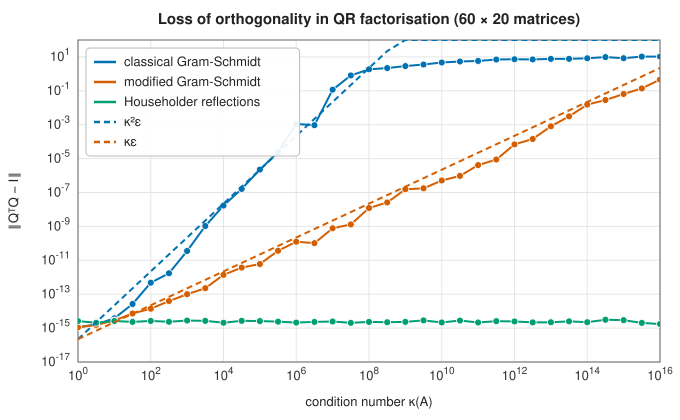

# QR factorisation

<div class="entry-summary">

| | |
|---|---|
| **Problem** | Factor an $m \times n$ matrix ($m \ge n$) as $A = QR$, with $Q$ having orthonormal columns and $R$ upper triangular; with column pivoting, $AP = QR$ reveals the numerical rank |
| **Devised by** | Orthogonalisation: Pierre-Simon Laplace (1812), Jørgen Pedersen Gram (1883), Erhard Schmidt (1907); reflections: Alston Householder (1958); rotations: Wallace Givens (1958); column pivoting: Peter Businger and Gene Golub (1965); the stability of modified Gram-Schmidt: Åke Björck (1967) |
| **Accuracy** | Householder: $Q$ orthogonal to machine precision, backward stable. Modified Gram-Schmidt: loss of orthogonality $\approx \kappa\varepsilon$. Classical Gram-Schmidt: $\approx \kappa^2\varepsilon$ |
| **Cost** | $2mn^2 - \tfrac23n^3$ flops for Householder ($2mn^2$ for Gram-Schmidt) |
| **API** | Production: used inside [`LeastSquaresSvd`](../../api/lib_jsl_linalg/trait.LeastSquaresSvd.html) and the SVD (crate-internal). Reference: [`qr`](../../api/lib_jsl_linalg_reference/qr/index.html) (`classical_gram_schmidt`, `modified_gram_schmidt`, `householder`, `orthogonality_error`) |

</div>

## Overview

The **QR factorisation** writes a matrix as an orthogonal factor times a triangular one. Its
columns of $Q$ are an orthonormal basis for the column space of $A$, built so that the first $k$ columns
of $Q$ span the first $k$ columns of $A$. It is the tool of choice for linear least squares, the first step
of the [SVD](svd.md) and of eigenvalue algorithms, and the core of the QR algorithm for eigenvalues.

Orthogonal matrices are the perfectly conditioned transformations: they preserve lengths, so they
never amplify errors. That is the source of QR's stability, but only if the computed $Q$ really is
orthogonal. The three classical algorithms differ precisely there: the **Gram-Schmidt** process
orthogonalises the columns one by one and, in floating point, gradually loses orthogonality;
**Householder reflections** build $Q$ as a product of exactly orthogonal matrices and keep it.

## History

The orthogonalisation of a set of functions or vectors appears in Laplace's work on least squares
(1812); Jørgen Pedersen Gram (1883) used it for series expansions, and Erhard Schmidt (1907) stated
the process for functions in his work on integral equations. For computation, Alston Householder
(1958) introduced the reflections that bear his name and showed how to triangularise a matrix with
them, and Wallace Givens (1958) used plane rotations. Gene Golub (1965) made Householder QR the
standard method for least squares, and with Peter Businger added column pivoting to reveal rank.
Åke Björck (1967) showed that the modified Gram-Schmidt process, though it loses orthogonality, gives
accurate least-squares solutions. Robert Schreiber and Charles Van Loan (1989) devised the compact
WY representation that lets reflections be applied in blocks, at matrix-multiply speed.

## The idea

### Gram-Schmidt orthogonalisation

Let $A$ be an $m \times n$ matrix with $m \ge n$ and columns $\mathbf a_1, \ldots, \mathbf a_n$. We want
orthonormal vectors $\mathbf q_1, \ldots, \mathbf q_n$ (mutually perpendicular, each of length 1) such that
$\mathbf q_1, \ldots, \mathbf q_k$ span the same space as $\mathbf a_1, \ldots, \mathbf a_k$ for every $k$.

The **Gram-Schmidt process** builds them one at a time.

- Normalise the first column: $\mathbf q_1 = \mathbf a_1/\|\mathbf a_1\|$.
- From the second column remove its component along $\mathbf q_1$, which is
  $(\mathbf q_1^{\mathsf T}\mathbf a_2)\,\mathbf q_1$. What is left, $\mathbf v_2 = \mathbf a_2 - (\mathbf q_1^{\mathsf T}\mathbf a_2)\,\mathbf q_1$, is
  perpendicular to $\mathbf q_1$. Normalise it to get $\mathbf q_2$.
- From the third column remove its components along both $\mathbf q_1$ and $\mathbf q_2$, normalise, and
  so on.

In symbols, for each column $j$:

$$
r_{ij} = \mathbf q_i^{\mathsf T}\mathbf a_j \ (i < j), \qquad \mathbf v_j = \mathbf a_j - \sum_{i<j}r_{ij}\mathbf q_i, \qquad r_{jj} = \|\mathbf v_j\|, \qquad \mathbf q_j = \mathbf v_j/r_{jj} .
$$

**Why this is a factorisation.** Rearranging the middle formula,
$\mathbf a_j = \sum_{i<j}r_{ij}\mathbf q_i + r_{jj}\mathbf q_j$: each column of $A$ is a combination of the first
$j$ columns of $Q$ with coefficients $r_{1j}, \ldots, r_{jj}$. That is precisely the statement
$A = QR$, where $Q$ has the $\mathbf q_j$ as columns and $R$ is the upper triangular matrix of the
$r_{ij}$.

**Classical and modified.** The formulas above are **classical Gram-Schmidt**: every coefficient
$r_{ij}$ is computed from the original column $\mathbf a_j$. **Modified Gram-Schmidt** subtracts the
components one at a time and computes each coefficient from the vector as it currently stands:
start with $\mathbf v = \mathbf a_j$, and for $i = 1, \ldots, j - 1$ set $r_{ij} = \mathbf q_i^{\mathsf T}\mathbf v$ and
$\mathbf v \leftarrow \mathbf v - r_{ij}\mathbf q_i$.

In exact arithmetic the two give identical results, since the $\mathbf q_i$ are orthogonal and
removing one component does not change the others. In floating point they differ. The computed
$\mathbf q_i$ are only approximately orthogonal, and when a column is nearly a combination of the
previous ones, $\mathbf v_j$ is a small difference of large vectors and its direction is contaminated
by rounding errors. The modified version projects out each direction from a vector that has
already had its earlier errors partly removed, so the errors do not compound as badly. The
computed $Q$ departs from orthogonality by about $\kappa^2\varepsilon$ for classical Gram-Schmidt and
$\kappa\varepsilon$ for modified, where $\kappa$ is the [condition number](lu.md#conditioning) of $A$.
Reorthogonalising (running the process twice) restores orthogonality.

### Householder reflections

Gram-Schmidt makes $Q$ by operating on $A$ with triangular transformations, and orthogonality is
the hoped-for result. Householder's method does the reverse: it operates on $A$ with orthogonal
transformations until it is triangular, so orthogonality is guaranteed by construction.

**The reflection.** For a unit vector $\mathbf v$, the matrix

$$
H = I - 2\mathbf v\mathbf v^{\mathsf T}
$$

is a **Householder reflection**. Applied to a vector, $H\mathbf y = \mathbf y - 2(\mathbf v^{\mathsf T}\mathbf y)\mathbf v$: it
subtracts twice the component of $\mathbf y$ along $\mathbf v$, which reverses that component and leaves
the rest alone. Geometrically, $H$ reflects in the plane (hyperplane) perpendicular to $\mathbf v$.
It is symmetric, and it is orthogonal, since reflecting twice restores the original:
$H^2 = I - 4\mathbf v\mathbf v^{\mathsf T} + 4\mathbf v(\mathbf v^{\mathsf T}\mathbf v)\mathbf v^{\mathsf T} = I$.

**Zeroing a column.** A reflection preserves length, so it can map a given vector $\mathbf x$ onto
any vector of the same length. We want it mapped onto a multiple of the first unit vector
$\mathbf e_1$, so that all its entries but the first become zero; the target must be
$\pm\|\mathbf x\|\mathbf e_1$. A reflection that takes $\mathbf x$ to $\mathbf y$ has its mirror perpendicular to
$\mathbf x - \mathbf y$, so

$$
\mathbf v \propto \mathbf x + \operatorname{sign}(x_1)\|\mathbf x\|\,\mathbf e_1 \qquad\text{maps}\qquad \mathbf x \mapsto -\operatorname{sign}(x_1)\|\mathbf x\|\,\mathbf e_1 .
$$

Of the two possible signs of the target, this one is chosen so that the first component of
$\mathbf v$ is $x_1$ plus a number of the same sign. With the other choice it would be a difference
of two nearly equal numbers whenever $\mathbf x$ is already close to a multiple of $\mathbf e_1$, and
would lose accuracy to cancellation.

**The factorisation.** Apply a reflection $H_1$ that zeroes the first column of $A$ below the
diagonal. Then apply $H_2$, built from the part of the second column on and below the diagonal,
which zeroes that column below the diagonal without disturbing the first row or column. After $n$
such steps,

$$
H_n\cdots H_2H_1A = R, \qquad\text{so}\qquad A = QR \quad\text{with}\quad Q = H_1H_2\cdots H_n .
$$

Two practical points. A reflection is never formed as a matrix; it is applied to each column
$\mathbf y$ by the formula $H\mathbf y = \mathbf y - 2(\mathbf v^{\mathsf T}\mathbf y)\mathbf v$, at the cost of a dot product and a
vector update. And $Q$ is usually not formed either, but kept as the list of vectors $\mathbf v_k$,
from which $Q\mathbf y$ or $Q^{\mathsf T}\mathbf y$ can be computed whenever needed.

Because every factor is orthogonal to working precision, so is the product: the computed $Q$ is
orthogonal to about $\varepsilon$ regardless of the conditioning of $A$.



The figure shows the three methods on $60 \times 20$ matrices with singular values spread between 1 and $1/\kappa$. Classical
Gram-Schmidt has lost all orthogonality by $\kappa = 10^8$, modified Gram-Schmidt follows $\kappa\varepsilon$, and Householder stays at
the level of rounding throughout. All three reproduce $A = QR$ to rounding error: the difference is
entirely in $Q$.

### Column pivoting

Plain QR processes the columns in the order given. If some columns are (nearly) combinations of
others, so that $A$ has fewer than $n$ independent columns, that fact is hidden somewhere inside
$R$. **QR with column pivoting** brings it into the open. At each step it swaps the remaining
column of largest norm into the current position, giving $AP = QR$ with $P$ a permutation.

The effect is that the most independent columns are processed first. The diagonal of $R$ then
decreases in magnitude, $|r_{11}| \ge |r_{22}| \ge \cdots$, and each $|r_{kk}|$ measures how much of
column $k$ is new, that is, not already explained by the columns before it. A sharp drop reveals
the **numerical rank**: if $A$ is close to a matrix of rank $r$, then $|r_{r+1,r+1}|$ is small.

Recomputing the norms of all remaining columns at every step would double the cost. Instead they
are **downdated**: after a reflection, the squared norm of what remains of a column is its
previous value minus the square of the entry just fixed in $R$. The subtraction can cancel, so
the norm is recomputed from scratch when the downdated value becomes unreliable (the safeguard
used in LAPACK's `geqp3`). The production library uses pivoted QR for
[least squares](least-squares.md) and to precondition the [Jacobi SVD](svd.md#one-sided-jacobi).

## Algorithm

**Householder QR.** Input: an $m \times n$ matrix $A$ with $m \ge n$. For $k = 1, \ldots, n$:

1. **Form the reflector.** Take $\mathbf x$, the part of column $k$ from row $k$ to row $m$. Set
   $\mathbf v = \mathbf x + \operatorname{sign}(x_1)\|\mathbf x\|\,\mathbf e_1$ and normalise it. (If $\mathbf x$ is zero,
   skip the step.)
2. **Apply it** to each column $j \ge k$: replace the part $\mathbf y$ of that column in rows $k$ to
   $m$ by $\mathbf y - 2(\mathbf v^{\mathsf T}\mathbf y)\mathbf v$. Column $k$ becomes $-\operatorname{sign}(x_1)\|\mathbf x\|$ on the
   diagonal and zero below.
3. **Store** $\mathbf v$ as $\mathbf v_k$.

At the end the upper triangle of the array is $R$. To apply $Q^{\mathsf T}$ to a vector, apply the
reflections in the order $1, \ldots, n$; to apply $Q$, in the order $n, \ldots, 1$. To form the thin
$Q$ explicitly, apply $Q$ to the first $n$ columns of the identity. The factorisation costs
about $2mn^2 - \tfrac23n^3$ flops.

**With column pivoting.** Compute the squared norm of every column at the start. Before step
$k$:

1. find the remaining column $j \ge k$ of largest (downdated) norm, swap it with column $k$, and
   record the swap in the permutation;
2. after applying the reflection, subtract $r_{kj}^2$ from the squared norm of each remaining
   column $j$; if the result has lost most of its digits to cancellation, recompute that norm
   from the column itself.

## Implementation

Modified Gram-Schmidt (reference):

```rust,ignore
{{#include ../../../crates/linalg_reference/src/qr.rs:mgs}}
```

Householder QR (reference):

```rust,ignore
{{#include ../../../crates/linalg_reference/src/qr.rs:householder}}
```

Pivoted Householder QR (production), for real and complex matrices:

```rust,ignore
{{#include ../../../crates/linalg/src/qr.rs:householder_pivoted}}
```

- For complex matrices the reflection maps $\mathbf x$ onto $-e^{i\theta}\|\mathbf x\|\mathbf e_1$, where $e^{i\theta}$ is the phase of $x_1$.
- When an explicit orthogonal factor is needed (in the SVD and both eigensolvers), the library accumulates blocks of
  reflections in the **compact WY form** $I - VTV^{\mathsf H}$ and applies each block with three matrix multiplications.
- The production QR is not exposed directly; least squares and the SVD use it. Its unpivoted, blocked
  form for least squares is tracked in [issue #11](https://github.com/jwkunz/lib_jsl/issues/11).

## In practice

```rust,ignore
{{#include ../../../crates/linalg_reference/examples/linalg_qr.rs}}
```

**Strengths**

- Householder QR is backward stable and keeps $Q$ orthogonal for any conditioning.
- Column pivoting reveals numerical rank cheaply.

**Weaknesses**

- Twice the cost of LU for square matrices.
- Gram-Schmidt needs reorthogonalisation to be reliable (but is the natural choice when columns arrive one at a time,
  as in Krylov methods).

## Exercises

1. Show that $H = I - 2\mathbf v\mathbf v^{\mathsf T}$ with $\|\mathbf v\| = 1$ is symmetric, orthogonal and an involution ($H^2 = I$).
2. Show that classical and modified Gram-Schmidt compute the same $Q$ and $R$ in exact arithmetic.
3. Apply classical Gram-Schmidt to $\begin{pmatrix}1 & 1 & 1\\ \varepsilon & 0 & 0\\ 0 & \varepsilon & 0\\ 0 & 0 & \varepsilon\end{pmatrix}$ with $\varepsilon^2$ below rounding (Läuchli's matrix) and
   compute $\mathbf q_2^{\mathsf T}\mathbf q_3$ by hand.
4. Run classical Gram-Schmidt twice ("twice is enough") and measure the loss of orthogonality as in the figure.
5. Show that column pivoting gives $|r_{11}| \ge |r_{22}| \ge \cdots \ge |r_{nn}|$.

<details>
<summary>Hints and answers</summary>

1. $H^{\mathsf T} = I - 2(\mathbf v\mathbf v^{\mathsf T})^{\mathsf T} = H$, and $H^{\mathsf T}H = I - 4\mathbf v\mathbf v^{\mathsf T} + 4\mathbf v(\mathbf v^{\mathsf T}\mathbf v)\mathbf v^{\mathsf T} = I$. Symmetry plus orthogonality gives $H^2 = H^{\mathsf T}H = I$.
2. Both subtract from $\mathbf a_j$ the projections onto $\mathbf q_1, \ldots, \mathbf q_{j-1}$. Classical Gram-Schmidt computes all the coefficients from the original $\mathbf a_j$, modified from the partially reduced vector, but when the $\mathbf q_i$ are orthogonal, $\mathbf q_i^{\mathsf T}\mathbf a_j$ and $\mathbf q_i^{\mathsf T}$(reduced vector) are equal.
3. Below rounding, $1 + \varepsilon^2 = 1$ and $\mathbf q_1 \approx (1, \varepsilon, 0, 0)$. Then $\mathbf a_2 - \mathbf q_1 \approx (0, -\varepsilon, \varepsilon, 0)$, so $\mathbf q_2 = (0, -1, 1, 0)/\sqrt2$, and similarly $\mathbf q_3 = (0, -1, 0, 1)/\sqrt2$. Then $\mathbf q_2^{\mathsf T}\mathbf q_3 = \tfrac12$: orthogonality is completely lost.
4. A second pass orthogonalises the result against the $\mathbf q_i$ again; Kahan and Parlett showed that two passes give orthogonality at the level of rounding error.
5. At step $k$ pivoting chooses the remaining column of largest norm (after projecting out the first $k - 1$ directions), and $|r_{kk}|$ is that norm. Projecting out one more direction cannot increase any remaining column's norm, so the next pivot is no larger.

</details>

## Further reading

- A. S. Householder, "Unitary triangularization of a nonsymmetric matrix", *Journal of the ACM* 5 (1958)
  339–342.
- Å. Björck, "Solving linear least squares problems by Gram-Schmidt orthogonalization", *BIT* 7 (1967)
  1–21.
- R. Schreiber and C. Van Loan, "A storage-efficient WY representation for products of Householder
  transformations", *SIAM Journal on Scientific and Statistical Computing* 10 (1989) 53–57.
- L. N. Trefethen and D. Bau, *Numerical Linear Algebra*, SIAM, 1997, lectures 7–10 and 16.
- G. H. Golub and C. F. Van Loan, *Matrix Computations*, 4th ed., Johns Hopkins University Press, 2013,
  chapter 5.
