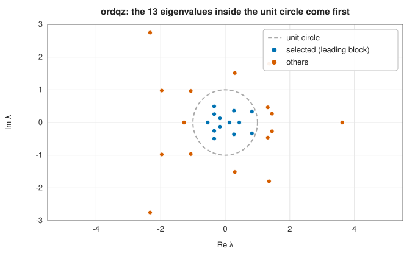
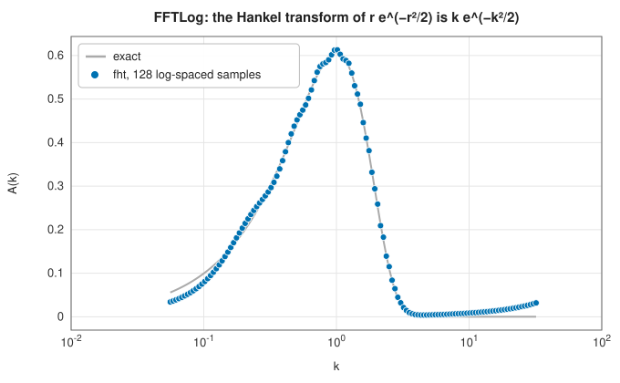

# Real QZ, reordering and Hankel transforms

<div class="entry-summary">

| | |
|---|---|
| **Problem** | Reduce a real pencil `(A, B)` to real generalised Schur form; reorder Schur and generalised Schur forms so that chosen eigenvalues come first, giving orthonormal bases of the corresponding invariant and deflating subspaces; transform Hermitian-symmetric signals; and compute Hankel transforms of log-spaced data |
| **Devised by** | Cleve Moler and G. W. Stewart (1973), the QZ algorithm; Zhaojun Bai and James Demmel (1993), and Bo Kågström (1993), swapping diagonal blocks; Andrew Hamilton (2000), FFTLog, after James Talman (1978) |
| **Accuracy** | Backward errors of $10^{-14}$; eigenvalues, selected counts and subspaces agree with SciPy (LAPACK) to $10^{-14}$; the transforms agree with `scipy.fft` to $10^{-14}$ |
| **Cost** | QZ: $O(n^3)$, about 30 $n^3$ flops with both transformations; a block swap $O(n)$, reordering $O(n^2)$ per eigenvalue moved; FFTLog: two real FFTs, $O(n\log n)$ |
| **Read first** | [Generalised eigenproblems and structured matrices](generalized-structured.md), [Further factorisations](factorizations.md) |
| **API** | [`qz_real`](../../api/lib_jsl_linalg/fn.qz_real.html), [`ordqz`](../../api/lib_jsl_linalg/fn.ordqz.html), [`ordqz_complex`](../../api/lib_jsl_linalg/fn.ordqz_complex.html), [`schur_sorted`](../../api/lib_jsl_linalg/fn.schur_sorted.html), [`schur_sorted_complex`](../../api/lib_jsl_linalg/fn.schur_sorted_complex.html), [`EigenSort`](../../api/lib_jsl_linalg/enum.EigenSort.html); [`hfft`](../../api/lib_jsl_ffts/fftlog/fn.hfft.html), [`ihfft`](../../api/lib_jsl_ffts/fftlog/fn.ihfft.html), [`fht`](../../api/lib_jsl_ffts/fftlog/fn.fht.html), [`ifht`](../../api/lib_jsl_ffts/fftlog/fn.ifht.html), [`fhtoffset`](../../api/lib_jsl_ffts/fftlog/fn.fhtoffset.html) |

</div>

## Overview

The [complex QZ algorithm](generalized-structured.md) already gives the generalised eigenvalues of a pencil $A - \lambda B$. For a real pencil the **real QZ** form keeps the arithmetic real:
$$Q^\top AZ = AA \text{ (quasi upper triangular)}, \qquad Q^\top BZ = BB \text{ (upper triangular)},$$
with 2 × 2 blocks for complex conjugate pairs, just as the real Schur form does for a single matrix.

Many applications need the eigenvalues in a particular order. The leading $k$ columns of $Z$ then span the subspace belonging to the first $k$ eigenvalues:
- Riccati equations and LQR control need the stable eigenvalues ($\operatorname{Re}\lambda < 0$ or $|\lambda| < 1$) first.
- Rational expectations models in economics need a stable/unstable split.
- Spectral projectors need the eigenvalues in a chosen region of the plane.

`schur(a, sort=...)` and `ordqz` provide this: they reorder the forms so that the selected eigenvalues come first. SciPy's predefined selections are the left or right half-plane and the inside or outside of the unit circle; a predicate gives any other.

The entry also adds two Fourier-type transforms from `scipy.fft`:
- **`hfft` and `ihfft`**, the FFT of a signal with Hermitian symmetry given by half of its samples.
- **The fast Hankel transform** (FFTLog), which computes $\int_0^\infty a(r)J_\mu(kr)\,k\,dr$ for logarithmically spaced samples. It is the workhorse for correlation functions and power spectra in cosmology.

## History

Cleve Moler and G. W. Stewart (1973) introduced the QZ algorithm: the Francis double-shift step applied to $AB^{-1}$ without forming it. Robert Ward (1975) and Linda Kaufman (1974) refined its deflations. Zhaojun Bai and James Demmel (1993) showed how to swap adjacent blocks of a real Schur form stably, through a small Sylvester equation. Bo Kågström (1993) did the same for pencils, and their methods are LAPACK's `trexc`, `trsen`, `tgexc` and `tgsen`.

James Talman (1978) computed Hankel transforms by FFTs in the logarithm of the radius. Andrew Hamilton (2000) turned this into FFTLog, with the low-ringing offset condition SciPy's `fhtoffset` uses.

## The idea

### The real QZ algorithm

1. A QR factorisation makes $B$ triangular.
2. Givens rotations from the bottom up make $A$ upper Hessenberg. Each rotation spoils $B$'s triangle by one entry, which a column rotation restores.
3. The double-shift step: the first column of $(AB^{-1} - \sigma_1)(AB^{-1} - \sigma_2)e_1$ has three non-zero entries, computable from $A$ and $B$ alone, with $\sigma_{1,2}$ the eigenvalues of the trailing 2 × 2 block of $AB^{-1}$.
4. A 3 × 3 Householder reflector introduces this bulge. Alternating left reflectors (restoring $A$'s Hessenberg form) and right reflectors (restoring $B$'s triangle) chase it down the pencil.
5. When a subdiagonal entry of $A$ becomes negligible the problem splits. A negligible diagonal entry of $B$ is an infinite eigenvalue: rotations chase it to the bottom of the active window, where it deflates.
6. Finally, 2 × 2 blocks with real eigenvalues are split by a rotation built from an eigenvector.

### Swapping diagonal blocks

Suppose a quasi-triangular $T = \begin{bmatrix}A_{11} & A_{12}\\ 0 & A_{22}\end{bmatrix}$ has blocks of size 1 or 2. If $X$ solves the Sylvester equation $A_{11}X - XA_{22} = -A_{12}$, then
$$T\begin{bmatrix}X\\ I\end{bmatrix} = \begin{bmatrix}X\\ I\end{bmatrix}A_{22},$$
so the columns of $\begin{bmatrix}X\\ I\end{bmatrix}$ span the invariant subspace of $A_{22}$'s eigenvalues. An orthogonal $Q$ whose leading columns span the same space, from a QR factorisation, gives $Q^\top TQ$ with $A_{22}$'s eigenvalues in the leading block. The equation is a linear system of at most 4 unknowns.

For pencils, the right and left deflating subspaces come from the pair of equations
$$A_{11}R - LA_{22} = -A_{12}, \qquad B_{11}R - LB_{22} = -B_{12}.$$
Then $\begin{bmatrix}R\\ I\end{bmatrix}$ and $\begin{bmatrix}L\\ I\end{bmatrix}$ give $Z$ and $Q$.

Reordering moves each selected block up, one adjacent swap at a time, to just below the blocks already moved.

### Subspaces, not matrices, are unique

The Schur vectors depend on the algorithm's choices: signs, rotations within a block, and the order among selected eigenvalues. The **subspace** spanned by the first $k$ columns does not, as long as the selected and unselected eigenvalues are distinct. It is compared through its orthogonal projector $Z_kZ_k^\top$.

### FFTLog

With $r_j = r_ce^{(j - j_c)\,\Delta}$ and $k_j = k_ce^{(j - j_c)\,\Delta}$, the Hankel transform is a convolution in $\ln r$. Its kernel's Fourier coefficients are the Mellin transform of $J_\mu$, a ratio of gamma functions:
$$u_m = 2^{q}\,\frac{\Gamma\!\big(\tfrac{\mu + 1 + q + iy_m}{2}\big)}{\Gamma\!\big(\tfrac{\mu + 1 - q - iy_m}{2}\big)}\,e^{iy_m(\ln 2 - \ln k_cr_c)}, \qquad y_m = \frac{\pi m}{n\Delta}.$$
So $A = \operatorname{reverse}\big(\operatorname{irfft}(u \cdot \operatorname{rfft}(a))\big)$. The **offset** $\ln k_cr_c$ is chosen (`fhtoffset`) so that $u$ is real at the Nyquist frequency, which reduces ringing. The **bias** $q$ multiplies the input by a power of $r$ for functions that decay slowly at one end.

## Implementation

```rust,ignore
{{#include ../../../crates/linalg/src/reorder.rs:qz_real}}
```

```rust,ignore
{{#include ../../../crates/linalg/src/reorder.rs:ordqz}}
```

```rust,ignore
{{#include ../../../crates/ffts/src/fftlog.rs:fht}}
```

- The complex variants (`schur_sorted_complex`, `ordqz_complex`) swap 1 × 1 blocks with single rotations.
- `EigenSort` follows SciPy's two conventions:
  - for `schur`, `'rhp'` means $\operatorname{Re}\lambda \ge 0$;
  - for `ordqz`, `'rhp'` means $> 0$, and the infinite eigenvalues count as outside the unit circle.
- The gamma ratios use a complex log-gamma from Stirling's series after upward recurrence, accurate to rounding.

## In practice

The references are from SciPy 1.17.1, written by `book/generator/data/make_qz213_refs.py`:

<p class="caption" id="tab-7-25"><strong>Table 7.25.</strong> The real QZ algorithm, `ordqz` and sorted Schur forms against SciPy: backward error, eigenvalues (matched, relative), the number selected for each sort, and the largest difference between the projectors onto the leading subspaces.</p>

{{#include ../generated/linear_algebra/qz213_qz.md}}

The leading invariant and deflating subspaces agree with LAPACK's to $10^{-14}$ for every sort. One case differs. When $B$ is singular, LAPACK leaves the infinite eigenvalues with $\beta$ of rounding size ($4 \times 10^{-32}$) rather than zero, so the sign of that rounding error decides whether they count as left-half-plane or outside the unit circle. The library deflates them with $\beta = 0$ exactly, and only the unaffected sorts are compared for that pencil.

<p class="caption" id="tab-7-26"><strong>Table 7.26.</strong> `hfft`, `ihfft` and the fast Hankel transform against `scipy.fft`.</p>

{{#include ../generated/linear_algebra/qz213_transforms.md}}



<p class="caption" id="fig-7-18"><strong>Figure 7.18.</strong> The generalised eigenvalues of a random 30 × 30 pencil after `ordqz` with `'iuc'`. The 13 inside the unit circle occupy the leading block, so the first 13 columns of $Z$ span their right deflating subspace (eigenvalues beyond the axes are not shown).</p>



<p class="caption" id="fig-7-19"><strong>Figure 7.19.</strong> FFTLog with 128 samples at spacing 0.05 in $\ln r$. The transform matches the exact $ke^{-k^2/2}$ over most of the range. Near the ends it deviates, because FFTLog treats the samples as periodic in $\ln r$.</p>

**Strengths**

- Real arithmetic throughout for real pencils, with infinite eigenvalues deflated exactly.
- Reordering by any predicate, with SciPy's four named selections.
- FFTLog in $O(n\log n)$ for any order $\mu$, with SciPy's offset and bias options.

**Weaknesses**

- The QZ sweeps are the unblocked single-bulge algorithm, slower than LAPACK's multishift variants for large $n$.
- No condition estimates for the reordered subspaces (LAPACK's `trsen`/`tgsen` with `ijob > 0`).
- FFTLog's periodic wrap-around causes ringing at the ends unless the input decays there.

## Exercises

1. Show that $T\begin{bmatrix}X\\ I\end{bmatrix} = \begin{bmatrix}X\\ I\end{bmatrix}A_{22}$ when $A_{11}X - XA_{22} = -A_{12}$.
2. Why is the Sylvester equation uniquely solvable exactly when $A_{11}$ and $A_{22}$ have no eigenvalue in common?
3. Why does the projector $Z_kZ_k^\top$ not depend on which orthonormal basis of the subspace is used?
4. Show that `hfft(ihfft(x), n)` returns `x` for real `x` of length `n`.

<details>
<summary>Hints and answers</summary>

1. The first block row is $A_{11}X + A_{12} = XA_{22}$, the Sylvester equation; the second is $A_{22} = A_{22}$.
2. The operator $X \mapsto A_{11}X - XA_{22}$ has eigenvalues $\lambda_i(A_{11}) - \lambda_j(A_{22})$.
3. Another basis is $Z_kW$ with $W$ orthogonal, and $Z_kWW^\top Z_k^\top = Z_kZ_k^\top$.
4. `ihfft(x)` is $\overline{\text{rfft}(x)}/n$, and `hfft` applies $n\cdot\text{irfft}(\overline{\cdot}, n)$, which undoes it.

</details>

## Further reading

- C. B. Moler and G. W. Stewart, "An algorithm for generalized matrix eigenvalue problems", *SIAM Journal on Numerical Analysis* 10 (1973) 241–256.
- Z. Bai and J. W. Demmel, "On swapping diagonal blocks in real Schur form", *Linear Algebra and its Applications* 186 (1993) 73–95.
- B. Kågström, "A direct method for reordering eigenvalues in the generalized real Schur form of a regular matrix pair (A, B)", in *Linear Algebra for Large Scale and Real-Time Applications*, Kluwer (1993) 195–218.
- A. J. S. Hamilton, "Uncorrelated modes of the non-linear power spectrum", *Monthly Notices of the Royal Astronomical Society* 312 (2000) 257–284.
- J. D. Talman, "Numerical Fourier and Bessel transforms in logarithmic variables", *Journal of Computational Physics* 29 (1978) 35–48.
- G. H. Golub and C. F. Van Loan, *Matrix Computations*, 4th ed., Johns Hopkins (2013), §7.7.
